<div align="center">

<p align="center" style="margin: 0 0 1.75rem;">
  
</p>


# Universidad Peruana de Ciencias Aplicadas

### Facultad de Ingeniería
### Carrera: Ingeniería de Software

**9.º ciclo**

**Nombre del curso:** Arquitecturas de Software Emergentes

**Sección:** 9075

**Código del curso:** : 1ASI0728 


**Periodo:** 202620  


**Nombre del profesor:** Wilder Aurelio Vega Calero

<br>

# *Informe de Trabajo Final*

<br>

**Nombre del Startup:** FreshEat  
**Nombre del Producto:** FreshSense

<br>

### Relación de Integrantes

| Apellidos y Nombres | Código |
|:-------------------:|:------:|
| Tuesta Marin, Romina Alejandra | U202211706 |
| Cossar Sánchez, Eduardo Jose | U202312109 |
| Mostajo Orosco, Maria Fernanda | U202312874 |
| Gonzáles Valverde, Carlos Matthew | u202314130 |
| Ramos Calagua, Sebastian Alexander | U202222846 |
<br>


**Septiembre 2026**

</div>

<div style="page-break-after: always;"></div>

# Registro de Versiones del Informe

| Versión | Fecha | Autor | Descripción de modificación |
|:------:|:-----:|:-----|:----------------------------|
| 1.0 | 08/09/2026 | Todos los integrantes | Se realizó los capitulos del 1-4 |

<div style="page-break-after: always;"></div>

# Project Report Collaboration Insights

**AV1:**

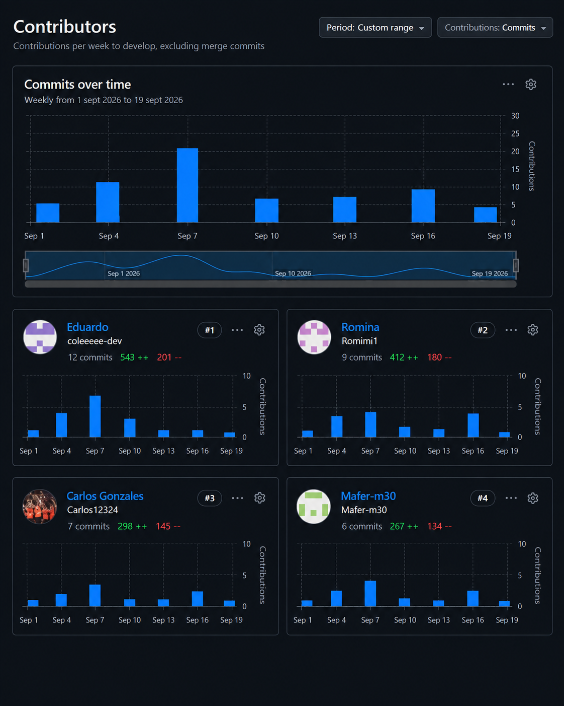

<div style="page-break-after: always;"></div>

# Tabla de contenidos

- [Student Outcome](#student-outcome)

- [Capítulo I: Introducción](#capítulo-i-introducción)
  - [1.1. Startup Profile](#11-startup-profile)
    - [1.1.1. Descripción de la Startup](#111-descripción-de-la-startup)
    - [1.1.2. Perfiles de integrantes del equipo](#112-perfiles-de-integrantes-del-equipo)
  - [1.2. Solution Profile](#12-solution-profile)
    - [1.2.1. Antecedentes y problemática](#121-antecedentes-y-problemática)
    - [1.2.2. Lean UX Process](#122-lean-ux-process)
      - [1.2.2.1. Lean UX Problem Statements](#1221-lean-ux-problem-statements)
      - [1.2.2.2. Lean UX Assumptions](#1222-lean-ux-assumptions)
      - [1.2.2.3. Lean UX Hypothesis Statements](#1223-lean-ux-hypothesis-statements)
      - [1.2.2.4. Lean UX Canvas](#1224-lean-ux-canvas)
  - [1.3. Segmentos objetivo](#13-segmentos-objetivo)

- [Capítulo II: Requirements Elicitation & Analysis](#capítulo-ii-requirements-elicitation--analysis)
  - [2.1. Competidores](#21-competidores)
    - [2.1.1. Análisis competitivo](#211-análisis-competitivo)
    - [2.1.2. Estrategias y tácticas frente a competidores](#212-estrategias-y-tácticas-frente-a-competidores)
  - [2.2. Entrevistas](#22-entrevistas)
    - [2.2.1. Diseño de entrevistas](#221-diseño-de-entrevistas)
    - [2.2.2. Registro de entrevistas](#222-registro-de-entrevistas)
    - [2.2.3. Análisis de entrevistas](#223-análisis-de-entrevistas)
  - [2.3. Needfinding](#23-needfinding)
    - [2.3.1. User Personas](#231-user-personas)
    - [2.3.2. User Task Matrix](#232-user-task-matrix)
    - [2.3.3. Empathy Mapping](#233-empathy-mapping)
    - [2.3.4. As-is Scenario Mapping](#234-as-is-scenario-mapping)
  - [2.4. Ubiquitous Language](#24-ubiquitous-language)

- [Capítulo III: Requirements Specification](#capítulo-iii-requirements-specification)
  - [3.1. To-Be Scenario Mapping](#31-to-be-scenario-mapping)
  - [3.2. User Stories](#32-user-stories)
  - [3.3. Impact Mapping](#33-impact-mapping)
  - [3.4. Product Backlog](#34-product-backlog)

- [Capítulo IV: Strategic-Level Software Design](#capítulo-iv-strategic-level-software-design)
  - [4.1. Strategic-Level Attribute-Driven Design](#41-strategic-level-attribute-driven-design)
    - [4.1.1. Design Purpose](#411-design-purpose)
    - [4.1.2. Attribute-Driven Design Inputs](#412-attribute-driven-design-inputs)
      - [4.1.2.1. Primary Functionality (Primary User Stories)](#4121-primary-functionality-primary-user-stories)
      - [4.1.2.2. Quality Attribute Scenarios](#4122-quality-attribute-scenarios)
      - [4.1.2.3. Constraints](#4123-constraints)
    - [4.1.3. Architectural Drivers Backlog](#413-architectural-drivers-backlog)
    - [4.1.4. Architectural Design Decisions](#414-architectural-design-decisions)
    - [4.1.5. Quality Attribute Scenario Refinements](#415-quality-attribute-scenario-refinements)
  - [4.2. Strategic-Level Domain-Driven Design](#42-strategic-level-domain-driven-design)
    - [4.2.1. EventStorming](#421-eventstorming)
    - [4.2.2. Candidate Context Discovery](#422-candidate-context-discovery)
    - [4.2.3. Domain Message Flows Modeling](#423-domain-message-flows-modeling)
    - [4.2.4. Bounded Context Canvases](#424-bounded-context-canvases)
    - [4.2.5. Context Mapping](#425-context-mapping)
  - [4.3. Software Architecture](#43-software-architecture)
    - [4.3.1. Software Architecture System Landscape Diagram](#431-software-architecture-system-landscape-diagram)
    - [4.3.2. Software Architecture Context Level Diagrams](#432-software-architecture-context-level-diagrams)
    - [4.3.3. Software Architecture Container Level Diagrams](#433-software-architecture-container-level-diagrams)
    - [4.3.4. Software Architecture Deployment Diagrams](#434-software-architecture-deployment-diagrams)

- [Capítulo V: Tactical-Level Software Design](#capítulo-v-tactical-level-software-design)
  - [5.X. Bounded Context: &lt;Bounded Context Name&gt;](#5x-bounded-context-bounded-context-name)
    - [5.X.1. Domain Layer](#5x1-domain-layer)
    - [5.X.2. Interface Layer](#5x2-interface-layer)
    - [5.X.3. Application Layer](#5x3-application-layer)
    - [5.X.4. Infrastructure Layer](#5x4-infrastructure-layer)
    - [5.X.6. Bounded Context Software Architecture Component Level Diagrams](#5x6-bounded-context-software-architecture-component-level-diagrams)
    - [5.X.7. Bounded Context Software Architecture Code Level Diagrams](#5x7-bounded-context-software-architecture-code-level-diagrams)
      - [5.X.7.1. Bounded Context Domain Layer Class Diagrams](#5x71-bounded-context-domain-layer-class-diagrams)
      - [5.X.7.2. Bounded Context Database Design Diagram](#5x72-bounded-context-database-design-diagram)

- [Capítulo VI: Solution UX Design](#capítulo-vi-solution-ux-design)
  - [6.1. Style Guidelines](#61-style-guidelines)
    - [6.1.1. General Style Guidelines](#611-general-style-guidelines)
    - [6.1.2. Web, Mobile & Devices Style Guidelines](#612-web-mobile--devices-style-guidelines)
  - [6.2. Information Architecture](#62-information-architecture)
    - [6.2.2. Labeling Systems](#622-labeling-systems)
    - [6.2.3. Searching Systems](#623-searching-systems)
    - [6.2.4. SEO Tags and Meta Tags](#624-seo-tags-and-meta-tags)
    - [6.2.5. Navigation Systems](#625-navigation-systems)
  - [6.3. Landing Page UI Design](#63-landing-page-ui-design)
    - [6.3.1. Landing Page Wireframe](#631-landing-page-wireframe)
    - [6.3.2. Landing Page Mock-up](#632-landing-page-mock-up)
  - [6.4. Applications UX/UI Design](#64-applications-uxui-design)
    - [6.4.1. Applications Wireframes](#641-applications-wireframes)
    - [6.4.2. Applications Wireflow Diagrams](#642-applications-wireflow-diagrams)
    - [6.4.3. Applications Mock-ups](#643-applications-mock-ups)
    - [6.4.4. Applications User Flow Diagrams](#644-applications-user-flow-diagrams)
  - [6.5. Applications Prototyping](#65-applications-prototyping)

- [Capítulo VII: Product Implementation, Validation & Deployment](#capítulo-vii-product-implementation-validation--deployment)
  - [7.1. Software Configuration Management](#71-software-configuration-management)
    - [7.1.1. Software Development Environment Configuration](#711-software-development-environment-configuration)
    - [7.1.2. Source Code Management](#712-source-code-management)
    - [7.1.3. Source Code Style Guide & Conventions](#713-source-code-style-guide--conventions)
    - [7.1.4. Software Deployment Configuration](#714-software-deployment-configuration)
  - [7.2. Solution Implementation](#72-solution-implementation)
    - [7.2.X. Sprint n](#72x-sprint-n)
      - [7.2.X.1. Sprint Planning n](#72x1-sprint-planning-n)
      - [7.2.X.2. Sprint Backlog n](#72x2-sprint-backlog-n)
      - [7.2.X.3. Development Evidence for Sprint Review](#72x3-development-evidence-for-sprint-review)
      - [7.2.X.4. Testing Suite Evidence for Sprint Review](#72x4-testing-suite-evidence-for-sprint-review)
      - [7.2.X.5. Execution Evidence for Sprint Review](#72x5-execution-evidence-for-sprint-review)
      - [7.2.X.6. Services Documentation Evidence for Sprint Review](#72x6-services-documentation-evidence-for-sprint-review)
      - [7.2.X.7. Software Deployment Evidence for Sprint Review](#72x7-software-deployment-evidence-for-sprint-review)
      - [7.2.X.8. Team Collaboration Insights during Sprint](#72x8-team-collaboration-insights-during-sprint)
  - [7.3. Validation Interviews](#73-validation-interviews)
    - [7.3.1. Diseño de Entrevistas](#731-diseño-de-entrevistas)
    - [7.3.2. Registro de Entrevistas](#732-registro-de-entrevistas)
    - [7.3.3. Evaluaciones según heurísticas](#733-evaluaciones-según-heurísticas)
  - [7.4. Video About-the-Product](#74-video-about-the-product)

- [Conclusiones](#conclusiones)
- [Conclusiones y recomendaciones](#conclusiones-y-recomendaciones)
- [Video About-the-Team](#video-about-the-team)
- [Bibliografía](#bibliografía)
- [Anexos](#anexos)

<div style="page-break-after: always;"></div>

# Student Outcome

El curso contribuye al cumplimiento del Student Outcome ABET.

**ABET – EAC - Student Outcome 3**

Criterio: Capacidad de comunicarse efectivamente con un rango de audiencias.


| Criterio específico | Acciones realizadas | Conclusiones |
|---|---|---|
| **Comunica oralmente sus ideas y/o resultados con objetividad a público de diferentes especialidades y niveles jerárquicos, en el marco del desarrollo de un proyecto en ingeniería.** | **Maria Fernanda Mostajo Orosco** <br> **AV1** <br> Presenta los hallazgos del análisis competitivo con claridad y precisión técnica, adaptando el lenguaje a la audiencia multidisciplinaria del proyecto. <br><br> **TB1** <br> Explicó los avances relacionados con las funcionalidades de monitoreo y alertas de FreshSense, comunicando los resultados del Sprint 1 y los aspectos que requerían ajustes. Asimismo, participó en las coordinaciones técnicas para facilitar la comprensión de los componentes desarrollados. <br><br> **AV2** <br> Explicó el funcionamiento de las nuevas características del backend, especialmente la recepción de datos del gas etileno y la generación de alertas ante niveles elevados. Comunicó los resultados de las pruebas de integración y las decisiones técnicas adoptadas para garantizar el intercambio de información entre los componentes. <br><br> **Eduardo Jose Cossar Sánchez** <br> **AV1** <br> Comunica efectivamente los conceptos de Domain-Driven Design y arquitectura C4, explicando la estrategia de bounded contexts de manera comprensible para stakeholders sin experiencia en DDD. <br><br> **TB1** <br> Explicó los resultados de las entrevistas realizadas a los segmentos objetivo, destacando las principales necesidades identificadas. Asimismo, comunicó los avances de desarrollo, pruebas y despliegue del Sprint 1, utilizando un lenguaje comprensible para los integrantes del equipo. <br><br> **AV2** <br> Presentó el funcionamiento de la primera versión de la aplicación móvil de FreshSense, explicando los flujos de monitoreo, alertas, vinculación del sensor mediante QR e ingreso de colaboradores. Asimismo, comunicó las decisiones de integración con el backend y la aplicación web para mantener una experiencia consistente entre plataformas. <br><br> **Romina Tuesta Marin** <br> **AV1** <br> Expuso el diseño táctico de los bounded contexts, demostrando capacidad para sintetizar información compleja en presentaciones accesibles a diferentes niveles técnicos. <br><br> **TB1** <br> Explicó los avances del Landing Page y los componentes IoT de FreshSense, comunicando las principales decisiones de implementación y los resultados obtenidos. Asimismo, participó en las reuniones de coordinación para transmitir los objetivos del Sprint 1 y resolver dudas técnicas entre los integrantes. <br><br> **AV2** <br> Presentó los avances del dispositivo IoT, explicando la integración de la lectura del gas etileno en el firmware del ESP32 y las pruebas realizadas con el hardware físico. Asimismo, comunicó los objetivos del Sprint 2, las responsabilidades del equipo y los acuerdos de mejora establecidos durante la retrospectiva. <br><br> **Carlos Matthew Gonzales Valverde** <br> **AV1** <br> Participó activamente en la organización y distribución de las responsabilidades del equipo, apoyando en las actividades de análisis, diseño y documentación del proyecto. Asimismo, coordinó con los demás integrantes para revisar los avances. <br><br> **TB1** <br> Comunicó los avances correspondientes a las 11 historias seleccionadas para el Sprint 1, explicando su organización dentro del Sprint Backlog y el estado de las evidencias de ejecución. Asimismo, coordinó con los responsables del Landing Page, Frontend y Backend para transmitir los aspectos pendientes y facilitar su integración. <br><br> **AV2** <br> Explicó el funcionamiento de la primera versión del Edge API, describiendo el proceso de recepción de lecturas del dispositivo IoT y su reenvío al backend ante interrupciones de conexión. Asimismo, comunicó las decisiones técnicas relacionadas con la vinculación de dispositivos y la integración de los servicios. <br><br> **Sebastian Ramos Calagua** <br> **AV1** <br> Explicó el diseño de experiencia de usuario y la arquitectura táctica de los módulos asignados, adaptando el lenguaje técnico para una rápida comprensión de los flujos de interacción y diagramas C4 por parte del equipo. <br><br> **TB1** <br> Explicó las actividades de despliegue de FreshSense en Google Cloud, describiendo la configuración del servidor, el uso de Nginx y la publicación del Backend y Frontend. Asimismo, comunicó los resultados de las verificaciones de accesibilidad y las soluciones técnicas aplicadas durante el Sprint 1. <br><br> **AV2** <br> Presentó los avances del despliegue de la nueva versión del backend y la preparación del Edge API para su funcionamiento en la red local. Asimismo, explicó el proceso de generación del instalable de la aplicación móvil y las funcionalidades implementadas, comunicando las decisiones técnicas y los resultados obtenidos durante el Sprint 2. | **AV1** <br> Los cinco integrantes demostraron capacidad de comunicación oral efectiva adaptando el contenido técnico a la audiencia, cumpliendo con el objetivo de transmitir ideas de manera clara y objetiva en un contexto de ingeniería. <br><br> **TB1** <br> La comunicación oral permitió presentar los avances del Sprint 1 y explicar las decisiones relacionadas con el desarrollo, las pruebas y el despliegue de FreshSense. Los integrantes compartieron información técnica de manera clara, facilitando la coordinación y comprensión de los resultados del proyecto. <br><br> **AV2** <br> La comunicación oral facilitó la explicación de los nuevos componentes de FreshSense, incluyendo el dispositivo IoT, el Edge API, el backend y la aplicación móvil. Los integrantes lograron transmitir los avances y decisiones técnicas del Sprint 2, favoreciendo la comprensión de la integración entre los diferentes componentes de la solución. |
| **Comunica en forma escrita ideas y/o resultados con objetividad a público de diferentes especialidades y niveles jerárquicos, en el marco del desarrollo de un proyecto en ingeniería.** | **Maria Fernanda Mostajo Orosco** <br> **AV1** <br> Redacta el análisis competitivo con estructura clara, utilizando tablas comparativas y un lenguaje técnico preciso, facilitando la comprensión de estrategias diferenciadas. <br><br> **TB1** <br> Contribuyó a la documentación de las funcionalidades de monitoreo y alertas de FreshSense, organizando la información sobre los avances del Sprint 1 y los aspectos pendientes de implementación. Asimismo, colaboró en la revisión del informe para mantener la coherencia de las funcionalidades descritas. <br><br> **AV2** <br> Documentó las nuevas funcionalidades del backend relacionadas con la ingesta de lecturas del gas etileno y la generación de alertas. Asimismo, describió los formatos de intercambio de información utilizados para la integración con la aplicación móvil y el Edge API, manteniendo claridad y precisión técnica. <br><br> **Eduardo Jose Cossar Sánchez** <br> **AV1** <br> Documentó exhaustivamente el diseño estratégico con diagramas EventStorming y Context Maps, proporcionando explicaciones complementarias que justifican cada decisión arquitectónica. <br><br> **TB1** <br> Elaboró la documentación correspondiente a las entrevistas de los segmentos objetivo y contribuyó al registro de evidencias de desarrollo, pruebas y despliegue del Sprint 1. Organizó la información mediante descripciones técnicas claras y estructuradas, manteniendo coherencia con los objetivos del proyecto. <br><br> **AV2** <br> Documentó las funcionalidades y los flujos de interacción de la primera versión de la aplicación móvil, incluyendo las pantallas de monitoreo, alertas, vinculación del sensor mediante QR e ingreso de colaboradores. Asimismo, describió la integración con los servicios del backend y la consistencia funcional con la aplicación web. <br><br> **Romina Tuesta Marin** <br> **AV1** <br> Escribía especificaciones técnicas detalladas de los bounded contexts tácticos, manteniendo coherencia terminológica y estructura jerárquica que facilita la lectura y referencia posterior. <br><br> **TB1** <br> Contribuyó a la documentación de los avances del Landing Page y los componentes IoT de FreshSense, describiendo las funcionalidades implementadas y su relación con los objetivos del Sprint 1. Asimismo, participó en la organización de los entregables y en la revisión de la información técnica del proyecto. <br><br> **AV2** <br> Elaboró la documentación del Sprint Planning 2, la matriz de líderes y colaboradores y el Sprint Backlog 2, especificando las responsabilidades y tareas del equipo. Asimismo, registró los acuerdos de la retrospectiva del Sprint 1 y documentó los avances del firmware del ESP32 relacionados con la lectura del gas etileno. <br><br> **Carlos Matthew Gonzales Valverde** <br> **AV1** <br> Se establecieron objetivos y tareas para cada integrante, organizando las actividades de acuerdo con las prioridades del proyecto. Se mantuvo una comunicación constante para resolver dudas, compartir avances y realizar ajustes cuando fue necesario. <br><br> **TB1** <br> Elaboró y organizó la documentación correspondiente a las 11 historias seleccionadas para el Sprint 1, incluyendo su seguimiento en el Sprint Backlog y las evidencias de ejecución. Asimismo, recopiló capturas de los componentes implementados y referencias de los servicios para mantener un registro claro de los avances del proyecto. <br><br> **AV2** <br> Documentó las características técnicas de la primera versión del Edge API, describiendo la recepción y el reenvío de lecturas del dispositivo IoT ante interrupciones de conexión. Asimismo, especificó los formatos de intercambio de datos y los mecanismos de vinculación de dispositivos y colaboradores, facilitando la comprensión de su integración con el backend. <br><br> **Sebastian Ramos Calagua** <br> **AV1** <br> Redactó la documentación técnica correspondiente a la arquitectura de información, los wireflows y los diccionarios de dominio en inglés, manteniendo un alto estándar técnico y estructural en el informe. <br><br> **TB1** <br> Documentó los procedimientos técnicos necesarios para el despliegue de FreshSense en Google Cloud, incluyendo la preparación del servidor, la configuración de Nginx y la publicación del Backend y Frontend. Asimismo, registró las actividades de verificación de accesibilidad y los resultados obtenidos durante el Sprint 1. <br><br> **AV2** <br> Contribuyó a la documentación de los procedimientos de despliegue de la nueva versión del backend y la preparación del Edge API para su ejecución en la red local. Asimismo, registró las actividades relacionadas con la generación del instalable de la aplicación móvil y la integración de sus funcionalidades, manteniendo información técnica organizada para futuras revisiones. | **AV1** <br> Los cinco miembros cumplieron con el estándar de comunicación escrita en ingeniería, produciendo documentación técnica clara, estructurada y accesible a diferentes niveles de especialización. <br><br> **TB1** <br> La documentación desarrollada durante el Sprint 1 permitió registrar de manera organizada los avances de implementación, las evidencias de ejecución y los procedimientos de despliegue de FreshSense. Los integrantes contribuyeron a mantener información técnica clara y coherente, facilitando su comprensión y posterior revisión. <br><br> **AV2** <br> La comunicación escrita permitió documentar los avances del Sprint 2, incluyendo la integración del dispositivo IoT, el Edge API, el backend y la aplicación móvil. La organización de las especificaciones técnicas, los procedimientos y las evidencias contribuyó a mantener la trazabilidad del desarrollo y facilitó la comprensión de la arquitectura y las funcionalidades implementadas. |


# Capítulo I: Introducción

## 1.1. Startup Profile

### 1.1.1. Descripción de la Startup

FreshSense es una startup de tecnología orientada a ayudar a restaurantes y negocios de alimentos fríos a reducir las pérdidas económicas ocasionadas por el deterioro y desperdicio de productos perecibles. La solución combina una aplicación de gestión de inventario con dispositivos de monitoreo para supervisar las condiciones de conservación de los alimentos y generar alertas oportunas ante situaciones que puedan afectar su calidad.

FreshSense permite a los negocios conocer el estado de sus productos, gestionar su inventario y recibir información que facilite la toma de decisiones sobre conservación, rotación y aprovechamiento de los alimentos. De esta manera, busca reducir las mermas, disminuir costos innecesarios y contribuir a mejorar la rentabilidad de los negocios.

La startup plantea un modelo de negocio basado en la comercialización de los dispositivos de monitoreo y una suscripción para acceder a funcionalidades avanzadas de la plataforma, como reportes, análisis del inventario y seguimiento de pérdidas.

### 1.1.2. Perfiles de integrantes del equipo

<table border="1">
  <tr>
      <td style="text-align:center;">
        
      </td>
      <td>
        <strong>Romina Alejandra Tuesta Marin - u202211706</strong><br>
        Mi nombre es Romina Alejandra Tuesta Marin. Soy estudiante de la carrera de Ingeniería de Software en la UPC. Me considero una persona responsable, organizada y comprometida con el desarrollo de los proyectos en los que participo. Como integrante del equipo, busco aportar activamente mediante el trabajo colaborativo, la comunicación y el cumplimiento de los objetivos establecidos.
      </td>
  </tr>

  <tr>
      <td style="text-align:center;">
        
      </td>
      <td>
        <strong>Eduardo Cossar - u202312109</strong><br>
        Mi nombre es Eduardo Cossar. Soy estudiante de la carrera de Ingeniería de Software, tengo 20 años y actualmente estoy cursando el septimo ciclo en la UPC. Me considero una persona responsable y comprometida con un gran interés por la tecnología. Como integrante de este equipo, me comprometo a brindar todo mi apoyo y participación activa para afrontar los desafíos que se presenten y dar lo mejor de mí para lograr el éxito de este proyecto.
      </td>
  </tr>

  <tr>
      <td style="text-align:center;">
        
      </td>
      <td>
        <strong>Maria Fernanda Mostajo - u202312874</strong><br>
        Mi nombre es Maria Fernanda Mostajo, estoy estudiando la carrera de Ingeniería de Software en la UPC, tengo conocimientos en los lenguajes de programación C++, Python, HTML, CSS, JavaScript y SQL. Además, cuento con habilidades de trabajo en equipo, el cual me permitira realizar un buen trabajo y cumplir con los objetivos planteados en el tiempo establecido.
      </td>
  </tr>

  <tr>
      <td style="text-align:center;">
        
      </td>
      <td>
        <strong>Carlos Matthew Gonzáles Valverde - u202314130 </strong><br>
        Mi nombre es Carlos Matthew Gonzales Valverde, soy estudiante de la carrera de Ingenieria de Software, me encuentro cursando el octavo ciclo y tengo 21 años. Me considero una persona amable y activa en el ambito tanto de los proyectos como fuera de ellos, se trabajar bajo presion y apoyo cada vez que pueda a mis compañeros, siempre busco que todo se cumpla a su medida segun las cosas que se requiera para un trabajo. Disfruto aprender ya sea de mis compañeros, siempre estoy dispuesto a aprender cosas nuevas o tambien a enseñarlas ya que me ayuda mucho en mi ambito profesional que me estoy desarrollando.
      </td>
  </tr>
  
<tr>
      <td style="text-align:center;">
        
      </td>
      <td>
        <strong>Sebastian Alexander Ramos Calagua - U202222846</strong><br>
        Mi nombre es Sebastian Alexander Ramos Calagua. Soy estudiante de la carrera de Ingeniería de Software y tengo 23 años. Me desempeño como Analista Programador con experiencia en el desarrollo backend utilizando C# y .NET, automatización con Python y creación de aplicaciones con Flutter. Poseo un sólido manejo de bases de datos en SQL Server, diseño de arquitecturas mediante C4 Model (PlantUML, Structurizr) y control de versiones con Git/GitHub. Orientado a la creación de APIs eficientes y al trabajo colaborativo en equipo para lograr nuestros objetivos.
      </td>
  </tr>
</table>

## 1.2. Solution Profile

### 1.2.1. Antecedentes y problemática

El desperdicio de alimentos es un problema grave en el Perú tanto a nivel económico como ambiental. Según la información explicada en el II Foro Nacional de la Recuperación de Alimentos y Conmemoración del Día de Concienciación sobre la Pérdida y el Desperdicio de Alimentos en el Perú, realizado por la FOA (Organización de la Naciones Unidas para la Alimentación y la Agricultura) junto con MIDAGRI (Ministerio de Desarrollo Agrario y Riego) y PMA (Programa Mundial de Alimentos), en el país, 12.8 millones de toneladas de alimentos se pierden en la cadena de producción (FOA, 2024). Es un número muy preocupante considerando que el 51% de las familias peruanas está en situación de inseguridad alimentaria (Blas, 2022). A partir de ello, es claro que hay una relaciónestrecha entre el desperdicio de alimentos y la inseguridad alimentaria; el gobierno se está encargando de mitigar tal desperdicio mediante foros, proyectos, etc. Teniendo en cuenta este contexto, Enrique Román, representante asistente de FAO en Perú señala que los hogares peruanos representan el 16% en el desperdicio de alimentos (FAO, 2024), un porcentaje alarmante. Más aún, acorde a Alberto Huiman, doctor en Ciencias Ambientales, cada peruano genera un desperdicio de 67 kilogramos por año y los restaurantes es alrededor de 500 kilogramos por día. Esto complica gravemente la situación del país respecto a las pérdidas en el aspecto de alimentos.  

Para analizar con más detalle los antecedentes y problemáticas, se realizó con anticipación la técnica 5 ‘W’s & 2 ‘H’s:

## What? (¿Qué es?)

FreshSense es una aplicación web orientada a restaurantes y negocios de alimentos fríos que permite monitorear y gestionar el inventario de productos perecibles. Mediante alertas y notificaciones, ayuda a detectar oportunamente condiciones que pueden ocasionar el deterioro de los alimentos, facilitando decisiones para reducir mermas y pérdidas económicas.

#### Why? (¿Por qué?)

La falta de información precisa y oportuna sobre las condiciones de conservación de los alimentos dificulta detectar su deterioro antes de que se convierta en una pérdida. Esto puede generar desperdicio de productos, costos de reposición y una reducción de la rentabilidad del negocio.

#### Where? (¿Dónde?)

FreshSense está orientada a restaurantes y negocios de alimentos fríos, principalmente en espacios donde se almacenan productos perecibles, como refrigeradores, congeladores, cámaras de frío y almacenes.

#### When? (¿Cuándo?)

El problema ocurre durante el almacenamiento y conservación de los productos, especialmente cuando permanecen durante periodos prolongados sin un monitoreo adecuado de sus condiciones. FreshSense permite realizar un seguimiento continuo y recibir alertas para tomar decisiones oportunas.

#### Who? (¿Quién?)

Los principales usuarios de FreshSense son los propietarios, administradores y encargados de restaurantes, así como los responsables de negocios de alimentos fríos que necesitan controlar la conservación de sus productos, reducir mermas y proteger la rentabilidad del negocio.

#### How? (¿Cómo?)

FreshSense busca facilitar la gestión y conservación de los productos mediante:

* Registro y gestión del inventario de alimentos.
* Monitoreo de condiciones de conservación mediante sensores.
* Alertas ante condiciones que puedan afectar los productos.
* Notificaciones sobre productos próximos a deteriorarse o vencer.
* Reportes sobre pérdidas, rotación y estado del inventario.
* Sugerencias para aprovechar productos antes de que representen una pérdida económica.
* Acceso a la información desde diferentes dispositivos.

#### How much? (¿Cuánto?)

El desperdicio y deterioro de alimentos representa una pérdida económica para los negocios, ya que implica desechar productos que fueron adquiridos para su comercialización o utilización. FreshSense busca reducir estas pérdidas mediante el monitoreo y gestión preventiva del inventario.

El modelo de negocio considera:

* Suscripción mensual o anual para acceder a funcionalidades avanzadas.
* Venta del dispositivo sensor como pago único.
* Funcionalidades premium orientadas al análisis del inventario y las pérdidas económicas.

### 1.2.2. Lean UX Process

#### 1.2.2.1. Lean UX Problem Statements

Los restaurantes y negocios de alimentos fríos pueden sufrir pérdidas económicas debido al deterioro de productos perecibles que no es detectado oportunamente. La falta de monitoreo continuo de las condiciones de conservación dificulta tomar decisiones preventivas sobre el inventario, generando mermas, costos de reposición y reducción de la rentabilidad.

La gestión manual del inventario y las condiciones de conservación también dificulta conocer en tiempo real qué productos presentan mayor riesgo de deterioro y cuáles requieren atención prioritaria.

**Creemos que** reducir el desperdicio de alimentos permitirá a los negocios disminuir sus pérdidas económicas y mejorar su rentabilidad. **Sabremos que esto es cierto cuando** se observe una reducción medible de las pérdidas asociadas al deterioro de productos durante el periodo de evaluación.

**Creemos que** las alertas sobre condiciones de conservación y productos próximos a deteriorarse ayudarán a los usuarios a tomar decisiones oportunas. **Sabremos que esto es cierto cuando** los usuarios utilicen las alertas para realizar acciones preventivas sobre los productos identificados.

**Creemos que** permitir el acceso a la aplicación desde diferentes dispositivos facilitará el monitoreo del inventario durante la operación diaria. **Sabremos que esto es cierto cuando** los usuarios consulten regularmente el estado de sus productos desde al menos dos tipos de dispositivos.

**Creemos que** los reportes de pérdidas y rotación de inventario ayudarán a los administradores a identificar oportunidades para reducir mermas. **Sabremos que esto es cierto cuando** los usuarios consulten estos reportes para tomar decisiones relacionadas con su inventario.

#### 1.2.2.2. Lean UX Assumptions

##### Business Assumptions

* Creemos que nuestros usuarios necesitan una solución que les permita monitorear las condiciones de conservación de sus productos y gestionar su inventario para reducir pérdidas económicas. 

*  Estas necesidades pueden resolverse mediante una aplicación que centralice el inventario, las alertas de conservación y los reportes de pérdidas en una interfaz sencilla y accesible.

*  Nuestros clientes iniciales son restaurantes y negocios de alimentos fríos que manejan productos perecibles y buscan reducir mermas y proteger la rentabilidad de sus operaciones.

* El principal valor que el cliente requiere de FreshSense es conocer oportunamente el estado de sus productos para tomar decisiones antes de que estos representen una pérdida económica.

* Como beneficios adicionales, el cliente podrá acceder a reportes de inventario, análisis de pérdidas, alertas preventivas y recomendaciones para aprovechar productos próximos a deteriorarse.

* Adquiriremos clientes mediante una landing page, demostraciones del producto, marketing digital y estrategias de venta directa orientadas a los segmentos objetivo.

* Generaremos ingresos mediante la venta del dispositivo sensor y suscripciones para acceder a funcionalidades avanzadas.

* Nuestra competencia incluye métodos manuales de control de inventario, hojas de cálculo y sistemas genéricos de gestión de inventario.
  
* Nos diferenciaremos mediante una solución especializada en la conservación de productos perecibles, que combine monitoreo, alertas y gestión del inventario.

* Nuestros principales riesgos son la resistencia al cambio tecnológico, la preferencia por métodos manuales, el costo percibido de la solución y la dificultad para incorporar el sistema en las actividades diarias del negocio.

* Reduciremos estos riesgos mediante una interfaz sencilla, procesos de registro rápidos, funcionalidades enfocadas en las necesidades principales del usuario y una implementación que requiera la menor cantidad posible de cambios en su rutina.

* Sabremos que hemos tenido éxito cuando los negocios usuarios reduzcan sus pérdidas asociadas al deterioro de alimentos y utilicen regularmente la aplicación para gestionar su inventario.

##### Business Outcomes

* Reducir las pérdidas económicas ocasionadas por el deterioro de alimentos.
* Disminuir la merma de productos perecibles.
* Mejorar la rentabilidad de los negocios mediante una gestión eficiente del inventario.
* Lograr la adopción y retención de usuarios mediante una solución simple y útil.
* Generar ingresos recurrentes mediante la venta del dispositivo y suscripción premium.
* Validar un modelo de negocio escalable para restaurantes y negocios de alimentos fríos.

##### User Assumptions

###### ¿Quiénes serán nuestros usuarios?

**Nuestros usuarios principales son:**

* Propietarios y administradores de restaurantes que necesitan controlar sus insumos perecibles y reducir pérdidas económicas.
* Propietarios y encargados de negocios de alimentos fríos que necesitan monitorear la conservación de sus productos y reducir mermas.

###### ¿Dónde encaja nuestro producto en su vida o trabajo?

Para los restaurantes, FreshSense se integra en la gestión diaria de insumos, permitiendo conocer el estado de los productos, recibir alertas y tomar decisiones para evitar pérdidas.

Para los negocios de alimentos fríos, FreshSense se integra en el proceso de almacenamiento y conservación, proporcionando información sobre las condiciones de los productos y alertando ante situaciones que puedan generar pérdidas.

###### ¿Qué problemas tiene nuestro producto y cómo se pueden resolver?

**Problemas:**

* El control del inventario y conservación puede realizarse mediante inspecciones manuales o registros poco actualizados.
* Los usuarios pueden no detectar oportunamente condiciones que afectan la conservación de sus productos.
* El deterioro de alimentos genera merma, costos de reposición y reducción de la rentabilidad.
* El monitoreo manual consume tiempo durante las actividades operativas del negocio.

**Soluciones:**

* Implementar monitoreo de las condiciones de conservación.
* Generar alertas ante condiciones que puedan afectar los productos.
* Mostrar información del inventario de forma clara y accesible.
* Generar reportes que permitan identificar pérdidas y oportunidades de mejora.
* Facilitar decisiones preventivas para reducir la merma.

###### ¿Cómo y cuándo es usado nuestro producto?

FreshSense es utilizada por propietarios, administradores y encargados durante las actividades de almacenamiento, conservación y gestión del inventario. Los usuarios pueden consultar el estado de sus productos, recibir alertas y revisar información sobre pérdidas y rotación durante la jornada operativa.

###### ¿Qué características son importantes?

* Interfaz clara, sencilla y fácil de utilizar.
* Monitoreo de las condiciones de conservación.
* Alertas oportunas ante situaciones de riesgo.
* Gestión rápida del inventario.
* Reportes de pérdidas y rotación.
* Acceso desde diferentes dispositivos.

###### ¿Cómo debe verse y comportarse nuestro producto?

FreshSense debe presentar una interfaz profesional, clara y orientada a la consulta rápida de información crítica. La navegación debe permitir acceder fácilmente al estado del inventario, alertas y reportes sin requerir múltiples pasos.

La aplicación debe estar disponible durante la jornada operativa del negocio y permitir consultas desde dispositivos móviles y computadoras.

##### User Outcomes

* Reducción de pérdidas económicas por deterioro de alimentos.
* Reducción de productos desperdiciados o descartados.
* Mayor frecuencia de monitoreo del inventario.
* Identificación oportuna de productos en riesgo.
* Mejor planificación de compras y reposición.
* Mayor control sobre las condiciones de conservación.
* Mejora de la rentabilidad mediante la reducción de mermas.

##### Features Assumptions

**Desde la cuenta de un restaurante:**

* Registrar alimentos e ingredientes, incluyendo cantidad, fecha de vencimiento y costo.
* Recibir alertas sobre productos próximos a deteriorarse.
* Consultar las condiciones de conservación de los productos.
* Recibir sugerencias para aprovechar productos próximos a deteriorarse.
* Generar reportes de rotación y pérdidas.

**Desde la cuenta de un negocio de alimentos fríos:**

* Registrar productos y cantidades disponibles.
* Monitorear las condiciones de conservación.
* Recibir alertas ante cambios que puedan afectar los productos.
* Identificar productos próximos a deteriorarse o vencer.
* Consultar reportes sobre pérdidas, rotación y estado del inventario.

#### 1.2.2.3. Lean UX Hypothesis Statements

**Creemos que** los restaurantes y negocios de alimentos fríos necesitan una solución que les permita monitorear sus productos y detectar oportunamente condiciones que puedan generar pérdidas económicas.

**Creemos que** las alertas de deterioro y las sugerencias de comercialización ayudarán a los negocios a reducir la merma de productos.

**Creemos que** la carga rápida del inventario facilitará la adopción de la aplicación sin alterar significativamente las actividades diarias de los usuarios.

**Creemos que** los reportes de pérdidas y rotación ayudarán a los administradores a identificar oportunidades para reducir costos y mejorar la rentabilidad.

**Creemos que** una aplicación accesible desde diferentes dispositivos facilitará el monitoreo del inventario durante la operación diaria.

**Sabremos que estas hipótesis son válidas cuando** los usuarios utilicen regularmente las funcionalidades de monitoreo, alertas y reportes, y se observe una reducción medible de las pérdidas económicas asociadas al deterioro de alimentos.


#### 1.2.2.4. Lean UX Canvas

A continuación se presenta el Lean UX Canvas:

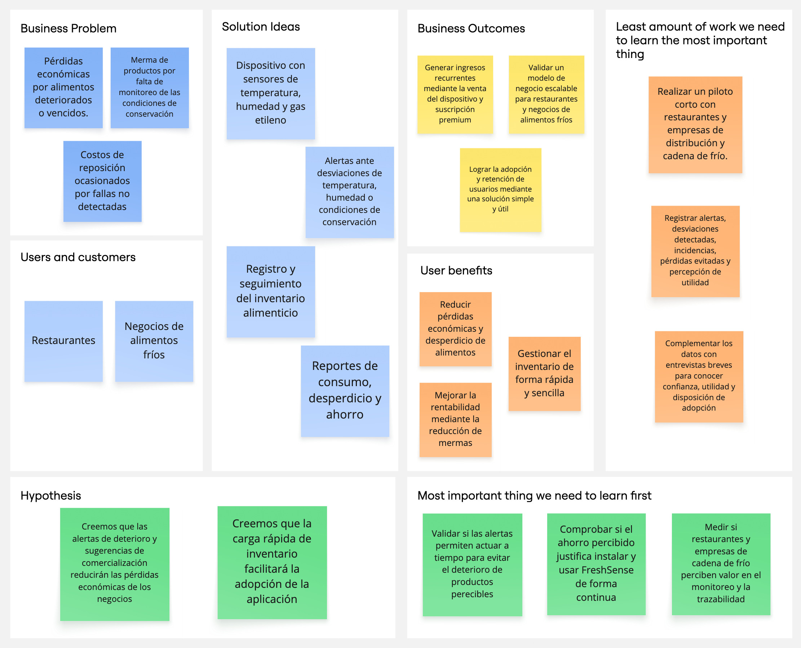

## 1.3. Segmentos objetivo

Para el proyecto FreshSense se han seleccionado dos segmentos principales de usuarios a los cuales la solución aporta un valor adaptado a sus necesidades específicas:

##### Propietarios y Gerentes de Restaurantes Pequeños

**Edad:** 28 a 50 años

**Perfil:** Emprendedores que administran restaurantes pequeños y gestionan insumos perecibles para la preparación de alimentos.

**Estilo de vida:** Dinámico y enfocado en las operaciones diarias, atención al cliente y control del negocio.

**Uso de tecnología:** Frecuente, principalmente mediante dispositivos móviles y computadoras para realizar consultas rápidas.

**Necesidad principal:** Controlar y conservar adecuadamente los insumos perecibles para reducir desperdicios, pérdidas económicas y costos innecesarios.

**Beneficios buscados:** Alertas sobre productos en riesgo de deterioro, monitoreo de las condiciones de conservación, gestión del inventario y reportes que permitan identificar pérdidas y mejorar la rentabilidad.

##### Propietarios y Encargados de Negocios de Alimentos Fríos

**Edad:** 30 a 55 años

**Perfil:** Emprendedores y encargados de negocios dedicados al almacenamiento, conservación y comercialización de productos que requieren cadena de frío.

**Estilo de vida:** Ocupado y enfocado en la operación diaria, supervisión de productos, atención al cliente y gestión del inventario.

**Uso de tecnología:** Moderado a frecuente, con disposición a utilizar herramientas que faciliten el monitoreo y control de sus productos.

**Necesidad principal:** Mantener las condiciones adecuadas de conservación para reducir el deterioro de productos, las mermas y las pérdidas económicas.

**Beneficios buscados:** Monitoreo de las condiciones de conservación, alertas ante posibles riesgos, información sobre el estado del inventario y reportes que permitan identificar pérdidas y mejorar la rentabilidad del negocio.

<div style="page-break-after: always;"></div>

# Capítulo II: Requirements Elicitation & Analysis

## 2.1. Competidores

El análisis de competidores de FreshSense se enfoca en soluciones relacionadas con el monitoreo de cadena de frío, control de condiciones ambientales, trazabilidad y supervisión de productos alimenticios perecibles. El análisis se realiza considerando los dos segmentos objetivo definidos para el proyecto:

- **Segmento 1: Propietarios y Gerentes de Restaurantes Pequeños.**
- **Segmento 2: Propietarios y Encargados de Negocios de Alimentos Fríos.**

Debido a que los competidores identificados poseen un alcance empresarial y logístico mayor que el planteado inicialmente para FreshSense, se consideran principalmente **competidores indirectos y referentes tecnológicos**. Las soluciones seleccionadas son:

- **Sensitech**
- **Tive**
- **Roambee**

Estas soluciones presentan similitudes con FreshSense en el monitoreo de variables ambientales, generación de alertas y visualización de información mediante plataformas digitales. Sin embargo, se diferencian por su nivel de especialización, mercados atendidos, alcance internacional y complejidad tecnológica.

### 2.1.1. Análisis competitivo

El objetivo de este análisis es responder la siguiente pregunta:

> **¿Cómo puede FreshSense diferenciarse de las soluciones existentes de monitoreo de cadena de frío mediante una propuesta accesible y especializada para pequeños restaurantes y negocios de alimentos fríos, orientada a reducir pérdidas por deterioro y facilitar el control de conservación e inventario?**

Los competidores seleccionados representan alternativas consolidadas dentro del mercado de monitoreo de condiciones y visibilidad de cadena de suministro.

#### Competitive Analysis Landscape

| Criterio | FreshSense | Sensitech | Tive | Roambee |
|---|---|---|---|---|
| **Tipo de competidor** | Startup analizada | Indirecto / referente | Indirecto / referente | Indirecto / referente |
| **Overview** | Solución IoT enfocada en el monitoreo de productos perecibles mediante dispositivos que recopilan temperatura y humedad y transmiten información hacia una plataforma digital. | Empresa especializada en visibilidad y monitoreo de cadena de frío, con soluciones para almacenamiento y transporte de productos sensibles. | Plataforma de visibilidad logística en tiempo real que combina rastreadores IoT con una plataforma cloud para monitorear envíos. | Plataforma de visibilidad de cadena de suministro que combina dispositivos IoT, sensores, conectividad y análisis para monitorear mercancías y activos. |
| **Ventaja competitiva** | Propuesta enfocada específicamente en empresas que trabajan con alimentos perecibles, con una arquitectura simplificada basada en dispositivos IoT, monitoreo de lotes, alertas y trazabilidad. | Amplio portafolio especializado en cadena de frío, experiencia empresarial y soluciones para almacenamiento y transporte. | Amplia capacidad de monitoreo multimodal y dispositivos capaces de medir múltiples variables en tiempo real. | Integración de monitoreo de condiciones, ubicación, analítica y visibilidad logística en una misma plataforma. |
| **Valor ofrecido al cliente** | Centralizar información sobre condiciones de conservación, dispositivos, lotes y alertas para detectar desviaciones y reducir pérdidas por deterioro. | Proteger la integridad de productos mediante monitoreo continuo, alertas y visibilidad de extremo a extremo. | Detectar desviaciones durante el transporte en tiempo real para actuar antes de que el producto resulte comprometido. | Proporcionar información en tiempo real y señales relacionadas con condiciones y ubicación para mejorar la toma de decisiones logísticas. |
| **Mercado objetivo** | Propietarios/Gerentes de Restaurantes Pequeños; Propietarios/Encargados de Negocios de Alimentos Fríos. | Alimentos, ciencias de la vida, industria y organizaciones con cadenas de suministro sensibles a temperatura. | Alimentos y bebidas, productos perecibles, farmacéutica, ciencias de la vida, bienes de alto valor y operadores logísticos. | Empresas de logística, alimentos y bebidas, farmacéutica, manufactura y organizaciones con cadenas de suministro complejas. |
| **Estrategia de marketing** | Marketing B2B orientado a demostrar reducción de pérdidas, control de condiciones y facilidad de monitoreo. | Demostraciones comerciales, contenido especializado, casos de uso e información dirigida a industrias reguladas y cadenas de frío. | Demostraciones, pruebas de producto, contenido especializado y comunicación centrada en visibilidad logística y prevención de pérdidas. | Demostraciones, pruebas del servicio, contenido sobre supply chain y comunicación orientada a visibilidad y analítica logística. |
| **Productos y servicios** | Dispositivo IoT con ESP32 + DHT22, Edge API, plataforma Web/Mobile, monitoreo de temperatura y humedad, lotes, dispositivos, alertas, trazabilidad y reportes. | SensiWatch Platform, TempTale, ColdStream Site y distintos sensores/registradores para monitoreo estacionario y en tránsito. | Plataforma Tive, trackers Solo Lite, Solo 5G, Solo Pro, sensores, alertas, reportes e integraciones. | Plataforma de visibilidad, dispositivos como BeeSense, monitoreo de temperatura, humedad, ubicación y eventos de transporte. |
| **Precios y costos** | Modelo previsto basado en dispositivo IoT y servicio digital. Los precios comerciales deben validarse posteriormente con los segmentos objetivo. | No publica una lista estándar de precios; el acceso comercial se gestiona mediante contacto y demostración. | Los precios de los trackers principales no se publican de forma general y dependen del volumen y contrato. La plataforma dispone de niveles Essential, Plus y Premium. | Utiliza modelos de suscripción y planes bajo demanda definidos mediante órdenes comerciales según cantidad de dispositivos, activos o envíos. |
| **Canales de distribución** | Landing Page, Web Application y Mobile Application. | Plataforma web, aplicación móvil y contacto comercial. | Plataforma web, integraciones/API y soluciones de seguimiento accesibles digitalmente. | Plataforma web, aplicación móvil, API y contacto comercial. |

### Sensitech

Sensitech ofrece soluciones de monitoreo de cadena de frío tanto para productos almacenados como transportados. Su sistema de monitoreo estacionario permite controlar temperatura y humedad en almacenes e instalaciones, consultar datos históricos y en tiempo real y generar alertas cuando las condiciones salen de los rangos establecidos.

También dispone de la plataforma SensiWatch, que proporciona visibilidad de extremo a extremo de la cadena de suministro y acceso a información desde dispositivos móviles.

#### SWOT - Sensitech

**Fortalezas**

- Amplio portafolio especializado en cadena de frío.
- Monitoreo estacionario y durante transporte.
- Soporte para temperatura, humedad y otras variables.
- Alertas y datos en tiempo real.
- Experiencia en sectores como alimentos y ciencias de la vida.
- Plataforma Web y aplicación móvil.

**Debilidades**

- Solución empresarial de mayor complejidad que puede requerir procesos de implementación y contratación más extensos.
- No ofrece precios públicos estándar para sus principales soluciones.
- Su amplio alcance puede resultar superior a las necesidades de empresas que requieren únicamente monitoreo básico de alimentos perecibles.

**Oportunidades**

- Crecimiento de la digitalización en cadenas de frío.
- Mayor necesidad de trazabilidad y reducción de pérdidas de productos sensibles.
- Incremento de requisitos de control y cumplimiento en cadenas logísticas.

**Amenazas**

- Aparición de soluciones IoT de menor costo.
- Empresas que desarrollen sistemas internos utilizando sensores y plataformas cloud.
- Competidores especializados en soluciones más simples para sectores específicos.

### Tive

Tive ofrece monitoreo de cadena de frío en tiempo real utilizando dispositivos capaces de recopilar información sobre temperatura, humedad, luz, impactos y ubicación.

Su plataforma permite supervisar envíos por transporte terrestre, marítimo, aéreo y ferroviario y generar alertas cuando las condiciones se encuentran fuera de los rangos establecidos.

#### SWOT - Tive

**Fortalezas**

- Monitoreo en tiempo real de múltiples variables.
- Seguimiento multimodal de envíos.
- Amplia cobertura de conectividad.
- Diversos modelos de trackers según el nivel de monitoreo requerido.
- Alertas automáticas e historial de los envíos.
- Integraciones mediante API y webhooks.

**Debilidades**

- Orientación principal hacia monitoreo de mercancías en tránsito.
- La oferta puede resultar más compleja para organizaciones que solo necesitan monitorear instalaciones o lotes específicos.
- Los precios de los dispositivos principales dependen de cotización y volumen.

**Oportunidades**

- Crecimiento del comercio y logística de productos sensibles.
- Mayor demanda de monitoreo en tiempo real.
- Integración con sistemas empresariales y plataformas logísticas.

**Amenazas**

- Competidores globales con soluciones equivalentes de seguimiento IoT.
- Reducción del costo de sensores y conectividad que facilita la entrada de nuevas soluciones.
- Desarrollo de plataformas de monitoreo propias por grandes operadores logísticos.

### Roambee

Roambee desarrolla soluciones de visibilidad de cadena de suministro mediante dispositivos IoT y servicios cloud.

Sus soluciones permiten monitorear condiciones como temperatura y humedad, además de eventos relacionados con ubicación y transporte. La plataforma genera alertas y señales para apoyar la toma de decisiones durante operaciones logísticas.

#### SWOT - Roambee

**Fortalezas**

- Combina monitoreo de condiciones y ubicación.
- Dispositivos con múltiples sensores.
- Plataforma orientada a visibilidad logística empresarial.
- Integración mediante API.
- Opciones de servicio y suscripción según necesidades de monitoreo.
- Capacidad para trabajar con operaciones logísticas de gran escala.

**Debilidades**

- Solución de mayor alcance y complejidad que un sistema enfocado únicamente en conservación de alimentos.
- Costos dependientes de contratos, dispositivos y volumen de operaciones.
- Su propuesta está orientada a supply chain visibility de forma amplia y no exclusivamente al sector de alimentos perecibles.

**Oportunidades**

- Mayor adopción de IoT en transporte y logística.
- Demanda creciente de información en tiempo real.
- Necesidad empresarial de reducir interrupciones y pérdidas en cadenas de suministro.

**Amenazas**

- Alta competencia en plataformas de supply chain visibility.
- Evolución rápida de sensores IoT y plataformas de análisis.
- Aparición de alternativas especializadas de menor costo.

### SWOT - FreshSense

**Fortalezas**

- Enfoque específico en productos alimenticios perecibles.
- Integración de dispositivos IoT con una plataforma digital.
- Monitoreo de temperatura y humedad.
- Gestión centralizada de dispositivos y lotes.
- Generación de alertas ante condiciones que requieren atención.
- Arquitectura preparada para Web y Mobile.
- Propuesta orientada a trazabilidad y reducción de pérdidas.

**Debilidades**

- Producto aún en etapa de desarrollo y validación.
- Menor cantidad de variables monitoreadas frente a competidores internacionales.
- Menor cobertura tecnológica y comercial.
- Dependencia inicial de sensores y conectividad del dispositivo.
- Modelo comercial y precios aún pendientes de validación con usuarios empresariales.

**Oportunidades**

- Digitalización de pequeños restaurantes y negocios dedicados al almacenamiento o comercialización de alimentos fríos.
- Necesidad de reducir pérdidas provocadas por una conservación inadecuada.
- Crecimiento de soluciones IoT accesibles.
- Posibilidad de adaptar la solución a necesidades específicas del mercado local.
- Incorporación futura de sensores adicionales y analítica avanzada.

**Amenazas**

- Presencia de competidores internacionales consolidados.
- Reducción de precios de soluciones comerciales existentes.
- Resistencia de algunas empresas a reemplazar procesos manuales.
- Entrada de nuevos proveedores de soluciones IoT.
- Dependencia de la correcta instalación y conectividad de los dispositivos.

### Conclusión del análisis competitivo

El análisis evidencia que FreshSense se desenvolvería en un mercado donde existen soluciones consolidadas con capacidades superiores en cobertura global, cantidad de sensores e infraestructura tecnológica.

Sensitech presenta una propuesta especialmente fuerte en monitoreo de cadena de frío tanto estacionario como en tránsito; Tive destaca por el seguimiento multimodal y la captura de múltiples variables en tiempo real; y Roambee ofrece una solución amplia de visibilidad y monitoreo de cadenas de suministro.

Frente a estos referentes, FreshSense no busca competir inicialmente por amplitud tecnológica. Su oportunidad de diferenciación se encuentra en adaptar el monitoreo de condiciones de conservación a una experiencia más simple y específica para **Propietarios/Gerentes de Restaurantes Pequeños** y **Propietarios/Encargados de Negocios de Alimentos Fríos**. La propuesta busca relacionar el estado de conservación con inventario, lotes, alertas e historial de condiciones, priorizando la reducción de mermas y pérdidas económicas.

### 2.1.2. Estrategias y tácticas frente a competidores

A partir del análisis competitivo, FreshSense plantea una estrategia de diferenciación basada en especialización, simplicidad y adaptación a los segmentos objetivo.

- **Especialización en alimentos perecibles:** orientar la experiencia y terminología a la conservación de insumos de restaurantes y productos almacenados o comercializados bajo refrigeración.

- **Implementación progresiva:** facilitar que el negocio pueda comenzar con un número reducido de dispositivos o zonas monitoreadas y ampliar posteriormente el alcance.

- **Experiencia simplificada:** concentrar la interacción en tareas relevantes para los segmentos, como verificar condiciones de conservación, controlar inventario o lotes, revisar incidencias y consultar historial.

- **Adaptación al contexto de pequeños negocios:** evitar replicar la complejidad de plataformas empresariales de gran escala y priorizar una solución comprensible para responsables que combinan tareas operativas y administrativas.

- **Modelo comercial flexible:** evaluar alternativas que combinen el dispositivo de monitoreo con el acceso al servicio digital, dejando la definición final de precios sujeta a validación con los segmentos objetivo.

- **Alertas orientadas a la acción:** priorizar avisos que permitan detectar desviaciones de conservación y actuar antes de que se produzcan pérdidas mayores.

- **Trazabilidad centralizada:** conservar el historial de condiciones e incidencias vinculadas con productos, inventario o lotes cuando corresponda al proceso del negocio.

- **Evolución tecnológica gradual:** mantener la posibilidad de incorporar nuevos sensores, capacidades de conectividad y funciones analíticas conforme evolucionen las necesidades de los usuarios.

Estas estrategias buscan que FreshSense se diferencie mediante una propuesta focalizada en los problemas operativos de conservación y desperdicio de alimentos de sus segmentos objetivo, en lugar de intentar replicar desde el inicio la amplitud funcional de plataformas internacionales consolidadas.


## 2.2. Entrevistas

Las entrevistas constituyen una fuente de información para comprender problemas, necesidades y prácticas relacionadas con la conservación de alimentos perecibles. Para esta versión del informe se conservan las **seis entrevistas realizadas durante la exploración inicial del dominio**, sin modificar la identidad, cargo, respuestas ni evidencia de los participantes.

Los entrevistados disponibles corresponden principalmente a responsables de logística, almacén, operaciones, calidad y cadena de frío. Por ello, sus hallazgos se utilizan como evidencia del problema transversal de conservación, monitoreo, lotes e incidencias. La interpretación de estos resultados se alinea con los segmentos objetivo definitivos del proyecto:

- **Segmento 1: Propietarios y Gerentes de Restaurantes Pequeños.**
- **Segmento 2: Propietarios y Encargados de Negocios de Alimentos Fríos.**

La evidencia disponible tiene una relación más directa con el segundo segmento. Para el primer segmento, los hallazgos se utilizan únicamente cuando describen necesidades transferibles al contexto de conservación de insumos perecibles; no se atribuyen a los entrevistados características propias de un restaurante que no hayan sido registradas.

### 2.2.1. Diseño de entrevistas

Las entrevistas realizadas fueron de tipo semiestructurado. La guía se orientó a conocer el contexto de trabajo de los participantes, los procesos actuales de conservación de productos perecibles, los problemas encontrados, las herramientas utilizadas y los criterios de adopción de una posible solución de monitoreo.

Las preguntas principales consideradas durante la investigación fueron las siguientes:

1. ¿Cuál es su cargo y qué responsabilidades tiene relacionadas con almacenamiento, conservación, calidad, transporte o comercialización de alimentos perecibles?
2. ¿Qué tipo de productos perecibles maneja y cuáles requieren mayor control de sus condiciones de conservación?
3. ¿Cómo monitorean actualmente variables como temperatura y humedad durante el almacenamiento o transporte?
4. ¿Qué problemas de conservación, deterioro o ruptura de la cadena de frío se presentan con mayor frecuencia?
5. ¿Qué consecuencias económicas, operativas o de calidad generan estas incidencias?
6. ¿Qué herramientas utilizan actualmente para controlar las condiciones de conservación: termómetros, sensores, registradores, hojas de cálculo, sistemas de inventario u otras?
7. ¿Con qué frecuencia revisan las condiciones de almacenamiento y qué información consideran más importante consultar?
8. ¿Qué tan útil sería recibir alertas automáticas cuando las condiciones se encuentren fuera de los límites establecidos?
9. ¿Cómo identifican y realizan actualmente el seguimiento de los lotes o grupos de productos?
10. Cuando ocurre una incidencia, ¿qué tan sencillo es identificar los productos o lotes que podrían haber sido afectados?
11. ¿Qué características debería tener una solución de monitoreo para que resulte útil y sencilla de implementar?
12. ¿Qué factores influirían más en una decisión de adopción: costo, precisión, facilidad de uso, instalación, trazabilidad, alertas, reportes, soporte u otros?

Además de las respuestas funcionales, el análisis considera características observables de los entrevistados como rol, responsabilidades, uso de herramientas digitales y principales frustraciones operativas, de modo que los hallazgos puedan alimentar los artefactos posteriores de Needfinding.

### 2.2.2. Registro de entrevistas


##### Entrevista 1

| Dato | Información |
| --- | --- |
| Nombre y apellidos | Carlos Mendoza Ruiz |
| Edad | 26 años |
| Distrito | Callao |
| Empresa / sector | Distribución refrigerada de alimentos |
| Cargo | Supervisor de Logística |
| Inicio de entrevista | 00:00 |
| Duración | 08:42 |
| Enlace | [Ver entrevista](URL) |


**Resumen:**  
Carlos Mendoza trabaja como supervisor de logística en una empresa dedicada a la distribución refrigerada de alimentos. Dentro de sus funciones supervisa el almacenamiento y transporte de productos como lácteos, carnes y alimentos congelados.

Explicó que actualmente realizan el control de temperatura mediante termómetros instalados en cámaras de refrigeración y registradores ubicados en algunas unidades de transporte. Parte de la información es revisada manualmente y posteriormente registrada en hojas de cálculo.

Señaló que uno de los principales problemas ocurre cuando existen variaciones de temperatura durante el transporte y estas se detectan recién al finalizar el recorrido. Este tipo de incidencias puede ocasionar revisión adicional de mercadería, retrasos y, en algunos casos, pérdida de productos.

Considera que recibir alertas automáticas sería especialmente útil para reaccionar antes de que una desviación genere un daño importante. Entre la información que considera prioritaria se encuentran la temperatura, humedad, ubicación del producto, identificación del lote y el historial de lecturas.

También indicó que una solución como FreshSense debería ser fácil de instalar, contar con información clara y permitir revisar rápidamente qué producto o lote fue afectado. Para una eventual adopción considera importantes la precisión de los sensores, el precio y la disponibilidad de soporte técnico.


##### Entrevista 2

| Dato | Información |
| --- | --- |
| Nombre y apellidos | Carlos Guimaraes |
| Edad | 27 años |
| Distrito | Villa El Salvador |
| Empresa / sector | Producción y almacenamiento de carnes y productos congelados |
| Cargo | Jefe de Almacén |
| Inicio de entrevista | 0:00 |
| Duración | 08:36 |
| Enlace | [Ver entrevista](https://drive.google.com/file/d/1Q8i84GD9mqFdKOLVYLR2PqdWQVT1MYik/view?usp=drive_link) |


**Resumen:**  
Carlos Guimaraes se desempeña como jefe de almacén en una empresa que trabaja con carnes y productos congelados. Dentro de sus funciones se encuentra supervisar el ingreso y salida de mercadería, verificar las condiciones de las cámaras frigoríficas y coordinar el movimiento de los diferentes lotes almacenados.

Explicó que los controles se realizan mediante termómetros instalados en las cámaras y verificaciones periódicas del personal. La identificación de lotes se gestiona mediante registros internos y etiquetas asociadas a cada ingreso de mercadería.

Indicó que los principales problemas pueden aparecer cuando existen fallas en los equipos de refrigeración o cuando las cámaras permanecen abiertas durante demasiado tiempo. Estas situaciones pueden ocasionar incrementos temporales de temperatura que deben ser identificados rápidamente.

Considera especialmente útil contar con alertas que indiquen cuándo una cámara o producto se encuentra fuera del rango permitido. También mencionó que sería importante identificar rápidamente qué lotes se encontraban almacenados durante una incidencia.

Para una posible implementación, considera relevantes el costo del sistema, la facilidad de instalación, la confiabilidad de las mediciones y la disponibilidad de soporte técnico.


##### Entrevista 3

| Dato | Información |
| --- | --- |
| Nombre y apellidos | Daniela Vargas Medina |
| Edad | 22 años |
| Distrito | Lurín |
| Empresa / sector | Comercialización y almacenamiento de frutas y vegetales |
| Cargo | Coordinadora de Operaciones |
| Inicio de entrevista | 00:00 |
| Duración | 09:04 |
| Enlace | [Ver entrevista](https://drive.google.com/file/d/1AqFpCV5FGpSXy3RIi9gN7BdsXJm4ywSU/view?usp=drive_link) |


**Resumen:**  
Daniela Vargas trabaja como coordinadora de operaciones en una empresa dedicada al almacenamiento y comercialización de frutas y vegetales. Sus responsabilidades incluyen coordinar el ingreso de productos, revisar el inventario disponible y supervisar las condiciones generales de almacenamiento.

Comentó que algunos controles de temperatura se realizan mediante equipos instalados en las cámaras, mientras que la revisión de humedad y estado de los productos depende en mayor medida de inspecciones realizadas por el personal.

Uno de los problemas que identifica es que diferentes productos requieren condiciones distintas de conservación y no siempre resulta sencillo mantener un seguimiento constante de todos los lotes almacenados.

Considera que una plataforma que permita visualizar lotes, condiciones ambientales e incidencias desde un mismo lugar ayudaría a mejorar el control de la operación. También considera útil contar con alertas configurables según el tipo de producto.

Entre las funcionalidades que considera importantes destacó el historial de mediciones, los reportes, la identificación de lotes afectados y una interfaz sencilla que pueda ser utilizada tanto por responsables de operaciones como por personal de calidad.


##### Entrevista 4

| Dato | Información |
| --- | --- |
| Nombre y apellidos | María Fernanda Rojas Díaz |
| Edad | 36 años |
| Distrito | Santa Anita |
| Empresa / sector | Producción y comercialización de productos lácteos |
| Cargo | Supervisora de Calidad |
| Inicio de entrevista | 00:00 |
| Duración | 09:18 |
| Enlace | [Ver entrevista](https://drive.google.com/file/d/1yaP9FCvV9rKo09GO2Eu2jYF9UUS8Ujob/view?usp=drive_link) |


**Resumen:**  
María Fernanda Rojas trabaja como supervisora de calidad en una empresa dedicada a la producción y comercialización de productos lácteos. Entre sus responsabilidades se encuentra verificar las condiciones de almacenamiento de productos terminados y coordinar controles relacionados con temperatura y calidad.

Comentó que actualmente utilizan termómetros digitales y realizan registros periódicos de temperatura en las áreas de almacenamiento. Parte de esta información es trasladada posteriormente a hojas de cálculo para mantener evidencia de los controles realizados.

Según indicó, uno de los principales problemas se presenta cuando una desviación ocurre entre dos controles manuales, debido a que puede pasar cierto tiempo antes de ser detectada. Esto puede generar revisiones adicionales del producto y, en algunos casos, la separación de lotes hasta confirmar que mantienen condiciones adecuadas.

Considera que contar con información disponible en tiempo real y recibir alertas automáticas facilitaría el trabajo del área de calidad. También considera importante poder revisar el historial de temperatura y humedad correspondiente a cada lote.

Entre los factores más relevantes para adoptar una solución de este tipo destacó la precisión de los sensores, la facilidad de uso, la generación de reportes y la posibilidad de acceder a información histórica.


##### Entrevista 5

| Dato | Información |
| --- | --- |
| Nombre y apellidos | Andrea Salazar Paredes |
| Edad | 29 años |
| Distrito | Ate |
| Empresa / sector | Operador logístico de productos refrigerados |
| Cargo | Coordinadora de Operaciones |
| Inicio de entrevista | 00:00 |
| Duración | 09:15 |
| Enlace | [Ver entrevista](https://drive.google.com/file/d/1iQW9Vu0lRPL9HhDX3PIfNHNQqrBESufE/view?usp=drive_link) |


**Resumen:**  
Andrea Salazar se desempeña como coordinadora de operaciones en una empresa que almacena y distribuye productos refrigerados para diferentes clientes del sector alimentario.

Indicó que la empresa trabaja con cámaras de refrigeración y vehículos acondicionados para mantener determinadas temperaturas. El control se realiza mediante sensores en algunos puntos de almacenamiento y verificaciones periódicas efectuadas por el personal.

Comentó que una dificultad importante es que la información de almacenamiento, transporte y lotes se encuentra distribuida entre diferentes registros. Cuando ocurre una incidencia, identificar cuándo sucedió y qué mercadería estuvo expuesta puede requerir revisar distintas fuentes de información.

Para ella, una plataforma centralizada que permita relacionar dispositivos, lotes e incidencias facilitaría considerablemente el trabajo operativo. Considera especialmente importantes las alertas en tiempo real y la posibilidad de consultar un historial de temperatura y humedad.

Señaló también que una solución tecnológica debería ser sencilla de utilizar por diferentes perfiles de empleados y ofrecer reportes que puedan ser revisados posteriormente. En una decisión de compra priorizaría la confiabilidad, facilidad de implementación y capacidad de generar alertas oportunas.


##### Entrevista 6

| Dato | Información |
| --- | --- |
| Nombre y apellidos | Javier Torres Castillo |
| Edad | 26 años |
| Distrito | San Luis |
| Empresa / sector | Distribución mayorista de alimentos perecibles |
| Cargo | Responsable de Cadena de Frío |
| Inicio de entrevista | 00:00 |
| Duración | 08:57 |
| Enlace | [Ver entrevista](https://drive.google.com/file/d/1_Jg-67dLuuAXt6bTV69x12lShay-IJ0v/view?usp=drive_link) |


**Resumen:**  
Javier Torres trabaja como responsable de cadena de frío en una empresa distribuidora de productos perecibles. Sus principales responsabilidades incluyen supervisar las condiciones de almacenamiento, coordinar despachos y verificar que los productos mantengan condiciones adecuadas durante su traslado.

Actualmente utilizan termómetros digitales y controles manuales realizados por el personal. Algunos vehículos disponen de dispositivos capaces de registrar temperatura, aunque señaló que no toda la información se encuentra disponible en una única plataforma.

Según su experiencia, las principales incidencias están relacionadas con variaciones de temperatura ocasionadas por aperturas prolongadas, problemas de refrigeración o retrasos durante la distribución. Estas situaciones pueden afectar la calidad de los productos y ocasionar devoluciones.

Considera que contar con alertas automáticas y un historial asociado a cada lote ayudaría a detectar problemas más rápidamente y facilitaría la identificación de responsabilidades frente a una incidencia.

Entre las características que considera indispensables mencionó facilidad de uso, precisión de las mediciones, disponibilidad de información histórica y generación de reportes. También considera importante que la solución pueda implementarse progresivamente, comenzando con determinados almacenes o vehículos antes de extenderse al resto de la operación.


### 2.2.3. Análisis de entrevistas

#### Hallazgos generales de la evidencia disponible

Los resultados registrados en las seis entrevistas muestran patrones consistentes relacionados con la conservación de alimentos perecibles. En los dos grupos originales de entrevistas, el **100 % de los participantes indicó realizar algún tipo de control de temperatura**, aunque parte del proceso continúa dependiendo de verificaciones manuales.

Asimismo, en ambos grupos originales el **100 % consideró útil recibir alertas automáticas** cuando las condiciones salen de los rangos establecidos y el **100 % consideró relevante relacionar las condiciones registradas con los lotes monitoreados** para facilitar la identificación de incidencias.

En el primer grupo de entrevistas, el **66.7 %** indicó utilizar sensores o registradores digitales en determinadas etapas, aunque la información no siempre se encuentra centralizada. En el segundo grupo, el **66.7 %** destacó la utilidad de disponer de reportes e historiales de mediciones.

De manera transversal, los principales problemas y necesidades identificados son:

- dependencia parcial de controles manuales;
- detección tardía de variaciones de temperatura;
- información distribuida entre diferentes registros;
- dificultad para identificar rápidamente productos o lotes afectados;
- necesidad de alertas oportunas;
- necesidad de consultar historial de condiciones;
- importancia de la facilidad de uso, precisión de las mediciones y reportes.

#### Interpretación para el Segmento 1: Propietarios y Gerentes de Restaurantes Pequeños

Las entrevistas disponibles no incluyen de manera directa a propietarios o gerentes de restaurantes pequeños. Por ello, para este segmento se utilizan únicamente los hallazgos que pueden trasladarse de forma razonable al manejo de insumos perecibles: controles manuales, necesidad de detectar desviaciones de conservación, importancia de actuar antes de que el producto se deteriore y necesidad de reducir pérdidas.

Con base en ello, la investigación disponible permite sustentar de manera preliminar necesidades relacionadas con la **supervisión de condiciones de conservación**, el **control de inventario perecible**, la **detección oportuna de productos en riesgo** y la **reducción de mermas**. Las características específicas del flujo operativo de un restaurante deben tratarse como hipótesis del arquetipo y no como respuestas directas de los entrevistados existentes.

#### Interpretación para el Segmento 2: Propietarios y Encargados de Negocios de Alimentos Fríos

La evidencia disponible presenta una relación directa con este segmento, ya que varios entrevistados son responsables de almacenes, operaciones, calidad o cadena de frío en negocios que manipulan alimentos refrigerados, congelados o perecibles.

Los hallazgos respaldan especialmente la necesidad de **monitorear temperatura y humedad**, **detectar desviaciones mediante alertas**, **relacionar incidencias con lotes o productos**, **consultar información histórica** y **centralizar datos que actualmente se encuentran distribuidos**. También se observa que la facilidad de implementación, la precisión de las mediciones y la disponibilidad de reportes son factores relevantes para la adopción.

#### Conclusión del análisis de entrevistas

La evidencia de entrevistas respalda el problema general que FreshSense busca abordar: la dificultad de mantener un control continuo y centralizado sobre las condiciones de conservación de alimentos perecibles.

Para el **Segmento 2**, el sustento es directo y permite identificar patrones de comportamiento y necesidades operativas. Para el **Segmento 1**, el sustento es indirecto y se utiliza como evidencia del problema transversal de conservación de insumos; por ello, los artefactos de Needfinding correspondientes se presentan como una aproximación preliminar alineada con la definición del segmento establecida en el Capítulo I.


## 2.3. Needfinding

El proceso de Needfinding organiza los hallazgos obtenidos durante la investigación para representar a los usuarios, las tareas que realizan en su contexto actual, sus principales preocupaciones y la forma en la que enfrentan el problema antes de utilizar FreshSense.

Los artefactos de esta sección se estructuran a partir de los dos segmentos objetivo definitivos:

- **Segmento 1: Propietarios y Gerentes de Restaurantes Pequeños.**
- **Segmento 2: Propietarios y Encargados de Negocios de Alimentos Fríos.**

La evidencia de entrevistas se utiliza como base para los aspectos relacionados con conservación, control, incidencias, inventario y pérdida de productos. Cuando un aspecto corresponde específicamente al entorno de restaurantes y no fue observado directamente en las entrevistas existentes, se mantiene como una hipótesis de diseño que deberá ser validada posteriormente.

### 2.3.1. User Personas

Se mantienen los nombres de los User Personas ya definidos por el equipo, pero se corrige su caracterización para que cada uno represente de manera consistente uno de los segmentos objetivo establecidos en el Capítulo I.

#### José Jiménez - Segmento 1: Propietarios y Gerentes de Restaurantes Pequeños

José Jiménez representa al propietario o gerente de un restaurante pequeño que combina responsabilidades administrativas con la supervisión de la operación diaria. Su interés principal es mantener disponibles los insumos necesarios para preparar los productos del negocio, conservarlos en condiciones adecuadas y evitar pérdidas por deterioro o vencimiento.

Dentro de su contexto de trabajo necesita revisar existencias, supervisar la conservación de ingredientes perecibles, organizar su rotación y actuar cuando identifica un producto que ya no se encuentra en condiciones adecuadas. Debido a que sus tareas se desarrollan en paralelo con la atención del negocio, valora mecanismos que reduzcan la dependencia de revisiones manuales y le permitan detectar riesgos de forma oportuna.

Sus principales objetivos son reducir mermas, mantener la calidad de los insumos, evitar compras innecesarias y disponer de información suficiente para tomar decisiones sobre uso, descarte o reposición de productos.

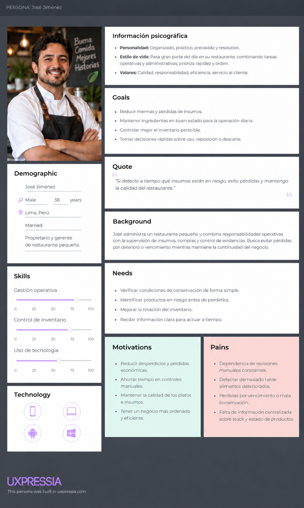

#### Luisa Pérez - Segmento 2: Propietarios y Encargados de Negocios de Alimentos Fríos

Luisa Pérez representa a la propietaria o encargada de un negocio que almacena o comercializa alimentos que requieren refrigeración o congelación. Su trabajo exige supervisar las condiciones de conservación, controlar el inventario disponible y reaccionar ante variaciones que puedan comprometer la calidad del producto.

Su principal preocupación es evitar pérdidas ocasionadas por fallas de refrigeración, productos próximos a vencer o incidencias que no sean detectadas a tiempo. Necesita identificar los productos o lotes afectados, mantener una rotación adecuada y contar con información histórica cuando debe revisar una incidencia.

Sus principales objetivos son mantener la cadena de frío, reducir mermas, conservar la calidad de los productos y mejorar el control operativo del negocio.

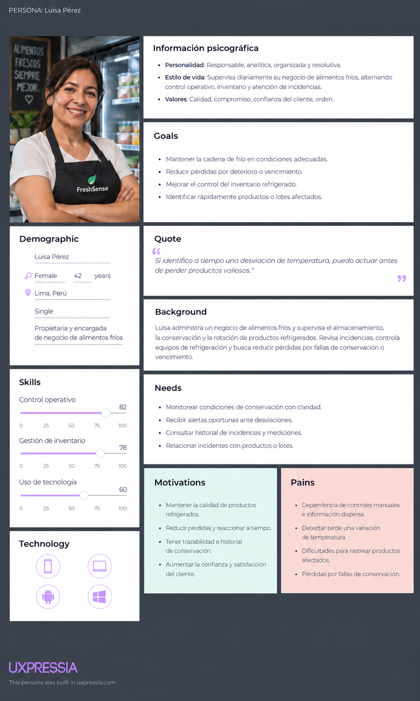

### 2.3.2. User Task Matrix

La siguiente matriz representa las tareas que los User Personas realizan para alcanzar sus objetivos **independientemente de la existencia de FreshSense**. Por ello, las tareas se expresan como actividades del negocio y no como funcionalidades de una aplicación.

Dado que la evidencia directa para el Segmento 1 es limitada, la matriz se presenta como una versión preliminar construida a partir de la definición de los segmentos y de los hallazgos transversales de las entrevistas.

| Tarea | José Jiménez - Frecuencia | José Jiménez - Importancia | Luisa Pérez - Frecuencia | Luisa Pérez - Importancia |
|---|---|---|---|---|
| Verificar las condiciones de conservación de los alimentos | Siempre | Muy alta | Siempre | Muy alta |
| Identificar productos próximos a vencer o deteriorarse | Casi siempre | Muy alta | Casi siempre | Muy alta |
| Registrar o revisar entradas y salidas de productos | Casi siempre | Alta | Siempre | Muy alta |
| Organizar la rotación del inventario | Casi siempre | Alta | Siempre | Muy alta |
| Revisar el funcionamiento de los equipos de refrigeración | Casi siempre | Muy alta | Siempre | Muy alta |
| Identificar productos o lotes afectados por una incidencia | A veces | Muy alta | Casi siempre | Muy alta |
| Revisar mermas y pérdidas de productos | A veces | Alta | Casi siempre | Alta |
| Planificar reposición o compra de productos | Casi siempre | Alta | Casi siempre | Alta |

El análisis muestra que ambos perfiles comparten tareas críticas relacionadas con la conservación, control de existencias y reducción de pérdidas. En José, estas tareas se integran con la operación diaria de un restaurante pequeño, donde los insumos se consumen continuamente para la preparación de alimentos. En Luisa, la prioridad se concentra en mantener condiciones estables de refrigeración, controlar la rotación y responder ante incidencias que puedan comprometer productos almacenados o comercializados.

La mayor coincidencia entre ambos perfiles se encuentra en la verificación de las condiciones de conservación y la detección oportuna de productos en riesgo. La principal diferencia está en que el segundo segmento requiere un énfasis mayor en el seguimiento de productos o lotes bajo cadena de frío.

### 2.3.3. Empathy Mapping

Los Empathy Maps se elaboran para representar la perspectiva de cada User Persona mediante sus preocupaciones, acciones, pensamientos, observaciones, pains y gains. La versión gráfica deberá elaborarse en la herramienta indicada para el curso y mantenerse consistente con las características definidas en esta sección.

#### Empathy Map - José Jiménez

El mapa de empatía de José refleja a un propietario o gerente de restaurante pequeño que necesita mantener la calidad de sus insumos mientras atiende múltiples responsabilidades operativas. Entre sus principales preocupaciones se encuentran el deterioro de alimentos, las pérdidas económicas, la falta de tiempo para revisar constantemente el inventario y la necesidad de disponer de ingredientes en condiciones adecuadas durante la jornada.

Como principales **pains** se consideran las revisiones manuales, el riesgo de descubrir demasiado tarde un producto deteriorado, las compras innecesarias y las mermas. Como **gains**, busca mayor control sobre sus insumos, reducción de pérdidas, información oportuna y una operación más ordenada.

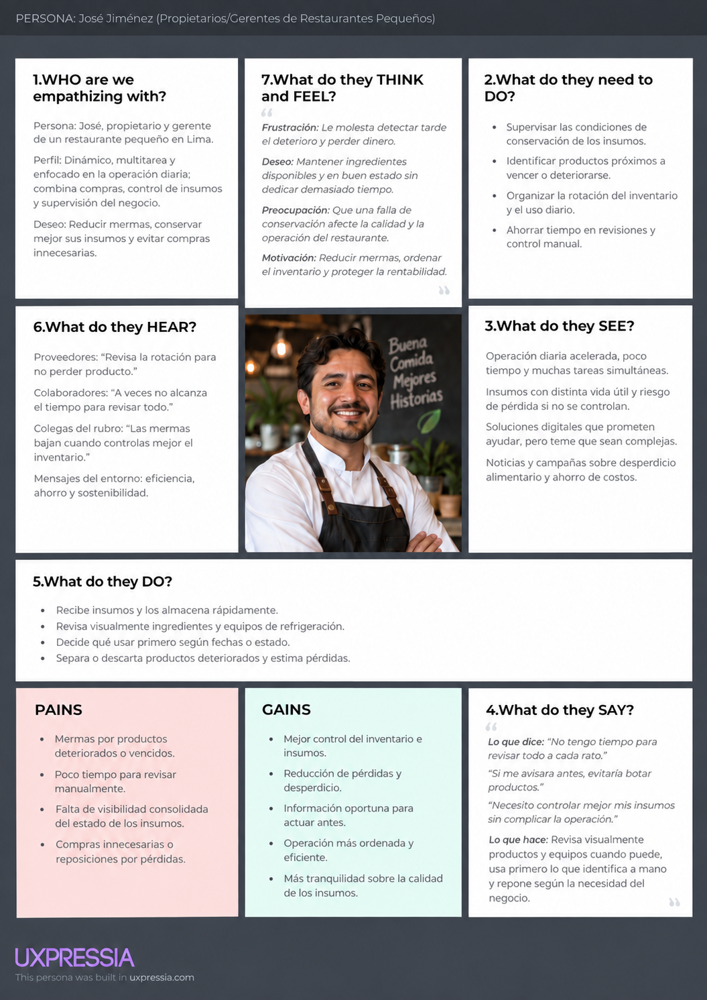

#### Empathy Map - Luisa Pérez

El mapa de empatía de Luisa representa a una propietaria o encargada de un negocio de alimentos fríos que necesita garantizar condiciones adecuadas de refrigeración y conservar el valor comercial de sus productos.

Sus principales preocupaciones se relacionan con variaciones de temperatura, fallas de refrigeración, pérdida de mercadería y dificultad para determinar qué productos fueron afectados durante una incidencia. Como **pains** se consideran la dependencia de controles manuales, información dispersa y detección tardía de problemas. Como **gains**, busca una mejor supervisión de la conservación, trazabilidad de incidencias, reducción de mermas y mayor confianza sobre el estado de sus productos.

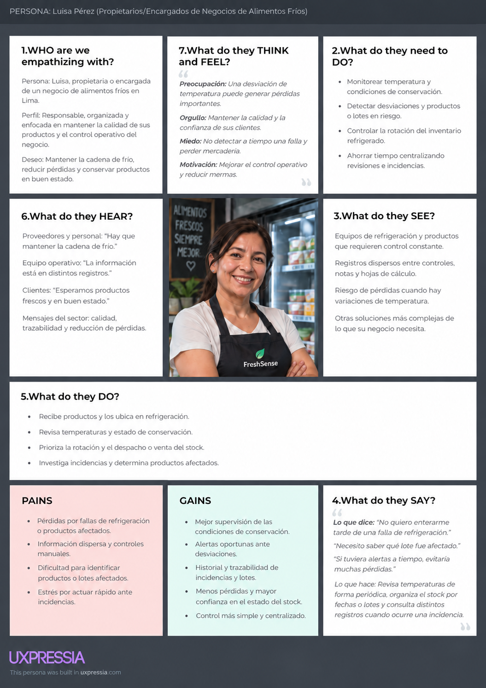

### 2.3.4. As-is Scenario Mapping

Los As-Is Scenario Maps representan cómo los usuarios realizan actualmente sus actividades antes de incorporar FreshSense. Para cada User Persona se consideran las filas **Phases, Doing, Thinking y Feeling**, con énfasis en los puntos de fricción existentes.

#### As-Is Scenario Map - José Jiménez

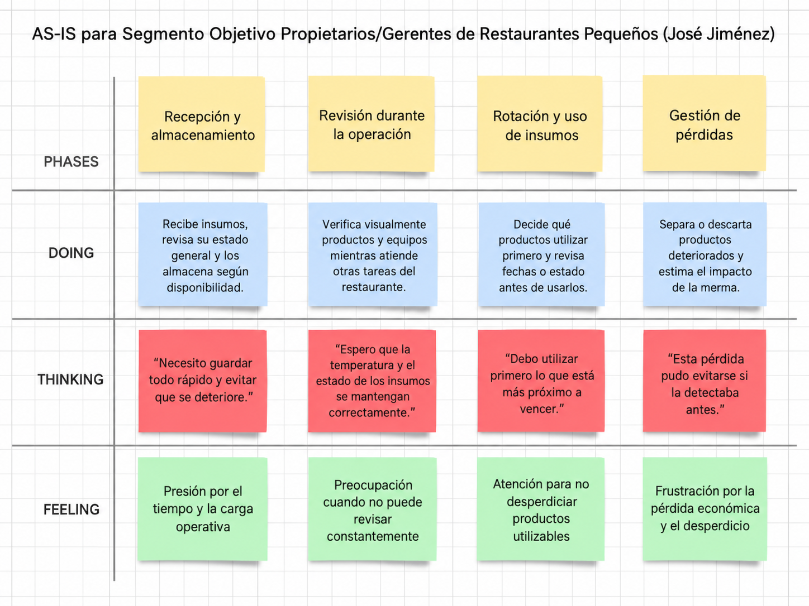

**Áreas negativas identificadas:** dependencia de revisiones manuales, dificultad para mantener seguimiento continuo, riesgo de detectar tarde el deterioro y poca visibilidad consolidada sobre las mermas.


#### As-Is Scenario Map - Luisa Pérez

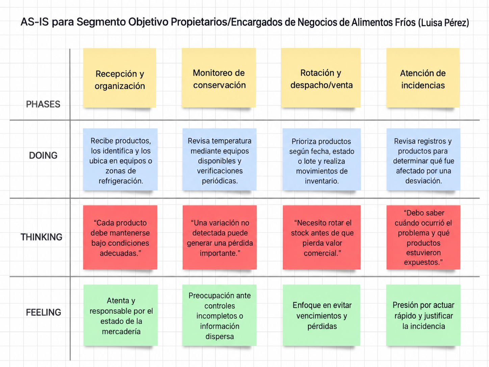

**Áreas negativas identificadas:** información distribuida, controles manuales, detección tardía de desviaciones, dificultad para relacionar una incidencia con productos o lotes específicos.


## 2.4. Ubiquitous Language

El Ubiquitous Language de FreshSense reúne términos propios del dominio de conservación, manejo e inventario de alimentos perecibles. Se excluyen términos puramente técnicos de desarrollo de software para mantener un lenguaje común entre el equipo y los stakeholders del negocio.

| Ubiquitous Term | Definición |
|---|---|
| **Perishable Food** | Alimento cuya calidad o aptitud para consumo puede disminuir en un periodo relativamente corto si no se mantiene bajo condiciones adecuadas de conservación. |
| **Food Waste** | Pérdida o descarte de alimentos o insumos que ya no pueden ser utilizados o comercializados debido a vencimiento, deterioro, mala rotación o conservación inadecuada. |
| **Food Inventory** | Conjunto organizado de alimentos e insumos disponibles dentro del negocio, considerando cantidades, fechas, ubicación y estado. |
| **Food Condition** | Estado de conservación de un alimento o producto en función de su frescura, integridad y condiciones de almacenamiento. |
| **Expiration Date** | Fecha a partir de la cual un producto deja de encontrarse dentro del periodo establecido para su consumo o comercialización. |
| **Shelf Life** | Periodo durante el cual un alimento conserva las condiciones esperadas de calidad bajo condiciones adecuadas de almacenamiento. |
| **Cold Chain** | Conjunto de condiciones y actividades destinadas a mantener productos refrigerados o congelados dentro de rangos adecuados durante su almacenamiento, manipulación o traslado. |
| **Cold Storage** | Almacenamiento de productos en equipos o ambientes refrigerados o congelados para conservar sus condiciones. |
| **Temperature Excursion** | Situación en la que la temperatura de conservación se desvía del rango establecido durante un periodo determinado. |
| **Batch / Lot** | Grupo identificable de productos que comparten un origen, ingreso, producción o condición de manejo y que puede ser seguido de manera conjunta. |
| **Stock Rotation** | Práctica de organizar el uso, venta o despacho de productos para reducir vencimientos y pérdidas. |
| **FIFO (First In, First Out)** | Criterio de rotación mediante el cual los productos que ingresaron primero son utilizados, vendidos o despachados antes que los de ingreso posterior. |
| **Spoilage** | Deterioro de un alimento que provoca pérdida de calidad o impide su uso o comercialización. |
| **Merma** | Disminución del inventario utilizable o comercializable debido a deterioro, vencimiento, manipulación, conservación inadecuada u otras pérdidas operativas. |
| **Refrigeration Equipment** | Equipo utilizado por el negocio para mantener alimentos bajo condiciones de refrigeración o congelación. |
| **Conservation Condition** | Condición ambiental o de almacenamiento que influye en el mantenimiento adecuado del producto, como temperatura o humedad. |


<div style="page-break-after: always;"></div>

# Capítulo III: Requirements Specification

## 3.1. To-Be Scenario Mapping

<figure id="fig-cmap" style="margin:1.5em 0;text-align:center">

<figcaption style="font-size:0.9em;color:#555;margin-top:0.4em"><em>To-Be Scenario Mapping.</em></figcaption>
</figure>

## 3.2. User Stories

| User Story ID | Título | Descripción | Criterios de Aceptación | Relacionado con (Epic ID) |
|---|---|---|---|---|
| **US01** | Visualización de la propuesta de valor | Como visitante representante de un restaurante pequeño o negocio de alimentos fríos, deseo conocer la propuesta de valor de FreshSense para evaluar cómo puede ayudar a reducir las pérdidas ocasionadas por el deterioro de productos perecibles. | **Escenario 1: Consulta de propuesta de valor**<br>**Dado que** un visitante accede al sitio informativo de FreshSense<br>**Cuando** consulta la información principal de la solución<br>**Entonces** el sistema presenta los beneficios relacionados con monitoreo, conservación de productos y reducción de mermas.<br><br>**Escenario 2: Identificación del problema atendido**<br>**Dado que** el visitante revisa la información de FreshSense<br>**Cuando** consulta los beneficios de la solución<br>**Entonces** puede identificar que FreshSense busca reducir las pérdidas ocasionadas por condiciones inadecuadas de conservación. | **EP01** |
| **US02** | Información según segmento objetivo | Como visitante representante de un restaurante pequeño o negocio de alimentos fríos, deseo consultar información relacionada con mi tipo de negocio para comprender cómo FreshSense puede atender mis necesidades particulares. | **Escenario 1: Información para restaurantes**<br>**Dado que** el visitante pertenece al segmento de restaurantes pequeños<br>**Cuando** consulta la información correspondiente a su segmento<br>**Entonces** el sistema presenta beneficios relacionados con conservación de insumos, inventario, alertas y reducción de mermas.<br><br>**Escenario 2: Información para negocios de alimentos fríos**<br>**Dado que** el visitante pertenece al segmento de negocios de alimentos fríos<br>**Cuando** consulta la información correspondiente a su segmento<br>**Entonces** el sistema presenta beneficios relacionados con monitoreo de condiciones, productos almacenados, lotes y alertas. | **EP01** |
| **US03** | Solicitud de contacto y demostración | Como visitante interesado en FreshSense, deseo enviar una solicitud de contacto para coordinar una demostración y obtener mayor información sobre la solución. | **Escenario 1: Solicitud válida**<br>**Dado que** el visitante proporciona los datos obligatorios de contacto<br>**Cuando** envía la solicitud<br>**Entonces** el sistema registra correctamente la solicitud de contacto.<br><br>**Escenario 2: Información incompleta**<br>**Dado que** el visitante no proporciona todos los datos obligatorios<br>**Cuando** intenta enviar la solicitud<br>**Entonces** el sistema no registra la solicitud e informa que existen datos pendientes. | **EP01** |
| **US04** | Solicitud de demostración comercial | Como visitante interesado en adoptar FreshSense, deseo iniciar una solicitud de demostración para evaluar la solución antes de incorporarla a mi negocio. | **Escenario 1: Inicio de solicitud**<br>**Dado que** el visitante ha revisado la propuesta de FreshSense<br>**Cuando** decide solicitar una demostración<br>**Entonces** el sistema permite iniciar el proceso de contacto comercial.<br><br>**Escenario 2: Asociación con segmento**<br>**Dado que** el visitante identifica el tipo de negocio al que pertenece<br>**Cuando** inicia la solicitud<br>**Entonces** el sistema registra el segmento asociado con la solicitud comercial. | **EP01** |
| **US05** | Acceso desde diferentes dispositivos | Como propietario, gerente o encargado de un negocio, deseo acceder a FreshSense desde computadoras, tablets y dispositivos móviles para consultar la información de mis productos durante la operación diaria. | **Escenario 1: Acceso compatible**<br>**Dado que** el usuario accede desde un dispositivo compatible<br>**Cuando** utiliza las funcionalidades disponibles<br>**Entonces** puede consultar y gestionar la información de su negocio sin pérdida de contenido.<br><br>**Escenario 2: Consistencia de información**<br>**Dado que** el usuario utiliza FreshSense desde diferentes dispositivos<br>**Cuando** consulta la información de su negocio<br>**Entonces** el sistema presenta los mismos datos actualizados independientemente del dispositivo utilizado. | **EP05** |
| **US06** | Monitoreo IoT de condiciones de conservación | Como encargado de un restaurante o negocio de alimentos fríos, deseo monitorear continuamente la temperatura y humedad de las zonas de conservación para detectar condiciones que puedan ocasionar el deterioro de los productos. | **Escenario 1: Registro de mediciones**<br>**Dado que** un dispositivo FreshSense se encuentra asociado con una zona de conservación<br>**Cuando** registra una medición válida de temperatura y humedad<br>**Entonces** el sistema almacena la medición asociándola con el dispositivo y la zona correspondiente.<br><br>**Escenario 2: Actualización de condiciones**<br>**Dado que** existen nuevas mediciones válidas<br>**Cuando** el sistema procesa las mediciones<br>**Entonces** actualiza el estado de las condiciones de conservación de la zona monitoreada. | **EP02** |
| **US07** | Estado de conservación de productos | Como propietario, gerente o encargado de un negocio, deseo consultar el estado de conservación de los productos para identificar aquellos que presentan mayor riesgo de deterioro. | **Escenario 1: Determinación del estado**<br>**Dado que** existen productos asociados con zonas monitoreadas<br>**Cuando** el sistema analiza sus condiciones de conservación y vencimiento<br>**Entonces** determina el nivel de riesgo correspondiente a cada producto.<br><br>**Escenario 2: Consulta de producto**<br>**Dado que** existe información registrada sobre un producto<br>**Cuando** el usuario consulta su estado<br>**Entonces** el sistema proporciona su identificación, lote, vencimiento, ubicación y condiciones registradas. | **EP02** |
| **US08** | Alertas preventivas de conservación | Como encargado de un restaurante o negocio de alimentos fríos, deseo recibir alertas cuando las condiciones de conservación se encuentren fuera de los rangos establecidos para actuar antes de que los productos resulten afectados. | **Escenario 1: Condición fuera de rango**<br>**Dado que** una medición supera los límites establecidos para una zona de conservación<br>**Cuando** el sistema procesa la medición<br>**Entonces** genera una alerta asociada con la zona afectada.<br><br>**Escenario 2: Condiciones normales**<br>**Dado que** las mediciones permanecen dentro de los rangos establecidos<br>**Cuando** el sistema procesa las mediciones<br>**Entonces** no genera una alerta por desviación de las condiciones. | **EP03** |
| **US09** | Configuración de alertas | Como administrador del negocio, deseo configurar las preferencias y responsables de las alertas para asegurar que las incidencias sean comunicadas a las personas correspondientes. | **Escenario 1: Configuración válida**<br>**Dado que** el administrador posee permisos para gestionar alertas<br>**Cuando** establece responsables y niveles de prioridad<br>**Entonces** el sistema almacena la configuración definida.<br><br>**Escenario 2: Aplicación de configuración**<br>**Dado que** existe una configuración activa de alertas<br>**Cuando** se genera una incidencia<br>**Entonces** el sistema utiliza dicha configuración para determinar a los responsables que deben ser notificados. | **EP03** |
| **US10** | Registro de productos e insumos | Como encargado del inventario, deseo registrar productos o insumos de manera rápida para mantener actualizado el inventario sin afectar las actividades diarias del negocio. | **Escenario 1: Registro válido**<br>**Dado que** el encargado proporciona la información obligatoria de un producto<br>**Cuando** registra el producto<br>**Entonces** el sistema almacena su identificación, cantidad, categoría, lote y vencimiento cuando corresponda.<br><br>**Escenario 2: Información incompleta**<br>**Dado que** falta información obligatoria del producto<br>**Cuando** se intenta completar el registro<br>**Entonces** el sistema no registra información incompleta. | **EP04** |
| **US11** | Actualización del inventario | Como encargado del inventario, deseo actualizar las cantidades disponibles de los productos para mantener información confiable sobre las existencias del negocio. | **Escenario 1: Actualización válida**<br>**Dado que** un producto se encuentra registrado<br>**Cuando** el encargado modifica su cantidad utilizando un valor válido<br>**Entonces** el sistema actualiza las existencias y registra la modificación.<br><br>**Escenario 2: Cantidad inválida**<br>**Dado que** el encargado proporciona una cantidad no permitida<br>**Cuando** intenta guardar la modificación<br>**Entonces** el sistema rechaza la actualización y mantiene la cantidad anterior. | **EP04** |
| **US12** | Reporte de mermas y pérdidas | Como propietario o gerente de un negocio, deseo consultar reportes periódicos de productos descartados y pérdidas económicas para identificar oportunidades de reducción de mermas. | **Escenario 1: Generación de reporte**<br>**Dado que** existen productos registrados como merma durante un periodo<br>**Cuando** el usuario solicita el reporte correspondiente<br>**Entonces** el sistema consolida las cantidades descartadas y su valor económico registrado.<br><br>**Escenario 2: Periodo sin mermas**<br>**Dado que** no existen productos registrados como merma durante el periodo seleccionado<br>**Cuando** el usuario solicita el reporte<br>**Entonces** el sistema informa que no existen mermas registradas para dicho periodo. | **EP06** |
| **US13** | Priorización de productos próximos a deteriorarse | Como propietario o gerente de un restaurante pequeño, deseo identificar los insumos próximos a deteriorarse o vencer para priorizar su aprovechamiento y reducir el desperdicio. | **Escenario 1: Identificación de producto en riesgo**<br>**Dado que** un insumo se encuentra próximo a vencer o presenta riesgo de deterioro<br>**Cuando** el sistema analiza el inventario<br>**Entonces** identifica el producto como de atención prioritaria.<br><br>**Escenario 2: Priorización de múltiples productos**<br>**Dado que** existen varios productos con diferentes niveles de riesgo<br>**Cuando** el usuario consulta los productos prioritarios<br>**Entonces** el sistema los ordena según su riesgo de deterioro o proximidad al vencimiento. | **EP04** |
| **US14** | Filtrado de productos y lotes | Como encargado del inventario, deseo filtrar los productos por zona de conservación, lote, categoría y fecha de vencimiento para localizar rápidamente aquellos que requieren atención. | **Escenario 1: Filtrado válido**<br>**Dado que** existen productos registrados con diferentes características<br>**Cuando** el usuario aplica uno o más criterios de filtrado<br>**Entonces** el sistema devuelve únicamente los productos que cumplen los criterios seleccionados.<br><br>**Escenario 2: Sin resultados**<br>**Dado que** ningún producto cumple los criterios establecidos<br>**Cuando** el usuario ejecuta el filtrado<br>**Entonces** el sistema informa que no existen resultados coincidentes. | **EP04** |
| **US15** | Inducción de nuevos colaboradores | Como administrador del negocio, deseo que los nuevos colaboradores dispongan de una guía inicial de uso para facilitar la adopción de FreshSense. | **Escenario 1: Primer acceso**<br>**Dado que** un colaborador utiliza FreshSense por primera vez<br>**Cuando** inicia su proceso de incorporación<br>**Entonces** el sistema proporciona información sobre las funcionalidades necesarias para sus actividades.<br><br>**Escenario 2: Inducción completada**<br>**Dado que** el colaborador ya completó la inducción<br>**Cuando** vuelve a utilizar FreshSense<br>**Entonces** puede continuar con sus actividades sin repetir obligatoriamente el proceso inicial. | **EP05** |
| **US16** | Experiencia accesible para entornos operativos | Como colaborador de un restaurante o negocio de alimentos fríos, deseo utilizar una experiencia clara y accesible para realizar mis actividades de manera sencilla durante la operación diaria. | **Escenario 1: Comprensión de información**<br>**Dado que** el colaborador consulta información del sistema<br>**Cuando** realiza una actividad relacionada con sus responsabilidades<br>**Entonces** puede identificar claramente la información necesaria para completarla.<br><br>**Escenario 2: Operaciones accesibles**<br>**Dado que** el colaborador dispone de los permisos requeridos<br>**Cuando** ejecuta una operación habitual<br>**Entonces** puede completarla sin requerir conocimientos técnicos especializados. | **EP05** |
| **US17** | Análisis de rotación de inventario | Como propietario o gerente de un negocio, deseo analizar la rotación de mis productos para mejorar las decisiones relacionadas con compra, reposición y utilización del inventario. | **Escenario 1: Análisis de periodo**<br>**Dado que** existe información histórica de movimientos de inventario<br>**Cuando** el usuario selecciona un periodo de análisis<br>**Entonces** el sistema calcula indicadores relacionados con entradas, salidas, rotación y mermas.<br><br>**Escenario 2: Información insuficiente**<br>**Dado que** no existe suficiente información para calcular un indicador<br>**Cuando** el usuario solicita el análisis<br>**Entonces** el sistema identifica los indicadores que no pueden ser calculados. | **EP06** |
| **US18** | Impacto económico de las pérdidas evitadas | Como propietario o gerente de un negocio, deseo consultar una estimación del valor económico asociado con los productos que evitaron convertirse en merma para evaluar los beneficios obtenidos mediante una mejor gestión del inventario. | **Escenario 1: Estimación disponible**<br>**Dado que** existen productos registrados con información de costo y estado<br>**Cuando** el sistema identifica productos utilizados o comercializados antes de convertirse en merma<br>**Entonces** calcula una estimación del valor económico correspondiente.<br><br>**Escenario 2: Datos insuficientes**<br>**Dado que** un producto no cuenta con información suficiente de costo<br>**Cuando** se realiza la estimación<br>**Entonces** el sistema excluye dicho producto del cálculo e identifica la información faltante. | **EP06** |
| **US19** | Asignación de responsables de alertas | Como administrador del negocio, deseo asignar responsables para las alertas críticas para asegurar que las incidencias sean atendidas por las personas correspondientes. | **Escenario 1: Asignación válida**<br>**Dado que** existen colaboradores registrados<br>**Cuando** el administrador asigna un responsable a un tipo de alerta<br>**Entonces** el sistema guarda la asociación correspondiente.<br><br>**Escenario 2: Generación de alerta crítica**<br>**Dado que** existe un responsable asignado a una alerta<br>**Cuando** se detecta una incidencia correspondiente<br>**Entonces** el sistema dirige la notificación al responsable configurado. | **EP03** |
| **US20** | Categorización de productos y zonas | Como encargado del inventario, deseo crear categorías personalizadas para organizar los productos y zonas de conservación de acuerdo con las necesidades del negocio. | **Escenario 1: Creación de categoría**<br>**Dado que** el encargado requiere una nueva clasificación<br>**Cuando** registra una categoría válida<br>**Entonces** el sistema almacena la categoría para su posterior utilización.<br><br>**Escenario 2: Asociación con categoría**<br>**Dado que** existe una categoría registrada<br>**Cuando** el encargado asocia un producto o zona con dicha categoría<br>**Entonces** el sistema conserva la relación correspondiente. | **EP04** |
| **US21** | Historial de inventario y mermas | Como propietario, encargado o responsable administrativo, deseo consultar y exportar el historial de productos, lotes y mermas para analizar incidencias y mantener evidencia de las operaciones realizadas. | **Escenario 1: Consulta histórica**<br>**Dado que** existen movimientos registrados durante un periodo<br>**Cuando** el usuario consulta el historial<br>**Entonces** el sistema presenta los movimientos de inventario, lotes y mermas correspondientes.<br><br>**Escenario 2: Exportación del historial**<br>**Dado que** existe información histórica disponible<br>**Cuando** el usuario solicita su exportación<br>**Entonces** el sistema genera un archivo con los registros del periodo seleccionado. | **EP06** |
| **US22** | Sugerencias de reposición de inventario | Como responsable de compras o inventario, deseo recibir sugerencias de reposición basadas en el comportamiento histórico de los productos para reducir el sobrestock y las pérdidas. | **Escenario 1: Información histórica suficiente**<br>**Dado que** existe suficiente información sobre los movimientos de un producto<br>**Cuando** el sistema analiza sus patrones históricos<br>**Entonces** genera una sugerencia de reposición basada en la información disponible.<br><br>**Escenario 2: Información histórica insuficiente**<br>**Dado que** no existen suficientes registros de un producto<br>**Cuando** se solicita una sugerencia<br>**Entonces** el sistema informa que todavía no dispone de información suficiente para generarla. | **EP06** |
| **US23** | Vinculación de dispositivos FreshSense | Como encargado de un negocio, deseo vincular cada dispositivo FreshSense con la zona de conservación correspondiente para identificar el origen de las mediciones recibidas. | **Escenario 1: Vinculación válida**<br>**Dado que** existe un dispositivo FreshSense disponible<br>**Cuando** el encargado lo asocia con una zona de conservación válida<br>**Entonces** el sistema registra la relación entre el dispositivo y la zona.<br><br>**Escenario 2: Dispositivo previamente vinculado**<br>**Dado que** el dispositivo ya se encuentra asociado con otra zona<br>**Cuando** se intenta realizar una nueva asociación<br>**Entonces** el sistema evita mantener asociaciones simultáneas incompatibles. | **EP02** |
| **US24** | Gestión de zonas de conservación | Como propietario o encargado de un negocio, deseo registrar y organizar las diferentes zonas de conservación para monitorear independientemente las condiciones de cada una. | **Escenario 1: Registro de zona**<br>**Dado que** existe una zona de conservación no registrada<br>**Cuando** el encargado proporciona su información requerida<br>**Entonces** el sistema registra la nueva zona.<br><br>**Escenario 2: Asociación con dispositivo**<br>**Dado que** existe una zona registrada<br>**Cuando** se vincula un dispositivo FreshSense con dicha zona<br>**Entonces** las futuras mediciones del dispositivo quedan asociadas con la zona correspondiente. | **EP02** |
| **US25** | Registro de causas de merma | Como encargado o responsable del negocio, deseo registrar la causa asociada con el descarte de un producto para analizar posteriormente los principales motivos de las mermas. | **Escenario 1: Registro de merma**<br>**Dado que** un producto es registrado como descartado<br>**Cuando** el usuario indica una causa válida de merma<br>**Entonces** el sistema almacena la causa junto con el registro del descarte.<br><br>**Escenario 2: Consulta de causas**<br>**Dado que** existen registros de merma con causas asociadas<br>**Cuando** se genera un reporte de pérdidas<br>**Entonces** el sistema puede agrupar las mermas según las causas registradas. | **EP04** |
| **US26** | Recuperación de contraseña | Como colaborador registrado, deseo recuperar el acceso a mi cuenta cuando olvide mi contraseña para continuar utilizando FreshSense de manera segura. | **Escenario 1: Solicitud válida**<br>**Dado que** existe una cuenta asociada con el correo proporcionado<br>**Cuando** el usuario solicita recuperar su contraseña<br>**Entonces** el sistema genera un mecanismo temporal de recuperación y lo envía al correo registrado.<br><br>**Escenario 2: Mecanismo inválido**<br>**Dado que** el mecanismo de recuperación ha expirado o ya fue utilizado<br>**Cuando** el usuario intenta utilizarlo nuevamente<br>**Entonces** el sistema rechaza la solicitud de cambio de contraseña. | **EP08** |
| **US27** | Administración de usuarios y roles | Como administrador del negocio, deseo gestionar los roles y permisos de los colaboradores para controlar las funcionalidades a las que puede acceder cada usuario. | **Escenario 1: Asignación de rol**<br>**Dado que** existe un colaborador registrado<br>**Cuando** el administrador le asigna un rol válido<br>**Entonces** el sistema aplica los permisos correspondientes al rol asignado.<br><br>**Escenario 2: Operación no autorizada**<br>**Dado que** el colaborador no posee el permiso requerido<br>**Cuando** intenta ejecutar una operación restringida<br>**Entonces** el sistema impide la operación. | **EP08** |
| **US28** | Gestión de colaboradores | Como propietario o gerente de un negocio, deseo incorporar colaboradores a FreshSense para que puedan realizar las actividades correspondientes a sus responsabilidades. | **Escenario 1: Incorporación de colaborador**<br>**Dado que** el propietario o gerente posee permisos administrativos<br>**Cuando** registra o invita a un nuevo colaborador<br>**Entonces** el sistema asocia al colaborador con el negocio correspondiente.<br><br>**Escenario 2: Asignación de responsabilidades**<br>**Dado que** el colaborador pertenece al negocio<br>**Cuando** se le asigna un rol<br>**Entonces** obtiene los permisos correspondientes a dicho rol. | **EP08** |
| **US29** | Consulta de facturación | Como responsable administrativo del negocio, deseo consultar los comprobantes asociados con la suscripción de FreshSense para mantener el control de los gastos relacionados con el servicio. | **Escenario 1: Comprobante disponible**<br>**Dado que** existe un pago procesado asociado con el negocio<br>**Cuando** el responsable consulta la facturación<br>**Entonces** el sistema permite obtener el comprobante correspondiente.<br><br>**Escenario 2: Periodo sin comprobantes**<br>**Dado que** no existen pagos registrados durante el periodo seleccionado<br>**Cuando** el responsable consulta la facturación<br>**Entonces** el sistema informa que no existen comprobantes disponibles para dicho periodo. | **EP07** |
| **US30** | Búsqueda de productos y lotes | Como encargado del inventario, deseo buscar productos y lotes registrados para localizar rápidamente su información y zona de almacenamiento. | **Escenario 1: Coincidencia encontrada**<br>**Dado que** existe un producto o lote registrado<br>**Cuando** el usuario realiza una búsqueda utilizando información identificable<br>**Entonces** el sistema devuelve los registros coincidentes y su información relevante.<br><br>**Escenario 2: Sin coincidencias**<br>**Dado que** ningún producto o lote coincide con el criterio proporcionado<br>**Cuando** el usuario realiza la búsqueda<br>**Entonces** el sistema informa que no se encontraron resultados. | **EP04** |
| **TS41** | API de ingesta de telemetría IoT | Como Developer, deseo disponer de un servicio de ingesta para recibir de manera segura las mediciones de temperatura y humedad enviadas por los dispositivos FreshSense para almacenarlas y procesarlas dentro de la plataforma. | **Escenario 1: Recepción de telemetría válida**<br>**Dado que** un dispositivo FreshSense autenticado envía una solicitud con una medición válida de temperatura, humedad, identificador del dispositivo y fecha de registro<br>**Cuando** el servicio valida y procesa la solicitud<br>**Entonces** almacena la medición asociada con el dispositivo correspondiente y devuelve una respuesta exitosa.<br><br>**Escenario 2: Dispositivo no autorizado**<br>**Dado que** un dispositivo envía una solicitud sin credenciales válidas<br>**Cuando** el servicio intenta validar la solicitud<br>**Entonces** rechaza la operación y no almacena las mediciones recibidas.<br><br>**Escenario 3: Información inválida**<br>**Dado que** un dispositivo autenticado envía una medición incompleta o inválida<br>**Cuando** el servicio valida los datos recibidos<br>**Entonces** rechaza la solicitud e informa que los datos proporcionados no son válidos. | **EP02** |
| **TS42** | Servicio de procesamiento de notificaciones | Como Developer, deseo disponer de un servicio encargado de procesar y distribuir las alertas generadas por FreshSense para notificar oportunamente a los responsables configurados. | **Escenario 1: Procesamiento de alerta válida**<br>**Dado que** FreshSense genera una alerta asociada con una incidencia de conservación<br>**Cuando** el servicio recibe el evento correspondiente<br>**Entonces** identifica a los responsables configurados y procesa el envío de la notificación.<br><br>**Escenario 2: Ausencia de responsable**<br>**Dado que** se genera una alerta sin un responsable válido configurado<br>**Cuando** el servicio intenta procesarla<br>**Entonces** registra la incidencia para evitar que la alerta sea descartada silenciosamente.<br><br>**Escenario 3: Fallo del servicio externo**<br>**Dado que** el proveedor utilizado para enviar una notificación no se encuentra disponible<br>**Cuando** el servicio intenta completar el envío<br>**Entonces** registra el fallo y conserva la notificación pendiente para un intento posterior. | **EP03** |
| **TS43** | Servicio de autenticación y autorización basada en roles | Como Developer, deseo implementar mecanismos de autenticación y autorización basada en roles para proteger los recursos de FreshSense y limitar las operaciones de acuerdo con los permisos de cada usuario. | **Escenario 1: Usuario autorizado**<br>**Dado que** un usuario presenta credenciales válidas y posee los permisos requeridos<br>**Cuando** solicita acceder a un recurso protegido<br>**Entonces** el servicio permite realizar la operación solicitada.<br><br>**Escenario 2: Usuario autenticado sin permisos**<br>**Dado que** un usuario se encuentra autenticado pero no posee el permiso requerido<br>**Cuando** solicita realizar una operación restringida<br>**Entonces** el servicio rechaza la operación por autorización insuficiente.<br><br>**Escenario 3: Usuario no autenticado**<br>**Dado que** una solicitud no presenta credenciales válidas<br>**Cuando** intenta acceder a un recurso protegido<br>**Entonces** el servicio rechaza la solicitud sin ejecutar la operación solicitada. | **EP08** |
| **TS44** | Integración de pagos y suscripciones | Como Developer, deseo integrar un servicio de procesamiento de pagos recurrentes para actualizar automáticamente el estado de las suscripciones contratadas por los negocios. | **Escenario 1: Pago confirmado**<br>**Dado que** el proveedor de pagos confirma una transacción válida asociada con una suscripción<br>**Cuando** FreshSense recibe la confirmación del pago<br>**Entonces** actualiza la vigencia de la suscripción correspondiente y registra la transacción.<br><br>**Escenario 2: Pago rechazado**<br>**Dado que** el proveedor informa que una transacción no fue procesada correctamente<br>**Cuando** FreshSense recibe la respuesta<br>**Entonces** mantiene el estado anterior de la suscripción y registra el intento fallido.<br><br>**Escenario 3: Notificación duplicada**<br>**Dado que** el proveedor envía nuevamente una confirmación de pago previamente procesada<br>**Cuando** FreshSense recibe la notificación duplicada<br>**Entonces** evita registrar nuevamente la misma transacción o extender incorrectamente la vigencia de la suscripción. | **EP07** |
| **TS45** | Optimización de consultas frecuentes | Como Developer, deseo implementar un mecanismo de almacenamiento temporal para optimizar las consultas frecuentes de inventario y productos sin comprometer la consistencia de la información. | **Escenario 1: Información disponible en almacenamiento temporal**<br>**Dado que** existe información válida almacenada temporalmente para una consulta frecuente<br>**Cuando** se recibe una nueva solicitud equivalente<br>**Entonces** el servicio obtiene la información disponible sin realizar nuevamente el procesamiento completo de la consulta.<br><br>**Escenario 2: Información inexistente o expirada**<br>**Dado que** la información solicitada no se encuentra disponible o ha expirado<br>**Cuando** se recibe la consulta<br>**Entonces** el servicio obtiene los datos desde la fuente principal y actualiza el almacenamiento temporal.<br><br>**Escenario 3: Actualización de inventario**<br>**Dado que** un registro de inventario utilizado por una consulta almacenada temporalmente ha sido modificado<br>**Cuando** se confirma la modificación<br>**Entonces** el sistema invalida o actualiza la información temporal relacionada para evitar devolver datos desactualizados. | **EP04** |

### Epics (Épicas)

| Epic ID | Título de la Épica | Alcance y Descripción Corta |
|---|---|---|
| **EP01** | **Portal Informativo y Conversión Comercial** | Comprende las funcionalidades del sitio informativo de FreshSense orientadas a comunicar la propuesta de valor a los segmentos objetivo, presentar información específica para restaurantes pequeños y negocios de alimentos fríos, y permitir que los potenciales clientes soliciten contacto o una demostración de la solución. |
| **EP02** | **Monitoreo IoT y Gestión de Zonas de Conservación** | Comprende la captura y consulta de las mediciones de temperatura y humedad obtenidas mediante los dispositivos FreshSense, así como la asociación de dispositivos con las diferentes zonas de conservación del negocio. Permite conocer las condiciones ambientales de cada zona e identificar productos que puedan encontrarse en riesgo de deterioro. |
| **EP03** | **Alertas Preventivas y Gestión de Incidencias** | Comprende la detección de condiciones de conservación fuera de los rangos establecidos y la generación de alertas preventivas. Permite configurar prioridades, responsables y criterios de notificación para facilitar una respuesta oportuna ante situaciones que puedan afectar los productos almacenados. |
| **EP04** | **Gestión de Inventario, Productos y Lotes** | Comprende el registro, actualización, organización, búsqueda y consulta de productos, insumos y lotes. Incluye funcionalidades para identificar productos próximos a deteriorarse, clasificarlos mediante categorías, registrar causas de merma y facilitar el control de las existencias durante las actividades diarias del negocio. |
| **EP05** | **Experiencia de Usuario y Adopción de la Plataforma** | Comprende las funcionalidades orientadas a facilitar el uso de FreshSense durante las actividades operativas del negocio. Incluye acceso desde diferentes dispositivos, una experiencia clara y accesible, y mecanismos de inducción que permitan a nuevos colaboradores comprender las funcionalidades necesarias para sus responsabilidades. |
| **EP06** | **Analítica de Mermas, Rotación y Reposición** | Comprende el análisis de la información histórica generada por el inventario para apoyar la toma de decisiones. Incluye reportes de mermas y pérdidas económicas, análisis de rotación, estimaciones del impacto económico de las pérdidas evitadas, consulta y exportación de históricos y sugerencias de reposición basadas en el comportamiento registrado. |
| **EP07** | **Suscripción y Facturación** | Comprende la gestión de los aspectos asociados con el modelo de suscripción de FreshSense, incluyendo el procesamiento de los pagos del servicio, la actualización de la vigencia de la suscripción y la consulta de los comprobantes correspondientes por parte de los responsables administrativos del negocio. |
| **EP08** | **Gestión de Usuarios, Colaboradores y Control de Acceso** | Comprende las funcionalidades necesarias para administrar las cuentas asociadas con cada negocio. Incluye incorporación de colaboradores, asignación de roles y permisos, recuperación de credenciales y mecanismos de autorización para restringir las operaciones según las responsabilidades de cada usuario. |

## 3.3. Impact Mapping

<figure id="fig-cmap" style="margin:1.5em 0;text-align:center">

<figcaption style="font-size:0.9em;color:#555;margin-top:0.4em"><em>Impact Mapping - User Persona 1.</em></figcaption>
</figure>

<figure id="fig-cmap" style="margin:1.5em 0;text-align:center">

<figcaption style="font-size:0.9em;color:#555;margin-top:0.4em"><em>Impact Mapping - User Persona 2.</em></figcaption>
</figure>

## 3.4. Product Backlog

El Product Backlog de FreshSense reúne y prioriza las User Stories y Technical Stories definidas para la solución. 
Para la estimación relativa se utiliza la escala de Fibonacci de 1, 2, 3, 5 y 8 Story Points.

| # Orden | User Story Id | Título | Descripción | Story Points |
|---:|---|---|---|---:|
| **1** | **US01** | Visualización de la propuesta de valor | Como visitante representante de un restaurante pequeño o negocio de alimentos fríos, deseo conocer la propuesta de valor de FreshSense para evaluar cómo puede ayudar a reducir las pérdidas ocasionadas por el deterioro de productos perecibles. | **2** |
| **2** | **US02** | Información según segmento objetivo | Como visitante representante de un restaurante pequeño o negocio de alimentos fríos, deseo consultar información relacionada con mi tipo de negocio para comprender cómo FreshSense puede atender mis necesidades particulares. | **3** |
| **3** | **US03** | Solicitud de contacto y demostración | Como visitante interesado en FreshSense, deseo enviar una solicitud de contacto para coordinar una demostración y obtener mayor información sobre la solución. | **3** |
| **4** | **US04** | Solicitud de demostración comercial | Como visitante interesado en adoptar FreshSense, deseo iniciar una solicitud de demostración para evaluar la solución antes de incorporarla a mi negocio. | **2** |
| **5** | **US06** | Monitoreo IoT de condiciones de conservación | Como encargado de un restaurante o negocio de alimentos fríos, deseo monitorear continuamente la temperatura y humedad de las zonas de conservación para detectar condiciones que puedan ocasionar el deterioro de los productos. | **8** |
| **6** | **TS41** | API de ingesta de telemetría IoT | Como Developer, deseo disponer de un servicio de ingesta para recibir de manera segura las mediciones de temperatura y humedad enviadas por los dispositivos FreshSense para almacenarlas y procesarlas dentro de la plataforma. | **8** |
| **7** | **US23** | Vinculación de dispositivos FreshSense | Como encargado de un negocio, deseo vincular cada dispositivo FreshSense con la zona de conservación correspondiente para identificar el origen de las mediciones recibidas. | **5** |
| **8** | **US24** | Gestión de zonas de conservación | Como propietario o encargado de un negocio, deseo registrar y organizar las diferentes zonas de conservación para monitorear independientemente las condiciones de cada una. | **5** |
| **9** | **US08** | Alertas preventivas de conservación | Como encargado de un restaurante o negocio de alimentos fríos, deseo recibir alertas cuando las condiciones de conservación se encuentren fuera de los rangos establecidos para actuar antes de que los productos resulten afectados. | **5** |
| **10** | **TS42** | Servicio de procesamiento de notificaciones | Como Developer, deseo disponer de un servicio encargado de procesar y distribuir las alertas generadas por FreshSense para notificar oportunamente a los responsables configurados. | **8** |
| **11** | **US10** | Registro de productos e insumos | Como encargado del inventario, deseo registrar productos o insumos de manera rápida para mantener actualizado el inventario sin afectar las actividades diarias del negocio. | **5** |
| **12** | **US11** | Actualización del inventario | Como encargado del inventario, deseo actualizar las cantidades disponibles de los productos para mantener información confiable sobre las existencias del negocio. | **3** |
| **13** | **US07** | Estado de conservación de productos | Como propietario, gerente o encargado de un negocio, deseo consultar el estado de conservación de los productos para identificar aquellos que presentan mayor riesgo de deterioro. | **5** |
| **14** | **US13** | Priorización de productos próximos a deteriorarse | Como propietario o gerente de un restaurante pequeño, deseo identificar los insumos próximos a deteriorarse o vencer para priorizar su aprovechamiento y reducir el desperdicio. | **5** |
| **15** | **US14** | Filtrado de productos y lotes | Como encargado del inventario, deseo filtrar los productos por zona de conservación, lote, categoría y fecha de vencimiento para localizar rápidamente aquellos que requieren atención. | **3** |
| **16** | **US30** | Búsqueda de productos y lotes | Como encargado del inventario, deseo buscar productos y lotes registrados para localizar rápidamente su información y zona de almacenamiento. | **3** |
| **17** | **US20** | Categorización de productos y zonas | Como encargado del inventario, deseo crear categorías personalizadas para organizar los productos y zonas de conservación de acuerdo con las necesidades del negocio. | **3** |
| **18** | **US25** | Registro de causas de merma | Como encargado o responsable del negocio, deseo registrar la causa asociada con el descarte de un producto para analizar posteriormente los principales motivos de las mermas. | **3** |
| **19** | **US12** | Reporte de mermas y pérdidas | Como propietario o gerente de un negocio, deseo consultar reportes periódicos de productos descartados y pérdidas económicas para identificar oportunidades de reducción de mermas. | **5** |
| **20** | **US21** | Historial de inventario y mermas | Como propietario, encargado o responsable administrativo, deseo consultar y exportar el historial de productos, lotes y mermas para analizar incidencias y mantener evidencia de las operaciones realizadas. | **5** |
| **21** | **US17** | Análisis de rotación de inventario | Como propietario o gerente de un negocio, deseo analizar la rotación de mis productos para mejorar las decisiones relacionadas con compra, reposición y utilización del inventario. | **5** |
| **22** | **US18** | Impacto económico de las pérdidas evitadas | Como propietario o gerente de un negocio, deseo consultar una estimación del valor económico asociado con los productos que evitaron convertirse en merma para evaluar los beneficios obtenidos mediante una mejor gestión del inventario. | **5** |
| **23** | **US22** | Sugerencias de reposición de inventario | Como responsable de compras o inventario, deseo recibir sugerencias de reposición basadas en el comportamiento histórico de los productos para reducir el sobrestock y las pérdidas. | **8** |
| **24** | **US09** | Configuración de alertas | Como administrador del negocio, deseo configurar las preferencias y responsables de las alertas para asegurar que las incidencias sean comunicadas a las personas correspondientes. | **5** |
| **25** | **US19** | Asignación de responsables de alertas | Como administrador del negocio, deseo asignar responsables para las alertas críticas para asegurar que las incidencias sean atendidas por las personas correspondientes. | **3** |
| **26** | **US05** | Acceso desde diferentes dispositivos | Como propietario, gerente o encargado de un negocio, deseo acceder a FreshSense desde computadoras, tablets y dispositivos móviles para consultar la información de mis productos durante la operación diaria. | **5** |
| **27** | **US16** | Experiencia accesible para entornos operativos | Como colaborador de un restaurante o negocio de alimentos fríos, deseo utilizar una experiencia clara y accesible para realizar mis actividades de manera sencilla durante la operación diaria. | **5** |
| **28** | **US15** | Inducción de nuevos colaboradores | Como administrador del negocio, deseo que los nuevos colaboradores dispongan de una guía inicial de uso para facilitar la adopción de FreshSense. | **3** |
| **29** | **US28** | Gestión de colaboradores | Como propietario o gerente de un negocio, deseo incorporar colaboradores a FreshSense para que puedan realizar las actividades correspondientes a sus responsabilidades. | **5** |
| **30** | **US27** | Administración de usuarios y roles | Como administrador del negocio, deseo gestionar los roles y permisos de los colaboradores para controlar las funcionalidades a las que puede acceder cada usuario. | **5** |
| **31** | **TS43** | Servicio de autenticación y autorización basada en roles | Como Developer, deseo implementar mecanismos de autenticación y autorización basada en roles para proteger los recursos de FreshSense y limitar las operaciones de acuerdo con los permisos de cada usuario. | **8** |
| **32** | **US26** | Recuperación de contraseña | Como colaborador registrado, deseo recuperar el acceso a mi cuenta cuando olvide mi contraseña para continuar utilizando FreshSense de manera segura. | **3** |
| **33** | **US29** | Consulta de facturación | Como responsable administrativo del negocio, deseo consultar los comprobantes asociados con la suscripción de FreshSense para mantener el control de los gastos relacionados con el servicio. | **5** |
| **34** | **TS44** | Integración de pagos y suscripciones | Como Developer, deseo integrar un servicio de procesamiento de pagos recurrentes para actualizar automáticamente el estado de las suscripciones contratadas por los negocios. | **8** |
| **35** | **TS45** | Optimización de consultas frecuentes | Como Developer, deseo implementar un mecanismo de almacenamiento temporal para optimizar las consultas frecuentes de inventario y productos sin comprometer la consistencia de la información. | **5** |

<div style="page-break-after: always;"></div>

# Capítulo IV: Strategic-Level Software Design

## 4.1. Strategic-Level Attribute-Driven Design

El diseño arquitectónico de FreshSense se desarrolla mediante el enfoque **Attribute-Driven Design (ADD)**, con el objetivo de definir una arquitectura guiada por las funcionalidades que poseen mayor impacto técnico, los atributos de calidad relevantes para la solución y las restricciones establecidas mediante las Technical Stories.

FreshSense combina gestión de inventario, monitoreo mediante dispositivos IoT, generación de alertas preventivas, análisis de mermas, administración de usuarios y procesamiento de suscripciones. Estas capacidades requieren la colaboración de diferentes componentes y bounded contexts, por lo que las decisiones arquitectónicas deben facilitar la separación de responsabilidades, la comunicación entre módulos, la protección de la información y la evolución progresiva de la solución.

El proceso de ADD toma como entrada las Primary User Stories, los Quality Attribute Scenarios y los Constraints. A partir de ellos se establecen los Architectural Drivers y se evalúan distintas alternativas arquitectónicas antes de seleccionar las decisiones que orientarán la arquitectura de FreshSense.


### 4.1.1. Design Purpose

El propósito del diseño arquitectónico de FreshSense es definir una estructura de software capaz de soportar las funcionalidades necesarias para reducir las pérdidas ocasionadas por el deterioro de productos perecibles en restaurantes pequeños y negocios de alimentos fríos.

La solución debe permitir que los encargados monitoreen continuamente las condiciones de temperatura y humedad de las zonas de conservación, relacionen dichas condiciones con los productos almacenados y reciban alertas cuando se detecten desviaciones respecto a los rangos definidos.

Además, FreshSense debe mantener información confiable sobre productos, lotes, cantidades, vencimientos y mermas, permitiendo posteriormente utilizar el historial generado para elaborar reportes, analizar la rotación del inventario y generar sugerencias de reposición.

Debido a que diferentes colaboradores pueden utilizar la plataforma, la arquitectura también debe proporcionar mecanismos adecuados de autenticación y autorización, permitiendo controlar las operaciones disponibles según los roles y permisos asignados dentro del negocio.

La solución debe considerar además la integración con dispositivos físicos, servicios de notificación y proveedores externos de pagos. Estas integraciones deben mantenerse separadas de las reglas centrales del dominio para reducir el acoplamiento y facilitar futuras modificaciones.

Por lo tanto, el diseño arquitectónico busca alcanzar una solución que proporcione un balance adecuado entre **rendimiento, disponibilidad, confiabilidad, seguridad, escalabilidad y modificabilidad**, manteniendo al mismo tiempo los límites definidos mediante Domain-Driven Design.


### 4.1.2. Attribute-Driven Design Inputs

El proceso de Attribute-Driven Design de FreshSense considera tres tipos principales de entradas: **Primary Functionality**, **Quality Attribute Scenarios** y **Constraints**.

La Primary Functionality identifica aquellas User Stories cuyo cumplimiento produce un impacto significativo en la arquitectura. Los Quality Attribute Scenarios representan condiciones de calidad que deben ser consideradas durante el diseño. Finalmente, los Constraints representan las Technical Stories que establecen capacidades técnicas obligatorias para la solución.


#### 4.1.2.1. Primary Functionality (Primary User Stories)

Para el proceso de diseño arquitectónico no se consideran todas las User Stories del Product Backlog, sino aquellas que requieren colaboración entre varios componentes, integración con dispositivos o servicios externos, procesamiento continuo de información, control de acceso o capacidades analíticas relevantes.

| User Story ID | Título | Descripción | Criterios de Aceptación relevantes para arquitectura | Relacionado con (Epic ID) |
|---|---|---|---|---|
| **US06** | Monitoreo IoT de condiciones de conservación | Permitir el monitoreo continuo de temperatura y humedad mediante dispositivos FreshSense asociados con zonas de conservación. | Una medición válida debe almacenarse asociada con su dispositivo y zona; posteriormente debe actualizarse el estado de las condiciones de conservación. | **EP02** |
| **US07** | Estado de conservación de productos | Determinar el nivel de riesgo de los productos utilizando información de conservación y vencimiento. | El sistema debe relacionar productos con zonas monitoreadas y proporcionar identificación, lote, vencimiento, ubicación y condiciones registradas. | **EP02** |
| **US08** | Alertas preventivas de conservación | Generar alertas cuando las condiciones de una zona se encuentren fuera de los rangos establecidos. | Cuando una medición supere los límites configurados, debe generarse una alerta asociada con la zona afectada. | **EP03** |
| **US10** | Registro de productos e insumos | Mantener actualizado el inventario mediante el registro de productos, insumos y lotes. | El sistema debe almacenar identificación, cantidad, categoría, lote y vencimiento cuando corresponda, rechazando registros incompletos. | **EP04** |
| **US12** | Reporte de mermas y pérdidas | Consolidar información de productos descartados y su impacto económico. | Para un periodo seleccionado, el sistema debe consolidar las cantidades descartadas y su valor económico registrado. | **EP06** |
| **US17** | Análisis de rotación de inventario | Analizar información histórica para apoyar decisiones de compra, reposición y utilización del inventario. | El sistema debe calcular indicadores de entradas, salidas, rotación y mermas utilizando la información histórica disponible. | **EP06** |
| **US22** | Sugerencias de reposición de inventario | Generar sugerencias de reposición a partir del comportamiento histórico de los productos. | Cuando exista suficiente información histórica, el sistema debe generar una sugerencia de reposición basada en los patrones registrados. | **EP06** |
| **US23** | Vinculación de dispositivos FreshSense | Asociar cada dispositivo FreshSense con una zona de conservación determinada. | El sistema debe mantener una relación válida entre dispositivo y zona y evitar asociaciones simultáneas incompatibles. | **EP02** |
| **US27** | Administración de usuarios y roles | Controlar las funcionalidades disponibles para cada colaborador mediante roles y permisos. | Un usuario que no posea los permisos requeridos no debe poder ejecutar una operación restringida. | **EP08** |
| **US29** | Consulta de facturación | Permitir consultar los comprobantes asociados con la suscripción de FreshSense. | Los pagos procesados deben asociarse con el negocio y permitir recuperar el comprobante correspondiente. | **EP07** |


#### 4.1.2.2. Quality Attribute Scenarios

Los Quality Attribute Scenarios representan condiciones que tienen influencia directa sobre las decisiones arquitectónicas de FreshSense.

Se priorizaron escenarios relacionados con **Performance, Reliability, Security, Availability, Scalability y Modifiability**, debido a la naturaleza distribuida de la solución y a la integración existente entre dispositivos IoT, backend, almacenamiento y servicios externos.

Las medidas cuantitativas utilizadas en los siguientes escenarios representan **objetivos arquitectónicos propuestos por el equipo** para evaluar posteriormente la solución, dado que las User Stories y Technical Stories actuales no establecen SLA o tiempos de respuesta específicos.

| ID | Atributo | Fuente | Estímulo | Artefacto | Entorno | Respuesta | Medida |
|---|---|---|---|---|---|---|---|
| **QAS-01** | Performance | Dispositivo FreshSense | Se recibe una medición que supera los límites configurados de una zona. | Servicio de ingesta e IoT Monitoring & Alerting | Operación normal | El sistema procesa la medición, identifica la desviación y genera el evento de alerta. | El **95%** de las alertas debe quedar disponibles para su distribución en un tiempo máximo de **2 segundos** desde la aceptación de la medición. |
| **QAS-02** | Reliability | Servicio externo de notificaciones | El proveedor utilizado para entregar una notificación se encuentra temporalmente indisponible. | Servicio de procesamiento de notificaciones | Falla externa | La notificación pendiente se conserva y se programa un nuevo intento sin perder la alerta. | El **100% de las notificaciones aceptadas** debe conservarse hasta ser enviada o quedar registrada explícitamente como fallida. |
| **QAS-03** | Security | Usuario autenticado | Un usuario intenta ejecutar una operación para la cual no posee permisos. | Servicio de autenticación y autorización / Backend | Operación normal | El sistema verifica los permisos asociados al usuario y rechaza la operación. | El **100% de las operaciones no autorizadas** debe ser rechazado sin modificar información protegida. |
| **QAS-04** | Availability | Dispositivo FreshSense | Los dispositivos continúan enviando mediciones mientras un componente interno de procesamiento presenta una interrupción temporal. | Servicio de ingesta y mecanismo de mensajería | Operación degradada | Las mediciones aceptadas se conservan hasta que el componente consumidor pueda procesarlas. | El servicio de ingesta debe mantener una disponibilidad mensual objetivo de **99.5%** y evitar pérdida de mediciones aceptadas durante interrupciones internas de hasta **5 minutos**. |
| **QAS-05** | Scalability | Conjunto de dispositivos FreshSense | Múltiples dispositivos transmiten mediciones simultáneamente. | Servicio de ingesta | Alta demanda | El sistema distribuye el procesamiento sin bloquear las demás funcionalidades. | El sistema debe poder aceptar al menos **100 mediciones por segundo**, manteniendo un tiempo de aceptación menor a **1 segundo en el percentil 95**. |
| **QAS-06** | Performance | Usuario de FreshSense | El usuario realiza una consulta frecuente de inventario cuya información se encuentra disponible en almacenamiento temporal. | Backend / mecanismo de almacenamiento temporal | Operación normal | El sistema utiliza la información almacenada temporalmente evitando repetir el procesamiento completo. | El **95% de las consultas con información disponible temporalmente** debe responder en menos de **200 ms**. |
| **QAS-07** | Modifiability | Equipo de desarrollo | Se incorpora una nueva integración o variante de dispositivo compatible con FreshSense. | Capa de integración / Sensor Management | Evolución del sistema | Se incorpora un adaptador que transforma la información externa al modelo interno utilizado por FreshSense. | La incorporación no debe requerir modificaciones en **Inventory Management**, **Operations & Waste Management** ni **Report Management**. |


#### 4.1.2.3. Constraints

Las restricciones consideradas para el diseño de FreshSense corresponden a las Technical Stories definidas para la solución.

Estas historias establecen capacidades técnicas que deben encontrarse presentes en la arquitectura, pero no obligan a utilizar una tecnología o producto específico. Las tecnologías concretas serán seleccionadas posteriormente como parte de las Architectural Design Decisions.

| Technical Story ID | Título | Descripción | Criterios de Aceptación relevantes | Relacionado con (Epic ID) |
|---|---|---|---|---|
| **TS41** | API de ingesta de telemetría IoT | Proporcionar un servicio seguro para recibir mediciones de temperatura y humedad enviadas por los dispositivos FreshSense. | Las mediciones válidas de dispositivos autenticados deben almacenarse y asociarse con el dispositivo correspondiente. Las solicitudes no autorizadas o inválidas deben ser rechazadas. | **EP02** |
| **TS42** | Servicio de procesamiento de notificaciones | Procesar y distribuir las alertas generadas por FreshSense hacia los responsables configurados. | El servicio debe identificar responsables, conservar alertas pendientes cuando falle un proveedor externo y registrar los casos en los que no exista un responsable válido. | **EP03** |
| **TS43** | Servicio de autenticación y autorización basada en roles | Proteger los recursos de FreshSense mediante autenticación y permisos asociados con los roles de los usuarios. | Las operaciones protegidas solo deben ejecutarse cuando el usuario se encuentre autenticado y posea los permisos correspondientes. | **EP08** |
| **TS44** | Integración de pagos y suscripciones | Integrar un servicio externo de pagos recurrentes con la gestión de suscripciones de FreshSense. | Los pagos confirmados deben actualizar la suscripción; los pagos rechazados deben conservar el estado anterior y las notificaciones duplicadas no deben generar transacciones duplicadas. | **EP07** |
| **TS45** | Optimización de consultas frecuentes | Implementar almacenamiento temporal para reducir el procesamiento requerido por consultas frecuentes. | Cuando la información se encuentre disponible debe reutilizarse; cuando expire debe recuperarse de la fuente principal y, ante modificaciones, debe invalidarse o actualizarse la información temporal relacionada. | **EP04** |


### 4.1.3. Architectural Drivers Backlog

A partir de las Primary User Stories, los Quality Attribute Scenarios y los Constraints se construyó el Architectural Drivers Backlog.

Los drivers fueron priorizados utilizando dos dimensiones: **Importance for Stakeholders** y **Impact on Architecture Technical Complexity**. En primer lugar se consideran aquellos elementos con alta importancia para los stakeholders y alto impacto sobre la arquitectura.

El backlog incluye Functional Drivers, Quality Attribute Drivers y todas las restricciones derivadas de las Technical Stories.

| Driver ID | Título del Driver | Descripción | Importancia para Stakeholders | Impacto en Architecture Technical Complexity |
|---|---|---|---|---|
| **FD-01** | Monitoreo continuo de condiciones | Recibir y procesar las mediciones de temperatura y humedad generadas por los dispositivos FreshSense. | High | High |
| **FD-02** | Generación de alertas preventivas | Detectar desviaciones respecto a los rangos configurados y generar alertas asociadas con la zona afectada. | High | High |
| **QAD-01** | Baja latencia de procesamiento | Las alertas deben generarse oportunamente después de recibir una medición fuera de rango. | High | High |
| **QAD-02** | Confiabilidad de notificaciones | Las alertas no deben perderse cuando falle temporalmente un proveedor externo. | High | High |
| **QAD-03** | Seguridad y autorización | Los usuarios únicamente deben ejecutar las operaciones permitidas para su rol. | High | High |
| **QAD-04** | Disponibilidad de la ingesta | Las interrupciones parciales no deben provocar pérdida de mediciones previamente aceptadas. | High | High |
| **QAD-05** | Escalabilidad de telemetría | La solución debe soportar múltiples dispositivos transmitiendo mediciones simultáneamente. | High | High |
| **C-01 / TS41** | Servicio seguro de ingesta IoT | La arquitectura debe proporcionar un mecanismo autenticado de recepción y almacenamiento de telemetría. | High | High |
| **C-02 / TS42** | Servicio de procesamiento de notificaciones | Debe existir una capacidad responsable de procesar y distribuir las alertas, incluyendo el manejo de fallos externos. | High | High |
| **C-03 / TS43** | Autenticación y autorización basada en roles | Los recursos protegidos deben validar la identidad y los permisos del usuario. | High | High |
| **FD-03** | Determinación del estado de conservación | Relacionar condiciones ambientales, ubicación y vencimiento para determinar el riesgo de los productos. | High | Medium |
| **FD-04** | Gestión de inventario y lotes | Mantener información confiable de productos, cantidades, categorías, lotes y vencimientos. | High | Medium |
| **FD-05** | Vinculación de dispositivo y zona | Mantener una relación consistente entre cada dispositivo FreshSense y su zona de conservación. | High | Medium |
| **FD-06** | Analítica de inventario y mermas | Consolidar información histórica para reportes de pérdidas, análisis de rotación y sugerencias de reposición. | High | Medium |
| **FD-07** | Administración de usuarios y roles | Gestionar permisos de los colaboradores asociados con el negocio. | High | Medium |
| **QAD-06** | Rendimiento de consultas frecuentes | Reducir el tiempo requerido para recuperar información utilizada repetidamente por los usuarios. | Medium | Medium |
| **QAD-07** | Modificabilidad de integraciones | Los cambios relacionados con dispositivos o proveedores externos deben mantenerse aislados del dominio principal. | Medium | High |
| **C-04 / TS44** | Integración de pagos y suscripciones | La solución debe procesar confirmaciones, rechazos y notificaciones duplicadas provenientes del proveedor de pagos. | Medium | High |
| **C-05 / TS45** | Almacenamiento temporal de consultas | La arquitectura debe incluir un mecanismo de almacenamiento temporal con estrategias de recuperación e invalidación. | Medium | Medium |
| **FD-08** | Gestión de suscripción y facturación | Mantener información consistente sobre pagos, vigencia de suscripciones y comprobantes. | Medium | Medium |


### 4.1.4. Architectural Design Decisions

Las Architectural Design Decisions se obtuvieron mediante un proceso iterativo de evaluación de los drivers definidos anteriormente.

#### Iteración 1 — Procesamiento de telemetría y alertas

Los drivers **FD-01**, **FD-02**, **QAD-01**, **QAD-04**, **QAD-05**, **C-01** y **C-02** indican que la recepción de telemetría constituye una de las capacidades con mayor impacto sobre la arquitectura.

Se determinó que el dispositivo debe comunicarse inicialmente con un servicio de ingesta responsable de autenticar el origen, validar la medición y confirmar su recepción.

Una vez aceptada, la medición puede ser publicada mediante un mecanismo de mensajería para que **IoT Monitoring & Alerting** la procese sin mantener al dispositivo bloqueado durante todo el flujo.

Cuando se detecte una condición fuera de rango, se generará un nuevo evento de alerta que podrá ser consumido por el servicio de procesamiento de notificaciones.

Esta decisión introduce un estilo **Event-Driven** en los flujos donde se requiere desacoplamiento y procesamiento asíncrono, mientras que las operaciones tradicionales de consulta y administración pueden continuar utilizando comunicación request/response.


#### Iteración 2 — Organización interna del backend

Los bounded contexts definidos mediante Domain-Driven Design representan responsabilidades claramente diferenciadas, pero no todos requieren inicialmente ser desplegados como aplicaciones independientes.

Se selecciona un **Modular Monolith** para el backend principal, donde cada bounded context se implementa como un módulo con límites explícitos y dependencias controladas.

Esta alternativa permite mantener la separación conceptual definida mediante DDD sin introducir desde la primera versión toda la complejidad operacional de una arquitectura completamente basada en microservicios.

Aquellos componentes que presentan características técnicas particulares, como el procesamiento de notificaciones o trabajos asíncronos, pueden ejecutarse mediante workers independientes sin obligar a distribuir todo el dominio.


#### Iteración 3 — Seguridad y control de acceso

Los drivers **FD-07**, **QAD-03** y **C-03** requieren que FreshSense controle el acceso a los recursos dependiendo de la identidad y los permisos del usuario.

Se selecciona un esquema de **Token-Based Authentication combinado con Role-Based Access Control (RBAC)** para los usuarios de la plataforma.

Las credenciales de los dispositivos IoT se administran de manera independiente de las credenciales de usuarios humanos, evitando utilizar el mismo mecanismo de identidad para ambos tipos de actor.

Esta decisión permite validar los permisos antes de ejecutar las operaciones protegidas y mantiene la lógica de autorización centralizada.


#### Iteración 4 — Procesamiento confiable de notificaciones

TS42 establece que una falla del proveedor externo no debe ocasionar que una alerta sea descartada silenciosamente.

Por esta razón, se selecciona un patrón de **Asynchronous Queue + Worker**, donde las alertas generadas son colocadas en un canal de procesamiento y posteriormente consumidas por el servicio encargado de distribuir las notificaciones.

En caso de fallo temporal del proveedor, la notificación puede conservarse y utilizar políticas de reintento sin bloquear el procesamiento de nuevas mediciones.


#### Iteración 5 — Optimización de consultas frecuentes

TS45 requiere reutilizar información procesada previamente y evitar devolver datos desactualizados cuando el inventario sea modificado.

Para satisfacer este constraint se selecciona un **Distributed Cache** como mecanismo de almacenamiento temporal para las consultas que presenten mayor frecuencia.

La fuente persistente continúa siendo la autoridad sobre la información del dominio. Cuando un registro relacionado se modifica, la aplicación debe invalidar o actualizar la entrada correspondiente del caché.

La tecnología específica utilizada para implementar este mecanismo se definirá en la arquitectura tecnológica de la solución.


#### Iteración 6 — Integraciones externas

FreshSense debe comunicarse con dispositivos físicos, proveedores de notificaciones y servicios de pagos.

Para evitar que los modelos externos se propaguen hacia los bounded contexts del dominio se utilizarán **Adapters y Anti-corruption Layers**.

En la integración con pagos se aplicará además **Idempotency**, debido a que TS44 establece explícitamente que una notificación duplicada de una transacción no debe producir un segundo registro ni extender incorrectamente una suscripción.


#### Candidate Pattern Evaluation Matrix

| Driver | Pattern / Alternativa 1 | Pro | Con | Pattern / Alternativa 2 | Pro | Con | Pattern / Alternativa 3 | Pro | Con |
|---|---|---|---|---|---|---|---|---|---|
| **FD-01 / FD-02 / QAD-01 / QAD-05** | **Event-Driven Architecture** | Desacopla la recepción de telemetría de su procesamiento y permite absorber incrementos de carga. | Introduce mensajería y consistencia eventual. | Comunicación completamente síncrona | Flujo sencillo de implementar inicialmente. | Los componentes permanecen acoplados y una falla puede propagarse por toda la operación. | Procesamiento por lotes | Simplifica algunos procesos de análisis. | No resulta apropiado para alertas que requieren respuesta oportuna. |
| **Bounded Contexts / QAD-07** | **Modular Monolith** | Conserva límites DDD y reduce la complejidad operacional inicial. | Los módulos comparten el mismo proceso de aplicación. | Microservices | Permite despliegues y escalamiento totalmente independientes. | Introduce mayor complejidad de red, despliegue y observabilidad. | Layered Monolith | Estructura inicial sencilla. | Facilita que las responsabilidades de diferentes dominios terminen acopladas. |
| **C-02 / QAD-02** | **Asynchronous Queue + Worker** | Permite reintentos y evita bloquear el procesamiento de alertas. | Requiere gestionar mensajes pendientes y fallidos. | Envío síncrono | Flujo directo y fácil de seguir. | Una falla del proveedor afecta directamente la solicitud. | Scheduled Batch | Fácil de implementar para procesos no urgentes. | Introduce una demora inadecuada para alertas preventivas. |
| **C-03 / QAD-03** | **Token Authentication + RBAC** | Adecuado para APIs y permite representar permisos por rol. | Requiere gestionar correctamente expiración y revocación. | Server Sessions | Modelo conocido para aplicaciones web tradicionales. | Requiere administrar el estado de sesión del lado del servidor. | API Keys para todos los actores | Implementación sencilla. | No resulta adecuada para representar roles y permisos de usuarios humanos. |
| **C-05 / QAD-06** | **Distributed Cache** | Permite compartir la información temporal entre múltiples instancias de la aplicación. | Añade un componente adicional de infraestructura. | In-Memory Cache | Muy rápido y sencillo en una sola instancia. | La información no se comparte entre instancias y puede volverse inconsistente. | Sin caché | Reduce componentes técnicos. | Todas las consultas impactan directamente sobre la fuente persistente. |
| **QAD-07 / Integraciones externas** | **Adapters + Anti-corruption Layer** | Aísla el dominio respecto a cambios de proveedores y formatos externos. | Requiere componentes adicionales de traducción. | Integración directa | Menor cantidad inicial de código. | Produce fuerte acoplamiento con contratos externos. | Shared Domain Model | Reduce algunas transformaciones. | Obliga a adaptar el dominio interno a conceptos externos. |
| **C-04 / TS44** | **Idempotent Event/Webhook Processing** | Evita duplicar transacciones ante mensajes repetidos. | Requiere mantener identificadores o registros de operaciones procesadas. | Procesamiento directo sin control | Implementación más simple. | Puede registrar una misma operación varias veces. | Deduplicación manual posterior | Permite corregir inconsistencias después. | El sistema puede permanecer temporalmente en un estado incorrecto. |

Como resultado del proceso de evaluación se adoptan las siguientes decisiones arquitectónicas:

- Backend principal organizado como **Modular Monolith** siguiendo los bounded contexts definidos mediante DDD.
- Procesamiento **Event-Driven** para telemetría y generación de alertas.
- Uso de un mecanismo de mensajería para desacoplar productores y consumidores en los procesos asíncronos.
- Servicio de notificaciones procesado mediante **Queue + Worker** con capacidad de reintento.
- Autenticación basada en tokens y autorización **RBAC** para usuarios.
- Credenciales independientes para dispositivos IoT.
- Uso de un **Distributed Cache** para optimizar consultas frecuentes.
- Integraciones externas implementadas mediante **Adapters y Anti-corruption Layers**.
- Procesamiento idempotente de los eventos provenientes del proveedor de pagos.
- Comunicación request/response para las operaciones administrativas y consultas que no requieren procesamiento asíncrono.


### 4.1.5. Quality Attribute Scenario Refinements

Luego de evaluar las alternativas arquitectónicas se refinan los escenarios de atributos de calidad considerados prioritarios para FreshSense.

Los escenarios finales permiten relacionar explícitamente los objetivos del negocio con las respuestas esperadas de la arquitectura y servirán posteriormente como referencia para validar las decisiones representadas en los diagramas de Software Architecture.


#### Scenario Refinement for Scenario 1

| Campo | Definición |
|---|---|
| **Scenario(s)** | QAS-01 — Procesamiento oportuno de alertas. |
| **Business Goals** | Detectar oportunamente desviaciones en las condiciones de conservación para permitir que el personal actúe antes de que los productos resulten afectados. |
| **Relevant Quality Attributes** | Performance, Reliability. |
| **Stimulus** | Una medición de temperatura o humedad supera los límites configurados para una zona. |
| **Stimulus Source** | Dispositivo FreshSense. |
| **Environment** | Operación normal con múltiples dispositivos transmitiendo información. |
| **Artifact (if Known)** | Servicio de ingesta, mecanismo de mensajería e IoT Monitoring & Alerting. |
| **Response** | El sistema valida la medición, la procesa, identifica la desviación y genera un evento de alerta. |
| **Response Measure** | El **95%** de los eventos de alerta debe encontrarse disponible para distribución en un máximo de **2 segundos** desde la aceptación de la medición. |
| **Questions** | ¿Cómo deben priorizarse múltiples alertas generadas simultáneamente? |
| **Issues** | Una demora o falla del proveedor de notificaciones no debe bloquear el procesamiento de nuevas mediciones. |


#### Scenario Refinement for Scenario 2

| Campo | Definición |
|---|---|
| **Scenario(s)** | QAS-02 — Confiabilidad del procesamiento de notificaciones. |
| **Business Goals** | Evitar que una incidencia relevante deje de ser comunicada debido a una interrupción temporal de un proveedor externo. |
| **Relevant Quality Attributes** | Reliability, Availability. |
| **Stimulus** | El proveedor utilizado para entregar una notificación no se encuentra disponible. |
| **Stimulus Source** | Servicio externo de notificaciones. |
| **Environment** | Operación degradada por una falla externa. |
| **Artifact (if Known)** | Servicio de procesamiento de notificaciones y cola de mensajes. |
| **Response** | La notificación se conserva como pendiente, el fallo queda registrado y se programa un nuevo intento. |
| **Response Measure** | El **100% de las notificaciones aceptadas** debe permanecer registrado hasta completar el envío o finalizar explícitamente como fallido. |
| **Questions** | ¿Cuántos reintentos deben realizarse y durante cuánto tiempo debe conservarse una notificación pendiente? |
| **Issues** | Debe evitarse el envío duplicado cuando un reintento ocurre después de una recuperación parcial del proveedor. |


#### Scenario Refinement for Scenario 3

| Campo | Definición |
|---|---|
| **Scenario(s)** | QAS-03 — Autorización basada en roles. |
| **Business Goals** | Proteger la información del negocio y limitar las operaciones disponibles de acuerdo con las responsabilidades de cada colaborador. |
| **Relevant Quality Attributes** | Security. |
| **Stimulus** | Un usuario autenticado intenta ejecutar una operación para la cual no posee permisos. |
| **Stimulus Source** | Usuario de FreshSense. |
| **Environment** | Operación normal. |
| **Artifact (if Known)** | Servicio de autenticación y autorización / Backend. |
| **Response** | El sistema valida los permisos del usuario y rechaza la operación antes de modificar el dominio. |
| **Response Measure** | El **100% de las operaciones no autorizadas** debe ser rechazado sin producir modificaciones en la información protegida. |
| **Questions** | ¿Cómo se gestionará la revocación de permisos cuando cambie el rol de un colaborador? |
| **Issues** | Los mecanismos de autenticación deben contemplar expiración y revocación de credenciales. |


#### Scenario Refinement for Scenario 4

| Campo | Definición |
|---|---|
| **Scenario(s)** | QAS-04 — Disponibilidad y confiabilidad de la ingesta. |
| **Business Goals** | Evitar vacíos en el historial de monitoreo debido a interrupciones temporales de los componentes internos. |
| **Relevant Quality Attributes** | Availability, Reliability. |
| **Stimulus** | Un componente encargado de procesar las mediciones presenta una interrupción temporal mientras los dispositivos continúan enviando información. |
| **Stimulus Source** | Falla de un componente interno. |
| **Environment** | Operación degradada. |
| **Artifact (if Known)** | Servicio de ingesta y mecanismo de mensajería. |
| **Response** | Las mediciones aceptadas permanecen disponibles para su procesamiento cuando el consumidor vuelva a encontrarse operativo. |
| **Response Measure** | Disponibilidad mensual objetivo de **99.5%** para la ingesta y ausencia de pérdida de mediciones aceptadas durante interrupciones internas de hasta **5 minutos**. |
| **Questions** | ¿Durante cuánto tiempo deben mantenerse las mediciones pendientes? |
| **Issues** | Deben definirse políticas para mensajes que no puedan procesarse después de múltiples intentos. |


#### Scenario Refinement for Scenario 5

| Campo | Definición |
|---|---|
| **Scenario(s)** | QAS-05 — Escalabilidad de telemetría. |
| **Business Goals** | Permitir que FreshSense soporte un crecimiento progresivo en la cantidad de dispositivos utilizados por sus clientes. |
| **Relevant Quality Attributes** | Scalability, Performance. |
| **Stimulus** | Un conjunto elevado de dispositivos transmite mediciones simultáneamente. |
| **Stimulus Source** | Dispositivos FreshSense. |
| **Environment** | Periodo de alta demanda. |
| **Artifact (if Known)** | Servicio de ingesta y mecanismo de mensajería. |
| **Response** | Las mediciones son aceptadas y distribuidas para su posterior procesamiento sin bloquear las demás funcionalidades de FreshSense. |
| **Response Measure** | El sistema debe aceptar al menos **100 mediciones por segundo** manteniendo un tiempo de aceptación inferior a **1 segundo en el percentil 95**. |
| **Questions** | ¿Cuál será el número máximo esperado de dispositivos activos durante la primera etapa del producto? |
| **Issues** | El crecimiento de la cantidad de dispositivos incrementará también el volumen histórico de mediciones almacenadas. |


#### Scenario Refinement for Scenario 6

| Campo | Definición |
|---|---|
| **Scenario(s)** | QAS-06 — Rendimiento de consultas frecuentes. |
| **Business Goals** | Permitir que los encargados consulten rápidamente información utilizada constantemente durante la operación diaria. |
| **Relevant Quality Attributes** | Performance. |
| **Stimulus** | Un usuario solicita información de inventario previamente almacenada temporalmente. |
| **Stimulus Source** | Usuario de FreshSense. |
| **Environment** | Operación normal. |
| **Artifact (if Known)** | Backend y mecanismo de almacenamiento temporal. |
| **Response** | El sistema devuelve la información disponible sin ejecutar nuevamente todo el procesamiento contra la fuente persistente. |
| **Response Measure** | El **95%** de las consultas con información disponible temporalmente debe responder en menos de **200 ms**. |
| **Questions** | ¿Qué consultas deben ser almacenadas temporalmente y cuál será su tiempo de expiración? |
| **Issues** | Las modificaciones sobre el inventario deben invalidar o actualizar inmediatamente la información temporal relacionada. |


#### Scenario Refinement for Scenario 7

| Campo | Definición |
|---|---|
| **Scenario(s)** | QAS-07 — Modificabilidad de integraciones. |
| **Business Goals** | Permitir que FreshSense evolucione hacia nuevas integraciones sin afectar las funcionalidades centrales de inventario, mermas y reportes. |
| **Relevant Quality Attributes** | Modifiability. |
| **Stimulus** | Se incorpora una nueva variante de dispositivo o proveedor externo compatible con FreshSense. |
| **Stimulus Source** | Equipo de desarrollo. |
| **Environment** | Evolución de la solución. |
| **Artifact (if Known)** | Capa de integración, Adapters y Anti-corruption Layer. |
| **Response** | La nueva integración transforma su contrato externo al modelo utilizado internamente por FreshSense. |
| **Response Measure** | La incorporación no debe requerir modificaciones en **Inventory Management**, **Operations & Waste Management** ni **Report Management**. |
| **Questions** | ¿Qué contrato mínimo deben respetar los dispositivos y proveedores integrados? |
| **Issues** | Los formatos externos pueden evolucionar independientemente del dominio de FreshSense. |

## 4.2. Strategic-Level Domain-Driven Design

### 4.2.1. EventStorming

El EventStorming de FreshSense permite representar el comportamiento del sistema a partir de los eventos que ocurren dentro del dominio, las acciones que los generan y las reglas de negocio que conectan dichos eventos.

El análisis se encuentra orientado a los dos segmentos objetivo de FreshSense: **Propietarios y Gerentes de Restaurantes Pequeños** y **Propietarios y Encargados de Negocios de Alimentos Fríos**. En ambos casos, la solución busca facilitar la gestión de productos perecibles, el monitoreo de sus condiciones de conservación, la detección de situaciones de riesgo y la reducción de mermas y pérdidas económicas.

Durante el EventStorming se identificaron eventos de dominio, comandos, actores, read models, sistemas externos, políticas y aggregates relacionados con la gestión de usuarios y organizaciones, suscripciones empresariales, dispositivos IoT, inventario y lotes, operaciones sobre los productos, monitoreo de condiciones ambientales, alertas y generación de reportes.

El resultado del EventStorming sirve como base para identificar las principales responsabilidades del dominio y establecer las fronteras entre los bounded contexts definidos posteriormente en la sección 4.2.2.

A continuación, se presentan los artefactos obtenidos durante las diferentes etapas del EventStorming de FreshSense.

<figure id="fig-eslegend" style="margin:1.5em 0;text-align:center">
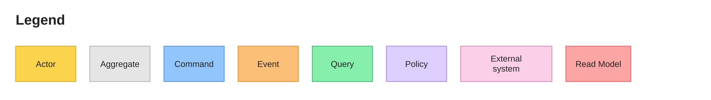
<figcaption style="font-size:0.9em;color:#555;margin-top:0.4em"><em>Legend — notación de colores empleada en el Event Storming.</em></figcaption>
</figure>

**Step 1 — Unstructured Exploration.** En esta primera etapa se realizó una exploración libre de los principales eventos que pueden ocurrir dentro del dominio de FreshSense. Se identificaron conceptos relacionados con el registro de usuarios y negocios, configuración de dispositivos, ingreso y actualización de productos y lotes, recepción de telemetría, detección de desviaciones, generación de alertas, registro de mermas y elaboración de reportes.

<figure id="fig-step1" style="margin:1.5em 0;text-align:center">
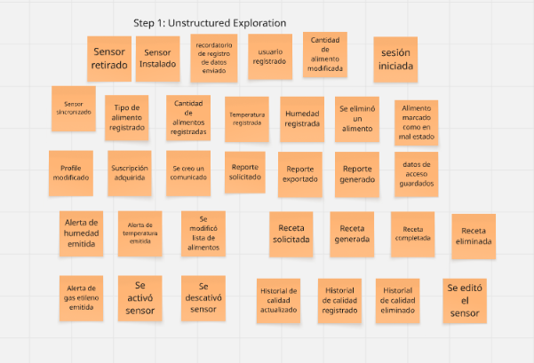
<figcaption style="font-size:0.9em;color:#555;margin-top:0.4em"><em>Step 1: Unstructured Exploration — lluvia inicial de eventos de dominio.</em></figcaption>
</figure>

**Step 2 — Timelines.** Los eventos identificados se organizaron cronológicamente para representar los principales flujos de operación de FreshSense. Estos flujos abarcan desde la configuración de usuarios, zonas y dispositivos, y el registro de productos o lotes, hasta el monitoreo continuo de temperatura y humedad, la identificación de desviaciones, la generación de alertas, el registro de mermas y la consulta de reportes.

<figure id="fig-step2" style="margin:1.5em 0;text-align:center">
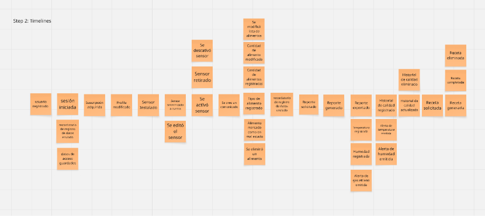
<figcaption style="font-size:0.9em;color:#555;margin-top:0.4em"><em>Step 2: Timelines — eventos ordenados cronológicamente.</em></figcaption>
</figure>

**Steps 3–5 — Actors, Commands y Aggregates preliminares.** Estas etapas se desarrollaron de manera iterativa. Se identificaron los actores que participan en los procesos de FreshSense, como propietarios, gerentes, encargados, supervisores y colaboradores del negocio; los comandos ejecutados por dichos actores o por los dispositivos IoT; y los aggregates preliminares responsables de mantener la consistencia de las principales reglas del dominio. El resultado consolidado de estas etapas se refleja en los siguientes pasos.

**Step 6 — Policies.** Se identificaron las políticas de dominio que permiten reaccionar automáticamente ante determinados eventos. Estas políticas siguen relaciones del tipo *“cuando ocurre X, entonces se ejecuta Y”*. Por ejemplo, cuando una lectura recibida desde un dispositivo supera los umbrales configurados para una zona de conservación, el sistema evalúa la desviación y, si corresponde, genera una alerta dirigida al personal responsable.

<figure id="fig-step6" style="margin:1.5em 0;text-align:center">
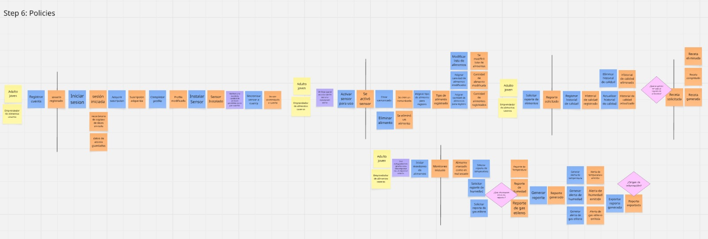
<figcaption style="font-size:0.9em;color:#555;margin-top:0.4em"><em>Step 6: Policies del dominio FreshSense.</em></figcaption>
</figure>

**Step 7 — Read Models.** Se identificaron las vistas de consulta necesarias para que los diferentes usuarios puedan supervisar la operación del negocio. Entre los principales read models se encuentran el inventario y sus lotes, el estado de las zonas y dispositivos, el historial de lecturas de temperatura y humedad, las alertas e incidencias registradas, las mermas y los reportes operativos y económicos.

<figure id="fig-step7" style="margin:1.5em 0;text-align:center">
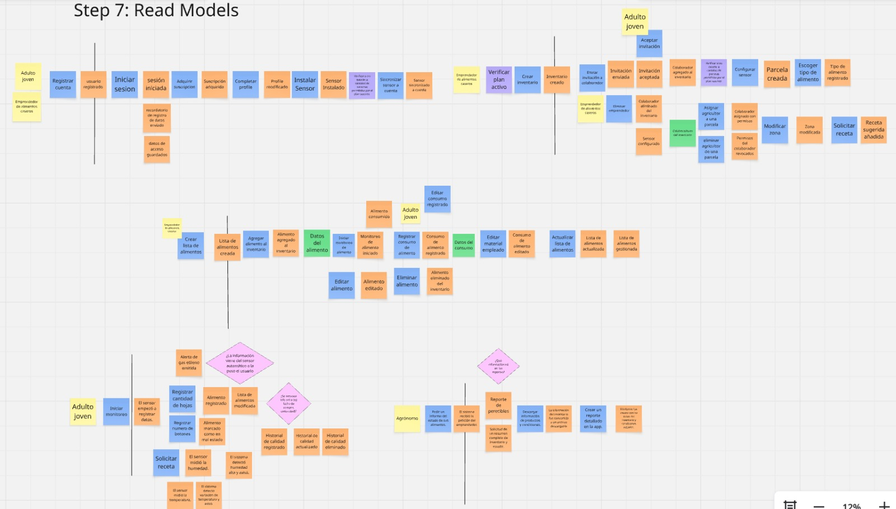
<figcaption style="font-size:0.9em;color:#555;margin-top:0.4em"><em>Step 7: Read Models identificados.</em></figcaption>
</figure>

**Step 8 — External Systems.** Se identificaron los sistemas externos que interactúan con FreshSense. El principal sistema externo es el **Dispositivo FreshSense**, encargado de recopilar y transmitir las condiciones ambientales de las zonas de conservación. También se consideran los servicios externos de notificaciones utilizados para enviar alertas y el sistema de pagos encargado de procesar las suscripciones empresariales.

<figure id="fig-step8" style="margin:1.5em 0;text-align:center">
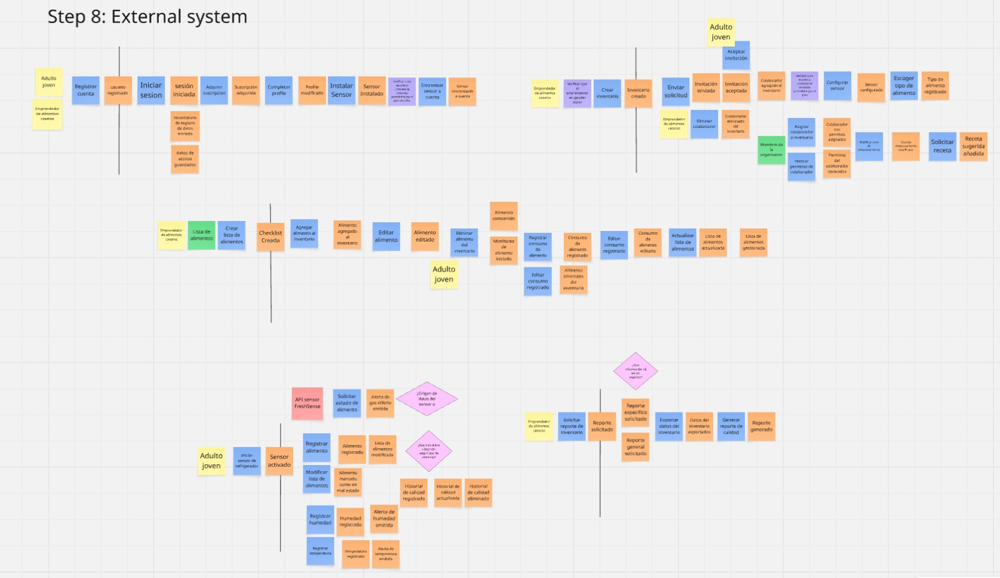
<figcaption style="font-size:0.9em;color:#555;margin-top:0.4em"><em>Step 8: External Systems del dominio.</em></figcaption>
</figure>

**Step 9 — Aggregates.** A partir de los comandos, eventos y reglas identificados, se establecieron ocho aggregates candidatos que representan las principales unidades de consistencia del dominio: `User`, `Organization`, `Subscription`, `SensorDevice`, `Inventory/Lot`, `Operation/Waste`, `Monitoring/Alert` y `Report`.

Estos aggregates concentran las reglas de negocio relacionadas con el acceso de los usuarios, la estructura de las organizaciones, las suscripciones empresariales, la configuración de los dispositivos, el inventario y sus lotes, las operaciones y mermas, el procesamiento de la telemetría y las alertas, y la generación de información consolidada para la toma de decisiones.

<figure id="fig-step9" style="margin:1.5em 0;text-align:center">
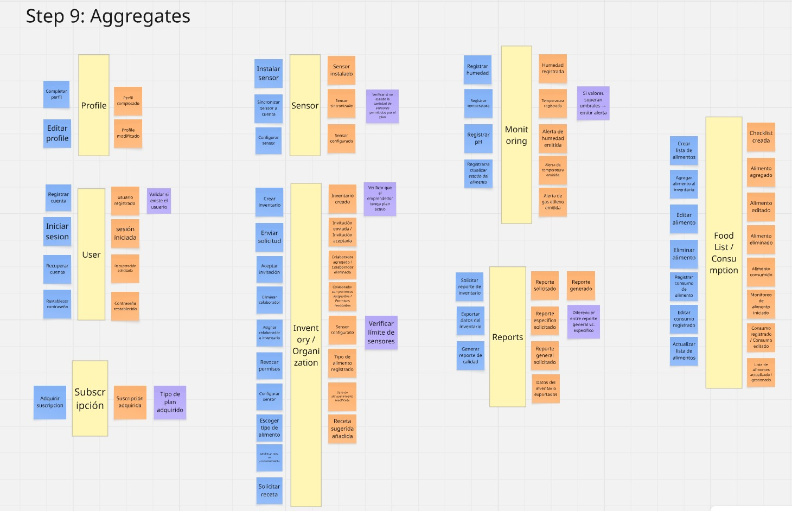
<figcaption style="font-size:0.9em;color:#555;margin-top:0.4em"><em>Step 9: Aggregates — agrupación de comandos y eventos.</em></figcaption>
</figure>

**Step 10 — Bounded Contexts.** Finalmente, los aggregates y capacidades identificadas se agruparon en ocho bounded contexts candidatos: **User Management**, **Organization Management**, **Subscription Management**, **Sensor Management**, **Inventory Management**, **Operations & Waste Management**, **IoT Monitoring & Alerting** y **Report Management**.

La separación de estas responsabilidades permite mantener límites claros entre las diferentes capacidades del dominio. Por ejemplo, la administración del hardware permanece separada del procesamiento de la telemetría, mientras que la gestión del inventario se diferencia de las operaciones que generan movimientos, consumo, rotación o merma.

Los bounded contexts obtenidos mediante este proceso constituyen la base para el Candidate Context Discovery desarrollado en la sección 4.2.2.

<figure id="fig-step10" style="margin:1.5em 0;text-align:center">
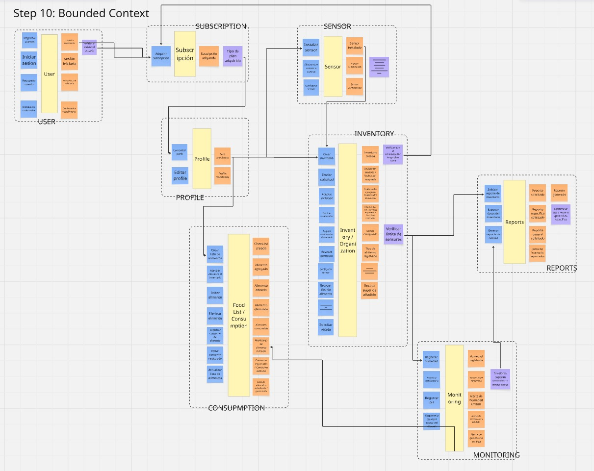
<figcaption style="font-size:0.9em;color:#555;margin-top:0.4em"><em>Step 10: Bounded Context — fronteras candidatas del dominio.</em></figcaption>
</figure>


### 4.2.2. Candidate Context Discovery

La identificación de contextos candidatos permite organizar el dominio de FreshSense en capacidades de negocio claramente delimitadas, reduciendo el acoplamiento entre responsabilidades y facilitando la evolución independiente de cada parte de la solución.

Los bounded contexts propuestos se obtienen a partir de las necesidades identificadas para los dos segmentos objetivo de FreshSense: **Propietarios y Gerentes de Restaurantes Pequeños** y **Propietarios y Encargados de Negocios de Alimentos Fríos**. Ambos segmentos requieren gestionar productos perecibles, controlar sus condiciones de conservación, recibir alertas ante situaciones de riesgo y disponer de información que permita reducir mermas y pérdidas económicas.

Asimismo, se consideran las funcionalidades definidas en las User Stories actuales del proyecto, especialmente aquellas relacionadas con autenticación y roles, gestión de colaboradores, dispositivos IoT, zonas de conservación, inventario y lotes, monitoreo de temperatura y humedad, alertas, movimientos de inventario, registro de mermas, suscripciones, facturación y generación de reportes.

A partir de este análisis, se identificaron los siguientes ocho bounded contexts candidatos:

| Bounded Context candidato | Responsabilidad principal |
|---|---|
| **User Management** | Gestiona autenticación, recuperación de credenciales y control de acceso de los usuarios de FreshSense mediante roles y permisos. |
| **Organization Management** | Gestiona la información del negocio, sus colaboradores y la relación de los usuarios con la organización a la que pertenecen. |
| **Subscription Management** | Administra las suscripciones empresariales de FreshSense, su vigencia, pagos, facturación y acceso a las funcionalidades asociadas al servicio contratado. |
| **Sensor Management** | Gestiona los dispositivos FreshSense y su asociación con las zonas de conservación del negocio, garantizando que cada dispositivo se encuentre correctamente vinculado. |
| **Inventory Management** | Gestiona productos e insumos perecibles, lotes, cantidades disponibles, categorías, fechas de vencimiento y ubicación dentro de las zonas de conservación. |
| **Operations & Waste Management** | Gestiona los movimientos que afectan las existencias del inventario y el registro de productos descartados o considerados merma, incluyendo las causas asociadas a dichas pérdidas. |
| **IoT Monitoring & Alerting** | Procesa las mediciones de temperatura y humedad recibidas desde los dispositivos FreshSense, evalúa los valores frente a los rangos configurados, identifica desviaciones y genera alertas para los responsables correspondientes. |
| **Report Management** | Consolida información histórica de inventario, movimientos, monitoreo y mermas para generar reportes de pérdidas, rotación, impacto económico y análisis orientados a la reposición de inventario. |

La separación propuesta permite distinguir las responsabilidades relacionadas con la administración del negocio de aquellas directamente vinculadas con el monitoreo y conservación de productos perecibles.

**User Management** mantiene la identidad, autenticación y autorización de los usuarios, mientras que **Organization Management** representa el negocio y la relación de sus colaboradores con FreshSense. De esta manera, la gestión de credenciales y permisos permanece separada de la estructura organizacional.

**Sensor Management** administra la vinculación de los dispositivos físicos con las zonas de conservación, mientras que **IoT Monitoring & Alerting** procesa e interpreta las mediciones de temperatura y humedad producidas por dichos dispositivos. Esta separación permite modificar el manejo de los dispositivos sin afectar directamente las reglas utilizadas para evaluar las condiciones de conservación y generar alertas.

Por otro lado, **Inventory Management** mantiene el estado de productos, lotes, cantidades, vencimientos y ubicaciones, mientras que **Operations & Waste Management** representa los movimientos que modifican las existencias y los registros relacionados con descartes y mermas. Esta separación permite mantener claramente diferenciada la información actual del inventario respecto del historial de operaciones que posteriormente puede utilizarse para análisis.

Finalmente, **Report Management** utiliza la información generada por los contextos operativos para elaborar reportes relacionados con mermas, pérdidas económicas, rotación, historial de inventario y sugerencias de reposición. **Subscription Management**, por su parte, mantiene las responsabilidades comerciales asociadas con pagos, vigencia de la suscripción y facturación sin introducir dichas reglas dentro de los contextos centrales del dominio.

Con esta distribución, FreshSense mantiene ocho bounded contexts con responsabilidades claramente diferenciadas y alineadas con las User Stories actuales, proporcionando una base consistente para el modelado de flujos de mensajes, los Bounded Context Canvases y el Context Mapping desarrollados en las siguientes secciones.

### 4.2.3. Domain Message Flows Modeling

El Domain Message Flows Modeling de FreshSense permite visualizar cómo colaboran los bounded contexts definidos en la sección anterior para resolver situaciones representativas del negocio. Para ello se utiliza la técnica de Domain Storytelling, representando mediante actores, sistemas, objetos de trabajo y actividades numeradas la secuencia de interacciones que atraviesa los límites del dominio.

Los escenarios seleccionados corresponden a procesos centrales para los dos segmentos objetivo de FreshSense: propietarios y gerentes de restaurantes pequeños, y propietarios y encargados de negocios de alimentos fríos. Los flujos permiten validar las responsabilidades asignadas a cada bounded context y verificar que la comunicación entre ellos mantenga una separación clara de responsabilidades.

<figure id="fig-notation" style="margin:1.5em 0;text-align:center">
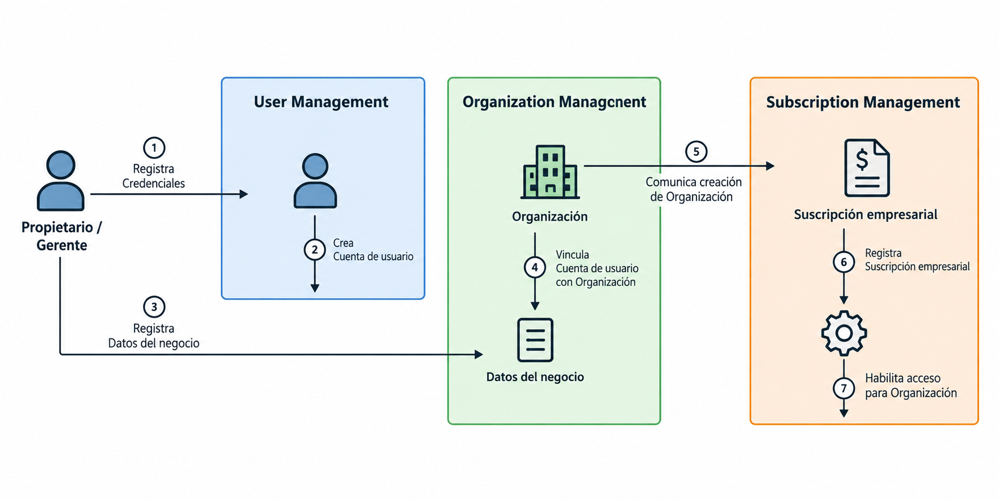
<figcaption style="font-size:0.9em;color:#555;margin-top:0.4em"><em>Notación utilizada en los Domain Message Flows.</em></figcaption>
</figure>

**Escenario 1 — Vinculación de dispositivo FreshSense con una zona de conservación.**

El flujo inicia cuando un encargado selecciona un dispositivo FreshSense y una zona de conservación registrada en su negocio. **User Management** permite verificar que el usuario posee los permisos requeridos para realizar la configuración, mientras que **Organization Management** permite identificar el negocio al cual pertenece.

Posteriormente, **Sensor Management** valida que el dispositivo pueda ser vinculado y registra la relación entre el dispositivo y la zona seleccionada. Si el dispositivo ya posee una asociación incompatible, la operación es rechazada para evitar que las futuras mediciones sean relacionadas simultáneamente con zonas diferentes.

Una vez completada la vinculación, las mediciones enviadas por el dispositivo pueden identificarse utilizando la zona correspondiente, permitiendo que **IoT Monitoring & Alerting** procese correctamente la telemetría recibida.

<figure id="fig-dmfm1" style="margin:1.5em 0;text-align:center">
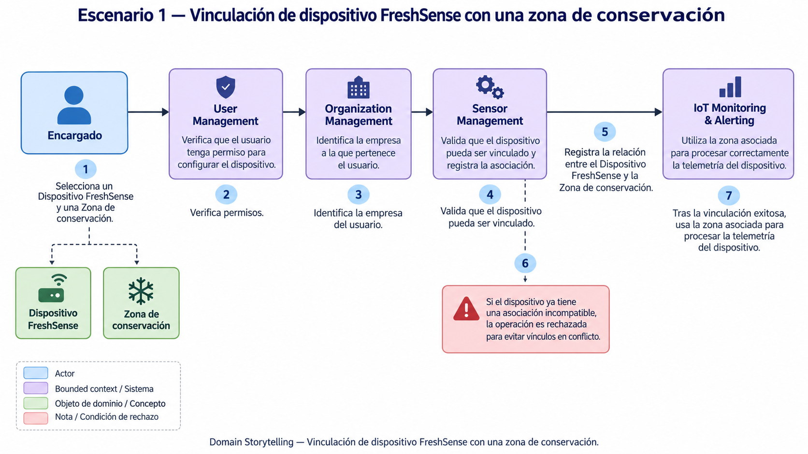
<figcaption style="font-size:0.9em;color:#555;margin-top:0.4em"><em>Domain Storytelling — Vinculación de dispositivo FreshSense con una zona de conservación.</em></figcaption>
</figure>

**Escenario 2 — Lectura del dispositivo IoT y generación de una alerta.**

El flujo comienza cuando el **Dispositivo FreshSense** obtiene una medición de temperatura y humedad y la transmite al sistema. **IoT Monitoring & Alerting** recibe la telemetría y consulta a **Sensor Management** para validar el dispositivo e identificar la zona de conservación con la que se encuentra asociado.

Con esta información, **IoT Monitoring & Alerting** evalúa las mediciones frente a los rangos establecidos. Cuando se detecta una desviación, consulta a **Inventory Management** para identificar los productos o lotes almacenados en la zona afectada. A continuación, registra la incidencia y genera una alerta dirigida a los responsables definidos para ese tipo de situación.

El servicio de procesamiento de notificaciones recibe la alerta, identifica a los responsables configurados y gestiona su distribución. Si el proveedor externo presenta una falla, la notificación permanece pendiente para un intento posterior.

Este flujo permite detectar oportunamente condiciones de temperatura o humedad que puedan comprometer productos perecibles y relacionar una incidencia ambiental con el inventario potencialmente afectado.

<figure id="fig-dmfm2" style="margin:1.5em 0;text-align:center">
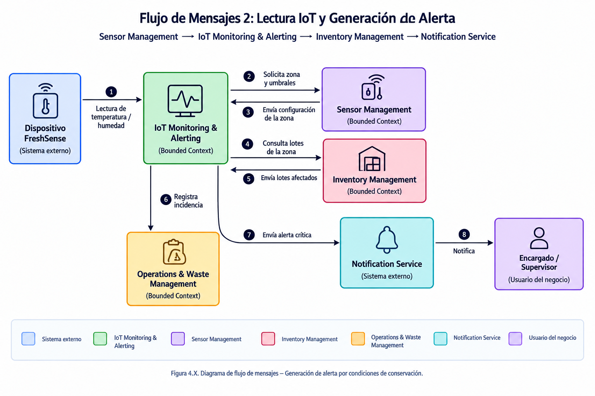
<figcaption style="font-size:0.9em;color:#555;margin-top:0.4em"><em>Domain Storytelling — Lectura IoT, evaluación de condiciones y generación de alerta.</em></figcaption>
</figure>

**Escenario 3 — Registro de merma y generación de reporte.**

El flujo inicia cuando un encargado identifica que un producto o lote debe ser retirado del inventario debido a una causa como vencimiento, deterioro o condiciones inadecuadas de conservación. **Inventory Management** actualiza las existencias correspondientes al producto o lote.

La operación es comunicada a **Operations & Waste Management**, que registra la merma junto con la causa indicada y la información necesaria para representar la pérdida producida. Posteriormente, **Report Management** utiliza la información histórica de inventario y mermas para consolidar indicadores relacionados con cantidades descartadas, pérdidas económicas y rotación.

Finalmente, el propietario o gerente puede solicitar el reporte correspondiente para analizar las principales causas de pérdida y apoyar decisiones relacionadas con compras, rotación y reposición de inventario.

<figure id="fig-dmfm3" style="margin:1.5em 0;text-align:center">
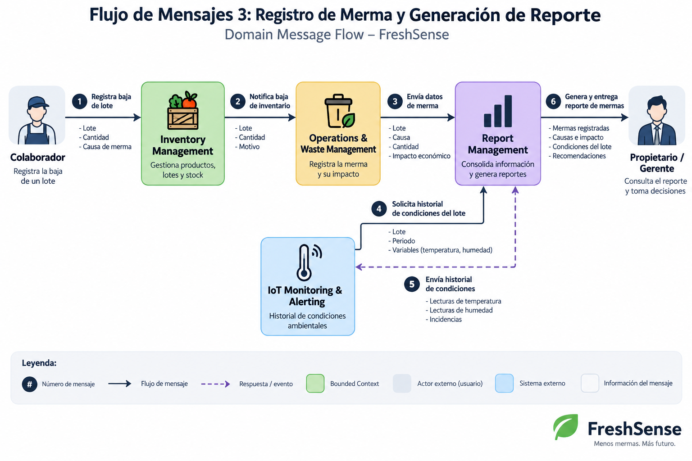
<figcaption style="font-size:0.9em;color:#555;margin-top:0.4em"><em>Domain Storytelling — Registro de merma y generación de reporte.</em></figcaption>
</figure>

Los tres escenarios permiten comprobar que los bounded contexts colaboran mediante responsabilidades claramente diferenciadas. **User Management** y **Organization Management** permiten establecer el ámbito empresarial y los permisos necesarios; **Sensor Management** e **IoT Monitoring & Alerting** administran la asociación de dispositivos y el procesamiento de telemetría; mientras que **Inventory Management**, **Operations & Waste Management** y **Report Management** gestionan las existencias, las mermas y la información utilizada para la toma de decisiones.

De esta manera, los Domain Message Flows permiten validar los límites definidos durante el Candidate Context Discovery y sirven como entrada para el diseño detallado de los Bounded Context Canvases y el Context Mapping.

### 4.2.4. Bounded Context Canvases

A partir de los bounded contexts identificados durante el Candidate Context Discovery y validados mediante los Domain Message Flows, se desarrollaron los Bounded Context Canvases de FreshSense.

Cada canvas permite detallar el propósito del contexto, su clasificación estratégica, los roles de dominio involucrados, las principales reglas de negocio, el lenguaje ubicuo, sus capabilities y las dependencias que mantiene con otros bounded contexts o sistemas externos.

El análisis se realizó de forma iterativa considerando los límites y responsabilidades de cada contexto, con el objetivo de reducir el acoplamiento, evitar la duplicación de reglas de negocio y mantener una separación clara entre las diferentes capacidades del dominio.

#### User Management

El bounded context **User Management** concentra las responsabilidades relacionadas con identidad y acceso a FreshSense, manteniendo separadas las credenciales y permisos de los usuarios de las reglas propias de la organización y de la operación del negocio.

<figure id="fig-canvas-user-management" style="margin:1.5em 0;text-align:center">
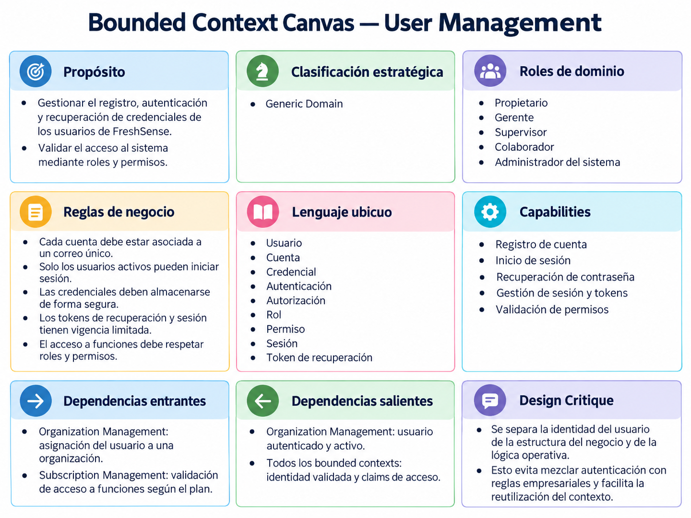
<figcaption style="font-size:0.9em;color:#555;margin-top:0.4em"><em>Bounded Context Canvas — User Management.</em></figcaption>
</figure>


#### Organization Management

El bounded context **Organization Management** representa el negocio sobre el cual opera FreshSense, incluyendo la información de la organización, sus colaboradores y la relación de los usuarios con el negocio al que pertenecen.

<figure id="fig-canvas-organization-management" style="margin:1.5em 0;text-align:center">
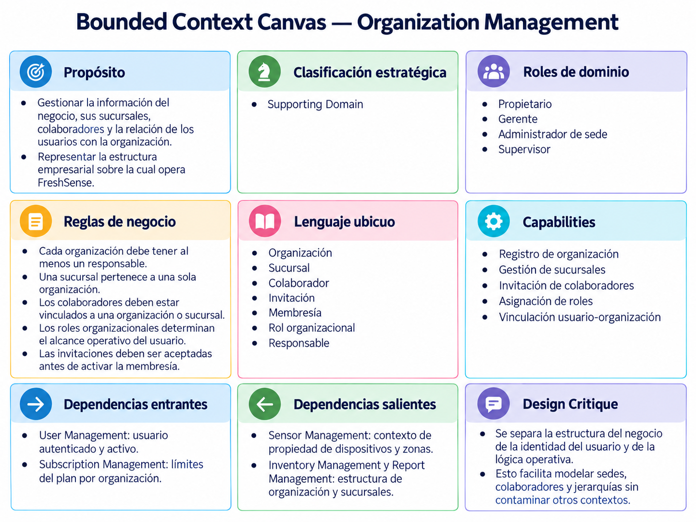
<figcaption style="font-size:0.9em;color:#555;margin-top:0.4em"><em>Bounded Context Canvas — Organization Management.</em></figcaption>
</figure>


#### Subscription Management

El bounded context **Subscription Management** administra las suscripciones empresariales de FreshSense, su vigencia, los procesos de facturación y las funcionalidades disponibles de acuerdo con el plan comercial contratado por cada organización.

<figure id="fig-canvas-subscription-management" style="margin:1.5em 0;text-align:center">
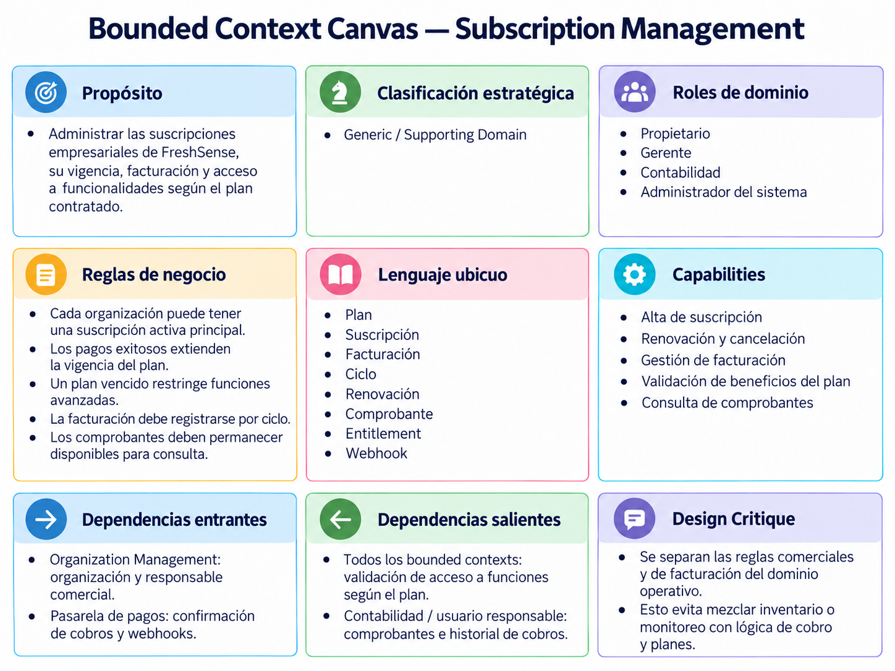
<figcaption style="font-size:0.9em;color:#555;margin-top:0.4em"><em>Bounded Context Canvas — Subscription Management.</em></figcaption>
</figure>


#### Sensor Management

El bounded context **Sensor Management** gestiona los dispositivos FreshSense y su relación con las zonas de conservación del negocio, asegurando que cada dispositivo se encuentre correctamente asociado con la zona desde la cual genera sus mediciones.

<figure id="fig-canvas-sensor-management" style="margin:1.5em 0;text-align:center">
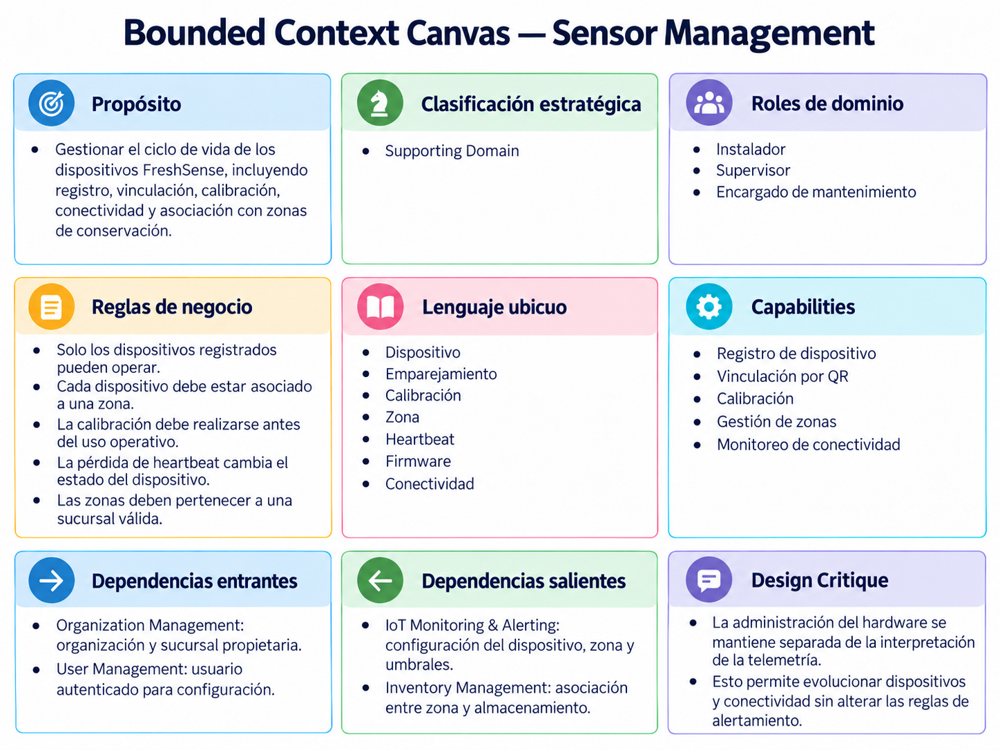
<figcaption style="font-size:0.9em;color:#555;margin-top:0.4em"><em>Bounded Context Canvas — Sensor Management.</em></figcaption>
</figure>


#### Inventory Management

El bounded context **Inventory Management** administra los productos e insumos perecibles, sus lotes, cantidades disponibles, categorías, vencimientos y ubicación dentro de las zonas de conservación del negocio.

<figure id="fig-canvas-inventory-management" style="margin:1.5em 0;text-align:center">
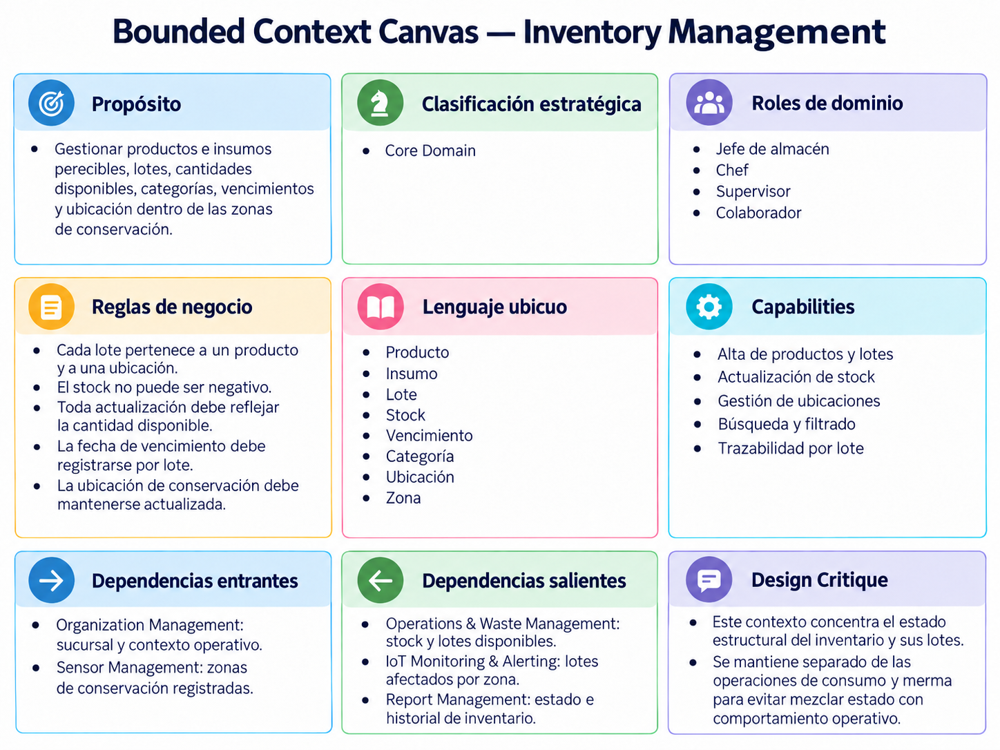
<figcaption style="font-size:0.9em;color:#555;margin-top:0.4em"><em>Bounded Context Canvas — Inventory Management.</em></figcaption>
</figure>


#### Operations & Waste Management

El bounded context **Operations & Waste Management** representa las operaciones que modifican las existencias durante la actividad diaria del negocio y el registro de productos descartados o considerados merma, incluyendo la causa asociada con cada pérdida.

<figure id="fig-canvas-operations-waste-management" style="margin:1.5em 0;text-align:center">
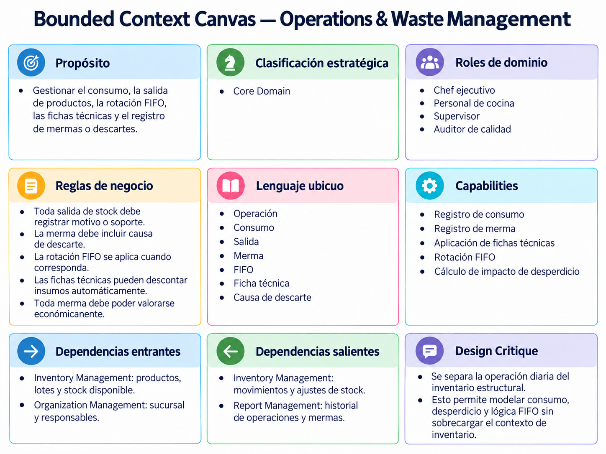
<figcaption style="font-size:0.9em;color:#555;margin-top:0.4em"><em>Bounded Context Canvas — Operations & Waste Management.</em></figcaption>
</figure>


#### IoT Monitoring & Alerting

El bounded context **IoT Monitoring & Alerting** procesa las lecturas provenientes de los dispositivos FreshSense, evalúa las condiciones ambientales frente a los umbrales configurados, identifica incidencias y genera alertas cuando existe un riesgo para la conservación de los productos.

<figure id="fig-canvas-iot-monitoring-alerting" style="margin:1.5em 0;text-align:center">
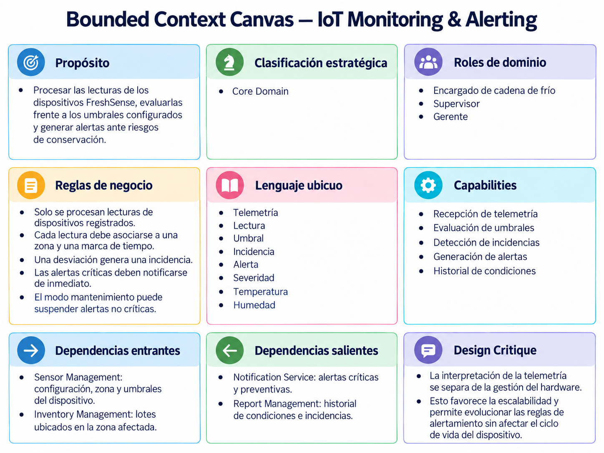
<figcaption style="font-size:0.9em;color:#555;margin-top:0.4em"><em>Bounded Context Canvas — IoT Monitoring & Alerting.</em></figcaption>
</figure>


#### Report Management

El bounded context **Report Management** consolida la información histórica generada por los diferentes contextos de FreshSense para elaborar reportes relacionados con inventario, mermas, pérdidas económicas, rotación e información utilizada para apoyar decisiones de reposición.

<figure id="fig-canvas-report-management" style="margin:1.5em 0;text-align:center">
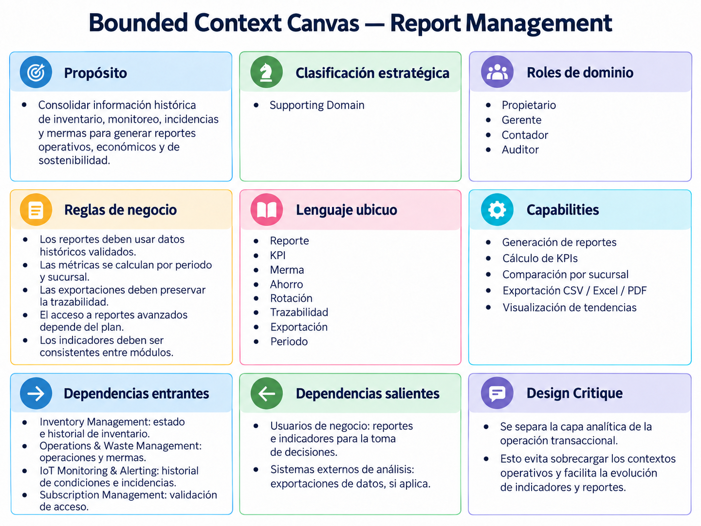
<figcaption style="font-size:0.9em;color:#555;margin-top:0.4em"><em>Bounded Context Canvas — Report Management.</em></figcaption>
</figure>

En conjunto, los Bounded Context Canvases permiten precisar las responsabilidades internas de cada contexto y visualizar las dependencias necesarias para la colaboración entre ellos. Esta definición sirve como base para establecer posteriormente las relaciones estructurales que se representan en el Context Mapping de FreshSense.


### 4.2.5. Context Mapping

En esta sección se analiza la relación entre los bounded contexts identificados para FreshSense y se proponen distintas alternativas de Context Mapping. El objetivo es evaluar diferentes formas de distribuir las responsabilidades del dominio, reducir dependencias innecesarias y mantener aisladas las capacidades principales de la solución.

Para el análisis se consideran los ocho bounded contexts definidos previamente: **User Management**, **Organization Management**, **Subscription Management**, **Sensor Management**, **Inventory Management**, **Operations & Waste Management**, **IoT Monitoring & Alerting** y **Report Management**.

Durante el proceso se evaluaron alternativas relacionadas con la agrupación o separación de responsabilidades, especialmente en aquellas áreas donde existe una colaboración estrecha, como la gestión de dispositivos y el monitoreo IoT, así como la gestión del inventario y las operaciones que modifican sus existencias.

Asimismo, se consideraron patrones de relación de Domain-Driven Design como **Customer/Supplier**, **Anti-corruption Layer**, **Conformist** y **Shared Kernel**, buscando mantener una comunicación clara entre bounded contexts sin introducir dependencias innecesarias.


#### Opción 1 — Contextos completamente separados

La primera alternativa mantiene los ocho bounded contexts como unidades independientes, estableciendo relaciones explícitas entre ellos.

En esta propuesta:

- **User Management** proporciona la identidad autenticada y la información necesaria para validar los permisos de los usuarios.
- **Organization Management** proporciona la información del negocio y sus colaboradores a los contextos que necesitan determinar el ámbito organizacional de una operación.
- **Subscription Management** administra independientemente la vigencia de la suscripción, pagos y facturación.
- **Sensor Management** administra los dispositivos y su vinculación con las zonas de conservación, proporcionando dicha información a **IoT Monitoring & Alerting**.
- **Inventory Management** mantiene la información de productos, lotes, cantidades, vencimientos y ubicación utilizada por **Operations & Waste Management**, **IoT Monitoring & Alerting** y **Report Management**.
- **Operations & Waste Management** registra movimientos que afectan las existencias y las mermas, proporcionando su historial a **Report Management**.
- **IoT Monitoring & Alerting** procesa las mediciones de temperatura y humedad y proporciona el historial de condiciones, incidencias y alertas a **Report Management**.
- **Report Management** consolida la información histórica recibida para elaborar reportes y análisis.

Esta alternativa presenta como principal ventaja una separación clara de responsabilidades y una alta independencia entre los contextos. Sin embargo, incrementa la cantidad de comunicaciones necesarias y puede generar mayor complejidad de integración entre módulos que colaboran frecuentemente.

<figure id="fig-cmo1" style="margin:1.5em 0;text-align:center">
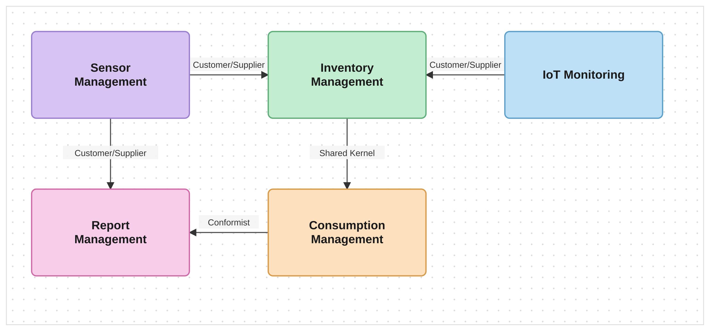
<figcaption style="font-size:0.9em;color:#555;margin-top:0.4em"><em>Opción 1 — ocho bounded contexts completamente separados.</em></figcaption>
</figure>


#### Opción 2 — Integración de gestión de sensores y monitoreo IoT

La segunda alternativa propone fusionar **Sensor Management** e **IoT Monitoring & Alerting** en un único bounded context.

Esta decisión permitiría concentrar en un solo contexto la vinculación de dispositivos con zonas, la recepción de telemetría, la evaluación de los rangos configurados y la generación de alertas. De esta manera, se reduciría la comunicación entre ambos módulos y se simplificaría el flujo de procesamiento de las mediciones.

Sin embargo, esta alternativa combina dos responsabilidades diferentes: por un lado, la administración y asociación de los dispositivos físicos y, por otro, la interpretación de las mediciones y aplicación de las reglas relacionadas con las condiciones de conservación.

La principal desventaja es que el contexto resultante tendría una responsabilidad demasiado amplia. Además, cambios relacionados con los dispositivos podrían afectar directamente las reglas utilizadas para procesar la telemetría y generar alertas.

Por esta razón, aunque la alternativa reduce la cantidad de comunicaciones entre contextos, incrementa el acoplamiento entre la gestión del dispositivo IoT y las reglas centrales de monitoreo.

<figure id="fig-cmo2" style="margin:1.5em 0;text-align:center">
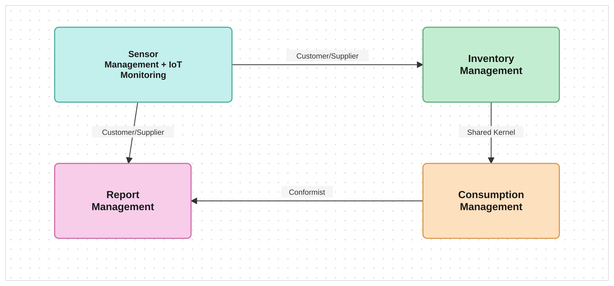
<figcaption style="font-size:0.9em;color:#555;margin-top:0.4em"><em>Opción 2 — Sensor Management e IoT Monitoring & Alerting integrados.</em></figcaption>
</figure>


#### Opción 3 — Separación de Core Domains y relaciones controladas

La tercera alternativa mantiene los ocho bounded contexts separados, pero define relaciones explícitas utilizando patrones de Domain-Driven Design para reducir el acoplamiento entre ellos.

En esta propuesta se establecen las siguientes relaciones principales:

- **User Management → Organization Management — Customer/Supplier:** User Management proporciona la identidad y permisos del usuario, mientras Organization Management utiliza esta información para relacionarlo con el negocio correspondiente.

- **Organization Management → Sensor Management — Customer/Supplier:** Organization Management proporciona la identidad del negocio necesaria para gestionar sus dispositivos y zonas de conservación.

- **Organization Management → Inventory Management — Customer/Supplier:** Inventory Management utiliza la información del negocio para asociar productos, lotes e inventario con la organización correspondiente.

- **Organization Management → Subscription Management — Customer/Supplier:** Subscription Management utiliza la identidad del negocio para administrar la vigencia de la suscripción, pagos y facturación.

- **Sensor Management → IoT Monitoring & Alerting — Anti-corruption Layer:** IoT Monitoring & Alerting utiliza una capa de traducción para recibir la identificación del dispositivo y la zona asociada sin depender directamente de los detalles internos utilizados por Sensor Management.

- **Inventory Management ↔ Operations & Waste Management — Shared Kernel:** ambos contextos comparten únicamente conceptos esenciales como `ProductId`, `LotId`, `Quantity` y referencias de inventario. Este conjunto reducido permite mantener consistencia cuando una operación modifica las existencias o registra una merma.

- **Inventory Management → IoT Monitoring & Alerting — Customer/Supplier:** IoT Monitoring & Alerting utiliza la ubicación de productos y lotes para determinar qué elementos podrían encontrarse afectados cuando se detecta una desviación en una zona de conservación.

- **Inventory Management → Report Management — Conformist:** Report Management consume la información histórica disponible sobre productos, lotes y movimientos utilizando el modelo publicado por Inventory Management.

- **Operations & Waste Management → Report Management — Conformist:** Report Management utiliza los movimientos y registros de merma para calcular indicadores relacionados con pérdidas y rotación.

- **IoT Monitoring & Alerting → Report Management — Conformist:** Report Management consume el historial de mediciones, incidencias y alertas para complementar los análisis relacionados con las condiciones de conservación.

Esta alternativa mantiene separados los contextos principales de FreshSense, pero establece mecanismos controlados de colaboración. De esta manera, las capacidades centrales relacionadas con inventario, monitoreo y reducción de mermas pueden evolucionar sin quedar fuertemente acopladas a las funciones de autenticación, organización, suscripción o facturación.

<figure id="fig-cmo3" style="margin:1.5em 0;text-align:center">
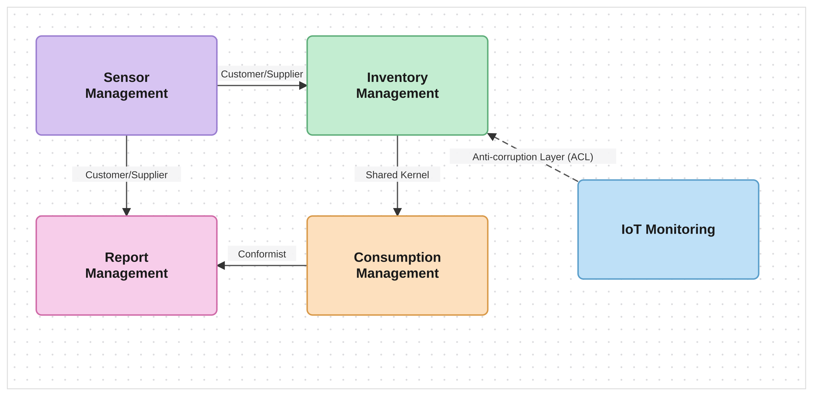
<figcaption style="font-size:0.9em;color:#555;margin-top:0.4em"><em>Opción 3 — bounded contexts separados mediante patrones DDD.</em></figcaption>
</figure>


#### Elección de la alternativa

Se seleccionó la **Opción 3**, ya que proporciona un equilibrio adecuado entre separación de responsabilidades, mantenibilidad y capacidad de evolución del sistema.

La solución mantiene como capacidades centrales **Inventory Management**, **Operations & Waste Management** e **IoT Monitoring & Alerting**, ya que estos contextos concentran las funcionalidades directamente relacionadas con la propuesta de valor de FreshSense: controlar productos perecibles, monitorear sus condiciones de conservación y reducir las pérdidas producidas por deterioro o merma.

Asimismo, mantener **Sensor Management** separado de **IoT Monitoring & Alerting** permite desacoplar la administración de los dispositivos de las reglas encargadas de interpretar sus mediciones. El uso de una **Anti-corruption Layer** evita que cambios en la representación de los dispositivos se propaguen hacia las reglas centrales del dominio.

La relación de **Shared Kernel** entre Inventory Management y Operations & Waste Management se limita a conceptos esenciales asociados con productos, lotes y cantidades, evitando compartir reglas de negocio completas entre ambos contextos.

Por otro lado, **Report Management** se mantiene como un contexto independiente encargado de utilizar información generada por los contextos operativos para producir análisis de mermas, pérdidas, rotación e información útil para la reposición de inventario.

Finalmente, **User Management**, **Organization Management** y **Subscription Management** proporcionan capacidades de soporte necesarias para el funcionamiento empresarial de FreshSense, manteniendo sus reglas separadas de los contextos centrales del dominio.

El siguiente Context Map consolidado representa la estructura seleccionada y las relaciones existentes entre los ocho bounded contexts de FreshSense.

<figure id="fig-cmap" style="margin:1.5em 0;text-align:center">
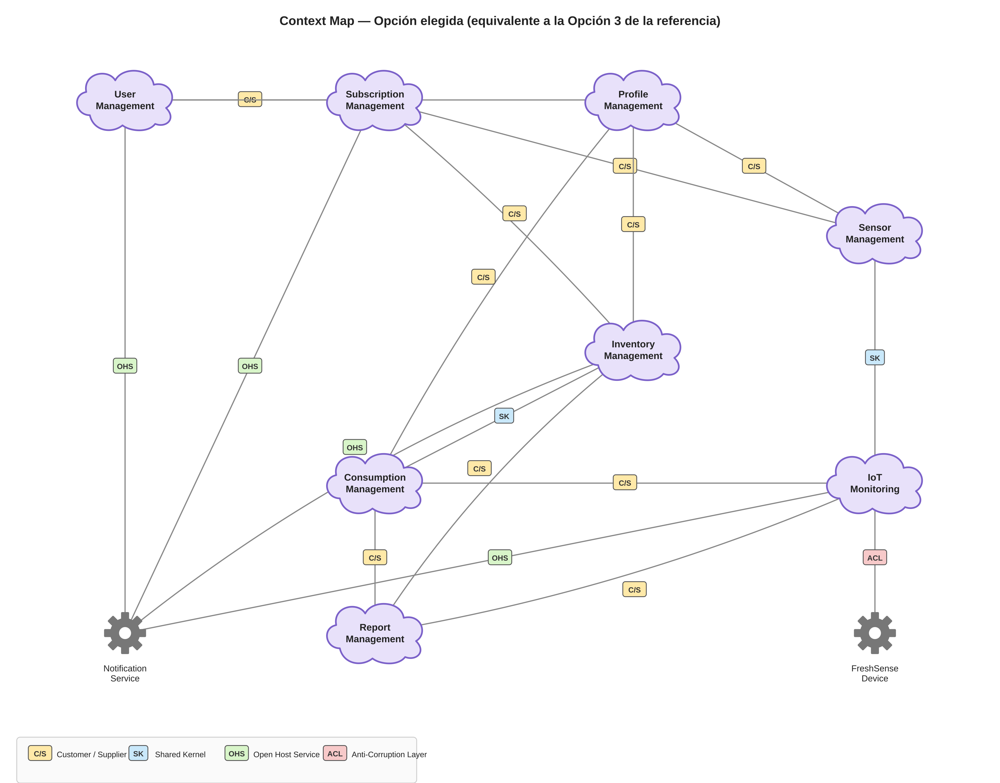
<figcaption style="font-size:0.9em;color:#555;margin-top:0.4em"><em>Context Map consolidado — ocho bounded contexts de FreshSense.</em></figcaption>
</figure>


## 4.3. Software Architecture

La arquitectura de software de FreshSense se representa utilizando el modelo C4, permitiendo describir progresivamente la solución desde una perspectiva general del ecosistema hasta la distribución de sus principales elementos de software.

A partir de las decisiones obtenidas mediante Attribute-Driven Design y de los bounded contexts identificados mediante Domain-Driven Design, la arquitectura busca mantener una separación clara entre las capacidades del negocio, los componentes responsables del procesamiento IoT y las integraciones con servicios externos.

En las siguientes secciones se presentan el System Landscape Diagram, el Context Level Diagram, el Container Level Diagram y el Deployment Diagram de FreshSense.


### 4.3.1. Software Architecture System Landscape Diagram

El System Landscape Diagram presenta una vista general del ecosistema en el que opera FreshSense. En este nivel se representa la plataforma como un único sistema de software y se identifican los principales tipos de usuario y sistemas externos con los que mantiene interacción.

Los usuarios de FreshSense se agrupan en tres actores principales. El **Visitante interesado** representa a potenciales clientes pertenecientes a los segmentos de restaurantes pequeños y negocios de alimentos fríos, quienes pueden consultar la propuesta de valor de FreshSense y solicitar contacto o una demostración.

El **Propietario, Gerente o Administrador** representa a los responsables de la gestión del negocio. Este actor utiliza FreshSense para supervisar productos, inventario, zonas de conservación, dispositivos IoT, alertas, colaboradores, reportes y aspectos relacionados con la suscripción.

El **Encargado o Colaborador** representa a los usuarios que realizan actividades operativas dentro del negocio. Dependiendo de los permisos asignados, estos usuarios pueden registrar y actualizar productos, consultar información del inventario, registrar mermas y atender las alertas generadas por la plataforma.

FreshSense también interactúa con el **FreshSense IoT Device**, dispositivo físico instalado en las zonas de conservación del negocio. Este dispositivo obtiene mediciones de temperatura y humedad y las transmite hacia la plataforma para su almacenamiento y procesamiento.

Por otro lado, la plataforma se integra con un **Notification Provider**, utilizado para distribuir las alertas generadas por FreshSense hacia los responsables configurados. Esta integración se mantiene separada del dominio principal para permitir que una falla temporal del proveedor no provoque la pérdida de una alerta pendiente.

Finalmente, FreshSense interactúa con un **Payment Provider**, encargado de procesar los pagos asociados con las suscripciones empresariales. El proveedor comunica a FreshSense el resultado de las operaciones realizadas para que la plataforma pueda mantener actualizado el estado de la suscripción y la información de facturación correspondiente.

El siguiente diagrama representa estas relaciones dentro del ecosistema general de FreshSense.

<figure id="fig-system-landscape" style="margin:1.5em 0;text-align:center">
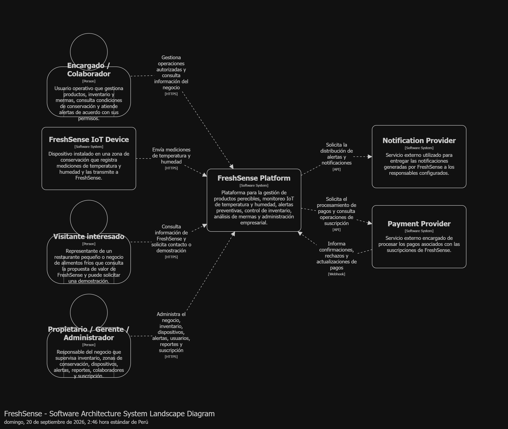
<figcaption style="font-size:0.9em;color:#555;margin-top:0.4em"><em>Software Architecture System Landscape Diagram — FreshSense.</em></figcaption>
</figure>

Esta vista permite identificar los límites generales de FreshSense antes de profundizar en su estructura interna. En el siguiente nivel se desarrolla el Software Architecture Context Level Diagram, donde se detallan las relaciones existentes entre FreshSense, sus usuarios y los sistemas externos que participan directamente en sus principales casos de uso.

### 4.3.2. Software Architecture Context Level Diagrams

El Software Architecture Context Level Diagram de FreshSense presenta el sistema como una única unidad de software y establece su límite respecto de los usuarios y sistemas externos con los que interactúa directamente.

Esta vista permite identificar las responsabilidades que pertenecen a FreshSense y aquellas que son delegadas a servicios externos, sin representar todavía los detalles internos de implementación, bounded contexts, containers o tecnologías específicas.

FreshSense posee tres tipos principales de actores humanos. El **Visitante interesado** interactúa con la plataforma para conocer la propuesta de valor de la solución y solicitar contacto o una demostración comercial. Este actor todavía no forma parte de una organización registrada dentro de FreshSense.

El **Propietario, Gerente o Administrador** representa al usuario responsable de la gestión del negocio. Este actor puede administrar información relacionada con productos, inventario, zonas de conservación, dispositivos FreshSense, alertas, colaboradores, roles, reportes y aspectos asociados con la suscripción del servicio.

El **Encargado o Colaborador** representa al personal que participa en las actividades operativas del negocio. Las acciones disponibles para este actor dependen de los roles y permisos configurados. Entre sus posibles responsabilidades se encuentran registrar y actualizar productos, consultar el inventario, revisar las condiciones de conservación, registrar mermas y atender alertas.

Además de los actores humanos, FreshSense interactúa directamente con el **FreshSense IoT Device**. Cada dispositivo se encuentra asociado con una zona de conservación y registra mediciones de temperatura y humedad. Estas mediciones son enviadas hacia FreshSense para ser almacenadas y posteriormente utilizadas en el análisis de las condiciones de conservación.

Cuando una medición se encuentra fuera de los rangos definidos, FreshSense puede generar una alerta. La distribución de dicha alerta se realiza mediante un **Notification Provider** externo. FreshSense determina la información que debe ser comunicada y los responsables correspondientes, mientras que el proveedor externo se encarga de efectuar la entrega de la notificación.

Finalmente, el sistema se integra con un **Payment Provider** para procesar las operaciones relacionadas con las suscripciones. FreshSense envía las solicitudes necesarias al proveedor y recibe posteriormente información relacionada con confirmaciones, rechazos o actualizaciones de las transacciones. Esta información es utilizada para mantener consistente el estado de la suscripción y la facturación del negocio.

El siguiente diagrama representa el límite del sistema FreshSense y sus interacciones directas con usuarios y sistemas externos.

<figure id="fig-c4-context" style="margin:1.5em 0;text-align:center">
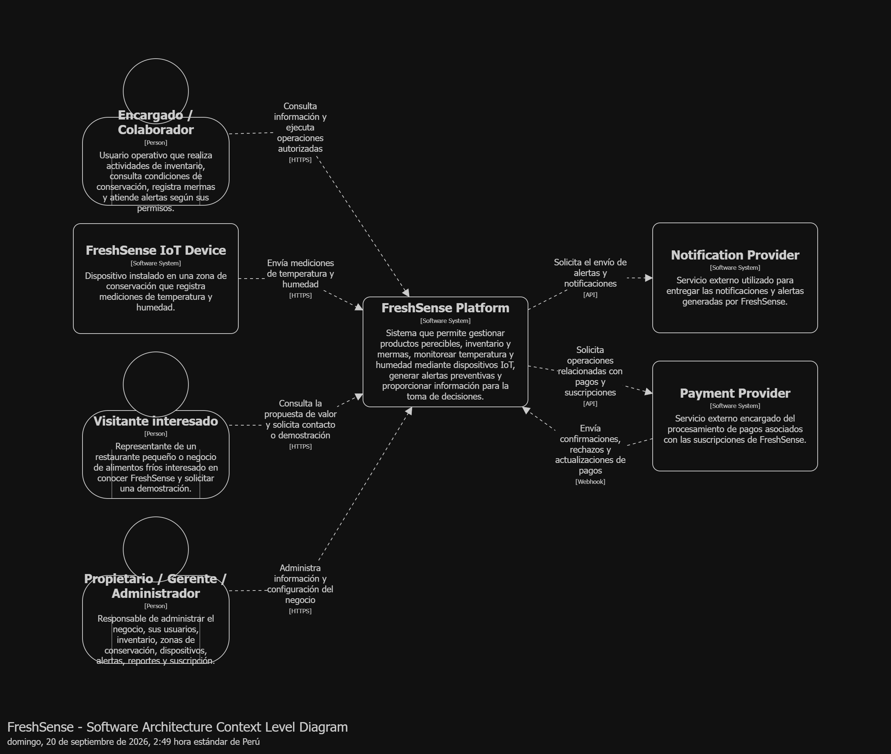
<figcaption style="font-size:0.9em;color:#555;margin-top:0.4em"><em>Software Architecture Context Level Diagram — FreshSense.</em></figcaption>
</figure>

El Context Level Diagram establece que las responsabilidades relacionadas con inventario, monitoreo, alertas, usuarios, reportes y suscripciones pertenecen al límite de **FreshSense Platform**, mientras que la adquisición física de las mediciones, la entrega final de las notificaciones y el procesamiento externo de los pagos corresponden a sistemas independientes.

En el siguiente nivel de la arquitectura se descompone FreshSense Platform en sus principales containers, permitiendo identificar cómo se distribuyen estas responsabilidades y qué mecanismos de comunicación se utilizan entre los diferentes elementos de software.

### 4.3.3. Software Architecture Container Level Diagrams

El Software Architecture Container Level Diagram profundiza en la estructura interna de **FreshSense Platform**, mostrando las principales unidades de software desplegables, sus responsabilidades, tecnologías y mecanismos de comunicación.

La arquitectura propuesta toma como base las decisiones obtenidas mediante Attribute-Driven Design. El dominio principal se implementa mediante un **Modular Monolith**, mientras que las capacidades que presentan necesidades particulares de integración o procesamiento asíncrono, como la ingesta IoT y la distribución de notificaciones, se mantienen como containers especializados.

La solución está compuesta por los siguientes containers principales:

| Container | Tecnología | Responsabilidad |
|---|---|---|
| **Landing Page** | HTML, CSS, JavaScript | Presenta la propuesta de valor de FreshSense y permite que los potenciales clientes soliciten contacto o una demostración. |
| **Web Application** | Angular 19, Angular Material | Proporciona la interfaz utilizada por propietarios, administradores y colaboradores para interactuar con las funcionalidades de FreshSense. |
| **Backend API** | Spring Boot, Java 24, REST, OpenAPI | Implementa las reglas del negocio y organiza el dominio mediante los ocho bounded contexts definidos para FreshSense. |
| **IoT Ingestion Service** | Spring Boot, Java 24 | Recibe, autentica y valida las mediciones de temperatura y humedad provenientes de los dispositivos FreshSense antes de incorporarlas al flujo de procesamiento. |
| **Message Broker** | RabbitMQ | Permite la comunicación asíncrona entre productores y consumidores de telemetría y alertas, reduciendo el acoplamiento entre componentes. |
| **Notification Worker** | Spring Boot, Java 24 | Procesa los eventos de notificación y administra los intentos de envío cuando existen fallas temporales del proveedor externo. |
| **Operational Database** | MySQL | Mantiene la información persistente de usuarios, organizaciones, suscripciones, dispositivos, zonas, inventario, mediciones, alertas, mermas y demás información transaccional. |
| **Distributed Cache** | Redis | Mantiene temporalmente resultados de consultas frecuentes para reducir el procesamiento repetitivo y mejorar el rendimiento de la aplicación. |

El **Backend API** constituye el núcleo de la aplicación y se implementa siguiendo un enfoque de **Modular Monolith**. Internamente se encuentra dividido de acuerdo con los ocho bounded contexts establecidos durante el diseño estratégico:

- **User Management**
- **Organization Management**
- **Subscription Management**
- **Sensor Management**
- **Inventory Management**
- **Operations & Waste Management**
- **IoT Monitoring & Alerting**
- **Report Management**

Estos contextos mantienen límites lógicos y responsabilidades diferenciadas dentro del mismo container, reduciendo la complejidad operacional inicial sin perder la separación definida mediante Domain-Driven Design.

La comunicación entre la **Web Application** y el **Backend API** utiliza operaciones REST sobre HTTPS. Este mecanismo se utiliza para las funcionalidades tradicionales de consulta y modificación de información, como inventario, usuarios, dispositivos, zonas, mermas, reportes y suscripciones.

El procesamiento de telemetría sigue un flujo diferente. El **FreshSense IoT Device**, considerado un sistema externo al límite de FreshSense Platform, envía mediciones de temperatura y humedad hacia el **IoT Ingestion Service**. Este servicio valida la identidad del dispositivo y la estructura de la medición antes de publicar la información aceptada en el **Message Broker**.

El **Message Broker** permite desacoplar al productor de telemetría de los componentes responsables de su procesamiento. El módulo **IoT Monitoring & Alerting**, implementado dentro del Backend API, consume los eventos correspondientes, registra las mediciones y evalúa sus valores frente a los rangos configurados para cada zona de conservación.

Cuando se identifica una condición fuera de rango, el Backend API genera un evento de alerta y lo publica nuevamente en el Message Broker. El **Notification Worker** consume dicho evento y solicita al **Notification Provider** externo la entrega de la notificación. Si el proveedor presenta una falla temporal, el Worker puede mantener la notificación pendiente y aplicar mecanismos de reintento.

La información transaccional del sistema se mantiene en la **Operational Database**, implementada utilizando MySQL. Este almacenamiento representa la fuente persistente de información utilizada por los bounded contexts.

Para aquellas consultas que presentan una elevada frecuencia de uso, FreshSense incorpora un **Distributed Cache** implementado mediante Redis. La utilización del caché no sustituye a la base de datos como fuente de verdad; cuando la información relacionada cambia, el Backend API debe actualizar o invalidar las entradas temporales correspondientes.

Finalmente, **Subscription Management**, dentro del Backend API, se comunica con el **Payment Provider** externo para procesar las operaciones relacionadas con la suscripción. Las confirmaciones o rechazos enviados posteriormente por el proveedor son procesados de manera idempotente para evitar que una misma notificación produzca múltiples modificaciones sobre la suscripción.

El siguiente diagrama representa la distribución de estas responsabilidades y las principales relaciones entre los containers y sistemas externos de FreshSense.

<figure id="fig-c4-container" style="margin:1.5em 0;text-align:center">
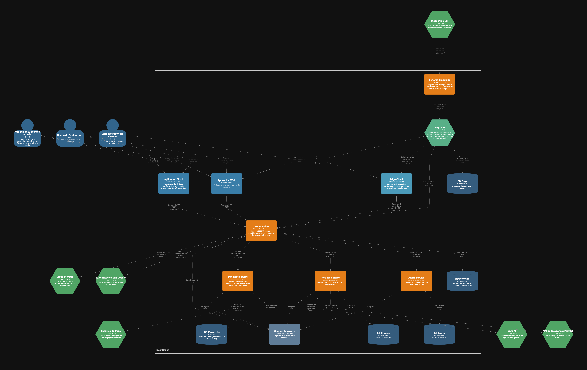
<figcaption style="font-size:0.9em;color:#555;margin-top:0.4em"><em>Software Architecture Container Level Diagram — FreshSense.</em></figcaption>
</figure>

Esta organización permite mantener las funcionalidades centrales del dominio dentro de una estructura modular, mientras que las responsabilidades con características técnicas diferentes, como la ingesta de telemetría y el procesamiento de notificaciones, pueden escalar y evolucionar de manera independiente.

El siguiente nivel describe cómo estos containers son desplegados sobre la infraestructura física y cloud utilizada por FreshSense.

### 4.3.4. Software Architecture Deployment Diagrams

El Software Architecture Deployment Diagram representa la distribución física y lógica de los principales elementos de FreshSense sobre los diferentes entornos de ejecución utilizados por la solución.

La arquitectura se distribuye principalmente entre los **dispositivos utilizados por los usuarios**, el **entorno IoT instalado en las zonas de conservación** y la **infraestructura cloud** donde se ejecutan los servicios principales de FreshSense.

En el entorno del usuario, propietarios, gerentes, administradores y colaboradores acceden a FreshSense mediante un navegador web desde computadoras, tablets o dispositivos móviles. Desde estos dispositivos se carga la aplicación web y se realizan las operaciones correspondientes según los permisos asignados al usuario.

En las zonas de conservación se encuentra instalado el **FreshSense IoT Device**, compuesto por el hardware de sensores y el sistema embebido responsable de obtener mediciones de **temperatura y humedad**. El dispositivo mantiene una relación con la zona de conservación configurada y transmite periódicamente las mediciones hacia la infraestructura backend de FreshSense utilizando una conexión segura.

La infraestructura cloud aloja los principales elementos de software de la plataforma. La **Web Application** proporciona la interfaz utilizada por los usuarios, mientras que el **Backend API** implementa las principales capacidades del dominio siguiendo la organización definida mediante los bounded contexts de FreshSense.

La recepción de las mediciones provenientes de los dispositivos IoT se realiza mediante el componente encargado de la **ingesta de telemetría**, que autentica el dispositivo, valida la información recibida y permite incorporarla al flujo de procesamiento de FreshSense.

Para los procesos que requieren comunicación asíncrona, como el procesamiento de telemetría y la generación de notificaciones, la arquitectura puede utilizar un mecanismo de mensajería que permita desacoplar los componentes productores de los consumidores correspondientes.

La información persistente de la plataforma se mantiene en la **base de datos operacional**, mientras que las consultas utilizadas frecuentemente pueden apoyarse en un mecanismo de **caché distribuida** para reducir el procesamiento repetitivo. La base de datos continúa siendo la fuente principal de información y el caché funciona únicamente como mecanismo de optimización.

Asimismo, la infraestructura se comunica con servicios externos encargados de la entrega de notificaciones y del procesamiento de pagos relacionados con las suscripciones de FreshSense.

Las comunicaciones entre los usuarios y la plataforma, así como entre FreshSense y los servicios externos, utilizan conexiones seguras mediante HTTPS. Los dispositivos IoT utilizan credenciales independientes para autenticar el envío de telemetría hacia la plataforma.

El siguiente diagrama representa la distribución de los principales elementos de FreshSense en sus respectivos entornos de ejecución.

<figure id="fig-c4d" style="margin:1.5em 0;text-align:center">
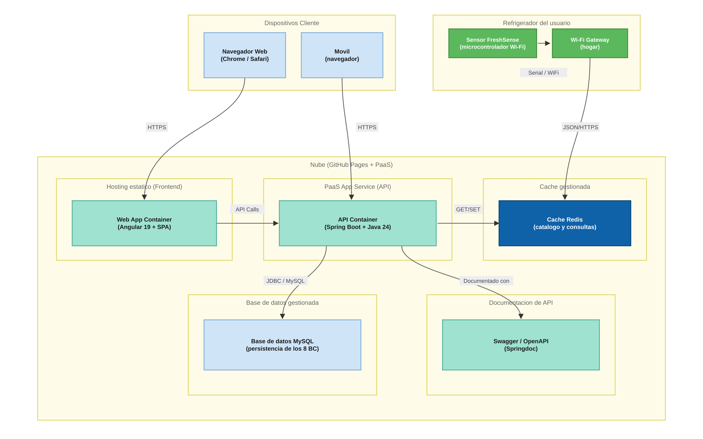
<figcaption style="font-size:0.9em;color:#555;margin-top:0.4em"><em>Software Architecture Deployment Diagram — FreshSense.</em></figcaption>
</figure>

Esta distribución permite separar el entorno físico encargado de obtener las condiciones de conservación, los dispositivos utilizados por los usuarios y la infraestructura encargada del procesamiento, almacenamiento e integración de la información. De esta manera, FreshSense puede evolucionar sus componentes de software sin depender directamente del hardware instalado y puede escalar los recursos de infraestructura de acuerdo con el crecimiento de la plataforma.


<div style="page-break-after: always;"></div>

# Capítulo V: Tactical-Level Software Design

Esta sección detalla el diseño táctico de cada uno de los ocho bounded contexts de FreshSense, siguiendo la arquitectura en capas (Domain, Interface, Application, Infrastructure) y el patrón CQS (Command/Query Separation) usado de forma consistente en todo el backend.

## 5.1. Bounded Context: User Management

El **User Management (IAM — Identity and Access Management) Bounded Context** es responsable de gestionar la autenticación y la creación de usuarios en el sistema. Este contexto asegura que los usuarios puedan registrarse, iniciar sesión y gestionar sus credenciales de manera segura, cumpliendo con los estándares de seguridad y privacidad. Implementa el control de acceso basado en roles (RBAC) con tokens JWT exigido por la **TS43**, y el flujo de recuperación de contraseña de la **US35**.

### 5.1.1. Domain Layer

La Domain Layer del User Management Bounded Context encapsula la lógica de negocio del contexto. En esta capa se definen los agregados, entidades, objetos de valor, servicios de dominio y políticas que representan los conceptos clave del sistema.

**Aggregates**

1. **User**
   - *Propósito:* Agregado raíz que representa a una persona con cuenta en FreshSense. Encapsula credenciales, datos de identidad y roles de acceso.

   - *Atributos:*

| Atributo | Tipo | Descripción |
|---|---|---|
| id | UUID | Identificador único del usuario. |
| email | Email (VO) | Correo electrónico único, usado como nombre de usuario. |
| fullName | String | Nombre completo del usuario. |
| passwordHash | PasswordHash (VO) | Contraseña almacenada con hash BCrypt (nunca en texto plano). |
| roles | Set&lt;Role&gt; | Roles asignados (ROLE_USER, ROLE_PREMIUM, ROLE_ADMIN). |
| createdAt / updatedAt | DateTime | Campos de auditoría. |
   - *Métodos:*

| Método | Descripción |
|---|---|
| User(SignUpCommand, Set&lt;Role&gt;) | Crea un usuario validando unicidad del email y la política de contraseña. |
| addRole(Role) / addRoles(List&lt;Role&gt;) | Asigna uno o varios roles válidos al usuario (US36). |
| requestPasswordReset() | Genera un `ResetToken` temporal y único para la recuperación (US35). |
| resetPassword(token, newHash) | Valida el token vigente, reemplaza el hash y lo invalida (uso único). |
| registerSignIn() | Registra el último acceso y habilita la emisión del JWT. |

**Entities**

1. **Role** — Rol que puede asignarse a un usuario para el control de acceso RBAC (TS43, US36).

| Atributo | Tipo | Descripción |
|---|---|---|
| id | UUID | Identificador del rol. |
| name | Roles (enum) | ROLE_USER, ROLE_PREMIUM o ROLE_ADMIN. |

| Método | Descripción |
|---|---|
| getDefaultRole() | Devuelve ROLE_USER. |
| toRoleFromName(String) | Convierte un nombre en instancia de Role. |
| validateRoleSet(List&lt;Role&gt;) | Asigna el rol por defecto si el conjunto es nulo o vacío. |
2. **ResetToken** — Token de un solo uso para restablecer la contraseña (US35).

| Atributo | Tipo | Descripción |
|---|---|---|
| id | UUID | Identificador. |
| tokenHash | String | Hash del token enviado por correo. |
| expiresAt | DateTime | Vencimiento del enlace de recuperación. |
| used | boolean | Indica si ya fue consumido. |

| Método | Descripción |
|---|---|
| isExpired() | Evalúa si el token venció. |
| markUsed() | Invalida el token. |
**Value Objects**

| Value Object | Descripción |
|---|---|
| Email | Encapsula y valida el formato del correo electrónico. |
| PasswordHash | Encapsula el hash BCrypt; impide exponer la contraseña en texto plano. |
| Roles | Enumeración inmutable: `ROLE_USER`, `ROLE_PREMIUM`, `ROLE_ADMIN`. |
| AccessToken | Token JWT emitido tras la autenticación, con los claims de rol (TS43). |

**Domain Services**

| Servicio | Descripción |
|---|---|
| PasswordPolicyService | Valida longitud mínima, mayúscula, minúscula y número antes de aceptar una contraseña. |
| TokenService | Genera y valida los tokens JWT que protegen los endpoints, incluidos los Premium (TS43). |

**Domain Events**

| Evento | Descripción |
|---|---|
| UserRegistered | Se creó la cuenta (ES: *cuenta registrada*). Dispara la creación del plan FREE y del perfil. |
| SessionStarted | El usuario se autenticó correctamente (ES: *sesión iniciada*). |
| PasswordResetRequested | Se solicitó el enlace de recuperación (US35). |
| PasswordReset | Se restableció la contraseña. |
| UserRoleChanged | Un administrador modificó el rol o plan del usuario (US36). |

**Policies**

- **Validar si existe el usuario**: no se permite registrar dos cuentas con el mismo email.
- **Asignar rol por defecto**: cuando se registra un usuario sin roles, el sistema le asigna automáticamente `ROLE_USER`.
- **Bloquear endpoints Premium**: cuando un JWT sin `ROLE_PREMIUM` invoca un endpoint exclusivo, el middleware responde `403 Forbidden` (TS43).

### 5.1.2. Interface Layer

La Interface Layer del User Management expone los puntos de entrada del contexto mediante controladores REST, recursos y *assemblers* que traducen entre el modelo HTTP y el modelo de dominio.

**Controllers**

1. **AuthenticationController** — Registro, inicio de sesión y recuperación de credenciales.

| Método | Endpoint | Descripción |
|---|---|---|
| POST | /api/v1/authentication/sign-up | Registra un nuevo usuario en el sistema. |
| POST | /api/v1/authentication/sign-in | Autentica al usuario y genera un token de acceso. |
| POST | /api/v1/authentication/forgot-password | Envía el enlace de restablecimiento (US35). |
| POST | /api/v1/authentication/reset-password | Restablece la contraseña con el token recibido. |
   - *Dependencias:* UserCommandService

2. **UsersController** — Gestiona las operaciones relacionadas con los usuarios.

| Método | Endpoint | Descripción |
|---|---|---|
| GET | /api/v1/users | Obtiene la lista de todos los usuarios (solo ROLE_ADMIN). |
| GET | /api/v1/users/{userId} | Obtiene los detalles de un usuario específico por su ID. |
| PATCH | /api/v1/users/{userId}/roles | Modifica los roles del usuario (US36). |
   - *Dependencias:* UserQueryService, UserCommandService

3. **RolesController** — Gestiona las consultas relacionadas con los roles.

| Método | Endpoint | Descripción |
|---|---|---|
| GET | /api/v1/roles | Obtiene la lista de todos los roles disponibles. |
   - *Dependencias:* RoleQueryService

**Resources**

| Resource | Campos |
|---|---|
| UserResource | id, email, fullName, roles |
| AuthenticatedUserResource | id, email, token (JWT) |
| SignUpResource | email, fullName, password, roles |
| SignInResource | email, password |
| ResetPasswordResource | token, newPassword |
| RoleResource | id, name |

**Transformers / Assemblers**

| Assembler | Transformación |
|---|---|
| UserResourceFromEntityAssembler | Convierte una entidad `User` en un recurso `UserResource`. |
| AuthenticatedUserResourceFromEntityAssembler | Convierte un `User` y su token en `AuthenticatedUserResource`. |
| SignUpCommandFromResourceAssembler | Convierte `SignUpResource` en el comando `SignUpCommand`. |
| SignInCommandFromResourceAssembler | Convierte `SignInResource` en el comando `SignInCommand`. |
| RoleResourceFromEntityAssembler | Convierte una entidad `Role` en un recurso `RoleResource`. |

### 5.1.3. Application Layer

La Application Layer del User Management coordina las operaciones entre la Interface Layer y la Domain Layer, orquestando comandos, consultas y la reacción a eventos de otros contextos.

**Command Services**

| Servicio | Comandos que maneja | Descripción |
|---|---|---|
| UserCommandServiceImpl | SignUpCommand, SignInCommand, RequestPasswordResetCommand, ResetPasswordCommand | Registra usuarios, autentica credenciales, emite el JWT y gestiona la recuperación de contraseña. |
| RoleCommandServiceImpl | SeedRolesCommand, AssignRoleCommand | Crea los roles predefinidos al iniciar el sistema y asigna roles a los usuarios (US36). |

**Query Services / Facades**

| Servicio | Consultas | Descripción |
|---|---|---|
| UserQueryServiceImpl | GetAllUsersQuery, GetUserByIdQuery, GetUserByEmailQuery | Recupera usuarios registrados sin modificar el estado del sistema. |
| RoleQueryServiceImpl | GetAllRolesQuery, GetRoleByNameQuery | Recupera los roles disponibles. |
| IamContextFacade | existsUserById, getRolesOf | Open Host Service que exponen los demás bounded contexts para validar identidad. |

**Event Handlers**

| Handler | Evento que escucha | Reacción |
|---|---|---|
| ApplicationReadyEventHandler | ApplicationReadyEvent (Spring Boot) | Ejecuta `SeedRolesCommand` para crear ROLE_USER, ROLE_PREMIUM y ROLE_ADMIN si no existen. |
| SubscriptionChangedEventHandler | PlanTypeAcquired (Subscription Management) | Sincroniza el rol `ROLE_PREMIUM` del usuario cuando su plan cambia. |

### 5.1.4. Infrastructure Layer

La Infrastructure Layer del User Management implementa la persistencia y las integraciones técnicas (ACL) hacia otros contextos y sistemas externos.

| Componente | Tipo | Responsabilidad |
|---|---|---|
| UserRepository | JPA Repository | Persistencia de usuarios; `findByEmail`, `existsByEmail`. |
| RoleRepository | JPA Repository | Persistencia de roles; `findByName`, `existsByName`. |
| ResetTokenRepository | JPA Repository | Persistencia de los tokens de recuperación (US35). |
| BCryptHashingService | Servicio técnico | Codifica y verifica contraseñas con BCrypt. |
| JwtTokenService | Servicio técnico | Genera y valida los tokens JWT con los claims de rol (TS43). |
| NotificationGatewayAdapter | ACL saliente | Solicita al Notification Service el envío del correo de recuperación (TS42). |

### 5.1.6. Bounded Context Software Architecture Component Level Diagrams

<figure id="fig-comp-iam" style="margin:1.5em 0;text-align:center">

<figcaption style="font-size:0.9em;color:#555;margin-top:0.4em"><em>Component Level Diagram — User Management.</em></figcaption>
</figure>

### 5.1.7. Bounded Context Software Architecture Code Level Diagrams

#### 5.1.7.1. Bounded Context Domain Layer Class Diagrams

<figure id="fig-class-iam" style="margin:1.5em 0;text-align:center">
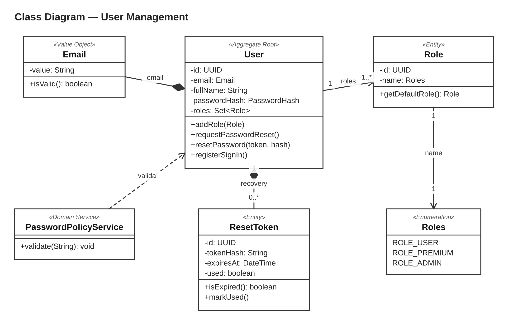
<figcaption style="font-size:0.9em;color:#555;margin-top:0.4em"><em>Class Diagram (Domain Layer) — User Management.</em></figcaption>
</figure>

#### 5.1.7.2. Bounded Context Database Design Diagram

<figure id="fig-er-iam" style="margin:1.5em 0;text-align:center">
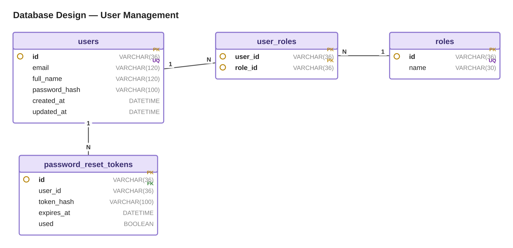
<figcaption style="font-size:0.9em;color:#555;margin-top:0.4em"><em>Database Design Diagram — User Management.</em></figcaption>
</figure>

## 5.2. Bounded Context: Subscription Management

El **Subscription Management Bounded Context** administra el ciclo de vida de los planes de FreshSense (FREE y PREMIUM), el cobro recurrente a través de la pasarela de pagos y la emisión de comprobantes. Implementa la integración con el **Sistema de Pago** exigida por la **TS44** y la descarga de facturas de la **US38**. Es el contexto que habilita las funcionalidades Premium (US17-US19).

### 5.2.1. Domain Layer

La Domain Layer del Subscription Management Bounded Context encapsula la lógica de negocio del contexto. En esta capa se definen los agregados, entidades, objetos de valor, servicios de dominio y políticas que representan los conceptos clave del sistema.

**Aggregates**

1. **Subscription**
   - *Propósito:* Agregado raíz que representa el plan contratado por un usuario y su vigencia.

   - *Atributos:*

| Atributo | Tipo | Descripción |
|---|---|---|
| id | UUID | Identificador de la suscripción. |
| userId | UUID | Usuario propietario del plan. |
| plan | PlanType (VO) | FREE o PREMIUM. |
| startedAt | DateTime | Fecha de inicio de la vigencia. |
| endsAt | DateTime? | Fecha de término; nula para el plan FREE. |
| active | boolean | Indica si la suscripción está vigente. |
   - *Métodos:*

| Método | Descripción |
|---|---|
| isActive() | Indica si el plan está vigente a la fecha actual. |
| upgradeToPremium(period) | Cambia el plan a PREMIUM y fija la fecha de término. |
| renew(days) | Extiende la vigencia al confirmarse el webhook de pago (TS44). |
| cancel() | Desactiva la renovación automática y marca el fin del periodo. |

**Entities**

1. **Payment** — Cobro procesado por la pasarela para una suscripción (TS44, US38).

| Atributo | Tipo | Descripción |
|---|---|---|
| id | UUID | Identificador del pago. |
| subscriptionId | UUID | Suscripción asociada. |
| amount | Money (VO) | Importe cobrado. |
| provider | String | Identificador del medio de pago procesado por el Sistema de Pago. |
| externalRef | String | Identificador del cobro en la pasarela. |
| paidAt | DateTime | Fecha de confirmación. |
| invoiceUrl | String | Enlace al comprobante en PDF (US38). |

| Método | Descripción |
|---|---|
| confirm(externalRef) | Marca el pago como confirmado tras el webhook. |
| generateInvoice() | Produce el comprobante descargable en PDF. |
**Value Objects**

| Value Object | Descripción |
|---|---|
| PlanType | Enumeración inmutable: `FREE`, `PREMIUM`. |
| Money | Importe con moneda; evita operar con números sueltos. |
| BillingPeriod | Periodo de facturación: `MONTHLY` o `ANNUAL`. |

**Domain Services**

| Servicio | Descripción |
|---|---|
| PlanEntitlementService | Determina qué funcionalidades (analítica avanzada, costeo de fichas técnicas, exportación) habilita cada plan. |

**Domain Events**

| Evento | Descripción |
|---|---|
| PlanTypeAcquired | Se asignó un plan al usuario (ES: *tipo de plan adquirido*). |
| SubscriptionUpgraded | El usuario pasó de FREE a PREMIUM. |
| SubscriptionRenewed | La pasarela confirmó la renovación y se extendió la vigencia (TS44). |
| SubscriptionExpired | Venció la suscripción y el usuario regresó al plan FREE. |
| PaymentConfirmed | Se registró un cobro exitoso y su comprobante (US38). |

**Policies**

- **Asignar plan gratuito**: cuando ocurre `UserRegistered`, se crea automáticamente una suscripción FREE.
- **Extender vigencia por webhook**: cuando la pasarela confirma la renovación mensual, se extiende la fecha de vigencia 30 días (TS44).
- **Degradar al vencer**: cuando `endsAt` es anterior a la fecha actual, la suscripción se marca inactiva y el usuario vuelve a FREE.

### 5.2.2. Interface Layer

La Interface Layer del Subscription Management expone los puntos de entrada del contexto mediante controladores REST, recursos y *assemblers* que traducen entre el modelo HTTP y el modelo de dominio.

**Controllers**

1. **SubscriptionsController** — Gestiona la consulta y el cambio de plan del usuario.

| Método | Endpoint | Descripción |
|---|---|---|
| GET | /api/v1/subscriptions/me | Obtiene la suscripción vigente del usuario autenticado. |
| POST | /api/v1/subscriptions/upgrade | Inicia el cambio a plan PREMIUM consumiendo el Sistema de Pago para crear el cobro (TS44). |
| POST | /api/v1/subscriptions/cancel | Cancela la renovación automática. |
   - *Dependencias:* SubscriptionCommandService, SubscriptionQueryService

2. **PaymentsController** — Expone el historial de pagos y los comprobantes (US38).

| Método | Endpoint | Descripción |
|---|---|---|
| GET | /api/v1/payments | Lista los cobros del usuario. |
| GET | /api/v1/payments/{paymentId}/invoice | Descarga el comprobante en PDF. |
   - *Dependencias:* PaymentQueryService

3. **BillingWebhookController** — Recibe las notificaciones de la pasarela de pagos (TS44).

| Método | Endpoint | Descripción |
|---|---|---|
| POST | /api/v1/billing/webhook | Procesa la notificación del Sistema de Pago y extiende la vigencia. |
   - *Dependencias:* SubscriptionCommandService

**Resources**

| Resource | Campos |
|---|---|
| SubscriptionResource | id, plan, startedAt, endsAt, active |
| UpgradeResource | plan, billingPeriod |
| PaymentResource | id, amount, provider, paidAt, invoiceUrl |
| WebhookPayloadResource | eventType, externalRef, amount, status |

**Transformers / Assemblers**

| Assembler | Transformación |
|---|---|
| SubscriptionResourceFromEntityAssembler | Convierte `Subscription` en `SubscriptionResource`. |
| PaymentResourceFromEntityAssembler | Convierte `Payment` en `PaymentResource`. |
| UpgradeCommandFromResourceAssembler | Convierte `UpgradeResource` en `UpgradeSubscriptionCommand`. |

### 5.2.3. Application Layer

La Application Layer del Subscription Management coordina las operaciones entre la Interface Layer y la Domain Layer, orquestando comandos, consultas y la reacción a eventos de otros contextos.

**Command Services**

| Servicio | Comandos que maneja | Descripción |
|---|---|---|
| SubscriptionCommandServiceImpl | CreateFreeSubscriptionCommand, UpgradeSubscriptionCommand, RenewSubscriptionCommand, CancelSubscriptionCommand | Crea, actualiza y cancela suscripciones; al ejecutar `UpgradeSubscriptionCommand` consume el `PaymentGatewayAdapter` para iniciar el cobro en el Sistema de Pago. |
| PaymentCommandServiceImpl | ConfirmPaymentCommand, GenerateInvoiceCommand | Registra los cobros confirmados y genera los comprobantes en PDF (US38). |

**Query Services / Facades**

| Servicio | Consultas | Descripción |
|---|---|---|
| SubscriptionQueryServiceImpl | GetSubscriptionByUserQuery, GetActivePlanQuery | Recupera el plan vigente del usuario. |
| PaymentQueryServiceImpl | GetPaymentsByUserQuery, GetInvoiceQuery | Recupera el historial de cobros y comprobantes. |
| SubscriptionsContextFacade | hasPremiumAccess(userId) | Open Host Service consultado por Report e Inventory para habilitar funciones Premium. |

**Event Handlers**

| Handler | Evento que escucha | Reacción |
|---|---|---|
| UserRegisteredEventHandler | UserRegistered (User Management) | Crea automáticamente una suscripción FREE para el usuario recién registrado. |
| BillingWebhookEventHandler | PaymentConfirmed (pasarela externa) | Extiende la vigencia de la suscripción 30 días y emite `SubscriptionRenewed` (TS44). |

### 5.2.4. Infrastructure Layer

La Infrastructure Layer del Subscription Management implementa la persistencia y las integraciones técnicas (ACL) hacia otros contextos y sistemas externos.

| Componente | Tipo | Responsabilidad |
|---|---|---|
| SubscriptionRepository | JPA Repository | Persistencia de suscripciones; `findByUserId`, `findActiveByUserId`. |
| PaymentRepository | JPA Repository | Persistencia de los cobros y sus comprobantes. |
| PaymentGatewayAdapter | ACL saliente | Consume la API del Sistema de Pago para crear el cobro y traduce su confirmación al modelo de dominio (TS44). |
| InvoicePdfGenerator | Servicio técnico | Genera el comprobante en PDF con JasperReports (US38). |
| ExternalUserService | ACL entrante | Consulta el `IamContextFacade` para validar la existencia del usuario. |

### 5.2.6. Bounded Context Software Architecture Component Level Diagrams

<figure id="fig-comp-sub" style="margin:1.5em 0;text-align:center">

<figcaption style="font-size:0.9em;color:#555;margin-top:0.4em"><em>Component Level Diagram — Subscription Management.</em></figcaption>
</figure>

### 5.2.7. Bounded Context Software Architecture Code Level Diagrams

#### 5.2.7.1. Bounded Context Domain Layer Class Diagrams

<figure id="fig-class-sub" style="margin:1.5em 0;text-align:center">
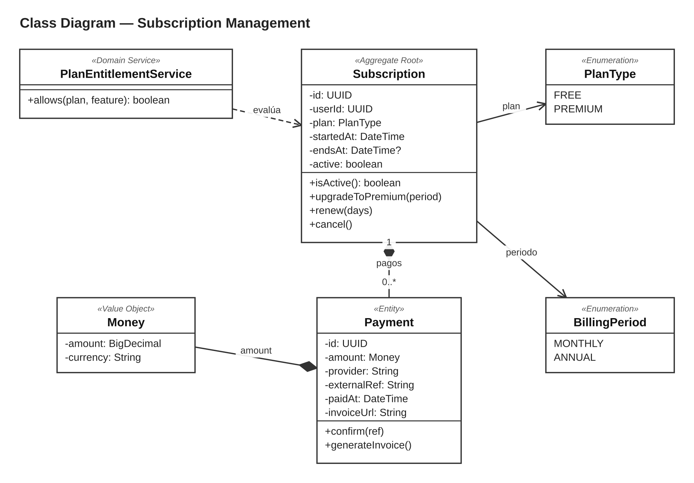
<figcaption style="font-size:0.9em;color:#555;margin-top:0.4em"><em>Class Diagram (Domain Layer) — Subscription Management.</em></figcaption>
</figure>

#### 5.2.7.2. Bounded Context Database Design Diagram

<figure id="fig-er-sub" style="margin:1.5em 0;text-align:center">
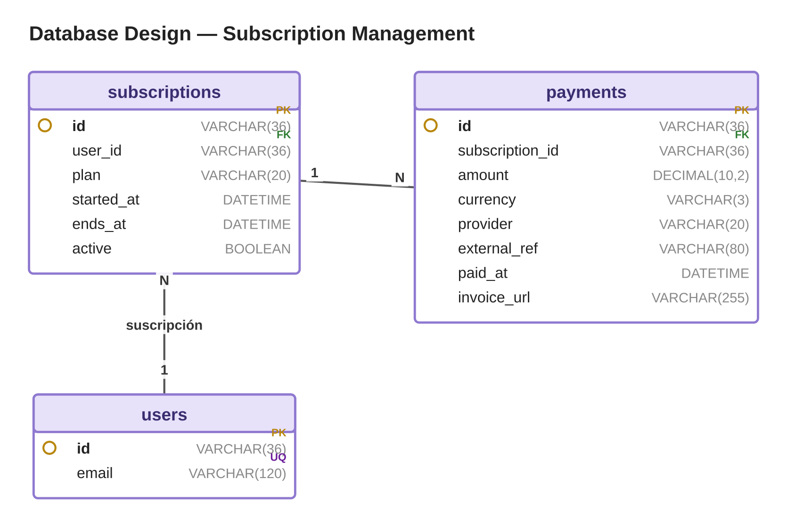
<figcaption style="font-size:0.9em;color:#555;margin-top:0.4em"><em>Database Design Diagram — Subscription Management.</em></figcaption>
</figure>

## 5.3. Bounded Context: Profile Management

El **Profile Management Bounded Context** modela el **negocio** (`Business`) que agrupa a los usuarios y sus dispositivos, la gestión de miembros exigida por la **US37**, y las preferencias de notificación de la **US09** y **US24**. Representa a los dos segmentos objetivo: el **restaurante** y el **negocio de distribución de alimentos en frío**. Es el contexto que permite que el propietario, el administrador y el personal de cocina o almacén compartan un mismo inventario, y que cada uno configure cómo y en qué turno recibir alertas.

### 5.3.1. Domain Layer

La Domain Layer del Profile Management Bounded Context encapsula la lógica de negocio del contexto. En esta capa se definen los agregados, entidades, objetos de valor, servicios de dominio y políticas que representan los conceptos clave del sistema.

**Aggregates**

1. **Business**
   - *Propósito:* Agregado raíz que representa el negocio (restaurante o distribuidora en frío) al que pertenecen los usuarios, los dispositivos y el inventario compartido.

   - *Atributos:*

| Atributo | Tipo | Descripción |
|---|---|---|
| id | UUID | Identificador del negocio. |
| name | String | Nombre comercial (por ejemplo, «Restaurante El Sabor» o «Distribuidora Frío Norte»). |
| segment | BusinessSegment (VO) | RESTAURANT o COLD_DISTRIBUTION: segmento objetivo al que pertenece. |
| members | List&lt;BusinessMember&gt; | Miembros vinculados con su rol. |
| createdAt / updatedAt | DateTime | Campos de auditoría. |
   - *Métodos:*

| Método | Descripción |
|---|---|
| invite(email, role) | Emite una invitación para incorporar a un miembro (US37). |
| addMember(userId, role) | Vincula un usuario al negocio cuando acepta la invitación. |
| removeMember(userId) | Desvincula a un miembro y revoca su acceso al inventario. |
| changeMemberRole(userId, role) | Modifica el rol del miembro dentro del negocio. |

**Entities**

1. **BusinessMember** — Vínculo entre un usuario y un negocio, con el rol que desempeña (US37).

| Atributo | Tipo | Descripción |
|---|---|---|
| id | UUID | Identificador del vínculo. |
| businessId | UUID | Negocio al que pertenece. |
| userId | UUID | Usuario vinculado. |
| role | MemberRole (VO) | OWNER, MANAGER o STAFF. |
| joinedAt | DateTime | Fecha de incorporación. |

| Método | Descripción |
|---|---|
| canManageInventory() | Indica si el rol permite editar el inventario compartido. |
2. **Invitation** — Invitación pendiente para incorporar a un nuevo miembro (US37).

| Atributo | Tipo | Descripción |
|---|---|---|
| id | UUID | Identificador de la invitación. |
| email | Email (VO) | Correo del invitado. |
| token | String | Token único del enlace de vinculación. |
| expiresAt | DateTime | Vencimiento de la invitación. |
| status | InvitationStatus | PENDING, ACCEPTED o EXPIRED. |

| Método | Descripción |
|---|---|
| accept(userId) | Convierte la invitación en un `BusinessMember`. |
| isExpired() | Evalúa el vencimiento. |
3. **NotificationPreference** — Preferencias de canal y turno operativo de cada usuario (US09, US24).

| Atributo | Tipo | Descripción |
|---|---|---|
| id | UUID | Identificador. |
| userId | UUID | Usuario propietario. |
| emailEnabled | boolean | Habilita el envío por correo. |
| pushEnabled | boolean | Habilita las notificaciones push. |
| operatingShift | TimeWindow (VO) | Turno operativo del usuario (por ejemplo, 06:00–23:00). |
| updatedAt | DateTime | Última modificación. |

| Método | Descripción |
|---|---|
| isOffShift(at) | Indica si un instante cae fuera del turno operativo. |
| routeFor(severity) | Determina el canal de destino según la severidad (US24). |
**Value Objects**

| Value Object | Descripción |
|---|---|
| MemberRole | Enumeración: `OWNER` (propietario), `MANAGER` (administrador o encargado), `STAFF` (personal de cocina o almacén). |
| BusinessSegment | Enumeración: `RESTAURANT`, `COLD_DISTRIBUTION`. |
| TimeWindow | Rango horario con inicio y fin, usado para el turno operativo. |
| InvitationStatus | Enumeración: `PENDING`, `ACCEPTED`, `EXPIRED`. |

**Domain Services**

| Servicio | Descripción |
|---|---|
| NotificationRoutingService | Decide el canal y el destinatario (responsable de turno o pantalla del local) según severidad y preferencias (US24). |

**Domain Events**

| Evento | Descripción |
|---|---|
| BusinessCreated | Se creó el negocio tras registrarse el usuario. |
| MemberInvited | Se envió una invitación a un nuevo miembro (US37). |
| MemberJoined | Un invitado aceptó y quedó vinculado al negocio. |
| NotificationPreferencesUpdated | El usuario cambió sus preferencias de alerta (US09). |
| OperatingShiftConfigured | Se definió el turno operativo para las notificaciones (US09). |

**Policies**

- **Crear negocio al registrarse**: cuando ocurre `UserRegistered`, se crea un `Business` con el usuario como `OWNER`.
- **Retener alertas leves fuera de turno**: cuando se dispara una alerta de baja severidad fuera del turno operativo, se retiene hasta el inicio del siguiente turno (US09).
- **Invitación de un solo uso**: una invitación aceptada o vencida no puede volver a utilizarse.

### 5.3.2. Interface Layer

La Interface Layer del Profile Management expone los puntos de entrada del contexto mediante controladores REST, recursos y *assemblers* que traducen entre el modelo HTTP y el modelo de dominio.

**Controllers**

1. **BusinessesController** — Gestiona el negocio y sus miembros.

| Método | Endpoint | Descripción |
|---|---|---|
| GET | /api/v1/businesses/me | Obtiene el negocio del usuario autenticado y sus miembros. |
| POST | /api/v1/businesses/{id}/invitations | Envía una invitación a un nuevo miembro (US37). |
| POST | /api/v1/invitations/{token}/accept | Acepta la invitación y vincula al usuario. |
| DELETE | /api/v1/businesses/{id}/members/{userId} | Desvincula a un miembro. |
   - *Dependencias:* BusinessCommandService, BusinessQueryService

2. **NotificationPreferencesController** — Gestiona las preferencias de notificación (US09, US24).

| Método | Endpoint | Descripción |
|---|---|---|
| GET | /api/v1/notification-preferences | Obtiene las preferencias del usuario. |
| PUT | /api/v1/notification-preferences | Actualiza canales y turno operativo. |
   - *Dependencias:* NotificationPreferenceCommandService

**Resources**

| Resource | Campos |
|---|---|
| BusinessResource | id, name, segment, members[] |
| BusinessMemberResource | userId, fullName, role, joinedAt |
| InvitationResource | email, role |
| NotificationPreferenceResource | emailEnabled, pushEnabled, shiftStart, shiftEnd |

**Transformers / Assemblers**

| Assembler | Transformación |
|---|---|
| BusinessResourceFromEntityAssembler | Convierte `Business` y sus miembros en `BusinessResource`. |
| NotificationPreferenceResourceFromEntityAssembler | Convierte `NotificationPreference` en su recurso. |
| InviteMemberCommandFromResourceAssembler | Convierte `InvitationResource` en `InviteMemberCommand`. |

### 5.3.3. Application Layer

La Application Layer del Profile Management coordina las operaciones entre la Interface Layer y la Domain Layer, orquestando comandos, consultas y la reacción a eventos de otros contextos.

**Command Services**

| Servicio | Comandos que maneja | Descripción |
|---|---|---|
| BusinessCommandServiceImpl | CreateBusinessCommand, InviteMemberCommand, AcceptInvitationCommand, RemoveMemberCommand | Crea el negocio, gestiona invitaciones y administra la membresía compartida (US37). |
| NotificationPreferenceCommandServiceImpl | UpdatePreferencesCommand, SetOperatingShiftCommand | Actualiza canales y turno operativo de las alertas (US09). |

**Query Services / Facades**

| Servicio | Consultas | Descripción |
|---|---|---|
| BusinessQueryServiceImpl | GetBusinessByUserQuery, GetMembersQuery | Recupera el negocio y sus miembros. |
| ProfileContextFacade | getBusinessOf(userId), getPreferencesOf(userId) | Open Host Service consultado por Inventory (inventario compartido) y por IoT Monitoring (envío de alertas). |

**Event Handlers**

| Handler | Evento que escucha | Reacción |
|---|---|---|
| UserRegisteredEventHandler | UserRegistered (User Management) | Crea el `Business` inicial, con el segmento elegido en el registro y el usuario como OWNER, y sus preferencias de notificación por defecto. |
| PlanTypeAcquiredEventHandler | PlanTypeAcquired (Subscription Management) | Ajusta el número máximo de miembros permitidos según el plan contratado. |

### 5.3.4. Infrastructure Layer

La Infrastructure Layer del Profile Management implementa la persistencia y las integraciones técnicas (ACL) hacia otros contextos y sistemas externos.

| Componente | Tipo | Responsabilidad |
|---|---|---|
| BusinessRepository | JPA Repository | Persistencia de negocios; `findByMemberUserId`. |
| BusinessMemberRepository | JPA Repository | Persistencia de los vínculos usuario–negocio. |
| InvitationRepository | JPA Repository | Persistencia de invitaciones pendientes (US37). |
| NotificationPreferenceRepository | JPA Repository | Persistencia de las preferencias de alerta. |
| ExternalUserService | ACL entrante | Consulta el `IamContextFacade` para resolver los datos del usuario. |
| NotificationGatewayAdapter | ACL saliente | Envía el correo de invitación mediante el Notification Service (TS42). |

### 5.3.6. Bounded Context Software Architecture Component Level Diagrams

<figure id="fig-comp-pro" style="margin:1.5em 0;text-align:center">
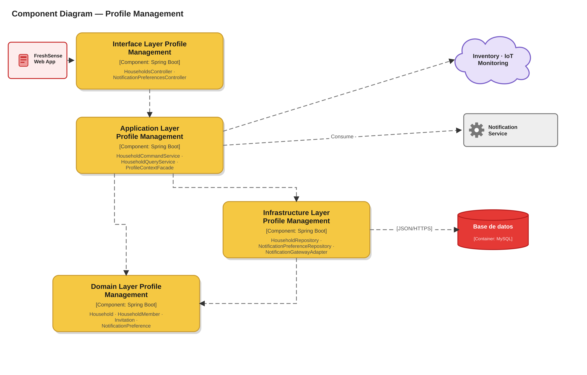
<figcaption style="font-size:0.9em;color:#555;margin-top:0.4em"><em>Component Level Diagram — Profile Management.</em></figcaption>
</figure>

### 5.3.7. Bounded Context Software Architecture Code Level Diagrams

#### 5.3.7.1. Bounded Context Domain Layer Class Diagrams

<figure id="fig-class-pro" style="margin:1.5em 0;text-align:center">
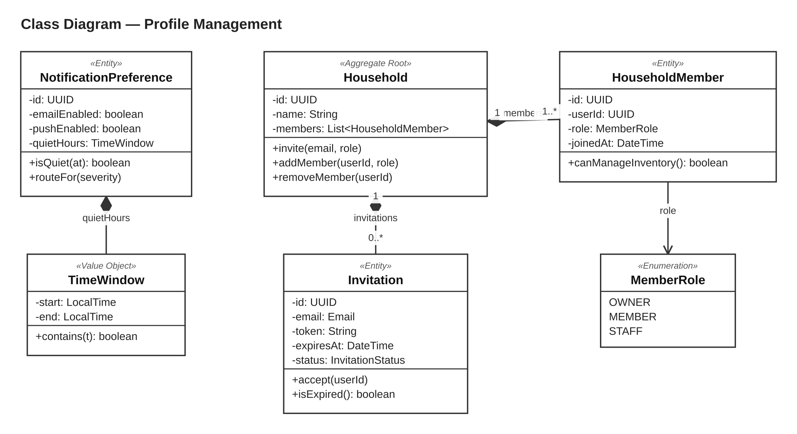
<figcaption style="font-size:0.9em;color:#555;margin-top:0.4em"><em>Class Diagram (Domain Layer) — Profile Management.</em></figcaption>
</figure>

#### 5.3.7.2. Bounded Context Database Design Diagram

<figure id="fig-er-pro" style="margin:1.5em 0;text-align:center">
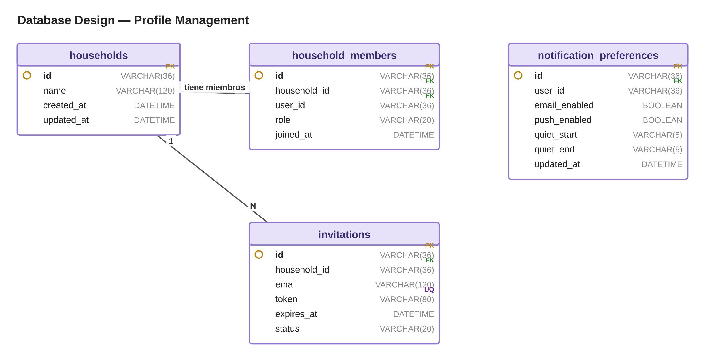
<figcaption style="font-size:0.9em;color:#555;margin-top:0.4em"><em>Database Design Diagram — Profile Management.</em></figcaption>
</figure>

## 5.4. Bounded Context: Sensor Management

El **Sensor Management Bounded Context** gestiona el ciclo de vida del hardware **FreshSense Device**: la vinculación mediante código QR y la calibración exigidas por la **US31**, el control del estado de conexión de la **US06**, y la organización en **zonas de almacenamiento** (cámaras frías, congeladores) que pide la **US33**. Este contexto conoce el dispositivo como equipo físico; la interpretación de sus lecturas corresponde a IoT Monitoring.

### 5.4.1. Domain Layer

La Domain Layer del Sensor Management Bounded Context encapsula la lógica de negocio del contexto. En esta capa se definen los agregados, entidades, objetos de valor, servicios de dominio y políticas que representan los conceptos clave del sistema.

**Aggregates**

1. **SensorDevice**
   - *Propósito:* Agregado raíz que representa un dispositivo FreshSense instalado en una cámara fría, congelador o vitrina del negocio.

   - *Atributos:*

| Atributo | Tipo | Descripción |
|---|---|---|
| id | UUID | Identificador del dispositivo. |
| businessId | UUID | Negocio propietario. |
| model | String | Modelo del hardware. |
| firmwareVersion | String | Versión de firmware instalada. |
| status | DeviceStatus (VO) | ACTIVE, OFFLINE o UNPAIRED. |
| zoneId | UUID? | Zona de almacenamiento asignada (US33). |
| calibration | Calibration (VO) | Temperatura base configurada durante la instalación (US31). |
| registeredAt / updatedAt | DateTime | Campos de auditoría. |
   - *Métodos:*

| Método | Descripción |
|---|---|
| register() | Da de alta el dispositivo en el sistema. |
| pairToBusiness(Business) | Vincula el dispositivo al negocio tras escanear su código QR (US31). |
| calibrate(baseTemperature) | Registra la temperatura base de la cámara para ajustar los umbrales. |
| assignToZone(zoneId) | Asigna el dispositivo a una cámara o congelador concreto (US33). |
| markOffline() | Marca el dispositivo como desconectado al no recibirse el *heartbeat* (US06). |

**Entities**

1. **StorageZone** — Área de almacenamiento del negocio, con sus propias reglas de temperatura (US33).

| Atributo | Tipo | Descripción |
|---|---|---|
| id | UUID | Identificador de la zona. |
| businessId | UUID | Negocio propietario. |
| name | String | Nombre asignado (por ejemplo, «Cámara Fría 1» o «Congelador Carnes»). |
| type | ZoneType (VO) | FRIDGE, FREEZER, COLD_ROOM o DISPLAY_CASE (vitrina). |
| targetTempC | float | Temperatura objetivo de la zona. |

| Método | Descripción |
|---|---|
| appliesRulesTo(InventoryItem) | Indica si un alimento hereda las reglas de temperatura de la zona. |
**Value Objects**

| Value Object | Descripción |
|---|---|
| DeviceStatus | Enumeración: `ACTIVE`, `OFFLINE`, `UNPAIRED`. |
| ZoneType | Enumeración: `FRIDGE`, `FREEZER`, `COLD_ROOM`, `DISPLAY_CASE`. |
| Calibration | Temperatura base y desviación aceptada, definidas al instalar el equipo (US31). |
| PairingCode | Código QR impreso en el hardware que identifica al dispositivo durante la vinculación. |

**Domain Services**

| Servicio | Descripción |
|---|---|
| DeviceHealthService | Evalúa el *heartbeat* recibido y determina cuándo un dispositivo pasa a OFFLINE (US06). |

**Domain Events**

| Evento | Descripción |
|---|---|
| SensorRegistered | Se dio de alta un dispositivo en el sistema. |
| SensorPaired | El dispositivo quedó vinculado al negocio tras escanear el QR (ES: *sensor instalado*). |
| SensorCalibrated | Se registró la temperatura base de la cámara (US31). |
| SensorConfigured | Se asignó el dispositivo a una zona de almacenamiento (ES: *sensor configurado*). |
| SensorDisconnected | El dispositivo perdió el enlace Wi-Fi y se notificó al usuario (US06). |

**Policies**

- **Vinculación única**: un código QR solo puede vincularse a un negocio a la vez.
- **Notificar desconexión**: cuando el servidor no recibe *heartbeat* dentro de la ventana esperada, se marca el dispositivo OFFLINE y se avisa al usuario (US06).
- **Heredar reglas de zona**: cuando un dispositivo se asigna a una zona, los alimentos asociados adoptan sus umbrales de temperatura (US33).

### 5.4.2. Interface Layer

La Interface Layer del Sensor Management expone los puntos de entrada del contexto mediante controladores REST, recursos y *assemblers* que traducen entre el modelo HTTP y el modelo de dominio.

**Controllers**

1. **DevicesController** — Gestiona el alta, vinculación y calibración de los dispositivos.

| Método | Endpoint | Descripción |
|---|---|---|
| GET | /api/v1/devices | Lista los dispositivos del negocio. |
| POST | /api/v1/devices/pair | Vincula un dispositivo escaneando su código QR (US31). |
| PATCH | /api/v1/devices/{id}/calibration | Registra la temperatura base de calibración. |
| PATCH | /api/v1/devices/{id}/zone | Asigna el dispositivo a una zona de almacenamiento. |
   - *Dependencias:* DeviceCommandService, DeviceQueryService

2. **StorageZonesController** — Administra las zonas de almacenamiento del negocio (US33).

| Método | Endpoint | Descripción |
|---|---|---|
| GET | /api/v1/storage-zones | Lista las zonas configuradas. |
| POST | /api/v1/storage-zones | Crea una nueva cámara, congelador o refrigerador. |
| DELETE | /api/v1/storage-zones/{id} | Elimina una zona sin dispositivos asociados. |
   - *Dependencias:* StorageZoneCommandService

3. **DeviceHeartbeatController** — Recibe la señal periódica de vida del dispositivo (US06).

| Método | Endpoint | Descripción |
|---|---|---|
| POST | /api/v1/devices/{id}/heartbeat | Registra el *ping* del dispositivo y actualiza su estado. |
   - *Dependencias:* DeviceCommandService

**Resources**

| Resource | Campos |
|---|---|
| DeviceResource | id, model, firmwareVersion, status, zoneId, calibration |
| PairDeviceResource | pairingCode (QR), businessId |
| CalibrationResource | baseTemperatureC |
| StorageZoneResource | id, name, type, targetTempC |

**Transformers / Assemblers**

| Assembler | Transformación |
|---|---|
| DeviceResourceFromEntityAssembler | Convierte `SensorDevice` en `DeviceResource`. |
| StorageZoneResourceFromEntityAssembler | Convierte `StorageZone` en su recurso. |
| PairDeviceCommandFromResourceAssembler | Convierte `PairDeviceResource` en `PairDeviceCommand`. |

### 5.4.3. Application Layer

La Application Layer del Sensor Management coordina las operaciones entre la Interface Layer y la Domain Layer, orquestando comandos, consultas y la reacción a eventos de otros contextos.

**Command Services**

| Servicio | Comandos que maneja | Descripción |
|---|---|---|
| DeviceCommandServiceImpl | RegisterDeviceCommand, PairDeviceCommand, CalibrateDeviceCommand, AssignZoneCommand, RegisterHeartbeatCommand | Da de alta, vincula, calibra y monitorea el estado de conexión de los dispositivos. |
| StorageZoneCommandServiceImpl | CreateZoneCommand, DeleteZoneCommand | Administra las áreas de almacenamiento del negocio (US33). |

**Query Services / Facades**

| Servicio | Consultas | Descripción |
|---|---|---|
| DeviceQueryServiceImpl | GetDevicesByBusinessQuery, GetDeviceByIdQuery | Recupera los dispositivos y su estado. |
| StorageZoneQueryServiceImpl | GetZonesByBusinessQuery | Recupera las zonas configuradas. |
| SensorContextFacade | existsDevice(id), getZoneOf(deviceId), getCalibration(deviceId) | Open Host Service consultado por IoT Monitoring para validar el origen de las lecturas. |

**Event Handlers**

| Handler | Evento que escucha | Reacción |
|---|---|---|
| BusinessCreatedEventHandler | BusinessCreated (Profile Management) | Crea la zona de almacenamiento por defecto («Cámara principal») para el nuevo negocio. |
| PlanTypeAcquiredEventHandler | PlanTypeAcquired (Subscription Management) | Ajusta el número máximo de dispositivos y zonas permitidos según el plan. |

### 5.4.4. Infrastructure Layer

La Infrastructure Layer del Sensor Management implementa la persistencia y las integraciones técnicas (ACL) hacia otros contextos y sistemas externos.

| Componente | Tipo | Responsabilidad |
|---|---|---|
| SensorDeviceRepository | JPA Repository | Persistencia de dispositivos; `findByBusinessId`, `findByPairingCode`. |
| StorageZoneRepository | JPA Repository | Persistencia de las zonas de almacenamiento. |
| HeartbeatScheduler | Spring Scheduler | Revisa periódicamente los *heartbeats* y marca los dispositivos OFFLINE (US06). |
| ExternalBusinessService | ACL entrante | Consulta el `ProfileContextFacade` para validar el negocio propietario. |
| NotificationGatewayAdapter | ACL saliente | Notifica al usuario la desconexión del dispositivo (TS42). |

### 5.4.6. Bounded Context Software Architecture Component Level Diagrams

<figure id="fig-comp-sen" style="margin:1.5em 0;text-align:center">

<figcaption style="font-size:0.9em;color:#555;margin-top:0.4em"><em>Component Level Diagram — Sensor Management.</em></figcaption>
</figure>

### 5.4.7. Bounded Context Software Architecture Code Level Diagrams

#### 5.4.7.1. Bounded Context Domain Layer Class Diagrams

<figure id="fig-class-sen" style="margin:1.5em 0;text-align:center">
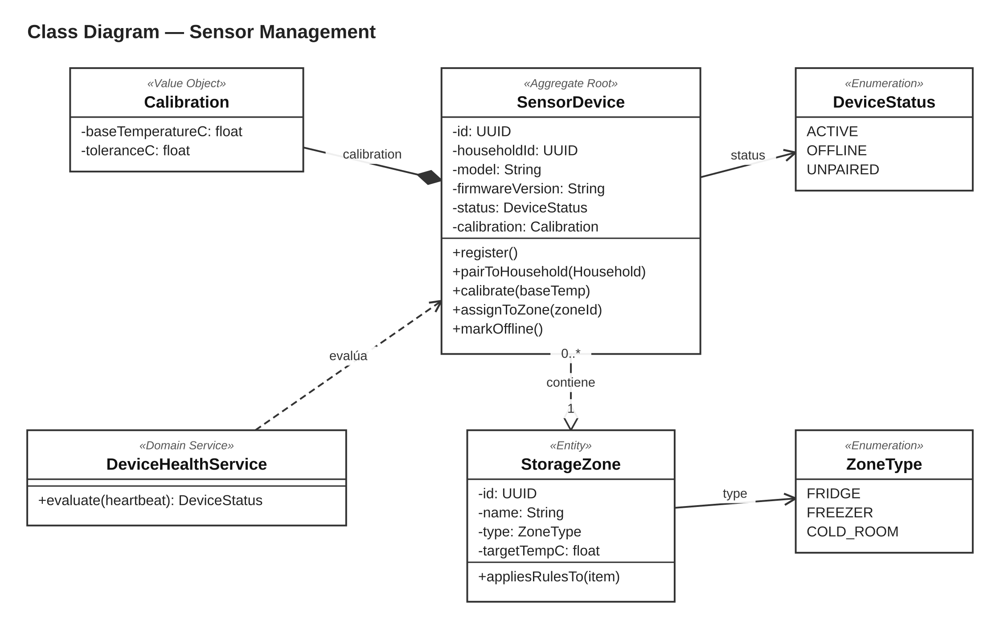
<figcaption style="font-size:0.9em;color:#555;margin-top:0.4em"><em>Class Diagram (Domain Layer) — Sensor Management.</em></figcaption>
</figure>

#### 5.4.7.2. Bounded Context Database Design Diagram

<figure id="fig-er-sen" style="margin:1.5em 0;text-align:center">
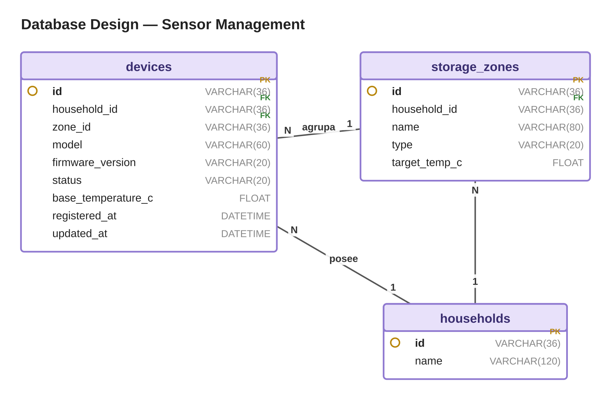
<figcaption style="font-size:0.9em;color:#555;margin-top:0.4em"><em>Database Design Diagram — Sensor Management.</em></figcaption>
</figure>

## 5.5. Bounded Context: Inventory Management

El **Inventory Management Bounded Context** administra el inventario de insumos y lotes del negocio, ya sea la cocina de un restaurante o el almacén de una distribuidora en frío: el alta por código de barras o QR (**US10**), el filtrado por cámara, lote y vencimiento (**US14**), la edición manual del stock (**US11**), la categorización personalizada (**US28**) y el registro del motivo de descarte (**US34**). Contiene el agregado `InventoryItem` y el catálogo `FoodModel`, que define la vida útil estimada por categoría de alimento y las reglas usadas para estimar la fecha de consumo preferente.

### 5.5.1. Domain Layer

La Domain Layer del Inventory Management Bounded Context encapsula la lógica de negocio del contexto. En esta capa se definen los agregados, entidades, objetos de valor, servicios de dominio y políticas que representan los conceptos clave del sistema.

**Aggregates**

1. **InventoryItem**
   - *Propósito:* Agregado raíz que representa un insumo o lote registrado en el inventario del negocio, con su cantidad, vencimiento estimado y estado de frescura.

   - *Atributos:*

| Atributo | Tipo | Descripción |
|---|---|---|
| id | UUID | Identificador del alimento. |
| businessId | UUID | Negocio propietario del inventario. |
| userId | UUID | Miembro del personal que lo registró. |
| zoneId | UUID | Cámara, congelador o vitrina donde se almacena (US14, US33). |
| lotCode | String | Código de lote leído del código de barras o QR (US10, US14). |
| supplier | String | Proveedor que entregó el lote (US40). |
| foodModelId | UUID | Categoría del catálogo que define su vida útil. |
| name | String | Nombre del alimento. |
| quantity | Quantity (VO) | Cantidad disponible. |
| unit | Unit (VO) | Unidad de medida (kg, unidades, litros). |
| addedAt | DateTime | Fecha de registro en el inventario. |
| bestBefore | DateTime? | Fecha estimada de consumo preferente. |
| status | FreshnessStatus (VO) | FRESH, AT_RISK o SPOILED. |
| notes | String | Observaciones y etiquetas personalizadas (US28). |
   - *Métodos:*

| Método | Descripción |
|---|---|
| markConsumed() | Registra el consumo del alimento y descuenta la cantidad. |
| markDiscarded(reason) | Registra la baja indicando la causa: falla de frío, vencimiento, contaminación o proveedor (US34). |
| updateQuantity(qty) | Corrige manualmente el stock disponible (US11). |
| updateStatus(FreshnessStatus) | Actualiza el estado de frescura según la evaluación del dominio. |
| estimateBestBefore(FoodModel) | Calcula la fecha de consumo preferente a partir de la vida útil del catálogo. |

**Entities**

1. **FoodModel** — Catálogo que define la vida útil y las reglas de conservación de cada categoría de alimento.

| Atributo | Tipo | Descripción |
|---|---|---|
| id | UUID | Identificador del modelo. |
| name | String | Nombre de la categoría. |
| category | String | Agrupación (Fruta, Verdura, Lácteo, Carne). |
| shelfLifeDays | int | Vida útil estimada en días. |
| rulesJson | ShelfLifeRules (VO) | Umbrales de temperatura, humedad y etileno aplicables. |

| Método | Descripción |
|---|---|
| rulesFor(zoneType) | Devuelve los umbrales ajustados al tipo de zona de almacenamiento. |
**Value Objects**

| Value Object | Descripción |
|---|---|
| FreshnessStatus | Enumeración: `FRESH`, `AT_RISK`, `SPOILED`. |
| Quantity | Cantidad con validación de no negatividad. |
| Unit | Unidad de medida del alimento (kg, g, L, unidades). |
| ShelfLifeRules | Reglas de vida útil y umbrales por categoría, serializadas en JSON. |
| DiscardReason | Enumeración: `COLD_FAILURE`, `EXPIRED`, `CONTAMINATED`, `SUPPLIER_DEFECT` (US34). |

**Domain Services**

| Servicio | Descripción |
|---|---|
| ShelfLifeEstimationService | Estima la fecha de consumo preferente combinando el `FoodModel` y la zona de almacenamiento. |
| BarcodeLookupService | Resuelve el producto, la categoría y el lote a partir del código de barras o QR escaneado (US10). |

**Domain Events**

| Evento | Descripción |
|---|---|
| FoodItemRegistered | Se agregó un alimento al inventario (ES: *alimento agregado*). |
| FoodItemUpdated | Se modificó manualmente la cantidad o los datos del alimento (US11). |
| FoodItemConsumed | El alimento fue consumido (ES: *alimento consumido*). |
| FoodItemDiscarded | El alimento fue descartado indicando la causa (US34). |
| FoodConditionUpdated | Cambió el estado de frescura del alimento tras una evaluación. |

**Policies**

- **Estimar vencimiento al registrar**: cuando se agrega un alimento, el sistema calcula automáticamente su `bestBefore` a partir del `FoodModel`.
- **Heredar reglas de la zona**: cuando el alimento se asocia a una zona de almacenamiento, adopta sus umbrales de temperatura (US33).
- **Solicitar motivo al descartar**: cuando el usuario elimina un producto marcándolo como desechado, la aplicación exige el motivo para el informe de mermas (US34).

### 5.5.2. Interface Layer

La Interface Layer del Inventory Management expone los puntos de entrada del contexto mediante controladores REST, recursos y *assemblers* que traducen entre el modelo HTTP y el modelo de dominio.

**Controllers**

1. **InventoryItemsController** — Gestiona el inventario de alimentos del negocio.

| Método | Endpoint | Descripción |
|---|---|---|
| GET | /api/v1/inventory-items | Lista los insumos con su estado de frescura (semáforo, US07) y filtros por cámara, lote y vencimiento (US14). |
| POST | /api/v1/inventory-items | Registra un insumo o lote por código de barras, QR o manualmente (US10). |
| PUT | /api/v1/inventory-items/{id} | Actualiza cantidad, unidad o etiquetas (US11, US28). |
| POST | /api/v1/inventory-items/{id}/consume | Marca el alimento como consumido. |
| POST | /api/v1/inventory-items/{id}/discard | Marca el alimento como descartado con su causa (US34). |
   - *Dependencias:* InventoryItemCommandService, InventoryItemQueryService

2. **FoodModelsController** — Expone el catálogo de categorías y vida útil.

| Método | Endpoint | Descripción |
|---|---|---|
| GET | /api/v1/food-models | Lista las categorías disponibles. |
| GET | /api/v1/food-models/{id} | Obtiene las reglas de vida útil de una categoría. |
   - *Dependencias:* FoodModelQueryService

3. **InventorySearchController** — Búsqueda global con autocompletado sobre el inventario (US39).

| Método | Endpoint | Descripción |
|---|---|---|
| GET | /api/v1/inventory/search | Devuelve coincidencias en vivo de insumos, lotes y fichas técnicas. |
   - *Dependencias:* InventoryItemQueryService

**Resources**

| Resource | Campos |
|---|---|
| InventoryItemResource | id, name, lotCode, zoneId, supplier, quantity, unit, addedAt, bestBefore, status, notes |
| CreateInventoryItemResource | name, quantity, unit, foodModelId, zoneId, lotCode?, supplier?, barcode? |
| DiscardResource | reason (COLD_FAILURE | EXPIRED | CONTAMINATED | SUPPLIER_DEFECT) |
| FoodModelResource | id, name, category, shelfLifeDays |

**Transformers / Assemblers**

| Assembler | Transformación |
|---|---|
| InventoryItemResourceFromEntityAssembler | Convierte `InventoryItem` en `InventoryItemResource`. |
| FoodModelResourceFromEntityAssembler | Convierte `FoodModel` en su recurso. |
| CreateInventoryItemCommandFromResourceAssembler | Convierte el recurso de alta en `RegisterFoodItemCommand`. |

### 5.5.3. Application Layer

La Application Layer del Inventory Management coordina las operaciones entre la Interface Layer y la Domain Layer, orquestando comandos, consultas y la reacción a eventos de otros contextos.

**Command Services**

| Servicio | Comandos que maneja | Descripción |
|---|---|---|
| InventoryItemCommandServiceImpl | RegisterFoodItemCommand, UpdateFoodItemCommand, ConsumeFoodItemCommand, DiscardFoodItemCommand | Registra, actualiza, consume y descarta alimentos, publicando los eventos correspondientes. |
| FoodModelCommandServiceImpl | SeedFoodModelsCommand | Carga el catálogo inicial de categorías y vidas útiles al iniciar el sistema. |

**Query Services / Facades**

| Servicio | Consultas | Descripción |
|---|---|---|
| InventoryItemQueryServiceImpl | GetInventoryItemsQuery, GetItemsAtRiskQuery, SearchInventoryQuery | Recupera el inventario, los alimentos en riesgo y las coincidencias de búsqueda (US39). |
| FoodModelQueryServiceImpl | GetAllFoodModelsQuery, GetFoodModelByIdQuery | Recupera el catálogo de categorías. |
| InventoryContextFacade | getInventorySnapshot(businessId), getItemsAtRisk(userId) | Open Host Service consultado por Consumption y Report Management. |

**Event Handlers**

| Handler | Evento que escucha | Reacción |
|---|---|---|
| FoodConditionUpdatedEventHandler | FoodConditionUpdated (IoT Monitoring) | Actualiza el `status` del `InventoryItem` a AT_RISK o SPOILED según la evaluación del FreshnessService. |
| SensorConfiguredEventHandler | SensorConfigured (Sensor Management) | Asocia los alimentos de la zona con el dispositivo que la monitorea. |

### 5.5.4. Infrastructure Layer

La Infrastructure Layer del Inventory Management implementa la persistencia y las integraciones técnicas (ACL) hacia otros contextos y sistemas externos.

| Componente | Tipo | Responsabilidad |
|---|---|---|
| InventoryItemRepository | JPA Repository | Persistencia del inventario; `findByBusinessId`, `findByZoneId`, `findByStatus`. |
| FoodModelRepository | JPA Repository | Persistencia del catálogo de categorías. |
| BarcodeApiAdapter | ACL saliente | Consulta el catálogo externo de códigos de barras y QR (US10). |
| RedisCacheAdapter | Caché | Almacena el catálogo y las consultas frecuentes del inventario (TS45). |
| ExternalSensorService | ACL entrante | Consulta el `SensorContextFacade` para conocer la zona del alimento. |

### 5.5.6. Bounded Context Software Architecture Component Level Diagrams

<figure id="fig-comp-inv" style="margin:1.5em 0;text-align:center">

<figcaption style="font-size:0.9em;color:#555;margin-top:0.4em"><em>Component Level Diagram — Inventory Management.</em></figcaption>
</figure>

### 5.5.7. Bounded Context Software Architecture Code Level Diagrams

#### 5.5.7.1. Bounded Context Domain Layer Class Diagrams

<figure id="fig-class-inv" style="margin:1.5em 0;text-align:center">
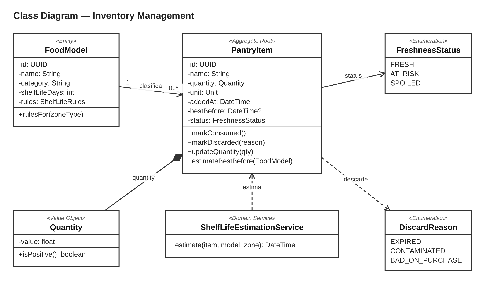
<figcaption style="font-size:0.9em;color:#555;margin-top:0.4em"><em>Class Diagram (Domain Layer) — Inventory Management.</em></figcaption>
</figure>

#### 5.5.7.2. Bounded Context Database Design Diagram

<figure id="fig-er-inv" style="margin:1.5em 0;text-align:center">
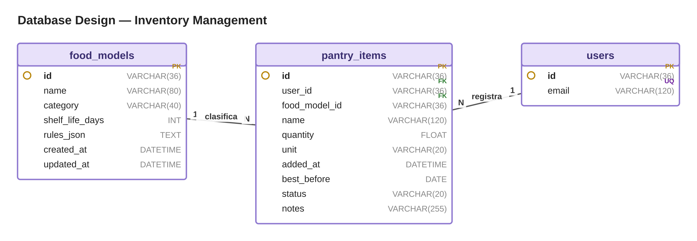
<figcaption style="font-size:0.9em;color:#555;margin-top:0.4em"><em>Database Design Diagram — Inventory Management.</em></figcaption>
</figure>

## 5.6. Bounded Context: Consumption Management

El **Consumption Management Bounded Context** registra el consumo y la merma efectiva de los insumos y gestiona las **fichas técnicas y la rotación** (**EP05**). En el restaurante, la ficha técnica descuenta los insumos de cada platillo y prioriza los que están por vencer (**US13**), con costeo y merma por corte en el plan premium (**US19**). En la distribución en frío, sugiere la salida FIFO de los lotes (**US13**). También registra las incidencias de calidad de cada proveedor (**US40**). Su registro de consumo es la fuente de los reportes de ahorro e impacto ambiental.

### 5.6.1. Domain Layer

La Domain Layer del Consumption Management Bounded Context encapsula la lógica de negocio del contexto. En esta capa se definen los agregados, entidades, objetos de valor, servicios de dominio y políticas que representan los conceptos clave del sistema.

**Aggregates**

1. **Recipe**
   - *Propósito:* Agregado raíz que representa la ficha técnica estandarizada de un platillo del restaurante, con sus insumos y porciones; se usa para descontar insumos y priorizar los que están por vencer (US13).

   - *Atributos:*

| Atributo | Tipo | Descripción |
|---|---|---|
| id | UUID | Identificador de la ficha técnica. |
| businessId | UUID | Restaurante al que pertenece la ficha. |
| title | String | Nombre del platillo. |
| prepMinutes | int | Tiempo de preparación en minutos. |
| portions | int | Porciones que rinde la ficha. |
| instructions | String | Pasos de preparación. |
| ingredients | List&lt;RecipeIngredient&gt; | Ingredientes requeridos. |
| isPremium | boolean | Indica si usa el costeo avanzado y la merma por corte (US19). |
   - *Métodos:*

| Método | Descripción |
|---|---|
| matches(atRiskItems) | Evalúa cuántos insumos en riesgo usa la ficha técnica (US13). |
| addIngredient(name, qty, unit, optional) | Incorpora un insumo a la ficha técnica. |
| costPerPortion() | Calcula el costo por porción a partir de los insumos (US19). |

**Entities**

1. **RecipeIngredient** — Insumo que forma parte de una ficha técnica.

| Atributo | Tipo | Descripción |
|---|---|---|
| id | UUID | Identificador. |
| recipeId | UUID | Ficha técnica a la que pertenece. |
| name | String | Nombre del ingrediente. |
| qty | Quantity (VO) | Cantidad requerida. |
| unit | Unit (VO) | Unidad de medida. |
| optional | boolean | Indica si el ingrediente es opcional. |

| Método | Descripción |
|---|---|
| isSatisfiedBy(inventoryItems) | Indica si el inventario cubre este ingrediente. |
2. **ConsumptionRecord** — Registro histórico de cada alimento consumido o descartado, base de los reportes (US29, US34).

| Atributo | Tipo | Descripción |
|---|---|---|
| id | UUID | Identificador del registro. |
| userId | UUID | Usuario que realizó la acción. |
| inventoryItemId | UUID | Alimento afectado. |
| action | ConsumptionAction (VO) | CONSUMED o DISCARDED. |
| reason | DiscardReason? | Causa de la merma, si aplica (US34). |
| supplier | String? | Proveedor del lote, usado en las incidencias de calidad (US40). |
| estimatedValue | Money (VO) | Valor económico del alimento. |
| recordedAt | DateTime | Fecha del registro. |

| Método | Descripción |
|---|---|
| isWaste() | Indica si el registro representa una merma. |
| carbonFootprint() | Estima el CO₂ asociado al alimento (US20). |
**Value Objects**

| Value Object | Descripción |
|---|---|
| ConsumptionAction | Enumeración: `CONSUMED`, `DISCARDED`. |
| SupplierIncident | Incidencia registrada contra un proveedor cuando su lote se malogra antes de tiempo (US40). |

**Domain Services**

| Servicio | Descripción |
|---|---|
| RecipeSuggestionService | Prioriza las fichas técnicas que usan insumos en estado AT_RISK del inventario del restaurante (US13). |
| RotationSuggestionService | Ordena la salida FIFO de los lotes de la distribuidora según su vencimiento (US13). |
| WasteValuationService | Calcula el valor económico y la huella de carbono del consumo y la merma (US18, US20). |

**Domain Events**

| Evento | Descripción |
|---|---|
| ConsumptionRegistered | Se registró el consumo de un alimento (ES: *alimento consumido*). |
| WasteRegistered | Se registró el descarte de un alimento con su causa (ES: *alimento desechado*). |
| RecipeSuggested | Se priorizaron fichas técnicas a partir de los insumos en riesgo (ES: *receta sugerida*). |
| SupplierIncidentRecorded | Se registró una incidencia de calidad contra un proveedor (US40). |

**Policies**

- **Priorizar insumos en riesgo**: cuando existen insumos en estado AT_RISK, el restaurante ve primero las fichas técnicas que los usan y la distribuidora ve esos lotes al inicio de la salida FIFO (US13).
- **Registrar valor al consumir**: cuando ocurre `FoodItemConsumed`, se crea un `ConsumptionRecord` con el valor económico estimado.
- **Restringir costeo avanzado**: cuando un usuario sin plan PREMIUM consulta el costeo o la merma por corte, el acceso se bloquea (US19).

### 5.6.2. Interface Layer

La Interface Layer del Consumption Management expone los puntos de entrada del contexto mediante controladores REST, recursos y *assemblers* que traducen entre el modelo HTTP y el modelo de dominio.

**Controllers**

1. **RecipesController** — Expone las fichas técnicas del restaurante y su priorización.

| Método | Endpoint | Descripción |
|---|---|---|
| GET | /api/v1/recipes | Lista las fichas técnicas del restaurante (US13). |
| GET | /api/v1/recipes/suggested | Devuelve las fichas priorizadas según los insumos en riesgo (US13). |
| GET | /api/v1/recipes/{id} | Obtiene el detalle, los insumos y el costo por porción de una ficha (US19). |
| POST | /api/v1/recipes | Crea una ficha técnica con sus insumos (US13). |
   - *Dependencias:* RecipeQueryService, RecipeCommandService

2. **ConsumptionController** — Expone el historial de consumo y descarte.

| Método | Endpoint | Descripción |
|---|---|---|
| GET | /api/v1/consumption | Lista los registros de consumo y merma por periodo. |
| GET | /api/v1/consumption/export | Descarga el historial en CSV o Excel (US29). |
| GET | /api/v1/consumption/rotation | Devuelve el orden FIFO de salida de los lotes (US13). |
| POST | /api/v1/consumption/supplier-incidents | Registra una incidencia de calidad de un proveedor (US40). |
   - *Dependencias:* ConsumptionQueryService

**Resources**

| Resource | Campos |
|---|---|
| RecipeResource | id, title, portions, prepMinutes, instructions, ingredients[], costPerPortion |
| RecipeIngredientResource | name, qty, unit, optional |
| SupplierIncidentResource | supplier, inventoryItemId, description |
| ConsumptionRecordResource | id, inventoryItemId, action, reason, estimatedValue, recordedAt |

**Transformers / Assemblers**

| Assembler | Transformación |
|---|---|
| RecipeResourceFromEntityAssembler | Convierte `Recipe` y sus ingredientes en `RecipeResource`. |
| ConsumptionRecordResourceFromEntityAssembler | Convierte `ConsumptionRecord` en su recurso. |
| SupplierIncidentCommandFromResourceAssembler | Convierte `SupplierIncidentResource` en `RecordSupplierIncidentCommand`. |

### 5.6.3. Application Layer

La Application Layer del Consumption Management coordina las operaciones entre la Interface Layer y la Domain Layer, orquestando comandos, consultas y la reacción a eventos de otros contextos.

**Command Services**

| Servicio | Comandos que maneja | Descripción |
|---|---|---|
| RecipeCommandServiceImpl | CreateRecipeCommand, UpdateRecipeCommand | Crea y mantiene las fichas técnicas del restaurante (US13, US19). |
| ConsumptionCommandServiceImpl | RegisterConsumptionCommand, RegisterWasteCommand, RecordSupplierIncidentCommand | Crea los registros de consumo y merma con su valoración económica y ambiental, y las incidencias de proveedores (US40). |

**Query Services / Facades**

| Servicio | Consultas | Descripción |
|---|---|---|
| RecipeQueryServiceImpl | GetRecipesQuery, GetSuggestedRecipesQuery, GetRecipeByIdQuery | Recupera las fichas técnicas y su priorización por riesgo (US13). |
| ConsumptionQueryServiceImpl | GetConsumptionByPeriodQuery, ExportConsumptionQuery, GetRotationQuery | Recupera el historial, genera la exportación en CSV/Excel (US29) y el orden FIFO de salida (US13). |
| ConsumptionContextFacade | getConsumptionSummary(userId, period) | Open Host Service consultado por Report Management para construir los reportes. |

**Event Handlers**

| Handler | Evento que escucha | Reacción |
|---|---|---|
| FoodItemConsumedEventHandler | FoodItemConsumed (Inventory Management) | Crea un `ConsumptionRecord` de tipo CONSUMED y calcula el valor económico rescatado. |
| FoodItemDiscardedEventHandler | FoodItemDiscarded (Inventory Management) | Crea un `ConsumptionRecord` de tipo DISCARDED con su causa y estima la huella de carbono. |
| FoodConditionUpdatedEventHandler | FoodConditionUpdated (IoT Monitoring) | Recalcula la priorización de fichas y la rotación FIFO cuando un insumo entra en estado AT_RISK (US13). |

### 5.6.4. Infrastructure Layer

La Infrastructure Layer del Consumption Management implementa la persistencia y las integraciones técnicas (ACL) hacia otros contextos y sistemas externos.

| Componente | Tipo | Responsabilidad |
|---|---|---|
| RecipeRepository | JPA Repository | Persistencia de fichas técnicas; `findByBusinessId`, `findByIngredientName`. |
| RecipeIngredientRepository | JPA Repository | Persistencia de los insumos de cada ficha técnica. |
| ConsumptionRecordRepository | JPA Repository | Persistencia del historial de consumo y merma. |
| RedisCacheAdapter | Caché | Sirve las fichas técnicas y el inventario más consultados en menos de 50 ms (TS45). |
| CsvExcelExporter | Servicio técnico | Genera el archivo CSV/Excel del historial con Apache POI (US29). |
| ExternalInventoryService | ACL entrante | Consulta el `InventoryContextFacade` para obtener los alimentos en riesgo. |

### 5.6.6. Bounded Context Software Architecture Component Level Diagrams

<figure id="fig-comp-con" style="margin:1.5em 0;text-align:center">
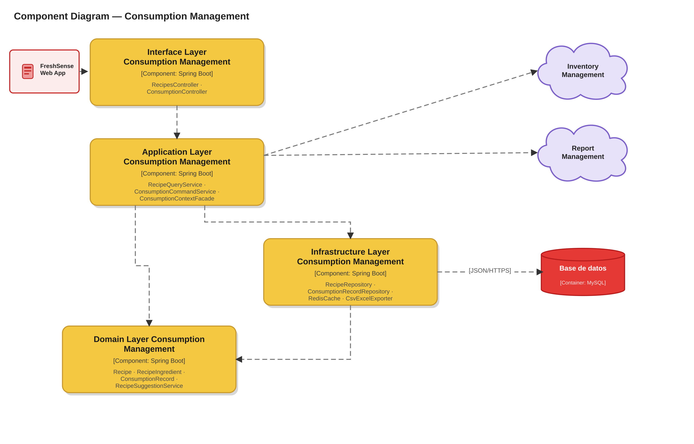
<figcaption style="font-size:0.9em;color:#555;margin-top:0.4em"><em>Component Level Diagram — Consumption Management.</em></figcaption>
</figure>

### 5.6.7. Bounded Context Software Architecture Code Level Diagrams

#### 5.6.7.1. Bounded Context Domain Layer Class Diagrams

<figure id="fig-class-con" style="margin:1.5em 0;text-align:center">
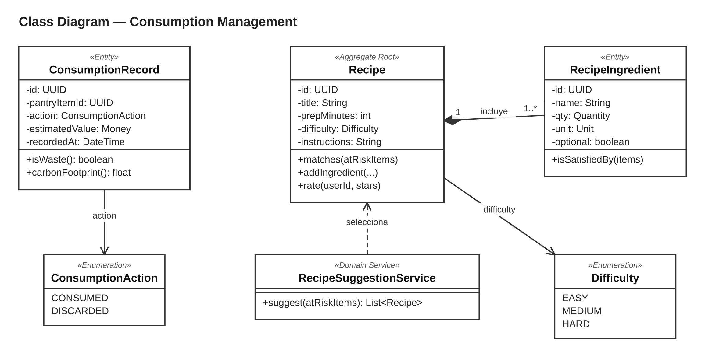
<figcaption style="font-size:0.9em;color:#555;margin-top:0.4em"><em>Class Diagram (Domain Layer) — Consumption Management.</em></figcaption>
</figure>

#### 5.6.7.2. Bounded Context Database Design Diagram

<figure id="fig-er-con" style="margin:1.5em 0;text-align:center">
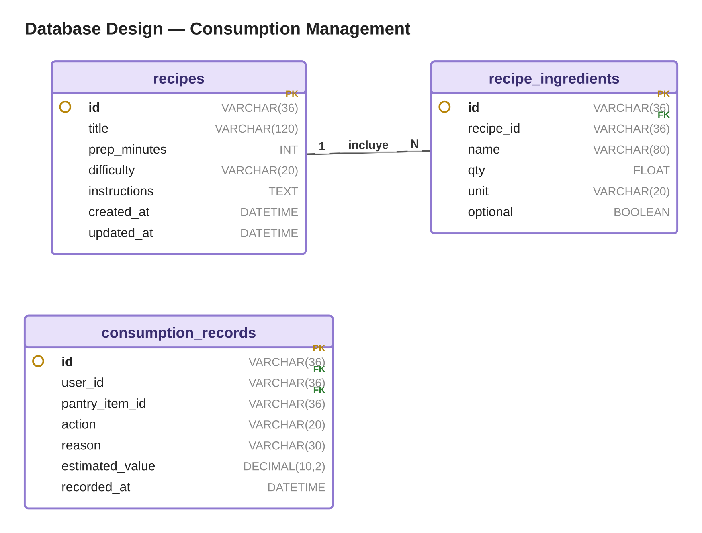
<figcaption style="font-size:0.9em;color:#555;margin-top:0.4em"><em>Database Design Diagram — Consumption Management.</em></figcaption>
</figure>

## 5.7. Bounded Context: IoT Monitoring

El **IoT Monitoring Bounded Context** es el núcleo de la integración IoT del producto. Recibe la telemetría del dispositivo FreshSense mediante el endpoint REST seguro definido en la **TS41**, evalúa las lecturas contra los umbrales de cada alimento a través del `FreshnessService` del modelo de dominio, y emite las alertas preventivas de la **US08**, respetando el **Modo Mantenimiento** de la **US32**. Este contexto traduce la señal física (temperatura, humedad, etileno) en conocimiento de negocio: el estado de frescura del alimento.

### 5.7.1. Domain Layer

La Domain Layer del IoT Monitoring Bounded Context encapsula la lógica de negocio del contexto. En esta capa se definen los agregados, entidades, objetos de valor, servicios de dominio y políticas que representan los conceptos clave del sistema.

**Aggregates**

1. **SensorReading**
   - *Propósito:* Agregado raíz que representa una lectura de telemetría enviada por el dispositivo FreshSense.

   - *Atributos:*

| Atributo | Tipo | Descripción |
|---|---|---|
| id | UUID | Identificador de la lectura. |
| deviceId | UUID | Dispositivo que la originó. |
| timestamp | DateTime | Instante de la medición. |
| temperatureC | float | Temperatura en grados Celsius. |
| humidityPct | float | Humedad relativa en porcentaje. |
| ethylenePpm | float | Concentración de gas etileno en ppm. |
| meta | String | Metadatos del envío (versión de firmware, calidad de señal). |
   - *Métodos:*

| Método | Descripción |
|---|---|
| isValid() | Valida que los rangos de las tres magnitudes sean físicamente posibles. |
| exceeds(ShelfLifeRules) | Indica si la lectura supera los umbrales de la categoría del alimento. |
| toQualityRecord() | Proyecta la lectura al histórico de calidad consultado en los reportes. |

**Entities**

1. **ExpirationAlert** — Alerta generada cuando un alimento entra en riesgo de deterioro (US08).

| Atributo | Tipo | Descripción |
|---|---|---|
| id | UUID | Identificador de la alerta. |
| inventoryItemId | UUID | Alimento afectado. |
| raisedAt | DateTime | Momento en que se emitió. |
| type | AlertType (VO) | NEARING_EXPIRY, HIGH_ETHYLENE o TEMP_RISK. |
| status | AlertStatus (VO) | OPEN, SENT, SNOOZED o RESOLVED. |
| meta | String | Valores que motivaron la alerta. |

| Método | Descripción |
|---|---|
| resolve() | Marca la alerta como resuelta cuando el alimento se consume o descarta. |
| snooze(until) | Pospone la alerta según las preferencias del usuario (US09). |
| markSent() | Registra que la notificación fue despachada. |
2. **ThresholdProfile** — Perfil de umbrales aplicado a una zona, incluido el Modo Mantenimiento (US32).

| Atributo | Tipo | Descripción |
|---|---|---|
| id | UUID | Identificador del perfil. |
| zoneId | UUID | Zona de almacenamiento a la que aplica. |
| maxTemperatureC | float | Temperatura máxima tolerada. |
| maxEthylenePpm | float | Concentración máxima de etileno tolerada. |
| maintenanceMode | boolean | Indica si el modo de mantenimiento está activo (US32). |

| Método | Descripción |
|---|---|
| applyMaintenanceMode() | Pausa las alarmas de la zona mientras la cámara se limpia o se repara (US32). |
| evaluate(SensorReading) | Determina si la lectura constituye una desviación. |
**Value Objects**

| Value Object | Descripción |
|---|---|
| AlertType | Enumeración: `NEARING_EXPIRY`, `HIGH_ETHYLENE`, `TEMP_RISK`. |
| AlertStatus | Enumeración: `OPEN`, `SENT`, `SNOOZED`, `RESOLVED`. |
| FreshnessStatus | Enumeración compartida con Inventory: `FRESH`, `AT_RISK`, `SPOILED` (Shared Kernel). |
| Severity | Nivel de la alerta empleado para decidir el canal de entrega (US24). |

**Domain Services**

| Servicio | Descripción |
|---|---|
| FreshnessService | Servicio de dominio central del modelo: `evaluate(InventoryItem, SensorReading*)` determina el `FreshnessStatus` y `estimateBestBefore(InventoryItem, FoodModel, SensorReading*)` ajusta la fecha de consumo preferente con la telemetría real. |
| ThresholdEvaluationService | Compara cada lectura con el `ThresholdProfile` vigente y decide si corresponde emitir una alerta. |

**Domain Events**

| Evento | Descripción |
|---|---|
| SensorReadingRegistered | Se persistió una lectura del dispositivo (ES: *registrar humedad / temperatura / etileno*). |
| FoodConditionUpdated | El `FreshnessService` recalculó el estado del alimento (ES: *estado del alimento actualizado*). |
| EthyleneAlertIssued | La concentración de etileno superó el umbral y se emitió la alerta (ES: *alerta emitida*). |
| TemperatureAlertIssued | La temperatura salió del rango tolerado de la zona. |
| AlertResolved | La alerta se cerró al consumirse o descartarse el alimento. |
| MaintenanceModeActivated | Se pausaron las alarmas de la cámara por limpieza o reparación (US32). |

**Policies**

- **Emitir alerta al superar umbrales**: cuando los valores del sensor superan los umbrales configurados, se emite una alerta de expiración (US08).
- **Evitar falsas alarmas**: cuando no existen desviaciones en los parámetros, el chequeo periódico no emite ninguna notificación (US08).
- **Pausar alarmas en Modo Mantenimiento**: mientras una cámara está en mantenimiento, sus lecturas se registran pero no generan alertas hasta que se reactive (US32).
- **Respetar el turno operativo**: cuando una alerta de baja severidad cae fuera del turno, se retiene hasta el siguiente; las críticas se envían siempre al responsable de turno (US09, US24).

### 5.7.2. Interface Layer

La Interface Layer del IoT Monitoring expone los puntos de entrada del contexto mediante controladores REST, recursos y *assemblers* que traducen entre el modelo HTTP y el modelo de dominio.

**Controllers**

1. **SensorReadingsController** — Endpoint de ingesta de telemetría del dispositivo IoT (TS41).

| Método | Endpoint | Descripción |
|---|---|---|
| POST | /api/v1/sensor-readings | Recibe un JSON con temperatura, humedad y etileno; valida el token del dispositivo y responde 201. |
| GET | /api/v1/sensor-readings | Consulta el histórico de lecturas por dispositivo y periodo. |
   - *Dependencias:* MonitoringCommandService, MonitoringQueryService

2. **AlertsController** — Expone y gestiona las alertas de expiración (US08).

| Método | Endpoint | Descripción |
|---|---|---|
| GET | /api/v1/alerts | Lista las alertas abiertas del usuario. |
| POST | /api/v1/alerts/{id}/snooze | Pospone la alerta según las preferencias (US09). |
| POST | /api/v1/alerts/{id}/resolve | Marca la alerta como resuelta. |
   - *Dependencias:* AlertCommandService, AlertQueryService

3. **ThresholdsController** — Configura los umbrales y el Modo Mantenimiento (US32).

| Método | Endpoint | Descripción |
|---|---|---|
| GET | /api/v1/thresholds/{zoneId} | Obtiene el perfil de umbrales de la zona. |
| PUT | /api/v1/thresholds/{zoneId} | Actualiza los umbrales o activa el Modo Mantenimiento. |
   - *Dependencias:* ThresholdCommandService

**Resources**

| Resource | Campos |
|---|---|
| SensorReadingResource | deviceId, timestamp, temperatureC, humidityPct, ethylenePpm, meta |
| AlertResource | id, inventoryItemId, type, status, raisedAt, meta |
| ThresholdProfileResource | zoneId, maxTemperatureC, maxEthylenePpm, maintenanceMode |
| QualityHistoryResource | deviceId, period, avgTemperature, avgHumidity, maxEthylene |

**Transformers / Assemblers**

| Assembler | Transformación |
|---|---|
| SensorReadingCommandFromResourceAssembler | Convierte el JSON entrante del dispositivo en `RegisterSensorReadingCommand` (TS41). |
| AlertResourceFromEntityAssembler | Convierte `ExpirationAlert` en `AlertResource`. |
| ThresholdProfileResourceFromEntityAssembler | Convierte `ThresholdProfile` en su recurso. |

### 5.7.3. Application Layer

La Application Layer del IoT Monitoring coordina las operaciones entre la Interface Layer y la Domain Layer, orquestando comandos, consultas y la reacción a eventos de otros contextos.

**Command Services**

| Servicio | Comandos que maneja | Descripción |
|---|---|---|
| MonitoringCommandServiceImpl | RegisterSensorReadingCommand | Valida el token del dispositivo, persiste la lectura y dispara la evaluación de frescura (TS41). |
| AlertCommandServiceImpl | IssueAlertCommand, SnoozeAlertCommand, ResolveAlertCommand | Emite, pospone y cierra las alertas de expiración (US08, US09). |
| ThresholdCommandServiceImpl | UpdateThresholdsCommand, ActivateMaintenanceModeCommand | Ajusta los umbrales por zona y activa el Modo Mantenimiento (US32). |

**Query Services / Facades**

| Servicio | Consultas | Descripción |
|---|---|---|
| MonitoringQueryServiceImpl | GetReadingsByDeviceQuery, GetQualityHistoryQuery | Recupera el histórico de telemetría y las métricas agregadas de calidad. |
| AlertQueryServiceImpl | GetOpenAlertsQuery, GetAlertsByItemQuery | Recupera las alertas vigentes del usuario. |
| MonitoringContextFacade | getQualityHistory(businessId, period), getOpenAlerts(userId) | Open Host Service consultado por Report Management e Inventory Management. |

**Event Handlers**

| Handler | Evento que escucha | Reacción |
|---|---|---|
| SensorConfiguredEventHandler | SensorConfigured (Sensor Management) | Crea el `ThresholdProfile` inicial de la zona con los umbrales por defecto de sus alimentos. |
| FoodItemRegisteredEventHandler | FoodItemRegistered (Inventory Management) | Asocia el nuevo alimento a la zona monitoreada y comienza a evaluarlo. |
| InventoryItemResolvedEventHandler | FoodItemConsumed / FoodItemDiscarded (Inventory Management) | Cierra automáticamente las alertas abiertas del alimento (`AlertResolved`). |

### 5.7.4. Infrastructure Layer

La Infrastructure Layer del IoT Monitoring implementa la persistencia y las integraciones técnicas (ACL) hacia otros contextos y sistemas externos.

| Componente | Tipo | Responsabilidad |
|---|---|---|
| SensorReadingRepository | JPA Repository | Persistencia de la telemetría; `findByDeviceIdAndTsBetween`. |
| ExpirationAlertRepository | JPA Repository | Persistencia de alertas; `findByStatus`, `findByInventoryItemId`. |
| ThresholdProfileRepository | JPA Repository | Persistencia de los perfiles de umbrales por zona. |
| DeviceTokenValidator | ACL entrante | Valida el token del dispositivo antes de aceptar la lectura (TS41). |
| NotificationGatewayAdapter | ACL saliente | Despacha la alerta a la cola de eventos del Notification Service (TS42). |
| FreshnessEvaluationScheduler | Spring Scheduler | Ejecuta el chequeo periódico de frescura sobre los alimentos activos. |

### 5.7.6. Bounded Context Software Architecture Component Level Diagrams

<figure id="fig-comp-mon" style="margin:1.5em 0;text-align:center">

<figcaption style="font-size:0.9em;color:#555;margin-top:0.4em"><em>Component Level Diagram — IoT Monitoring.</em></figcaption>
</figure>

### 5.7.7. Bounded Context Software Architecture Code Level Diagrams

#### 5.7.7.1. Bounded Context Domain Layer Class Diagrams

<figure id="fig-class-mon" style="margin:1.5em 0;text-align:center">

<figcaption style="font-size:0.9em;color:#555;margin-top:0.4em"><em>Class Diagram (Domain Layer) — IoT Monitoring.</em></figcaption>
</figure>

#### 5.7.7.2. Bounded Context Database Design Diagram

<figure id="fig-er-mon" style="margin:1.5em 0;text-align:center">

<figcaption style="font-size:0.9em;color:#555;margin-top:0.4em"><em>Database Design Diagram — IoT Monitoring.</em></figcaption>
</figure>

## 5.8. Bounded Context: Report Management

El **Report Management Bounded Context** consolida la información de los demás contextos para producir los **reportes de consumo y sostenibilidad**: el reporte semanal de mermas (**US12**), la analítica avanzada de rotación (**US17**), el panel de ahorro económico (**US18**) y las métricas de impacto ecológico en kg de CO₂ evitado (**US20**). Genera los archivos descargables en PDF y Excel con JasperReports y Apache POI, y expone la información al Analytics Service externo.

### 5.8.1. Domain Layer

La Domain Layer del Report Management Bounded Context encapsula la lógica de negocio del contexto. En esta capa se definen los agregados, entidades, objetos de valor, servicios de dominio y políticas que representan los conceptos clave del sistema.

**Aggregates**

1. **ConsumptionReport**
   - *Propósito:* Agregado raíz que representa un reporte consolidado de consumo, merma y ahorro para un periodo determinado.

   - *Atributos:*

| Atributo | Tipo | Descripción |
|---|---|---|
| id | UUID | Identificador del reporte. |
| userId | UUID | Usuario o negocio destinatario. |
| period | Period (VO) | Rango de fechas cubierto (periodStart–periodEnd). |
| savedAmount | Money (VO) | Valor económico rescatado al consumir a tiempo (US18). |
| wasteReducedKgCO2 | float | Kilogramos de CO₂ evitados (US20). |
| sections | List&lt;ReportSection&gt; | Bloques del reporte: inventario, consumo, calidad. |
| createdAt | DateTime | Fecha de generación. |
   - *Métodos:*

| Método | Descripción |
|---|---|
| generate(inventory, consumption, quality) | Construye el reporte a partir de los tres contextos fuente. |
| exportTo(format) | Exporta el reporte a PDF o Excel (US29). |
| isPremiumOnly() | Indica si el nivel de detalle requiere plan PREMIUM (US17). |

**Entities**

1. **ReportSection** — Bloque temático del reporte con sus métricas calculadas.

| Atributo | Tipo | Descripción |
|---|---|---|
| id | UUID | Identificador de la sección. |
| reportId | UUID | Reporte al que pertenece. |
| type | SectionType (VO) | INVENTORY, CONSUMPTION, QUALITY o SUSTAINABILITY. |
| metricsJson | String | Métricas calculadas serializadas. |
| order | int | Posición dentro del reporte. |

| Método | Descripción |
|---|---|
| render(format) | Produce la representación de la sección en el formato solicitado. |
**Value Objects**

| Value Object | Descripción |
|---|---|
| Period | Rango de fechas con inicio y fin; valida que el fin sea posterior al inicio. |
| Money | Importe con moneda, usado para el ahorro estimado (US18). |
| SectionType | Enumeración: `INVENTORY`, `CONSUMPTION`, `QUALITY`, `SUSTAINABILITY`. |
| ExportFormat | Enumeración: `PDF`, `XLSX`, `CSV` (US29). |

**Domain Services**

| Servicio | Descripción |
|---|---|
| ReportAssemblyService | Orquesta la consulta a Inventory, Consumption e IoT Monitoring y arma las secciones del reporte. |
| SustainabilityMetricsService | Convierte los kilogramos de alimento salvado en CO₂ evitado y litros de agua preservados (US20). |

**Domain Events**

| Evento | Descripción |
|---|---|
| ReportRequested | El usuario solicitó un reporte (ES: *solicitar reporte*). |
| ReportGenerated | El reporte se construyó y quedó disponible (ES: *reporte generado*). |
| WeeklyReportSent | Se despachó el resumen semanal al correo del usuario (US12). |
| ReportExported | El usuario descargó el reporte en PDF, Excel o CSV (US29). |

**Policies**

- **Emitir reporte semanal**: cuando se cumple el ciclo de 7 días, el servidor consolida los datos y envía un resumen gráfico al correo y al panel (US12).
- **Verificar plan antes de la analítica avanzada**: cuando un usuario sin PREMIUM solicita la rotación detallada, el acceso se bloquea (US17).
- **Calcular impacto ambiental**: cuando se genera el reporte, se estima el CO₂ evitado a partir de los alimentos consumidos a tiempo (US20).

### 5.8.2. Interface Layer

La Interface Layer del Report Management expone los puntos de entrada del contexto mediante controladores REST, recursos y *assemblers* que traducen entre el modelo HTTP y el modelo de dominio.

**Controllers**

1. **ReportsController** — Genera y expone los reportes de consumo y sostenibilidad.

| Método | Endpoint | Descripción |
|---|---|---|
| GET | /api/v1/reports | Lista los reportes generados del usuario. |
| POST | /api/v1/reports | Genera un reporte para el periodo indicado (US12). |
| GET | /api/v1/reports/{id} | Obtiene el detalle del reporte y sus secciones. |
| GET | /api/v1/reports/{id}/export | Descarga el reporte en PDF, Excel o CSV (US29). |
   - *Dependencias:* ReportCommandService, ReportQueryService

2. **AnalyticsController** — Expone la analítica avanzada y el panel de ahorro (US17, US18).

| Método | Endpoint | Descripción |
|---|---|---|
| GET | /api/v1/analytics/rotation | Gráficos de rotación de inventario (solo PREMIUM). |
| GET | /api/v1/analytics/savings | Ahorro acumulado estimado en moneda local. |
| GET | /api/v1/analytics/sustainability | Métricas de CO₂ evitado y agua preservada (US20). |
   - *Dependencias:* ReportQueryService

**Resources**

| Resource | Campos |
|---|---|
| ReportResource | id, period, savedAmount, wasteReducedKgCO2, sections[], createdAt |
| ReportSectionResource | type, metrics, order |
| CreateReportResource | periodStart, periodEnd, scope |
| SustainabilityResource | kgCO2Avoided, litersWaterSaved, itemsSaved |

**Transformers / Assemblers**

| Assembler | Transformación |
|---|---|
| ReportResourceFromEntityAssembler | Convierte `ConsumptionReport` y sus secciones en `ReportResource`. |
| SustainabilityResourceFromEntityAssembler | Convierte las métricas ambientales en su recurso. |
| CreateReportCommandFromResourceAssembler | Convierte `CreateReportResource` en `GenerateReportCommand`. |

### 5.8.3. Application Layer

La Application Layer del Report Management coordina las operaciones entre la Interface Layer y la Domain Layer, orquestando comandos, consultas y la reacción a eventos de otros contextos.

**Command Services**

| Servicio | Comandos que maneja | Descripción |
|---|---|---|
| ReportCommandServiceImpl | GenerateReportCommand, ExportReportCommand | Construye el reporte consultando los contextos fuente y genera el archivo descargable. |
| WeeklyReportSchedulerImpl | SendWeeklyReportCommand | Consolida y despacha el reporte semanal de mermas al correo del negocio (US12). |

**Query Services / Facades**

| Servicio | Consultas | Descripción |
|---|---|---|
| ReportQueryServiceImpl | GetReportsByUserQuery, GetReportByIdQuery, GetSustainabilityMetricsQuery | Recupera los reportes generados y las métricas de impacto ambiental. |
| AnalyticsQueryServiceImpl | GetRotationAnalyticsQuery, GetSavingsQuery | Recupera la analítica avanzada y el ahorro acumulado, previa verificación del plan (US17, US18). |
| ReportContextFacade | getLatestReport(userId) | Open Host Service consultado por el Analytics Service externo. |

**Event Handlers**

| Handler | Evento que escucha | Reacción |
|---|---|---|
| ConsumptionRegisteredEventHandler | ConsumptionRegistered (Consumption Management) | Acumula el valor rescatado y actualiza las métricas del periodo en curso. |
| WasteRegisteredEventHandler | WasteRegistered (Consumption Management) | Acumula la merma y recalcula la huella de carbono del periodo (US20). |
| WeeklyCycleEventHandler | WeeklyCycleCompleted (Spring Scheduler) | Dispara `SendWeeklyReportCommand` para generar y enviar el resumen (US12). |

### 5.8.4. Infrastructure Layer

La Infrastructure Layer del Report Management implementa la persistencia y las integraciones técnicas (ACL) hacia otros contextos y sistemas externos.

| Componente | Tipo | Responsabilidad |
|---|---|---|
| ConsumptionReportRepository | JPA Repository | Persistencia de reportes; `findByUserIdAndPeriod`. |
| ReportSectionRepository | JPA Repository | Persistencia de las secciones de cada reporte. |
| JasperPdfExporter | Servicio técnico | Genera el reporte en PDF con JasperReports. |
| ApachePoiExcelExporter | Servicio técnico | Genera el reporte en Excel con Apache POI (US29). |
| ExternalInventoryService | ACL entrante | Consulta el `InventoryContextFacade` para el snapshot de inventario. |
| ExternalConsumptionService | ACL entrante | Consulta el `ConsumptionContextFacade` para el resumen de consumo. |
| ExternalMonitoringService | ACL entrante | Consulta el `MonitoringContextFacade` para el histórico de calidad. |
| AnalyticsServiceAdapter | ACL saliente | Publica las métricas consolidadas al Analytics Service externo. |

### 5.8.6. Bounded Context Software Architecture Component Level Diagrams

<figure id="fig-comp-rep" style="margin:1.5em 0;text-align:center">

<figcaption style="font-size:0.9em;color:#555;margin-top:0.4em"><em>Component Level Diagram — Report Management.</em></figcaption>
</figure>

### 5.8.7. Bounded Context Software Architecture Code Level Diagrams

#### 5.8.7.1. Bounded Context Domain Layer Class Diagrams

<figure id="fig-class-rep" style="margin:1.5em 0;text-align:center">

<figcaption style="font-size:0.9em;color:#555;margin-top:0.4em"><em>Class Diagram (Domain Layer) — Report Management.</em></figcaption>
</figure>

#### 5.8.7.2. Bounded Context Database Design Diagram

<figure id="fig-er-rep" style="margin:1.5em 0;text-align:center">

<figcaption style="font-size:0.9em;color:#555;margin-top:0.4em"><em>Database Design Diagram — Report Management.</em></figcaption>
</figure>

<div style="page-break-after: always;"></div>


<div style="page-break-after: always;"></div>

# Capítulo VI: Solution UX Design

## 6.1. Style Guidelines

FreshSense establece un conjunto de lineamientos visuales y de interacción orientados a mantener una experiencia consistente entre el Landing Page, la aplicación web, la aplicación móvil y la experiencia asociada al dispositivo IoT.

La solución está dirigida principalmente a **empresas de distribución y cadena de frío** y a **empresas productoras y comercializadoras de alimentos perecibles**. Por ello, la experiencia visual prioriza claridad, confiabilidad y rápida interpretación de información relacionada con monitoreo ambiental, lotes, dispositivos, alertas y trazabilidad.

Los recursos visuales del producto, como logotipos, imágenes, tipografías y demás elementos gráficos, se centralizarán en la carpeta `Assets/` del repositorio para mantener una referencia común entre todos los integrantes del equipo.

### 6.1.1. General Style Guidelines

Los lineamientos generales de FreshSense definen la identidad visual y comunicacional utilizada en los diferentes productos digitales que forman parte de la solución.

#### Branding

La identidad de FreshSense está orientada a transmitir **frescura, control, trazabilidad, tecnología y confiabilidad**.

La marca busca representar una solución tecnológica que permita a las empresas monitorear las condiciones de conservación de productos perecibles durante su almacenamiento y distribución, facilitando la detección de desviaciones y reduciendo las pérdidas asociadas al deterioro de productos.

El diseño visual mantiene una apariencia limpia y profesional, evitando interfaces excesivamente cargadas. Los elementos relacionados con monitoreo, conservación, alertas, dispositivos y trazabilidad deben utilizarse de manera consistente en todos los productos digitales.

#### Typography

FreshSense utiliza la familia tipográfica **Poppins** debido a su apariencia moderna, limpia y legible en interfaces digitales.

Se establece la siguiente jerarquía tipográfica:

- **H1:** títulos principales de páginas y mensajes de mayor importancia.
- **H2:** títulos de secciones.
- **H3:** subtítulos y encabezados de componentes.
- **Body:** contenido descriptivo, datos y textos de apoyo.
- **Labels:** nombres de campos, indicadores, filtros y estados.

La jerarquía debe mantenerse de manera consistente en las experiencias Web y Mobile para facilitar la lectura y comprensión de la información.

#### Colors

La paleta cromática de FreshSense está compuesta principalmente por verde, azul, tonos neutros y blanco.

| Color | Uso principal |
|---|---|
| **Green - Primary** | Acciones principales, indicadores de condiciones adecuadas y elementos asociados a conservación. |
| **Blue - Secondary** | Monitoreo, información tecnológica, gráficos y componentes secundarios. |
| **Gray - Neutral** | Textos secundarios, etiquetas, íconos y divisores. |
| **White - Background** | Fondos principales, tarjetas y espacios de contenido. |
| **Text - Base** | Información principal y contenido de alta prioridad. |

Los estados que requieran atención podrán utilizar indicadores visuales diferenciados según su nivel de severidad. Sin embargo, el color no será el único mecanismo de comunicación; cada estado deberá estar acompañado por texto o iconografía que permita comprender claramente la situación.

#### Spacing & Layout

FreshSense utiliza una estructura modular para mantener consistencia entre páginas y componentes.

**Base Unit**

- Size: `8 px`
- Uso: unidad base para márgenes, paddings y separación entre elementos.

**Grid System**

- Grid: `12 columnas`
- Gutter: `22 px`
- Margins: proporcionales a la unidad base.

**Section Spacing**

- Standard section: `56 px`
- Hero section: `72 px`
- Footer: `36–56 px`

**Cards & Components**

- Internal padding: `18–22 px`
- Border radius: `16 px`
- Elevation: `0 10px 25px rgba(0,0,0,.08)`

**Alignment**

- Contenido principal dentro de un contenedor máximo de `1120 px` o `92%` del ancho disponible.
- El contenido textual se alinea principalmente a la izquierda para facilitar su lectura.
- Los indicadores críticos y métricas principales deberán tener mayor jerarquía visual.
- Se utilizarán espacios amplios entre grupos de información para diferenciar claramente cada sección.

#### Tone of Voice

El tono de comunicación de FreshSense busca transmitir profesionalismo, confianza y claridad, debido a que la solución presenta información utilizada para supervisar las condiciones de conservación de productos perecibles.

| Dimensión | Orientación de FreshSense | Justificación |
|---|---|---|
| Divertido / Serio | **Serio** | Los datos de monitoreo y las alertas requieren una comunicación clara y confiable. |
| Formal / Casual | **Formal** | La solución está orientada a organizaciones y procesos empresariales. |
| Respetuoso / Irreverente | **Respetuoso** | Los mensajes deben orientar al usuario sin generar confusión. |
| Entusiasta / Sereno | **Sereno** | Las incidencias deben comunicarse con claridad sin utilizar mensajes alarmistas. |

Los mensajes del sistema deben ser breves, precisos y orientados a una acción concreta.

Ejemplos:

- `Temperature above allowed range`
- `Device disconnected`
- `Cold chain deviation detected`
- `Reading updated successfully`
- `Lot requires attention`

### 6.1.2. Web, Mobile & Devices Style Guidelines

FreshSense mantiene una identidad visual consistente entre sus diferentes interfaces. Los usuarios deben reconocer los mismos colores, tipografía, iconografía, indicadores y terminología independientemente de si utilizan la aplicación web o móvil.

#### Web Style Guidelines

El Landing Page y la aplicación web utilizarán principios de **Material Design**, manteniendo consistencia en componentes como botones, formularios, tarjetas, tablas, menús, indicadores y mensajes de estado.

Para la versión Desktop del Landing Page se utilizará principalmente el **patrón de lectura Z**, dirigiendo inicialmente la atención hacia la marca, propuesta de valor y Call-to-Action principal.

Posteriormente, el contenido presentará el funcionamiento de FreshSense, sus principales beneficios y la solución específica para cada segmento empresarial.

En pantallas de menor tamaño, el contenido adoptará una estructura principalmente vertical.

La aplicación web priorizará la visualización de información relacionada con:

- Dashboard.
- Monitoring.
- Inventory.
- Lots.
- Devices.
- Alerts.
- Traceability.
- Reports.

Los datos provenientes del dispositivo IoT, como temperatura, humedad, última lectura y estado de conexión, se presentarán mediante tarjetas, tablas, indicadores y gráficos que permitan identificar rápidamente desviaciones o situaciones que requieran atención.

#### Mobile Style Guidelines

La aplicación móvil mantendrá los mismos principios visuales definidos para la aplicación web, adaptando la distribución a pantallas de menor tamaño.

Se priorizarán las funcionalidades que requieren consulta rápida:

- Estado general del monitoreo.
- Alertas activas.
- Lecturas recientes.
- Estado de dispositivos.
- Estado de lotes.

La información se organizará principalmente en una sola columna y se priorizarán los eventos o condiciones que requieran atención inmediata.

Los nombres, colores, iconos y estados serán equivalentes a los utilizados en Web para reducir la curva de aprendizaje entre plataformas.

#### IoT Style Guidelines

El dispositivo IoT actual de FreshSense funciona como un nodo de monitoreo encargado de registrar las condiciones ambientales relacionadas con la conservación de productos perecibles.

El prototipo utiliza un microcontrolador **ESP32** junto con un sensor **DHT22** para obtener periódicamente información de temperatura y humedad.

Las mediciones son transmitidas mediante Wi-Fi hacia el Edge API y posteriormente enviadas al backend de FreshSense para su almacenamiento, procesamiento y visualización.

El prototipo físico actual no incorpora una pantalla ni controles de interacción directa documentados. Por ello, la interacción del usuario con el dispositivo se realiza principalmente mediante las aplicaciones digitales de FreshSense.

Los principales elementos relacionados con el dispositivo utilizarán etiquetas simples y consistentes:

| Elemento | Label |
|---|---|
| Estado del dispositivo | `Connected` / `Disconnected` |
| Temperatura | `Temperature` |
| Humedad | `Humidity` |
| Última medición | `Last Reading` |
| Estado del monitoreo | `Monitoring Status` |
| Identificador | `Device ID` |

La interfaz debe permitir que el usuario comprenda el estado del dispositivo y de las condiciones monitoreadas sin necesidad de conocer detalles técnicos como el funcionamiento del ESP32, DHT22, JSON o Edge API.

#### Internationalization & Accessibility

FreshSense considera dos locales principales:

- `en_US` - English.
- `es_419` - Latin American Spanish.

El idioma predeterminado de las interfaces será **English**, manteniendo disponible la estructura necesaria para presentar los mismos contenidos en español latinoamericano.

En las experiencias Web se utilizarán atributos ARIA para facilitar el uso de tecnologías de asistencia.

Asimismo, los estados importantes no serán representados únicamente mediante colores, sino también mediante texto, iconos u otros indicadores reconocibles.

La estructura visual, las etiquetas y los componentes mantendrán consistencia entre ambos idiomas.


## 6.2. Information Architecture

La arquitectura de información de FreshSense está diseñada para que los visitantes y usuarios puedan comprender rápidamente la propuesta del producto y acceder a información relacionada con monitoreo, dispositivos, productos perecibles, alertas y trazabilidad sin recorrer estructuras complejas.

La organización considera las necesidades de los dos segmentos principales:

- **Empresas de distribución y cadena de frío:** organizaciones encargadas del transporte, distribución o almacenamiento de productos perecibles que requieren supervisar continuamente las condiciones de conservación.
- **Empresas productoras y comercializadoras de alimentos perecibles:** organizaciones que producen, almacenan o comercializan alimentos y necesitan controlar las condiciones de sus productos y reducir pérdidas asociadas al deterioro.

La arquitectura considera el Landing Page, la aplicación web, la aplicación móvil y las funcionalidades asociadas al monitoreo mediante dispositivos IoT.

### 6.2.1. Organization Systems

FreshSense utiliza distintos sistemas de organización dependiendo del tipo de información y de la tarea que realiza el usuario.

#### Hierarchical Organization

El Landing Page utiliza una organización jerárquica que presenta primero la información de mayor relevancia:

1. Propuesta de valor.
2. Funcionamiento de FreshSense.
3. Beneficios.
4. Solución para distribución y cadena de frío.
5. Solución para productores y comercializadores.
6. Call-to-Action.
7. Contacto.

En las aplicaciones, la información se organiza priorizando inicialmente indicadores generales, alertas activas y posibles desviaciones antes de mostrar información secundaria.

#### Sequential Organization

Los procesos que requieren completar varias acciones utilizan una organización secuencial.

Ejemplos:

`Register → Add Device → Configure Device → Start Monitoring`

`Register Lot → Add Product Information → Associate Device → Start Tracking`

De esta manera, el usuario recibe únicamente la información necesaria para completar cada etapa del proceso.

#### Matrix Organization

Las vistas de monitoreo utilizan estructuras matriciales que permiten comparar diferentes dispositivos, lotes o variables.

**Monitoring**

| Device | Temperature | Humidity | Status | Last Reading |
|---|---|---|---|---|
| Device ID | Value | Value | Connection Status | Date & Time |

**Lots**

| Lot | Product | Location | Monitoring Status | Last Update |
|---|---|---|---|---|
| Lot ID | Product Name | Location | Status | Date & Time |

Este sistema facilita la supervisión simultánea de múltiples productos y dispositivos.

#### Alphabetical Organization

Los productos, dispositivos y ubicaciones podrán organizarse alfabéticamente cuando sea necesario localizar un elemento específico.

#### Chronological Organization

Las lecturas, alertas, incidencias y registros de trazabilidad se organizan principalmente de forma cronológica, mostrando primero los eventos más recientes.

#### Topic-Based Organization

Las principales funcionalidades se agrupan según el tópico al que pertenecen:

- Dashboard
- Monitoring
- Inventory
- Lots
- Devices
- Alerts
- Traceability
- Reports

#### Audience-Based Organization

En el Landing Page se diferencia el contenido según los segmentos objetivo:

- **For Cold Chain:** contenido orientado a empresas de distribución y operadores de cadena de frío.
- **For Producers:** contenido orientado a empresas productoras y comercializadoras de alimentos perecibles.

Esto permite presentar beneficios específicos para cada segmento sin modificar la identidad general de FreshSense.

### 6.2.2. Labeling Systems

El sistema de etiquetado de FreshSense utiliza términos breves, consistentes y fáciles de reconocer.

Se evita mostrar terminología técnica relacionada con la implementación cuando no aporta valor directo al usuario.

#### Landing Page

| Label | Propósito |
|---|---|
| `Home` | Regresar al inicio. |
| `Solution` | Presentar la solución FreshSense. |
| `How It Works` | Explicar el funcionamiento general del sistema. |
| `Benefits` | Presentar los principales beneficios. |
| `For Cold Chain` | Información dirigida a empresas de distribución y cadena de frío. |
| `For Producers` | Información dirigida a productores y comercializadores. |
| `Contact` | Presentar los medios de contacto. |
| `Sign In` | Acceder a la plataforma. |
| `Get Started` | Iniciar el proceso de acceso o registro. |

#### Web and Mobile Applications

| Label | Información asociada |
|---|---|
| `Dashboard` | Resumen general del sistema e indicadores principales. |
| `Monitoring` | Visualización de las condiciones registradas por los dispositivos. |
| `Inventory` | Información de los productos registrados. |
| `Lots` | Gestión y seguimiento de lotes. |
| `Devices` | Gestión de dispositivos IoT asociados. |
| `Alerts` | Eventos o desviaciones que requieren atención. |
| `Traceability` | Historial de eventos y condiciones asociadas a productos o lotes. |
| `Reports` | Información consolidada y resultados de monitoreo. |

#### IoT Monitoring

| Label | Información asociada |
|---|---|
| `Device` | Dispositivo IoT registrado. |
| `Device ID` | Identificador único del dispositivo. |
| `Connected` | Dispositivo comunicándose correctamente. |
| `Disconnected` | Dispositivo sin comunicación con el sistema. |
| `Temperature` | Temperatura obtenida mediante el sensor. |
| `Humidity` | Humedad obtenida mediante el sensor. |
| `Last Reading` | Fecha y hora de la lectura más reciente. |
| `Monitoring Status` | Estado actual del proceso de monitoreo. |

Las etiquetas se mantendrán equivalentes entre las experiencias Web y Mobile para evitar que un mismo concepto tenga diferentes nombres dependiendo de la plataforma.

### 6.2.3. Searching Systems

El sistema de búsqueda se concentra principalmente en las aplicaciones Web y Mobile, donde el volumen de información puede aumentar debido al registro de dispositivos, lotes, productos, lecturas y alertas.

El Landing Page no requiere un buscador interno debido a que su contenido está organizado en un número reducido de secciones accesibles mediante navegación directa.

#### Lots Search

El usuario podrá buscar lotes mediante:

- Lot ID.
- Producto.
- Ubicación.

Los resultados podrán filtrarse según:

- Monitoring Status.
- Fecha.
- Ubicación.
- Producto.

Cada resultado mostrará información relevante del lote y su estado actual.

#### Device Search

Los dispositivos podrán buscarse mediante:

- Device ID.
- Ubicación.

Los resultados podrán filtrarse según:

- Connected.
- Disconnected.
- Fecha de última lectura.

Cada resultado mostrará como mínimo:

- Device ID.
- Connection Status.
- Temperature.
- Humidity.
- Last Reading.

#### Monitoring Search

La información de monitoreo podrá consultarse utilizando:

- Device.
- Lot.
- Rango de fechas.
- Ubicación.

Los resultados mostrarán las principales mediciones registradas durante el período seleccionado.

#### Alerts Search

Las alertas podrán filtrarse según:

- Estado.
- Severidad.
- Fecha.
- Tipo de evento.
- Device.
- Lot.

Por defecto, se mostrarán primero las alertas más recientes y aquellas que requieran mayor atención.

#### Traceability Search

La información de trazabilidad podrá consultarse mediante:

- Lot ID.
- Producto.
- Device.
- Período.

Los resultados se mostrarán cronológicamente para facilitar la revisión de los eventos registrados durante el almacenamiento o distribución del producto.

Cuando una búsqueda no presente coincidencias, la interfaz mostrará un mensaje claro y permitirá modificar o eliminar los filtros aplicados.

### 6.2.4. SEO Tags and Meta Tags

FreshSense utilizará SEO Tags y Meta Tags para representar adecuadamente el contenido del Landing Page y de la aplicación web.

#### Landing Page

| Element | Value |
|---|---|
| **Title** | `FreshSense | Smart Cold Chain Monitoring for Perishable Foods` |
| **Description** | `FreshSense helps companies monitor temperature and humidity conditions during the storage and distribution of perishable food products using IoT technology.` |
| **Keywords** | `cold chain monitoring, perishable food, IoT monitoring, temperature monitoring, humidity monitoring, food traceability, cold storage` |
| **Author** | `FreshSense Team` |

#### Web Application

| Element | Value |
|---|---|
| **Title** | `FreshSense Platform | Monitor Your Cold Chain` |
| **Description** | `Monitor devices, environmental conditions, lots, alerts and traceability information for perishable food products with FreshSense.` |
| **Keywords** | `FreshSense, cold chain, IoT monitoring, food traceability, temperature, humidity, logistics` |
| **Author** | `FreshSense Team` |

#### Mobile Application - ASO

En caso de publicación de la aplicación móvil mediante un App Store, se utilizarán los siguientes elementos:

| Element | Value |
|---|---|
| **App Title** | `FreshSense` |
| **App Subtitle** | `Smart Cold Chain Monitoring` |
| **App Keywords** | `cold chain, food, monitoring, temperature, humidity, traceability, IoT` |
| **App Description** | `FreshSense helps companies monitor environmental conditions, connected devices and alerts related to the storage and distribution of perishable food products.` |

### 6.2.5. Navigation Systems

La navegación de FreshSense busca mantener recorridos simples y consistentes entre el Landing Page y las diferentes aplicaciones.

#### Landing Page - Desktop

La versión Desktop utilizará una barra de navegación superior con acceso a las principales secciones:

`Home | Solution | How It Works | Benefits | For Cold Chain | For Producers | Contact`

Además, se mostrarán las principales acciones:

`Sign In | Get Started`

Los Call-to-Action permitirán dirigir a los usuarios hacia el acceso a la plataforma o hacia información específica relacionada con su segmento.

#### Landing Page - Mobile

En pantallas móviles, las mismas opciones estarán agrupadas en un menú compacto para reducir el espacio utilizado y priorizar el contenido principal.

El orden y significado de las secciones serán equivalentes a los utilizados en Desktop.

#### Web Application

Una vez autenticado, el usuario tendrá acceso a los principales módulos de FreshSense:

`Dashboard | Monitoring | Inventory | Lots | Devices | Alerts | Traceability | Reports`

El **Dashboard** funcionará como punto inicial de la experiencia y permitirá visualizar información relevante como:

- Estado general del monitoreo.
- Dispositivos conectados.
- Alertas activas.
- Lecturas recientes.
- Lotes que requieren atención.

#### Mobile Application

La navegación móvil priorizará las funcionalidades que requieren consulta frecuente:

- Dashboard.
- Monitoring.
- Alerts.
- Devices.
- Lots.

Las funcionalidades complementarias, como Inventory, Traceability y Reports, permanecerán disponibles desde la navegación secundaria.

#### IoT Device Navigation

La interacción con los dispositivos IoT se realiza principalmente mediante las aplicaciones Web y Mobile.

El recorrido principal será:

`Devices → Select Device → Monitoring → Reading Details`

Para el seguimiento de productos, se utilizará:

`Lots → Select Lot → Traceability → Event Details`

Desde estas vistas, el usuario podrá conocer el estado de conexión de los dispositivos, consultar las mediciones de temperatura y humedad y revisar los eventos asociados al monitoreo de cada lote.

Esta organización evita que el usuario necesite interactuar directamente con componentes técnicos como el ESP32 o el sensor DHT22 para utilizar las funciones principales de FreshSense.

## 6.3. Landing Page UI Design

### 6.3.1. Landing Page Wireframe

A continuación se realizaron los wireframes de la landing page de FreshSense, siguiendo los user stories como referencia, para conocer las necesidades y preferencias de los usuarios visitantes:

**Figura 1.** Wireframe de la página principal 


**Figura 2.** Como funciona FreshSense
 

**Figura 3.** Vistazo inicial a los beneficios 
 

**Figura 4.** Modelo inicial para los planes de subscripción.
 

**Figura 5.** Wireframe para los testimonios
 

**Figura 6.** Wireframe para el formulario y se incluye el footer
 

### 6.3.2. Landing Page Mock-up

Una vez se realizaron los wireframes, usamos los Style Guidelines, para desarrollar el siguiente paso, los mock ups, utilizamos los colores y modelos referidos en los guidelines, los colores verdes y azules predominantes en el diseño, aluden a la escencia de la aplicación:

**Figura 7.** Mock-Up de la página principal 
 

**Figura 8.** Mock-Up se muestra las funciones de FreshSense
 

**Figura 9.** Vistazo inicial a los beneficios 
 

**Figura 10.** Mock-Up para los planes de subscripción.
 

**Figura 11.** Mock-Up para los testimonios
 

**Figura 12.** Mock-Up para el formulario y se incluye el footer


## 6.4. Applications UX/UI Design

En la sección de Applications UX/UI Design nos enfocamos en el diseño de la interfaz y la experiencia de usuario de la aplicación web de FreshSenser, donde incluimos una visualización funcional por cada parte del aplicativo con sus flujos de interacción completos. Se elaboraron wireframes en formato mobile que facilitan la disposición de las funciones de la plataforma a través de su dispositivo móvil frecuente, con elementos en pantallas que son la introducción al app, el login up, el sign up, el home o dashboard, el menú, el inventario de insumos, el detalle de cada insumo, el monitoreo de insumos, alertas, recetas, reportes, logros y soporte. En base a estos esquemas se diseñaron los mockups con alta fidelidad. En los siguientes sprints se muestra el desarrollo de cada vista de la app y cómo estas interactúan.

### 6.4.1. Applications Wireframes


### 6.4.2. Applications Wireflow Diagrams

Para este apartado, el wireflow se diseñó para representar de forma detallada el proceso de uso desde el inicio de sesión hasta las funcionalidades principales, como la gestión del inventario de alimentos, el monitoreo en tiempo real, la recepción de alertas, la consulta de recetas, el seguimiento de logros y la personalización de ajustes. De esta manera, se asegura que la navegación sea coherente, intuitiva y centrada en mejorar la experiencia del usuario final.


### 6.4.3. Applications Mock-ups


### 6.4.4. Applications User Flow Diagrams


Cada figura del diagrama tiene un significado específico dentro del flujo de usuario:

- Start: punto de inicio del recorrido.

- Page: pantalla normal de la aplicación.

- Option Page: menú o sección con varias opciones.

- End: final del flujo o salida de la app.

- Input: ingreso de datos por parte del usuario.

- Decision: condición que define diferentes caminos.

- Result: acción realizada con éxito.

- Notification: mensaje o alerta mostrado al usuario.


Ahora representamos los User Flow Diagrams de la aplicación web FreshSense, los cuales permiten visualizar de manera clara el recorrido que realiza el usuario dentro del sistema, desde que abre la aplicación hasta que cierra sesión. Este diagrama utiliza convenciones gráficas específicas para identificar los distintos tipos de pantallas, acciones, decisiones, resultados y notificaciones que intervienen en la experiencia del usuario. Gracias a esta representación, se facilita el análisis de la interacción, la detección de posibles mejoras en la navegación y la validación de que todos los escenarios de uso estén contemplados.

## 6.5. Applications Prototyping

Para validar la navegación y la interacción de los usuarios con FreshSense se desarrolló un prototipo interactivo de la aplicación. Este prototipo permite recorrer las principales vistas y funcionalidades definidas durante el proceso de diseño UX/UI, simulando el comportamiento esperado de la solución antes de su implementación completa.

El prototipo facilita la validación de los flujos de navegación, la organización de las pantallas y las interacciones entre las diferentes funcionalidades de la aplicación.

El prototipo interactivo de FreshSense puede consultarse en el siguiente enlace:

[Prototipo interactivo de FreshSense en Figma](https://www.figma.com/proto/WMu6m6D3rPs3AI4HYKKbNJ/WireFrames-LandingPage?node-id=159-1605&p=f&t=tnVLge8rsFfHhU1S-1&scaling=min-zoom&content-scaling=fixed&page-id=159%3A1603)

<div style="page-break-after: always;"></div>


<div style="page-break-after: always;"></div>

# Capítulo VII: Product Implementation, Validation & Deployment

## 7.1. Software Configuration Management

FreshSense se configura como un solo producto para los dos segmentos: propietarios y administradores de restaurantes, y encargados de negocios de distribución de alimentos en fríos. No hay una rama ni un repositorio por rubro. Los dos usan el mismo frontend y el mismo API. En el restaurante la cámara es la de cocina. En la distribución es la cámara o la vitrina del lote.

El código de esa aplicación y este informe se versionan aparte, en la organización `1ASI0572-2620-8725`. Así un cambio del informe no mezcla el historial de la app. El entorno de desarrollo está en 7.1.1, el manejo de ramas y módulos en 7.1.2, el estilo en 7.1.3 y el despliegue en 7.1.4.

### 7.1.1. Software Development Environment Configuration

En esta sección se describen los productos de software que el equipo utiliza en cada etapa del ciclo de vida de FreshSense: gestión del proyecto, requisitos y diseño, desarrollo del software, desarrollo del dispositivo IoT, pruebas, documentación y despliegue. Es el mismo entorno para los dos segmentos objetivo (propietarios y administradores de restaurantes, y encargados de negocios de distribución de alimentos en frío), porque ambos usan la misma Landing Page, la misma aplicación web y el mismo API.

**Project Management y colaboración**

| Producto | Tipo | Propósito en el proyecto | Ruta de referencia |
|---|---|---|---|
| GitHub (organización `1ASI0572-2620-8725`) | SaaS | Alojamiento de los repositorios del informe, la Landing Page, el frontend y el backend; control de ramas y *pull requests*. | https://github.com/1ASI0572-2620-8725 |
| Git | Software de escritorio | Control de versiones local de cada integrante, con el flujo de ramas descrito en 7.1.2. | https://git-scm.com/downloads |
| Markdown | Lenguaje de marcado | Redacción del informe del proyecto (`README.md`) directamente en el repositorio. | https://www.markdownguide.org |

**Requirements Management y diseño**

| Producto | Tipo | Propósito en el proyecto | Ruta de referencia |
|---|---|---|---|
| Visual Paradigm Online | SaaS | Diagramas C4 (contexto, contenedores y despliegue) del Capítulo IV. | https://online.visual-paradigm.com |
| Figma | SaaS | Wireframes, mock-ups y prototipo interactivo de la Landing Page y de la aplicación web (Capítulo VI). | https://www.figma.com |

**Software Development**

| Producto | Tipo | Propósito en el proyecto | Ruta de referencia |
|---|---|---|---|
| Zed | Software de escritorio | Editor usado para revisar el código del frontend y del backend. | https://zed.dev/download |
| Node.js 20 LTS y npm 10 | Entorno de ejecución | Instalación de dependencias y ejecución del servidor de desarrollo y del *build* del frontend. | https://nodejs.org |
| Angular CLI 20 | Framework y CLI | Creación, ejecución (`npm start`, puerto 4200) y compilación (`npm run build`) de la aplicación web. | https://angular.dev/tools/cli |
| JDK 17 | Entorno de ejecución | Compilación y ejecución del backend. En el servidor se ejecuta con Java 21, compatible con el código compilado para Java 17. | https://adoptium.net |
| Maven Wrapper (`mvnw`) | Herramienta de *build* | Compila y empaqueta los tres servicios del backend en archivos `.jar` sin instalar Maven globalmente. | https://maven.apache.org/wrapper |
| Spring Boot 3.5.7 | Framework | Monolito modular (puerto 8080) y los servicios de alertas (8083) y recetas (8082). | https://spring.io/projects/spring-boot |
| MySQL Community Server 8 | Gestor de base de datos | Bases `freshsense_db`, `alerts_db` y `recipes_db`, una por servicio. | https://dev.mysql.com/downloads/mysql |
| Docker y Docker Compose | Contenedores | Levantar en local el frontend, el backend y la base de datos juntos para pruebas de integración. | https://docs.docker.com/get-docker |

**IoT Development**

| Producto | Tipo | Propósito en el proyecto | Ruta de referencia |
|---|---|---|---|
| Arduino IDE 2 (núcleo ESP32) | Software de escritorio | Escritura, compilación y carga del firmware C++ del ESP32 DevKit C v4 con las librerías DHT sensor library, WiFi, ArduinoJson y HTTPClient. | https://www.arduino.cc/en/software |
| Wokwi | SaaS | Simulación del circuito ESP32 + DHT22 y validación del firmware antes de usar el hardware físico. | https://wokwi.com |

**Software Testing y documentación**

| Producto | Tipo | Propósito en el proyecto | Ruta de referencia |
|---|---|---|---|
| Swagger UI (springdoc-openapi) | Librería | Documentación y prueba de los endpoints REST del backend. | https://springdoc.org |
| Navegador web (Firefox / Chrome) con DevTools | Software de escritorio | Pruebas de la aplicación web, revisión de peticiones al API y de errores en consola. | https://www.mozilla.org/firefox |

**Software Deployment**

| Producto | Tipo | Propósito en el proyecto | Ruta de referencia |
|---|---|---|---|
| GitHub Pages | SaaS | Publicación de la Landing Page. | https://pages.github.com |
| Google Cloud Compute Engine | IaaS | Máquina virtual donde se ejecutan la aplicación web, el API y la base de datos. | https://cloud.google.com/compute |
| Nginx | Servidor web | Sirve la aplicación web y actúa como proxy inverso hacia el API. | https://nginx.org |
| Certbot (Let's Encrypt) | Herramienta CLI | Emisión y renovación automática del certificado HTTPS. | https://certbot.eff.org |

Para ejecutar el proyecto en local, cada integrante sigue este orden:

```bash
# 1. Backend: un terminal por servicio (requiere MySQL en localhost:3306)
cd alerts-service  && ../mvnw spring-boot:run -Dspring-boot.run.profiles=local
cd recipes-service && ../mvnw spring-boot:run -Dspring-boot.run.profiles=local
./mvnw spring-boot:run -Dspring-boot.run.profiles=local      # monolito en :8080

# 2. Frontend
npm install
npm start                                                    # http://localhost:4200
```

En local, el frontend consume el API en `http://localhost:8080/api`, configurado en `src/environments/environment.ts`. Las credenciales de la base de datos y las claves (`JWT_SECRET`, `AES_SECRET`, `OPENAI_API_KEY`) se pasan como variables de entorno o en `application-local.properties`, que no se sube al repositorio.

### 7.1.2. Source Code Management

El código de la aplicación y el informe no están en el mismo repositorio, para poder versionar cada uno sin pisar al otro.

| Repositorio | Visibilidad | Rama estable | Qué guarda |
| :--- | :--- | :--- | :--- |
| [Frontend](https://github.com/1ASI0572-2620-8725/Frontend) | Privado | `main` | Aplicación web que usan los dos segmentos |
| [report](https://github.com/1ASI0572-2620-8725/report) | Público | `main` | Este informe y las figuras de `Assets/` |

En el informe usamos estas ramas:

| Rama | Para qué la usamos | Ejemplo |
| :--- | :--- | :--- |
| `main` | Versión que ya se puede mostrar | `main` |
| `develop` | Juntar avances antes de pasarlos a `main` | `develop` |
| `chapterN-vN` | Cierre de un capítulo | `chapter2-v3` |
| `feature/...` | Una entrega concreta, sin tocar la versión cerrada | `feature/chapter-6.1-6.1.2-6.2.1.3-6.2.1.6` |

El flujo del informe es corto. Se saca la rama `feature` desde la versión del capítulo que estamos usando, se modifica `README.md`, el commit lleva el prefijo `docs:` y se sube esa rama. Recién después de la revisión se integra a `main`.

El frontend está dividido según lo que hace la aplicación, y esos módulos son los mismos para los dos segmentos. En `src/app` están `accounts`, `inventory`, `monitoring`, `alerts`, `recipes`, `reports`, `notifications` y `billing`. `shared` y `core` son soporte, no un rubro distinto. Las rutas de las pantallas están en `src/app/app.routes.ts`: al entrar redirige a `/login`, y con sesión se abre `/inventory`, `/monitoring`, `/devices`, `/alerts`, `/recipes`, `/reports`, `/notifications` y `/settings`.

Dentro de cada módulo de negocio van `domain`, `application`, `infrastructure` y `presentation`. Los textos de pantalla están en `public/i18n/es.json` y `public/i18n/en.json`.

No subimos contraseñas ni llaves. La URL del API va en `src/environments/environment.ts` cuando se corre en local (`http://localhost:8080/api`), en `environment.production.ts` para la app de Azure y en `environment.docker.ts` cuando Nginx publica `/api`.

### 7.1.3. Source Code Style Guide & Conventions

En esta sección se definen las convenciones de nomenclatura y estilo de código que el equipo aplica en todos los productos de FreshSense: Landing Page, aplicación web, backend (monolito y microservicios de alertas y recetas), Edge API y firmware del dispositivo. Su objetivo es que el código sea legible, consistente y fácil de mantener sin importar qué integrante lo haya escrito. Como regla general, **todos los elementos de código (variables, funciones, clases, archivos, ramas, commits y escenarios de prueba) se nombran en inglés**. El español se reserva para los textos visibles por el usuario, que se gestionan mediante archivos de traducción.

#### Convenciones generales

| Aspecto | Convención | Ejemplo |
|---|---|---|
| Idioma del código | Inglés | `pantryItem`, `getFreshnessStatus()` |
| Indentación | 2 espacios (HTML, CSS, JS, TS, C++); 4 espacios (Java) | — |
| Codificación de archivos | UTF-8, salto de línea LF | — |
| Longitud de línea | Máximo 100 caracteres (TS/JS/Java); 80 caracteres (C++) | — |
| Comentarios | Solo donde aportan contexto; en inglés | `// Threshold based on food category` |
| Formateo automático | Prettier (frontend), formateador del IDE (Java) y *Auto Format* de Arduino IDE, basado en clang-format (C++) | `.prettierrc`, `.clang-format` |

#### HTML (Landing Page y templates de Angular)

Referencias: *HTML Style Guide and Coding Conventions* (W3Schools) y *Google HTML/CSS Style Guide*.

- Elementos y atributos en minúsculas; los valores de atributos siempre entre comillas dobles: `<section class="hero-section">`.
- Uso de etiquetas semánticas (`header`, `nav`, `main`, `section`, `article`, `footer`) en lugar de `div` genéricos.
- Toda imagen incluye el atributo `alt` con una descripción significativa.
- Se declara `<!DOCTYPE html>`, `lang="es"` y las meta tags de `charset` y `viewport` en el Landing Page.
- No se usan estilos en línea (`style="..."`); los estilos van en hojas CSS.
- Identificadores y clases en *kebab-case*: `id="contact-form"`, `class="plan-card"`.

#### CSS

Referencia: *Google HTML/CSS Style Guide*.

- Nombres de clases en *kebab-case* y descriptivos según su función, no su apariencia: `.alert-banner` en lugar de `.red-box`.
- Se adopta la metodología **BEM** para componentes del Landing Page: `.pricing-card`, `.pricing-card__title`, `.pricing-card--featured`.
- Colores, tipografías y espaciados se definen como variables CSS (`--color-primary`, `--spacing-md`) siguiendo la guía de estilos del Capítulo VI.
- Diseño responsive con enfoque *mobile-first* y media queries en orden ascendente.
- Se evita el uso de `!important` y de selectores por ID para estilos.

#### JavaScript (Landing Page)

Referencia: *Google JavaScript Style Guide*.

- Variables y funciones en *camelCase*: `submitContactForm()`, `isFormValid`.
- Constantes globales en *UPPER_SNAKE_CASE*: `MAX_MESSAGE_LENGTH`.
- Uso de `const` por defecto y `let` solo cuando el valor cambia; no se usa `var`.
- Siempre se usa punto y coma y comparación estricta (`===`).
- Archivos en *kebab-case*: `contact-form.js`, `language-switcher.js`.

#### TypeScript y Angular (Frontend Web Application)

Referencias: *Angular Coding Style Guide* y *Google TypeScript Style Guide*.

- **Archivos** en *kebab-case* con sufijo según su tipo: `product-list.component.ts`, `monitoring.service.ts`, `auth.guard.ts`.
- **Clases, interfaces y enums** en *PascalCase*: `ProductListComponent`, `MonitoringService`, `FreshnessStatus`.
- **Propiedades y métodos** en *camelCase*: `loadProducts()`, `latestReading`.
- **Selectores de componentes** con el prefijo `app-`: `<app-monitoring-panel>`.
- **Una responsabilidad por archivo**: un componente, servicio o modelo por archivo.
- **Organización por bounded context y por capa**, alineada con el diseño táctico del Capítulo IV. Los módulos de negocio son `accounts`, `inventory`, `monitoring`, `alerts`, `recipes`, `reports`, `notifications` y `billing`; `core` y `shared` contienen lo transversal:

```
src/app/
├── core/                    # interceptores, guards, configuración global
├── shared/                  # componentes y utilidades reutilizables
└── <bounded-context>/       # accounts, inventory, monitoring, alerts, recipes...
    ├── domain/              # modelos y reglas del contexto
    ├── application/         # servicios de aplicación y casos de uso
    ├── infrastructure/      # clientes HTTP hacia el API
    └── presentation/        # componentes y páginas
```

- Las rutas de la aplicación se declaran en `src/app/app.routes.ts`, en *kebab-case* y en inglés: `/login`, `/monitoring`, `/alerts`, `/inventory`, `/devices`.
- Uso de **Angular Material** como única librería de componentes de UI, según las restricciones del proyecto.
- Los textos visibles se externalizan en `public/i18n/es.json` y `public/i18n/en.json`; las claves se escriben en inglés y en *dot.case*: `"inventory.list.title"`.
- La URL del API nunca se escribe en los componentes: se lee de `src/environments/` (`environment.ts`, `environment.production.ts`, `environment.docker.ts`).
- Se usa tipado explícito y se evita `any`.

#### Java y Spring Boot (monolito, alerts-service y recipes-service)

Referencias: *Google Java Style Guide* y *Spring Boot Features*.

- Paquetes en minúsculas, organizados por bounded context y capa: `<paquete-base>.inventory.domain.model`, `<paquete-base>.monitoring.interfaces.rest`.
- Clases en *PascalCase* con sufijo según su rol: `Product`, `ProductCommandService`, `ProductsController`, `ProductResource`.
- Métodos y atributos en *camelCase*; constantes en *UPPER_SNAKE_CASE*.
- Endpoints REST en inglés, con recursos en plural y en *kebab-case* bajo el prefijo `/api`: `/api/products`, `/api/alerts`, `/api/edge/readings`.
- Tablas de base de datos en *snake_case* y en plural: `products`, `sensor_readings`. Cada servicio tiene su propia base (`freshsense_db`, `alerts_db`, `recipes_db`).
- Los clientes Feign entre servicios se nombran con el sufijo `Client`: `AlertsServiceClient`, `RecipesServiceClient`.
- Las claves y credenciales (`JWT_SECRET`, `AES_SECRET`, `OPENAI_API_KEY`, datos de la base) se leen de variables de entorno; nunca se escriben en el código ni en `application.properties` versionado.

#### C++ (firmware del dispositivo FreshSense – ESP32 + DHT22)

Referencias: *Google C++ Style Guide* y *Barr Group Embedded C Coding Standard* (BARR-C:2018).

- **Archivos** en *snake_case*, con un `.h` y un `.cpp` por módulo; el sketch principal es `freshsense_device.ino`: `dht_sensor.h` / `dht_sensor.cpp`, `edge_client.cpp`.
- **Clases, structs y enums** en *PascalCase*: `DhtSensor`, `SensorReading`, `DeviceState`.
- **Funciones y métodos** en *camelCase*, empezando con un verbo: `readTemperature()`, `sendReading()`.
- **Variables locales y parámetros** en *camelCase*: `humidityPct`, `lastReadingMs`. Los **miembros privados** llevan el sufijo `_`: `pin_`, `intervalMs_`.
- **Constantes y configuración** en *UPPER_SNAKE_CASE*, con `constexpr` en un archivo `config.h`: `READING_INTERVAL_MS`, `EDGE_API_URL`. Los pines se nombran por su función: `DHT_SENSOR_PIN`.
- Las **unidades de medida van en el nombre** de la variable: `temperatureC`, `humidityPct`, `timeoutMs`.
- **Guardas de inclusión** con `#pragma once` en todos los headers.
- **Tipos de ancho fijo** (`uint8_t`, `int16_t`, `uint32_t`) en lugar de `int` o `long`, para que el tamaño de los datos no dependa de la placa.
- No se usan `delay()` bloqueantes en el `loop()`; la temporización se maneja con `millis()`. Se evita la memoria dinámica (`new`, `malloc`) y los objetos `String` en el ciclo principal.
- El JSON que se envía al Edge API se arma con **ArduinoJson**, con claves en *camelCase* iguales a las del backend: `temperatureC`, `humidityPct`.
- Las credenciales (Wi-Fi y `X-Device-Key`) van en `secrets.h`, excluido con `.gitignore`; solo se versiona `secrets.example.h` como plantilla.

```cpp
// dht_sensor.h
#pragma once
#include <stdint.h>

constexpr uint32_t READING_INTERVAL_MS = 5000;

class DhtSensor {
 public:
  explicit DhtSensor(uint8_t pin);
  float readTemperatureC();
  float readHumidityPct();

 private:
  uint8_t pin_;
};
```

#### Gherkin (Acceptance Tests)

Referencia: *Gherkin Conventions for Readable Specifications*.

- Archivos `.feature` en inglés y en *kebab-case*, uno por User Story: `us07-freshness-dashboard.feature`.
- Cada `Feature` lleva el ID de la User Story en su título.
- Los escenarios se escriben desde la perspectiva del usuario con la estructura `Given` / `When` / `Then`, y `And` para pasos adicionales.
- Se usa `Scenario Outline` con `Examples` cuando un escenario se repite con distintos datos.

```gherkin
Feature: US07 - Freshness traffic-light dashboard
  As a restaurant manager or cold-food distribution manager
  I want to see the cold room status by color
  So that I can act before the products spoil

  Scenario: Cold room above the safe temperature is shown in red
    Given the user is logged in
    And the latest reading of the cold room is above the safe temperature
    When the user opens the monitoring panel
    Then the cold room is displayed with a red indicator
```

#### Convenciones de commits

Los mensajes de commit siguen **Conventional Commits** (detallado en la sección 7.1.2): `feat:`, `fix:`, `docs:`, `style:`, `refactor:`, `test:`, `chore:`. Ejemplo: `feat(monitoring): add traffic-light status to latest reading`.

### 7.1.4. Software Deployment Configuration

En esta sección se describe la configuración con la que se publica cada producto de FreshSense. La Landing Page se publica en GitHub Pages. La aplicación web, el API y la base de datos se publican en una máquina virtual de Google Cloud, detrás de Nginx y con HTTPS. Así, el navegador y el dispositivo IoT se comunican con el sistema por un único dominio seguro.

**Resumen de despliegue**

| Producto | Plataforma | URL pública |
|---|---|---|
| Landing Page | GitHub Pages | https://1asi0572-2620-8725.github.io/landing-page/ |
| Aplicación web (Angular) | Google Cloud Compute Engine + Nginx | https://35-224-123-160.sslip.io |
| API REST (Spring Boot) | Google Cloud Compute Engine + Nginx (proxy inverso) | https://35-224-123-160.sslip.io/api |
| Documentación del API | Swagger UI | https://35-224-123-160.sslip.io/swagger-ui/index.html |
| Base de datos | MySQL 8 en la misma máquina virtual (sin acceso público) | — |

**Landing Page**

1. El repositorio `landing-page` contiene el sitio estático (HTML, CSS y JavaScript).
2. En *Settings → Pages* se configuró la publicación desde la rama principal del repositorio.
3. Cada *push* a `main` vuelve a publicar el sitio automáticamente en la URL indicada.

**Infraestructura en Google Cloud**

| Elemento | Configuración |
|---|---|
| Servicio | Compute Engine, máquina e2-micro (2 vCPU compartidas, 1 GB de RAM), zona `us-central1-f`. |
| Sistema operativo | Rocky Linux 9, con 2 GB de swap para compensar la memoria limitada. |
| Software instalado | Java 21 (OpenJDK), MySQL 8, Nginx y Certbot. |
| Firewall | Reglas de la VPC y `firewalld` que abren los puertos 80 (redirige a HTTPS) y 443 (HTTPS). El puerto 8080 se mantiene abierto temporalmente para probar el API y Swagger de forma directa durante el desarrollo; MySQL solo escucha en la propia máquina. |
| Dominio | `35-224-123-160.sslip.io`, un nombre gratuito que resuelve a la IP externa de la máquina y permite emitir un certificado sin comprar dominio. |
| Certificado | Let's Encrypt emitido con Certbot (plugin de Nginx), con renovación automática programada. |

**Backend (API REST)**

1. Se compilan los tres servicios en local con `./mvnw clean package -DskipTests`, que genera `backend.jar`, `alerts-service.jar` y `recipes-service.jar`.
2. Los archivos se suben a `/opt/freshsense` en la máquina virtual.
3. Las variables de entorno se definen en `/opt/freshsense/env.sh`, con permisos solo para el usuario del servicio. No se suben al repositorio.

| Variable | Uso |
|---|---|
| `DB_HOST`, `DB_PORT`, `DB_USER`, `DB_PASSWORD` | Conexión a MySQL local. |
| `JWT_SECRET`, `AES_SECRET` | Firma de tokens JWT y cifrado AES-256 de datos sensibles. |
| `ALERTS_SERVICE_URL`, `RECIPES_SERVICE_URL` | URL directa de los servicios de alertas (`http://localhost:8083`) y recetas (`http://localhost:8082`) que consume el monolito mediante Feign. |
| `CORS_EXTRA_ORIGINS` | Orígenes adicionales permitidos por CORS (`https://35-224-123-160.sslip.io`). |
| `OPENAI_API_KEY` | Clave del servicio de recetas para la generación con IA. Solo vive en el servidor, nunca en el frontend. |

4. Cada servicio se inicia con un *script* que carga `env.sh` y ejecuta `java -jar` con un límite de memoria (`-Xmx`) acorde a la máquina: el monolito en el puerto 8080, alertas en el 8083 y recetas en el 8082.
5. Hibernate (`ddl-auto=update`) crea o actualiza las tablas al arrancar, y el servicio publica su documentación en Swagger UI.

**Aplicación web (Angular)**

1. En `src/environments/environment.production.ts` se configura `apiBaseUrl: 'https://35-224-123-160.sslip.io/api'`.
2. Se compila con `npm run build -- --configuration=production`, que genera `dist/frontend/browser`.
3. El contenido de esa carpeta se copia a `/var/www/freshsense` en la máquina virtual.

**Nginx (servidor web y proxy inverso)**

Nginx publica en un solo dominio la aplicación web y el API, lo que evita problemas de contenido mixto y de cookies entre dominios:

| Ruta | Destino |
|---|---|
| `/` | Archivos estáticos de Angular, con `try_files ... /index.html` para que funcionen las rutas de la SPA. |
| `/api/`, `/swagger-ui/`, `/v3/api-docs` | Proxy inverso a `http://127.0.0.1:8080`, reenviando las cabeceras `Host`, `X-Forwarded-For` y `X-Forwarded-Proto`. |
| Puerto 80 | Redirección permanente (301) a HTTPS. |

**Dispositivo IoT**

1. El firmware del ESP32 se configura con la red Wi-Fi del local y la dirección del Edge API (documentación complementaria **IoT Device Design** del informe IoT).
2. Se carga en la placa desde Arduino IDE por USB, después de validarlo en Wokwi.
3. El Edge API reenvía cada lectura al backend mediante `POST https://35-224-123-160.sslip.io/api/edge/readings`, autenticándose con la cabecera `X-Device-Key` que se obtiene al registrar el dispositivo en la aplicación.

## 7.2. Solution Implementation
En esta sección se presenta la evidencia del proceso de implementación, pruebas, documentación y despliegue de los productos digitales de FreshSense, organizada por Sprint. Cada Sprint incluye su planificación, la distribución de liderazgo entre los integrantes, el backlog trabajado y la evidencia de desarrollo, ejecución, documentación de servicios, despliegue y colaboración del equipo.

En el Sprint 1 se construyó el primer recorrido completo de la solución, el mismo para los dos segmentos objetivo:

- **Landing Page** (HTML5, CSS3 y JavaScript), publicada en GitHub Pages, con la propuesta de valor, el formulario de demo y el acceso a la aplicación.
- **Frontend Web Application** (Angular 20 con Angular Material), con registro, ingreso, monitoreo, alertas, inventario y dispositivos.
- **Web Services** en Spring Boot: un monolito modular (puerto 8080) y dos microservicios, **alerts-service** (8083) y **recipes-service** (8082), cada uno con su propia base de datos MySQL. El recipes-service consume un servicio externo de inteligencia artificial (OpenAI) para generar recetas a partir de los insumos disponibles.
- **Prototipo del dispositivo IoT simulado en Wokwi** (ESP32 + DHT22, firmware en C++), que junto con el **Edge API** envía las lecturas de temperatura y humedad al backend mediante `POST /api/edge/readings`. El prototipo físico se implementará en un Sprint posterior.

La aplicación web, el API y la documentación en Swagger UI están desplegados en Google Cloud Compute Engine detrás de Nginx con HTTPS (sección 7.1.4).

### 7.2.1. Sprint 1

En el sprint 1 queremos que una persona de cualquiera de los dos segmentos pueda entender FreshSense, pedir una demo y entrar a ver la cámara: la lectura, el color y la alerta. Los segmentos son propietarios y administradores de restaurantes, y encargados de negocios de distribución de alimentos en fríos.

#### 7.2.1.1. Sprint Planning 1

El equipo FreshEat decidió que el primer Sprint debía validar de punta a punta la propuesta central de FreshSense: que la información de la cámara de frío llegue desde el dispositivo hasta el usuario y lo alerte a tiempo. Para lograrlo se incluyó en el alcance el Landing Page, que presenta la solución a los visitantes y los dirige a la aplicación; el registro e ingreso a la aplicación web; un panel de monitoreo con semáforo de frescura y alertas preventivas; un conjunto de endpoints para autenticación, ingesta de telemetría y alertas, que los desarrolladores del frontend y del Edge API pueden usar; y una primera versión del prototipo físico (ESP32 + DHT22) integrada con el Edge API. Con este criterio se tomaron, en orden de prioridad, las 11 primeras historias del Product Backlog.

| Sprint # | Sprint 1 |
|---|---|
| **Sprint Planning Background** | |
| Date | 20/09/2026 |
| Time | 10:00 pm |
| Location | Reunión virtual vía Discord|
| Prepared By | Romina Tuesta Marin |
| Attendees (to planning meeting) | Gonzáles Valverde Carlos Matthew / Ramos Calagua Sebastian Alexander / Mostajo Orosco Maria Fernanda / Cossar Sánchez Eduardo Jose / Tuesta Marin Romina Alejandra |
| Previous Sprint Review Summary | No aplica. El Sprint 1 es el primer Sprint de implementación del proyecto, por lo que no existe un incremento previo que revisar. |
| Previous Sprint Retrospective Summary | No aplica. Al ser el primer Sprint, no existe una retrospectiva previa. Para este Sprint el equipo acordó trabajar con GitFlow, Conventional Commits y Pull Requests revisados por al menos un integrante|
| **Sprint Goal & User Stories** | |
| Sprint 1 Goal |Nuestro enfoque es proporcionar a los propietarios y administradores de restaurantes, así como a los responsables de distribución de productos refrigerados que visiten el sitio web, información clara sobre FreshSense y un acceso directo a la plataforma; proporcionarles una aplicación web donde puedan registrarse, iniciar sesión y monitorear la temperatura y humedad de sus cámaras frigoríficas mediante un estado tipo semáforo y alertas preventivas; proporcionar a los desarrolladores de frontend y edge endpoints seguros para autenticación, recepción de telemetría y alertas; y proporcionar a los fabricantes de dispositivos un primer prototipo físico (ESP32 + DHT22) integrado con la API Edge.

Creemos que esto proporciona mayor confianza a los visitantes para solicitar una demostración o crear una cuenta; una visibilidad temprana y confiable de las condiciones de la cadena de frío que reduzca las verificaciones manuales de temperatura para los responsables de restaurantes y distribución; una base documentada para que los desarrolladores puedan construir nuevas funcionalidades sobre la API; y un flujo de datos de extremo a extremo validado, desde el dispositivo hasta la plataforma.

Esto se confirmará cuando un visitante llegue a la página de registro desde el llamado a la acción (CTA) de la Landing Page en no más de dos clics; una lectura enviada por el dispositivo físico se muestre en el panel de monitoreo con su color correspondiente al semáforo en menos de 10 segundos; una lectura fuera del rango seguro genere una alerta visible en la vista de alertas; los endpoints de autenticación, telemetría y alertas respondan correctamente desde la interfaz Swagger desplegada; y las 11 historias de usuario del Sprint cumplan con sus escenarios de aceptación en el entorno desplegado. |
| Sprint 1 Velocity | 37 Story Points |
| Sum of Story Points | 37 Story Points |

**User Stories incluidos en el Sprint 1**

| # | ID | Título | Story Points | Aporte al Sprint Goal |
|:-:|---|---|:-:|---|
| 1 | US01 | Visualización de propuesta B2B | 2 | Información clara de la solución para los visitantes. |
| 2 | US02 | Sección para Restaurantes y Negocios en Frío | 2 | Información específica para cada segmento objetivo. |
| 3 | US03 | Formulario de contacto y demos B2B | 2 | Conversión del visitante en un contacto comercial. |
| 4 | US04 | Call to Action (CTA) Corporativo | 2 | Camino directo del Landing Page a la aplicación. |
| 5 | US05 | Adaptabilidad en móviles y tablets | 3 | Acceso desde tablets de cocina y teléfonos. |
| 6 | TS43 | API Gestor de Autenticación y RBAC B2B | 5 | Registro, ingreso y endpoints seguros. |
| 7 | TS41 | API Ingesta de Sensores IoT B2B | 5 | Endpoint de telemetría para el Edge API. |
| 8 | US06 | Telemetría y monitoreo IoT de cámaras frías | 5 | Flujo de datos del prototipo físico a la plataforma. |
| 9 | US07 | Dashboard con semáforo comercial | 3 | Estado de la cámara visible con un color. |
| 10 | US08 | Alertas preventivas de temperatura | 5 | Aviso oportuno cuando se pierde la cadena de frío. |
| 11 | TS42 | Microservicio de Notificaciones de Emergencia | 3 | Envío de las alertas a los usuarios. |
| | | **Total** | **37** | |

La velocidad de 37 Story Points se fijó en función de la capacidad del equipo de cinco integrantes durante las dos semanas del Sprint. El detalle de las tareas de cada historia está en el Sprint Backlog 1 (sección 7.2.1.2).

**Aspect Leaders and Collaborators**

Para el Sprint 1, el equipo organizó el trabajo en aspectos que siguen el recorrido del usuario y los productos del Sprint: el Landing Page (US01 a US05); la gestión de cuentas, con registro, ingreso y roles (TS43); la ingesta IoT, que abarca el firmware, el Edge API y el endpoint de lecturas (TS41, US06); el monitoreo y las alertas, con el semáforo, las alertas preventivas y el servicio de notificaciones (US07, US08, TS42); y el despliegue de todos los productos. Cada aspecto tiene un líder (L), responsable de coordinarlo y asegurar su calidad, y colaboradores (C), que participan en su implementación. Esta distribución sirvió de base para asignar las tareas del Sprint Backlog 1.

| Team Member (Last Name, First Name) | GitHub Username | Landing Page | Accounts (IAM) | IoT (Device prototype) | Monitoring & Alerts | Deployment |
|---|---|---|---|---|---|---|
| Tuesta Marin, Romina | Romimi1 | L | C | L | C | C |
| Gonzáles Valverde, Carlos | Carlos12324 | C | L | C | C | C |
| Ramos Calagua, Sebastian | DazzliBoy | C | C | C | C | L |
| Mostajo Orosco, Maria Fernanda | Mafer-m30 | C | C | C | L | C |
| Cossar Sánchez, Eduardo | coleeeee-dev | C | C | C | C | C |

#### 7.2.1.2. Sprint Backlog 1

Del Product Backlog se tomaron las primeras 11 historias. Suman 37 puntos. El sprint 1 no arma dos productos. Arma el mismo recorrido para propietarios y administradores de restaurantes y para encargados de negocios de distribución de alimentos en fríos:

1. Entrar a la misma aplicación, por registro o por login (US01 a US05 y TS43). En el código eso es `/register` y `/login`.
2. Recibir la lectura del sensor de la cámara (TS41). En el API es `POST /api/edge/readings` y `POST /api/monitoring`.
3. Ver esa lectura con color, y la alerta si el frío se pierde (US06, US07, US08 y TS42). En la app son `/monitoring` y `/alerts`.

En el restaurante la cámara es la de cocina y el producto es un insumo. En la distribución la cámara es la de la mercadería y el producto es un lote. Las fichas de platillo y el costeo no entran aquí: son del restaurante y van después en el backlog.

| Orden | ID | Título | Puntos | A quién le sirve |
| :-: | :--- | :--- | :--- | :--- |
| 1 | US01 | Visualización de propuesta B2B | 2 | Los dos segmentos |
| 2 | US02 | Sección para Restaurantes y Negocios en Frío | 2 | Los dos segmentos |
| 3 | US03 | Formulario de contacto y demos B2B | 2 | Los dos segmentos |
| 4 | US04 | Call to Action (CTA) Corporativo | 2 | Los dos segmentos |
| 5 | US05 | Adaptabilidad en móviles y tablets | 3 | Los dos segmentos |
| 6 | TS43 | API Gestor de Autenticación y RBAC B2B | 5 | Los dos segmentos |
| 7 | TS41 | API Ingesta de Sensores IoT B2B | 5 | Los dos segmentos |
| 8 | US06 | Telemetría y monitoreo IoT de cámaras frías | 5 | Los dos segmentos |
| 9 | US07 | Dashboard con semáforo comercial | 3 | Los dos segmentos |
| 10 | US08 | Alertas preventivas de temperatura | 5 | Los dos segmentos |
| 11 | TS42 | Microservicio de Notificaciones de Emergencia | 3 | Los dos segmentos |

Una historia de esta lista se cierra cuando se cumplen sus tres escenarios. Si en la revisión falta uno, se deja anotado cuál y por qué no se pudo probar.

#### 7.2.1.3. Development Evidence for Sprint Review

Durante el Sprint 1 de FreshSense, el equipo trabajó en la implementación de los productos digitales necesarios para establecer las funcionalidades iniciales de la solución. Los avances comprenden el Landing Page, desarrollado con HTML, CSS y JavaScript, y la aplicación web, desarrollada con Angular. Asimismo, se contempló la integración con los servicios Backend y los componentes IoT encargados de la recepción y procesamiento de lecturas de temperatura y humedad.

En el Landing Page se incorporaron las secciones informativas de FreshSense, recursos visuales, elementos de navegación, botones de acceso a la plataforma y archivos de traducción. Estas funcionalidades se relacionan con las historias US01, US02, US03, US04 y US05 del Sprint Backlog.

En la aplicación web se desarrollaron componentes para el registro e inicio de sesión, gestión de inventario, monitoreo de sensores IoT y visualización de alertas. También se incorporaron servicios para la comunicación con el API REST, configuraciones de entorno y mecanismos de navegación. Estos avances se relacionan principalmente con las historias TS43, US06, US07 y US08.

Para mantener la trazabilidad del desarrollo, se presenta la siguiente tabla con los commits registrados en los repositorios de código fuente. Algunos corresponden a componentes preparados antes de la reunión de planificación del Sprint 1, que fueron incorporados como base del incremento desarrollado durante esta iteración.

**Tabla. Commits relacionados con la implementación del Sprint 1**

| Repository | Branch | Commit Id | Commit Message | Commit Message Body | Committed on (Date) |
|---|---|---|---|---|---|
| [1ASI0572-2620-8725/Frontend](https://github.com/1ASI0572-2620-8725/Frontend) | main | [5615ceb](https://github.com/1ASI0572-2620-8725/Frontend/commit/5615cebc04e5e644168c027f1c27252d745fc9dc) | feat: initial files | This are the initial files for the frontend - first commit | 02/09/2026 |
| [1ASI0572-2620-8725/Frontend](https://github.com/1ASI0572-2620-8725/Frontend) | main | [a0684d8](https://github.com/1ASI0572-2620-8725/Frontend/commit/a0684d8430f400924df91929e62256de6e2851e9) | feat: app file | Sin cuerpo de mensaje | 02/09/2026 |
| [1ASI0572-2620-8725/Frontend](https://github.com/1ASI0572-2620-8725/Frontend) | main | [9814e44](https://github.com/1ASI0572-2620-8725/Frontend/commit/9814e446bea585b933d07c27f540156c323aa720) | feat: rest of the app | Sin cuerpo de mensaje | 02/09/2026 |
| [1ASI0572-2620-8725/landing-page](https://github.com/1ASI0572-2620-8725/landing-page) | main | [477bd20](https://github.com/1ASI0572-2620-8725/landing-page/commit/477bd20863fda6fe2c32e5d0c084f675634dde0a) | first commit | Sin cuerpo de mensaje | 07/10/2026 |
| [1ASI0572-2620-8725/BackEnd](https://github.com/1ASI0572-2620-8725/BackEnd) | main | [cd732db](https://github.com/1ASI0572-2620-8725/BackEnd/commit/cd732db43bd4c581a7579a8ca91785abaf29e9fb) | first commit | Sin cuerpo de mensaje | 08/10/2026 |

Los commits del Frontend evidencian la incorporación de la estructura inicial del proyecto Angular, los componentes de interfaz, los servicios de comunicación con el Backend y los archivos de configuración necesarios para su ejecución. Por su parte, el commit del Landing Page registra la incorporación de los archivos principales del sitio web, incluyendo su estructura HTML, hojas de estilo, scripts y recursos gráficos.

**Evidencia de desarrollo del Backend y componentes IoT**

En el repositorio Backend de FreshSense se registró la incorporación del código fuente de los servicios desarrollados con Spring Boot, incluyendo módulos de autenticación, gestión de dispositivos IoT, recepción y almacenamiento de lecturas, monitoreo ambiental y administración de alertas y notificaciones. Asimismo, se incorporaron los servicios complementarios de alertas, recetas y descubrimiento de servicios mediante Eureka. Este commit permite evidenciar la estructura y las funcionalidades implementadas en el Backend, relacionadas principalmente con las historias técnicas TS41, TS42 y TS43, así como con las historias US06, US07 y US08 del Sprint 1.

#### 7.2.1.4. Testing Suite Evidence for Sprint Review

Durante el Sprint 1 de FreshSense, el equipo inició la especificación de pruebas para evaluar las funcionalidades principales de la solución, considerando las historias de usuario y las historias técnicas establecidas en el Sprint Backlog. Las pruebas están orientadas a verificar el comportamiento del Landing Page, la autenticación de usuarios, la recepción de datos provenientes de sensores IoT, el monitoreo de condiciones ambientales y la gestión de alertas.

Para definir los escenarios de aceptación se utilizó el enfoque Behavior-Driven Development (BDD), empleando el lenguaje Gherkin y la estructura Given-When-Then. Esta aproximación permite describir el comportamiento esperado de las funcionalidades y mantener la trazabilidad entre los requisitos y sus correspondientes pruebas.

Las especificaciones se encuentran almacenadas en un repositorio independiente de GitHub, organizado mediante archivos `.feature`. Actualmente se dispone de 14 archivos de especificación. Algunos de ellos corresponden a funcionalidades de otros incrementos o utilizan identificadores anteriores del Product Backlog, por lo que requieren ajustes para mantener coherencia con el alcance vigente del Sprint 1.

**Repositorio de pruebas:** [FreshSense Acceptance Tests](https://github.com/1ASI0572-2620-8725/Acceptance-Tests)

**Archivos del Sprint:** [Sprint 01](https://github.com/1ASI0572-2620-8725/Acceptance-Tests/tree/main/Sprint%2001)

##### Relación de pruebas de aceptación

La siguiente tabla presenta las especificaciones existentes relacionadas con el Sprint 1 y su correspondencia con las historias definidas en el Sprint Backlog.

| Story ID | Funcionalidad evaluada | Archivo de prueba existente |
|---|---|---|
| US01 | Visualización de propuesta B2B | `us01-visualizacion-propuesta.feature` |
| US02 | Sección para Restaurantes y Negocios en Frío | `us02-seccion-pequenos-negocios.feature` | 
| US03 | Formulario de contacto y demos B2B | `us03-formulario-contacto.feature` | 
| US04 | Call to Action Corporativo | `us04-cta-suscripcion.feature` |
| US05 | Adaptabilidad en móviles y tablets | `us05-compatibilidad-movil.feature` |
| TS43 | API Gestor de Autenticación y RBAC B2B | `ts33-api-usuarios.feature` |
| TS41 | API Ingesta de Sensores IoT B2B | `ts31-api-sensores.feature` | 
| US07 | Dashboard con semáforo comercial | `us07-visualizacion-inventario.feature` |
| US08 | Alertas preventivas de temperatura | `us08-alertas-anticipadas.feature` | 

Los escenarios publicados permiten establecer una base para la validación funcional del producto. Sin embargo, las especificaciones que no coinciden con las historias actuales deberán actualizarse antes de considerarse evidencia definitiva de aceptación del Sprint.

##### Especificaciones de pruebas mediante Gherkin

A continuación, se presentan ejemplos del código Gherkin publicado en el repositorio de pruebas, que describen comportamientos esperados de las funcionalidades del Sprint 1.

**US01 – Visualización de la propuesta de FreshSense**

Archivo: [us01-visualizacion-propuesta.feature](https://github.com/1ASI0572-2620-8725/Acceptance-Tests/blob/main/Sprint%2001/us01-visualizacion-propuesta.feature)

```gherkin
Feature: US01 - Visualizacion de la propuesta de FreshSense

    Scenario: Visitante entiende la propuesta de valor
      Given un visitante accede a la landing page de FreshSense
      When visualiza la seccion principal
      Then ve el mensaje principal con la propuesta de valor de la solucion
      And puede identificar claramente el beneficio del producto
```

Esta especificación describe el comportamiento esperado del Landing Page cuando un visitante accede a la sección principal e identifica la propuesta de valor de FreshSense.

**US03 – Formulario de contacto**

Archivo: [us03-formulario-contacto.feature](https://github.com/1ASI0572-2620-8725/Acceptance-Tests/blob/main/Sprint%2001/us03-formulario-contacto.feature)

```gherkin
Feature: US03 - Formulario de contacto

    Scenario: Visitante envia formulario de contacto
      Given un visitante esta en la landing page de FreshSense
      When completa el formulario con nombre, email y mensaje
      And hace clic en el boton de enviar
      Then el sistema registra la solicitud de contacto
      And muestra un mensaje de confirmacion al usuario
```

El escenario define la validación del formulario de contacto, verificando que el visitante pueda completar sus datos y que el sistema registre la solicitud y presente una confirmación. Su ejecución satisfactoria deberá comprobarse sobre el sitio implementado.

**US05 – Compatibilidad móvil**

Archivo: [us05-compatibilidad-movil.feature](https://github.com/1ASI0572-2620-8725/Acceptance-Tests/blob/main/Sprint%2001/us05-compatibilidad-movil.feature)

```gherkin
Feature: US05 - Compatibilidad movil

    Scenario: Usuario accede desde un dispositivo movil
      Given un usuario accede a la landing page desde un smartphone
      When carga la pagina en pantalla pequena
      Then todos los elementos se adaptan correctamente al tamaño de pantalla
      And el contenido es legible sin necesidad de zoom horizontal

    Scenario: Usuario accede desde una tablet
      Given un usuario accede a la landing page desde una tablet
      When carga la pagina
      Then el layout se adapta correctamente al tamaño de pantalla
```

Estos escenarios describen la adaptación de la interfaz del Landing Page a dispositivos móviles y tablets, buscando garantizar la legibilidad y correcta distribución de sus componentes visuales.


##### Evidencia de commits relacionados con Testing

La siguiente tabla presenta los commits registrados en el repositorio de pruebas de aceptación, permitiendo identificar los avances asociados a la preparación de especificaciones del Sprint 1.

| Repository | Branch | Commit Id | Commit Message | Commit Message Body | Committed on (Date) |
|---|---|---|---|---|---|
| [1ASI0572-2620-8725/Acceptance-Tests](https://github.com/1ASI0572-2620-8725/Acceptance-Tests) | main | [fbf1a89](https://github.com/1ASI0572-2620-8725/Acceptance-Tests/commit/fbf1a8996aae4913f01e210316b948ad5f7e619d) | upload: gherkin tests | Sin cuerpo de mensaje | 08/10/2026 |

El commit presentado evidencia la incorporación de 14 archivos `.feature` organizados dentro del directorio `Sprint 01`. Estos archivos documentan escenarios de aceptación de diferentes funcionalidades del producto.

#### 7.2.1.5. Execution Evidence for Sprint Review

La aplicación es una sola para los dos segmentos. No hay una pantalla de restaurante y otra de distribución. El propietario o administrador del restaurante y el encargado del negocio de distribución de alimentos en fríos entran al mismo registro, al mismo monitoreo, a las mismas alertas y al mismo inventario. Lo que cambia es la lectura: cocina e insumos en el restaurante, cámara o vitrina y lote por entregar en la distribución.

En esta parte van tres enlaces. El back, la landing y el front ya están publicados.

| Dónde | Enlace |
| :--- | :--- |
| Back | [https://35-224-123-160.sslip.io/swagger-ui/index.html](https://35-224-123-160.sslip.io/swagger-ui/index.html) |
| Landing | [https://1asi0572-2620-8725.github.io/landing-page/](https://1asi0572-2620-8725.github.io/landing-page/) |
| Front | [https://35-224-123-160.sslip.io/login](https://35-224-123-160.sslip.io/login) |


Landing ya desplegada. Desde ahí se entra a la aplicación. La misma página es la puerta para el propietario o administrador del restaurante y para el encargado de la distribución de alimentos en fríos.

El recorrido de la aplicación es uno solo. Se hace igual si quien entra es propietario o administrador de un restaurante, o encargado de un negocio de distribución de alimentos en fríos.

1. `/register` crea la cuenta. Si ya existe, `/login`. En Swagger: `POST /api/accounts/register` y `POST /api/accounts/login`.
2. `/monitoring` muestra temperatura, humedad y el color verde, amarillo o rojo. En Swagger: `GET /api/monitoring/latest` y `POST /api/monitoring`. El sensor manda la lectura con `POST /api/edge/readings`.
3. `/alerts` lista el aviso si la cámara está en rojo. En Swagger: `GET /api/alerts` y `POST /api/alerts`.
4. `/inventory` muestra el producto, la cantidad y el vencimiento. En Swagger: `GET /api/products` y `POST /api/products`.
5. `/devices` empareja el sensor de esa cámara. En Swagger: `POST /api/devices`.

| Pantalla | Ruta | Operación | Cómo lo lee el restaurante | Cómo lo lee la distribución en fríos |
| :--- | :--- | :--- | :--- | :--- |
| Registro | `/register` | `POST /api/accounts/register` | Alta del administrador del local | Alta del encargado del negocio |
| Ingreso | `/login` | `POST /api/accounts/login` | Entra al turno de cocina | Entra a revisar la mercadería |
| Monitoreo | `/monitoring` | `GET /api/monitoring/latest` | Cámara de cocina | Cámara o vitrina del lote |
| Alertas | `/alerts` | `GET /api/alerts` | El frío de los insumos se perdió | El lote no está para salir |
| Inventario | `/inventory` | `GET /api/products` | Insumo, cantidad y vencimiento | Lote, cantidad y vencimiento |
| Dispositivos | `/devices` | `POST /api/devices` | Sensor de la cocina | Sensor de la cámara de distribución |

Las capturas de abajo son del recorrido de la aplicación. El front publicado está en [https://35-224-123-160.sslip.io/login](https://35-224-123-160.sslip.io/login). La cuenta demo no tenía productos ni una lectura reciente: monitoreo, alertas e inventario se ven vacíos, y sin lectura reciente esa fila no queda en verde.


Registro. La misma pantalla sirve para el administrador del restaurante y para el encargado de la distribución de alimentos en fríos.


Ingreso. Después de entrar, el panel es el mismo para los dos segmentos.


Panel de la cuenta demo. Temperatura y humedad salen sin datos porque no había una lectura reciente.


Monitoreo. En el restaurante se lee como la cámara de cocina; en la distribución, como la cámara o vitrina del lote.


Alertas. Sin aviso activo en la cuenta demo.


Inventario. Sin productos cargados: insumo en el restaurante, lote en la distribución.


Dispositivos. Aquí se registra el sensor de la cocina o el de la cámara de distribución.


Swagger del API en [https://35-224-123-160.sslip.io/swagger-ui/index.html](https://35-224-123-160.sslip.io/swagger-ui/index.html).


Operación de registro en Swagger, la misma que usa `/register`.

Si no llega una lectura reciente, esa fila no se marca en verde. Quien no tiene permiso de facturación igual entra por `/login` al panel. `/plan` queda para la suscripción, no para esta revisión de la cámara.

#### 7.2.1.6. Services Documentation Evidence for Sprint Review

En el Sprint 1 se subió al repositorio de la organización el backend existente de FreshSense como versión base, en un único commit inicial. Este código ya contiene los endpoints documentados con OpenAPI 3 (Swagger) que se describen en esta sección, así que en este sprint no hubo cambios sobre los servicios. Las modificaciones y nuevos endpoints (Reports, Billing y Catalog, entre otros) se registrarán como commits propios en los sprints en que se trabajen sus historias de usuario.

- **Swagger UI:** https://35-224-123-160.sslip.io/swagger-ui/index.html
- **Especificación OpenAPI (JSON):** https://35-224-123-160.sslip.io/v3/api-docs

Todas las operaciones intercambian JSON y están protegidas con un token JWT (`Authorization: Bearer <token>`), salvo el registro, el inicio de sesión y la vinculación del dispositivo (`/api/edge/claim`). Los errores siguen los códigos HTTP estándar: `400` (datos inválidos), `401` (sin token o token inválido), `403` (requiere plan premium), `404` (recurso no encontrado) y `409` (correo ya registrado).

**Auth – registro, inicio de sesión y gestión de sesión (TS43)**

| Endpoint | Acción | Verbo | Sintaxis de llamada | Parámetros | Respuesta |
|---|---|---|---|---|---|
| `/api/accounts/register` | Registrar nuevo usuario | POST | `POST /api/accounts/register` | Body `UserRegistrationRequest`: `email`, `password` (mín. 8 caracteres, una mayúscula y un dígito), `fullName` | `201` `UserResponse`. `400` datos inválidos; `409` correo ya registrado. |
| `/api/accounts/login` | Iniciar sesión | POST | `POST /api/accounts/login` | Body `LoginRequest`: `email`, `password` | `200` `UserResponse` con `token` y `refreshToken`. `401` credenciales incorrectas. |
| `/api/accounts/refresh` | Renovar el access token | POST | `POST /api/accounts/refresh` | — | `200` `UserResponse` con un nuevo `token`. |
| `/api/accounts/logout` | Cerrar sesión | POST | `POST /api/accounts/logout` | Header `Authorization` | `204` sin contenido. |
| `/api/accounts/me` | Obtener el usuario autenticado | GET | `GET /api/accounts/me` | Header `Authorization` | `200` `UserResponse` (`token` en `null`). |
| `/api/accounts/me` | Actualizar el perfil | PUT | `PUT /api/accounts/me` | Body `UpdateProfileRequest`: `fullName` | `200` `UserResponse`. |
| `/api/accounts/change-password` | Cambiar la contraseña | POST | `POST /api/accounts/change-password` | Body `ChangePasswordRequest`: `currentPassword`, `newPassword` | `204` sin contenido. `400` / `401`. |

**Devices y Edge/IoT – registro del dispositivo e ingesta de lecturas (TS41, US06)**

| Endpoint | Acción | Verbo | Sintaxis de llamada | Parámetros | Respuesta |
|---|---|---|---|---|---|
| `/api/devices` | Registrar un dispositivo en la cuenta | POST | `POST /api/devices` | Body `RegisterDeviceRequest`: `deviceId`, `name` | `200` `DeviceRegistrationResponse`: `deviceId`, `name`, `pairingCode`, `pairingExpiresAt`. |
| `/api/devices` | Listar los dispositivos de la cuenta | GET | `GET /api/devices` | Header `Authorization` | `200` lista de `DeviceResponse`: `id`, `deviceId`, `name`, `registeredAt`. |
| `/api/edge/claim` | Vincular el dispositivo con el código de emparejamiento | POST | `POST /api/edge/claim` | Body `ClaimRequest`: `code` | `200` `ClaimResponse`: `deviceId`, `secretKey`. La `secretKey` se usa como `X-Device-Key`. |
| `/api/edge/readings` | Recibir una lectura enviada por el Edge API | POST | `POST /api/edge/readings` | Header `X-Device-Key`. Body `EdgeReadingRequest`: `deviceId`, `temperature`, `humidity`, `time` (`dd/MM/yyyy HH:mm`), `status`, `category` | `200` `MonitoringReadingDto` con el estado calculado. |

**Monitoring – lecturas y semáforo (US06, US07)**

| Endpoint | Acción | Verbo | Sintaxis de llamada | Parámetros | Respuesta |
|---|---|---|---|---|---|
| `/api/monitoring` | Listar las lecturas registradas | GET | `GET /api/monitoring` | Header `Authorization` | `200` lista de `MonitoringReadingDto`. |
| `/api/monitoring` | Registrar una lectura de monitoreo | POST | `POST /api/monitoring` | Body `MonitoringReadingRequest`: `temperature`, `humidity`, `ethyleneLevel`, `oxygenLevel`, `ripeness`, `cleanliness` | `201` `MonitoringReadingDto`. `400` datos inválidos. |
| `/api/monitoring/latest` | Obtener la última lectura con su color | GET | `GET /api/monitoring/latest` | Header `Authorization` | `200` `MonitoringReadingDto` con `status` (`GREEN`, `YELLOW`, `RED`, `UNKNOWN`). `204` si aún no hay lecturas. |

**Alerts – alertas de la cadena de frío, vencimiento y stock (US08)**

| Endpoint | Acción | Verbo | Sintaxis de llamada | Parámetros | Respuesta |
|---|---|---|---|---|---|
| `/api/alerts` | Listar todas las alertas | GET | `GET /api/alerts` | Header `Authorization` | `200` lista de `AlertResponse`. |
| `/api/alerts` | Crear una alerta | POST | `POST /api/alerts` | Body `AlertRequest`: `title`, `message`, `severity` (`INFO`, `WARNING`, `CRITICAL`), `source`, `state`, `timeAgo` | `200` `AlertResponse`. |
| `/api/alerts/{id}` | Actualizar una alerta (por ejemplo, marcarla como resuelta) | PUT | `PUT /api/alerts/{id}` | Path `id` (int64). Body `AlertRequest` | `200` `AlertResponse`. `404` si la alerta no existe. |

**Notifications – envío y gestión de notificaciones (TS42)**

| Endpoint | Acción | Verbo | Sintaxis de llamada | Parámetros | Respuesta |
|---|---|---|---|---|---|
| `/api/notifications/send` | Enviar una notificación a un usuario | POST | `POST /api/notifications/send` | Body `SendNotificationRequest`: `userId`, `title`, `message`, `alertType`, `channelType` (`IN_APP`, `EMAIL`, `PUSH`, `VOICE`) | `200` objeto con el resultado del envío. |
| `/api/notifications` | Obtener la bandeja de notificaciones in-app | GET | `GET /api/notifications` | Header `Authorization` | `200` lista de `NotificationResponse`: `id`, `title`, `message`, `alertType`, `read`, `createdAt`. |
| `/api/notifications/{id}/read` | Marcar una notificación como leída | PATCH | `PATCH /api/notifications/{id}/read` | Path `id` (int64) | `200`. |
| `/api/notifications/preferences` | Obtener las preferencias de notificación | GET | `GET /api/notifications/preferences` | Header `Authorization` | `200` `NotificationPreference`. |
| `/api/notifications/preferences` | Actualizar las preferencias de notificación | PUT | `PUT /api/notifications/preferences` | Body `NotificationPreferenceRequest`: `inAppEnabled`, `emailEnabled`, `pushEnabled`, `quietStart`, `quietEnd` | `200` `NotificationPreference`. |

**Inventory – productos del inventario**

| Endpoint | Acción | Verbo | Sintaxis de llamada | Parámetros | Respuesta |
|---|---|---|---|---|---|
| `/api/products` | Listar los productos | GET | `GET /api/products` | Header `Authorization` | `200` lista de `ProductResponse`. |
| `/api/products` | Registrar un producto | POST | `POST /api/products` | Body `ProductRequest`: `name`, `description`, `category`, `quantity`, `imageUrl`, `expirationDate` (`yyyy-MM-dd`) | `201` `ProductResponse`. `400` datos inválidos. |
| `/api/products/{id}` | Actualizar parcialmente un producto | PATCH | `PATCH /api/products/{id}` | Path `id` (int64). Body `UpdateProductRequest` (todos los campos opcionales) | `200` `ProductResponse`. `404`. |
| `/api/products/{id}` | Eliminar un producto | DELETE | `DELETE /api/products/{id}` | Path `id` (int64) | `204` sin contenido. `404`. |

**Recipes – recetas y generación con IA (recipes-service)**

| Endpoint | Acción | Verbo | Sintaxis de llamada | Parámetros | Respuesta |
|---|---|---|---|---|---|
| `/api/recipes/generate-batch` | Generar un lote de recetas con IA (OpenAI) a partir de los insumos | POST | `POST /api/recipes/generate-batch` | Header `Authorization` | `201` recetas generadas. |
| `/api/recipes` | Listar las recetas | GET | `GET /api/recipes` | Header `Authorization` | `200` lista de `RecipeResponse`. |
| `/api/recipes` | Crear una receta | POST | `POST /api/recipes` | Body `CreateRecipeRequest`: `title`, `description`, `image`, `rating` (1–5), `level` (`Easy`, `Medium`, `Hard`), `type` (`Vegetarian`, `Vegan`, `Omnivore`), `time`, `ingredients[]`, `steps[]` | `201` `RecipeResponse`. `403` si el plan no lo permite. |
| `/api/recipes/{id}` | Obtener el detalle de una receta | GET | `GET /api/recipes/{id}` | Path `id` (int64) | `200` `RecipeResponse`. `404`. |
| `/api/recipes/premium` | Listar recetas premium | GET | `GET /api/recipes/premium` | Header `Authorization` | `200` recetas premium. `403` si el usuario no es premium. |

**Ejemplos de request y response con datos de muestra**

*Registro – `POST /api/accounts/register`*

```json
// Request
{ "email": "jose.jimenez@restaurante.pe", "password": "Fresh2026", "fullName": "José Jiménez" }

// Response 201
{ "id": 12, "email": "jose.jimenez@restaurante.pe", "fullName": "José Jiménez",
  "role": "USER_STANDARD", "token": "eyJhbGciOi...", "refreshToken": "eyJhbGciOi..." }
```

El API crea la cuenta con el rol `USER_STANDARD` y devuelve el token, así que el usuario entra a la aplicación sin volver a iniciar sesión.

*Lectura del dispositivo – `POST /api/edge/readings`*

```json
// Header: X-Device-Key: <secretKey obtenida en /api/edge/claim>
// Request
{ "deviceId": "FS-ESP32-001", "temperature": 7.8, "humidity": 82.5,
  "time": "08/10/2026 14:30", "category": "Lácteos" }

// Response 200
{ "id": 245, "temperature": 7.8, "humidity": 82.5, "recordedAt": "2026-10-08T14:30:00",
  "deviceId": "FS-ESP32-001", "status": "YELLOW", "category": "Lácteos" }
```

El Edge API reenvía la lectura del ESP32 simulado en Wokwi. El backend la guarda y le asigna el color del semáforo (`status`): en este ejemplo, `YELLOW` porque la temperatura se acerca al límite seguro.

**Commits relacionados con la documentación**

| Repository | Branch | Commit Id | Commit Message | Commit Message Body | Committed on (Date) |
|---|---|---|---|---|---|
| 1ASI0572-2620-8725/BackEnd | main | cd732db | first commit | Carga inicial del backend existente de FreshSense (API REST Spring Boot con documentación OpenAPI) como base del proyecto. | 08/10/2026 |

#### 7.2.1.7. Software Deployment Evidence for Sprint Review

Durante el Sprint 1 de FreshSense, el equipo realizó actividades de configuración y despliegue de los productos digitales que conforman la primera versión de la solución. Estas actividades comprendieron la publicación del Landing Page mediante GitHub Pages, la preparación de infraestructura en Google Cloud Compute Engine y el despliegue de la aplicación web Angular y los servicios Backend desarrollados con Spring Boot.

Asimismo, se configuró Nginx como servidor web y proxy inverso para facilitar la comunicación entre los componentes de la solución. El proceso contempló la compilación de los servicios, la transferencia de archivos ejecutables al servidor y la verificación de accesibilidad de los componentes desplegados.

**Resumen de los componentes de despliegue**

| Producto | Plataforma | Configuración |
|---|---|---|
| Landing Page | GitHub Pages | Publicación del sitio web estático desde el repositorio de GitHub |
| Frontend Web Application | Google Cloud Compute Engine | Aplicación Angular servida mediante Nginx |
| Backend REST API | Google Cloud Compute Engine | Servicios Spring Boot ejecutados en la máquina virtual |
| Base de datos | MySQL 8 | Almacenamiento de información en el entorno del servidor |
| Documentación de servicios | Swagger UI | Acceso a la documentación de los endpoints REST |

**1. Despliegue del Landing Page**

El Landing Page de FreshSense se publicó utilizando GitHub Pages, a partir del repositorio que contiene los archivos HTML, CSS y JavaScript del sitio web. Esta plataforma permite poner a disposición de los visitantes la información sobre la propuesta de valor, las funcionalidades y los servicios ofrecidos por FreshSense.

La publicación se realizó desde la rama `main`, utilizando la configuración de GitHub Pages descrita en la sección 7.1.4. El sitio web se encuentra documentado en la siguiente dirección:

**URL:** https://1asi0572-2620-8725.github.io/landing-page/


*Figura 1. Landing Page de FreshSense publicada mediante GitHub Pages.*

**2. Preparación y compilación del Backend**

Para el despliegue de los servicios Backend, el equipo utilizó una máquina virtual de Google Cloud Compute Engine con Rocky Linux 9. De acuerdo con la configuración definida en la sección 7.1.4, el entorno incorpora Java 21, MySQL 8 y Nginx.

Como parte del proceso, se realizó la compilación de los proyectos Spring Boot mediante Maven, generando los archivos ejecutables JAR correspondientes al Backend principal y a los servicios complementarios de alertas y recetas.

La evidencia presentada muestra el resultado `BUILD SUCCESS`, que confirma que el proceso de compilación mostrado finalizó satisfactoriamente.


*Figura 2. Compilación satisfactoria de los servicios Backend mediante Maven y generación de archivos JAR.*

**3. Transferencia de archivos y preparación del servidor**

Después de la compilación, se preparó el directorio `/opt/freshsense` de la máquina virtual para almacenar los archivos ejecutables de los servicios.

Los archivos JAR fueron transferidos al entorno de despliegue, donde se realiza su ejecución y configuración según los puertos establecidos para cada servicio. Esta organización permite mantener los componentes Backend en una ubicación definida dentro del servidor.


*Figura 3. Preparación del directorio de despliegue y transferencia de archivos ejecutables a Google Cloud Compute Engine.*

**4. Configuración del servidor web y verificación del despliegue**

Para publicar la aplicación web y permitir su comunicación con los servicios Backend, se utilizó Nginx como servidor web y proxy inverso. Esta configuración permite atender las solicitudes de la aplicación Angular y redirigir las peticiones del API REST hacia los servicios correspondientes.

Adicionalmente, la configuración de despliegue contempla el acceso mediante HTTPS, utilizando el dominio `35-224-123-160.sslip.io`, según lo establecido en la sección 7.1.4.

Durante la verificación del entorno se ejecutaron comprobaciones de configuración de Nginx y solicitudes HTTP a los componentes del sistema. La evidencia muestra una validación satisfactoria de la configuración del servidor y respuestas HTTP 200 en las comprobaciones realizadas para Backend, Frontend y API.


*Figura 4. Validación de la configuración de Nginx y comprobación de accesibilidad de los componentes desplegados.*

**5. Acceso a los productos desplegados**

Las siguientes direcciones corresponden a los servicios publicados e identificados en la configuración del proyecto.

| Producto | URL |
|---|---|
| Landing Page | https://1asi0572-2620-8725.github.io/landing-page/ |
| Aplicación web | https://35-224-123-160.sslip.io/login |
| Documentación Swagger | https://35-224-123-160.sslip.io/swagger-ui/index.html |
| Especificación OpenAPI | https://35-224-123-160.sslip.io/v3/api-docs |

Estas direcciones permiten acceder a los productos principales de la solución y verificar la disponibilidad de sus interfaces. Las comprobaciones HTTP presentadas constituyen evidencia inicial de accesibilidad, mientras que la validación funcional de los recorridos de usuario y endpoints se documenta en las secciones de Testing y Execution Evidence del Sprint.

**6. Estado de los componentes IoT**

La arquitectura de FreshSense contempla el uso de un ESP32 con sensor DHT22 y un Edge API encargado de transmitir las lecturas ambientales hacia el Backend. La configuración prevista para estos componentes se describe en la sección 7.1.4.

La evidencia de instalación, ejecución e integración de estos componentes se incorporará cuando se disponga de las capturas correspondientes al entorno IoT utilizado durante el Sprint.

En conjunto, las evidencias presentadas documentan los procesos de compilación, preparación del servidor, transferencia de ejecutables y comprobación básica de accesibilidad de los componentes web y Backend. Estos avances constituyen la base técnica para continuar con la integración y validación de las funcionalidades de FreshSense en los siguientes incrementos.

#### 7.2.1.8. Team Collaboration Insights during Sprint

Durante el Sprint 1, el equipo trabajó en la organización de GitHub `1ASI0572-2620-8725`, con un repositorio por producto. Cada integrante desarrolló sus tareas en ramas `feature/*`, las integró a `develop` mediante Pull Requests y, al cerrar el Sprint, se pasaron a `main` para el despliegue. 

**Repositorios del Sprint 1:**

### 7.2.2. Sprint 2

En el sprint 2 queremos que el propietario o administrador de un restaurante y el encargado de un negocio de distribución de alimentos en fríos puedan revisar sus cámaras desde el celular, vincular el sensor escaneando su QR y enterarse cuando el etileno sube. Para eso se construyó la primera versión de la aplicación móvil y del Edge API, y el backend empezó a leer y evaluar el gas etileno.

#### 7.2.2.1. Sprint Planning 2

El equipo FreshEat decidió que el segundo Sprint debía acercar FreshSense al lugar donde se trabaja: la cocina, el almacén y la cámara de frío. En el Sprint 1 la información llegaba al navegador y el dispositivo solo medía temperatura y humedad (DHT22). Para este Sprint se incluyó en el alcance la primera versión de la aplicación móvil, con ingreso, monitoreo, alertas, vinculación del sensor por QR y alta de insumos con la cámara del celular; la primera versión del Edge API, que recibe las lecturas del dispositivo en la red local, las valida y las reenvía al backend aunque se corte el internet por unos minutos; y la lectura del gas etileno en el firmware, en el Edge API y en el backend, que ahora guarda el valor y genera la alerta HIGH_ETHYLENE. Con este criterio se tomaron las historias 12 a 16 del Product Backlog y se completaron los escenarios de etileno que quedaron pendientes en US06, TS41 y US08.

| Sprint # | Sprint 2 |
|---|---|
| **Sprint Planning Background** | |
| Date | 04/11/26 |
| Time | 10:00 am |
| Location | Reunión virtual vía Discord |
| Prepared By | Romina Tuesta Marin |
| Attendees (to planning meeting) | Gonzáles Valverde Carlos Matthew / Ramos Calagua Sebastian Alexander / Mostajo Orosco Maria Fernanda / Cossar Sánchez Eduardo Jose / Tuesta Marin Romina Alejandra |
| Previous Sprint Review Summary | En el Sprint 1 se publicaron la Landing Page en GitHub Pages, y la aplicación web y el API REST en Google Cloud con HTTPS. El API quedó documentado en Swagger con 39 operaciones. Se recorrió el flujo de registro, monitoreo con semáforo, alertas y vinculación del dispositivo. Quedaron pendientes tres puntos: el firmware solo se probó en simulación (Wokwi); el DHT22 no mide etileno, por lo que los escenarios de etileno de US06, TS41 y US08 no se pudieron probar; y el panel de la cuenta demo se veía vacío porque no recibía lecturas reales. |
| Previous Sprint Retrospective Summary | Lo que funcionó: trabajar con GitFlow y Pull Requests permitió integrar el frontend y el backend sin conflictos grandes. Lo que se debe mejorar: algunos commits no siguieron Conventional Commits (por ejemplo, `first commit`) y no se revisaron los checks de GitHub antes de unir ramas. Acuerdos para el Sprint 2: todo commit sigue Conventional Commits, ningún Pull Request se une a `develop` con checks en rojo, y el dispositivo se prueba con hardware físico, no solo en Wokwi. |
| **Sprint Goal & User Stories** | |
| Sprint 2 Goal | Nuestro enfoque es proporcionar a los propietarios y administradores de restaurantes, así como a los encargados de negocios de distribución de alimentos en fríos, una aplicación móvil donde puedan iniciar sesión, ver el estado de sus cámaras con el semáforo, recibir las alertas según su turno, vincular un sensor escaneando su QR, registrar insumos o lotes con la cámara del celular y corregir el stock después del conteo; proporcionar a los desarrolladores del dispositivo un Edge API que reciba las lecturas en la red local y las reenvíe al backend; y proporcionar a los desarrolladores del backend la lectura, el almacenamiento y la evaluación del gas etileno.<br><br>Creemos que esto permite revisar las cámaras sin estar frente a una computadora, detectar antes que una fruta o verdura se está deteriorando gracias al etileno, y no perder lecturas cuando la conexión del local falla.<br><br>Esto se confirmará cuando un usuario inicie sesión en la aplicación móvil y vea el estado de su cámara con el color del semáforo; una lectura de etileno enviada por el dispositivo físico pase por el Edge API y aparezca en la aplicación móvil y en la web en menos de 10 segundos; una lectura de etileno por encima del umbral genere la alerta `HIGH_ETHYLENE` en la aplicación móvil; las lecturas tomadas durante un corte de internet lleguen al backend cuando vuelva la conexión; un sensor quede vinculado a su cámara escaneando su QR desde el celular; y las 5 historias del Sprint, junto con los escenarios de etileno pendientes, cumplan sus escenarios de aceptación en el entorno desplegado. |
| Sprint 2 Velocity | 16 Story Points |
| Sum of Story Points | 16 Story Points |

**User Stories incluidas en el Sprint 2**

| # | ID | Título | Story Points | Aporte al Sprint Goal |
|:-:|---|---|:-:|---|
| 1 | US09 | Preferencias de alertas por turno | 3 | Alertas en el celular según el turno del personal. |
| 2 | US31 | Vinculación y calibración de sensores | 3 | Vinculación del sensor por QR desde la app y registro en el Edge API. |
| 3 | US10 | Alta de insumos por lector de código/QR | 5 | Registro de insumos o lotes con la cámara del celular. |
| 4 | US11 | Modificación manual de stock e insumos | 2 | Corrección del stock desde la app después del conteo. |
| 5 | US37 | Gestión de colaboradores por local | 3 | Acceso del personal de la sede a la app con su propio usuario. |
| | | **Total** | **16** | |

**Escenarios pendientes del Sprint 1 que se cierran en este Sprint**

| ID | Título | Escenarios pendientes | Qué se hace en el Sprint 2 |
|---|---|---|---|
| US06 | Telemetría y monitoreo IoT de cámaras frías | Escenarios 1 y 3 en lo referido al etileno. | El firmware lee el sensor de gas y envía `ethylenePpm` al Edge API. |
| TS41 | API Ingesta de Sensores IoT B2B | Escenario 1: lectura con temperatura, humedad y etileno. | El backend valida y guarda `ethylenePpm` en cada lectura. |
| US08 | Alertas preventivas de temperatura | Escenario 1 cuando el producto está en riesgo por etileno. | El backend compara el etileno con `maxEthylenePpm` y emite `HIGH_ETHYLENE`. |

Estas historias ya se contaron en la velocidad del Sprint 1, por eso no suman puntos nuevos. La velocidad de 16 Story Points es menor que la del Sprint 1 porque buena parte de la capacidad del equipo se usó para crear dos productos nuevos, la aplicación móvil y el Edge API, y para integrar el sensor de etileno con el hardware físico. El detalle de las tareas está en el Sprint Backlog 2 (sección 7.2.2.2).

**Aspect Leaders and Collaborators**

Para el Sprint 2, el equipo organizó el trabajo en aspectos que siguen el camino de una lectura, desde el dispositivo hasta el celular del usuario: el dispositivo IoT, con la lectura del gas etileno en el firmware (US06); el Edge API, que recibe y reenvía las lecturas y registra el sensor vinculado (TS41, US31); el backend, con el almacenamiento del etileno, la alerta `HIGH_ETHYLENE`, las preferencias por turno, el inventario y los colaboradores (TS41, US08, US09, US10, US11, US37); la aplicación móvil, que presenta todo lo anterior al usuario (US09, US31, US10, US11, US37); y el despliegue de los productos. Cada aspecto tiene un líder (L), responsable de coordinarlo y asegurar su calidad, y colaboradores (C), que participan en su implementación. Esta distribución sirvió de base para asignar las tareas del Sprint Backlog 2.

| Team Member (Last Name, First Name) | GitHub Username | IoT Device (Ethylene) | Edge API | Backend (Ingestion & Alerts) | Mobile App | Deployment |
|---|---|---|---|---|---|---|
| Tuesta Marin, Romina | Romimi1 | C | C | C | C | C |
| Gonzáles Valverde, Carlos | Carlos12324 | L | L | C | C | C |
| Ramos Calagua, Sebastian | DazzliBoy | C | C | C | L | L |
| Mostajo Orosco, Maria Fernanda | Mafer-m30 | C | C | L | C | C |
| Cossar Sánchez, Eduardo | coleeeee-dev | C | C | C | C | C |

#### 7.2.2.2. Sprint Backlog 2

Del Product Backlog se tomaron las historias 12 a 16. Suman 16 puntos. Igual que en el Sprint 1, el Sprint 2 no arma dos productos. Arma el mismo recorrido, ahora desde el celular, para propietarios y administradores de restaurantes y para encargados de negocios de distribución de alimentos en fríos:

1. Entrar a la aplicación móvil con la misma cuenta de la web (TS43, ya implementada). Si el usuario es un colaborador, entra con la invitación de su sede (US37).
2. Vincular el sensor de la cámara escaneando su QR (US31). En el Edge API es `POST /api/edge/claim`.
3. Recibir la lectura de temperatura, humedad y etileno, que pasa por el Edge API antes de llegar al backend (US06, TS41). En el API es `POST /api/edge/readings`.
4. Ver esa lectura con color en la app y recibir la alerta según el turno (US08, US09).
5. Registrar los insumos o lotes con la cámara del celular y corregir el stock tras el conteo (US10, US11).

En el restaurante, el etileno avisa que las frutas y verduras de la cámara de cocina se están madurando antes de tiempo. En la distribución, avisa que un lote de la cámara de mercadería debe salir primero.

| Orden | ID | Título | Puntos | A quién le sirve |
| :-: | :--- | :--- | :--- | :--- |
| 1 | US09 | Preferencias de alertas por turno | 3 | Los dos segmentos |
| 2 | US31 | Vinculación y calibración de sensores | 3 | Los dos segmentos |
| 3 | US10 | Alta de insumos por lector de código/QR | 5 | Los dos segmentos |
| 4 | US11 | Modificación manual de stock e insumos | 2 | Los dos segmentos |
| 5 | US37 | Gestión de colaboradores por local | 3 | Los dos segmentos |

El tablero del Sprint se gestionó en Trello: 


**Tareas del Sprint 2**

| User Story ID | User Story Title | Task ID | Task Title | Description | Estimation (Hours) | Assigned To | Status |
|---|---|---|---|---|:-:|---|---|
| US06 | Telemetría y monitoreo IoT (etileno) | T01 | Lectura del sensor de gas en el firmware | Conectar el sensor de gas al ESP32, leer su valor y convertirlo a `ethylenePpm`. | 6 | Romina Tuesta | Done |
| US06 | Telemetría y monitoreo IoT (etileno) | T02 | Envío de lecturas completas al Edge API | Agregar `ethylenePpm` al JSON y enviarlo al Edge API junto con temperatura y humedad. | 3 | Romina Tuesta | Done |
| US06 | Telemetría y monitoreo IoT (etileno) | T03 | Prueba con hardware físico | Probar el circuito real, no solo en Wokwi, y registrar las lecturas obtenidas. | 3 | Romina Tuesta | Done |
| TS41 | API Ingesta de Sensores IoT B2B | T04 | Recepción de lecturas en el Edge API | Endpoint que recibe la lectura del dispositivo en la red local y valida su token. | 5 | Carlos Gonzáles | Done |
| TS41 | API Ingesta de Sensores IoT B2B | T05 | Cola local de lecturas | Guardar las lecturas mientras no hay internet y reenviarlas en orden cuando vuelve la conexión. | 5 | Carlos Gonzáles | Done |
| TS41 | API Ingesta de Sensores IoT B2B | T06 | Lecturas incompletas o duplicadas | Rechazar lecturas sin temperatura, humedad o etileno, y no repetir una lectura ya enviada. | 3 | Carlos Gonzáles | Done |
| TS41 | API Ingesta de Sensores IoT B2B | T07 | Campo `ethylenePpm` en el backend | Agregar el campo al modelo y a la tabla de lecturas, con su validación. | 3 | Maria Fernanda Mostajo | Done |
| US08 | Alertas preventivas (etileno) | T08 | Alerta `HIGH_ETHYLENE` | Comparar la lectura con `maxEthylenePpm` de la zona y emitir la alerta. | 4 | Maria Fernanda Mostajo | Done |
| US09 | Preferencias de alertas por turno | T09 | Endpoint de preferencias por turno | Guardar el horario del turno y los canales de aviso de cada usuario. | 3 | Maria Fernanda Mostajo | Done |
| US09 | Preferencias de alertas por turno | T10 | Notificaciones push en la app móvil | Recibir las alertas en el celular: las críticas siempre y las leves solo dentro del turno. | 5 | Eduardo Cossar | Done |
| US09 | Preferencias de alertas por turno | T11 | Pantallas de monitoreo y alertas en la app | Ver las cámaras con el semáforo, el detalle de la lectura y la lista de alertas. | 6 | Eduardo Cossar | Done |
| US09 | Preferencias de alertas por turno | T12 | Pantalla de preferencias de turno | Formulario en la app para configurar el horario y los canales. Si falta el horario o el canal, no se guarda y se señalan los datos que faltan. | 3 | Sebastian Ramos | Done |
| US31 | Vinculación y calibración de sensores | T13 | Escaneo del QR del sensor | Leer el QR del dispositivo con la cámara del celular y enviarlo a `POST /api/edge/claim`. Si el QR no es de un sensor FreshSense o ya está vinculado a otra zona, no se vincula y se muestra el motivo. | 4 | Eduardo Cossar | Done |
| US31 | Vinculación y calibración de sensores | T14 | Registro del dispositivo en el Edge API | Asociar el dispositivo a su zona y guardar la temperatura límite de esa cámara, sin heredar el umbral de otra zona. | 4 | Carlos Gonzáles | Done |
| US10 | Alta de insumos por lector de código/QR | T15 | Escaneo de código de barras o QR | Leer el código del empaque y buscarlo en el catálogo. Si el código no existe, no se crea el insumo y se ofrece el alta manual. | 5 | Sebastian Ramos | Done |
| US10 | Alta de insumos por lector de código/QR | T16 | Registro del insumo o lote | Guardar el insumo con su fecha de ingreso y categoría. Si ya existe en la sucursal, sumar la cantidad recibida al stock y registrar el nuevo ingreso. | 4 | Maria Fernanda Mostajo | Done |
| US11 | Modificación manual de stock e insumos | T17 | Ajuste de stock en la app | Pantalla para cambiar la cantidad de un insumo después del conteo. Si la cantidad es negativa o no numérica, el stock no cambia. | 3 | Sebastian Ramos | Done |
| US11 | Modificación manual de stock e insumos | T18 | Registro de auditoría del ajuste | Guardar usuario, fecha, cantidad anterior y cantidad nueva de cada ajuste. | 2 | Romina Tuesta | Done |
| US37 | Gestión de colaboradores por local | T19 | Invitación de colaboradores | Endpoint que envía la invitación al correo y asigna la sede y el turno. Si el enlace expiró o el correo ya tiene acceso a esa sede, no se crea otro acceso. | 4 | Carlos Gonzáles | Done |
| US37 | Gestión de colaboradores por local | T20 | Ingreso del colaborador en la app | Aceptar la invitación y ver solo el inventario de su sede y turno. | 3 | Eduardo Cossar | Done |
| — | Despliegue | T21 | Despliegue del backend y del Edge API | Publicar la nueva versión del backend y dejar el Edge API listo para la red del local. | 4 | Sebastian Ramos | Done |
| — | Despliegue | T22 | Versión instalable de la app móvil | Generar el instalable de la app y documentar cómo instalarlo. | 3 | Sebastian Ramos | Done |
| | | | | **Total** | **85** | | |

Una historia de esta lista se cierra cuando se cumplen sus tres escenarios. Los escenarios de etileno de US06, TS41 y US08 se prueban con el dispositivo físico. Si en la revisión falta uno, se deja anotado cuál y por qué no se pudo probar.

#### 7.2.2.3. Development Evidence for Sprint Review

En el Sprint 2 el equipo se centró en la integración IoT de FreshSense. El prototipo físico (ESP32 con sensores AM2302 y MQ135) reemplazó a la simulación del Sprint 1. Se construyó el Edge API en Python/Flask, que clasifica la frescura de cada lectura cerca del dispositivo. El backend se amplió para recibir y guardar el nivel de etileno medido por el sensor de gas. La aplicación web se configuró con la nueva URL de producción del backend y se publicó la primera versión de la aplicación móvil para Android, que muestra temperatura, humedad y etileno.

El Sprint 2 se desarrolló del 03/11/2026 al 14/11/2026. La tabla incluye los commits registrados en los repositorios de la organización durante ese periodo.

Entre los logros destacables se encuentran:

- Firmware del ESP32 (C++/Arduino) con lectura del AM2302 (temperatura y humedad, GPIO 4) y del MQ135 (etileno, GPIO 34), y con actuadores: LED (GPIO 27), buzzer (GPIO 25) y relé con ventilador (GPIO 26).
- Clasificación local en el dispositivo con la regla FS-FRUIT-1 (FRESH / AT_RISK / SPOILED). Así los actuadores responden aunque no haya conexión a internet.
- Edge API en Flask con arquitectura DDD (domain, application, infrastructure, interfaces). Valida cada lectura, la clasifica en semáforo (GREEN / YELLOW / RED) según los umbrales de la categoría del dispositivo y la reenvía al backend.
- Emparejamiento del Edge con la cuenta del usuario mediante un código de un solo uso (`/edge/setup` → `POST /edge/claim` → `POST /api/edge/claim`).
- Ingesta del etileno en el backend: se agregó `ethylenePpm` a `EdgeReadingRequest`, `EdgeController` y `MonitoringService`. El valor se guarda en `ethylene_level` y llega al front como `ethyleneLevel`.
- Pruebas unitarias e integrales de la ingesta Edge en el backend (MockMvc) y en el Edge (pytest).
- Aplicación móvil Flutter para Android con la misma estructura DDD del frontend web, publicada como `freshsense-v1.0.0.apk`.
- Frontend web y backend apuntando a la nueva URL de producción (`https://137-131-253-18.sslip.io`).

A continuación, se presenta una tabla detallada de los commits más relevantes realizados en los diferentes repositorios durante el Sprint 2:

| Repository | Branch | Commit Id | Commit Message | Commit Message Body | Committed on (Date) |
|---|---|---|---|---|---|
| https://github.com/1ASI0572-2620-8725/Embebed-System | master | 8e437e0 | Initial commit: Embebed-System FreshSense. | Firmware del nodo ESP32 (`prototipo1/FreshSenseNode.h`, `prototipo1.ino`), supuestos de prueba, servidor local de pruebas por USB (`servidor/servidor.py`) y diagrama de clases. | 07/11/2026 |
| https://github.com/1ASI0572-2620-8725/Embebed-System | master | 2d7ce7c | Unifica los actuadores y los supuestos con la regla FS-FRUIT-1. | La placa confirma cada caso y el localhost muestra el mismo resultado. | 13/11/2026 |
| https://github.com/1ASI0572-2620-8725/repositorio-wokwi | main | e01ad1f | Initial commit: repositorio-wokwi FreshSense. | Proyecto de simulación en Wokwi: `sketch.ino`, `diagram.json`, chip personalizado del ventilador (`ventilador.chip.c`) y diagrama de clases. | 07/11/2026 |
| https://github.com/1ASI0572-2620-8725/Freshsense-EDGE | main | 361928e | Initial commit: Freshsense-EDGE FreshSense. | Edge API en Flask con capas DDD: clasificación de frescura, validación, emparejamiento (`claim_device.py`), reenvío al backend (`upstream_forwarder.py`), catálogo de umbrales en MySQL con respaldo en memoria, Dockerfile y pruebas. | 07/11/2026 |
| https://github.com/1ASI0572-2620-8725/Freshsense-EDGE | main | 28a3ec9 | test: amplía unitarios e integrales de frescura, claim y validación | Suma cobertura por categoría, aliases del embebido y más rechazos de payload. | 13/11/2026 |
| https://github.com/1ASI0572-2620-8725/Freshsense-EDGE | main | b74225e | Alinea la frescura de Frutas con las bandas semi de FS-FRUIT-1. | El Edge marcaba como malogrado lo que el prototipo trata como semi. | 13/11/2026 |
| https://github.com/1ASI0572-2620-8725/BackEnd | main | 5ee19c1 | Recibir nivel de etileno (ethylenePpm) desde el Edge | Agrega `ethylenePpm` a `EdgeReadingRequest` y lo propaga en `EdgeController` y `MonitoringService.saveFromEdge`. | 07/11/2026 |
| https://github.com/1ASI0572-2620-8725/BackEnd | main | deda7b9 | Documentar el envio de etileno (ethylenePpm) desde el Edge | Actualiza el README con el nuevo campo del payload de `POST /api/edge/readings`. | 07/11/2026 |
| https://github.com/1ASI0572-2620-8725/BackEnd | main | 6993562 | Actualizar URL de produccion del backend | Cambia en el README la URL del API y de Swagger a `https://137-131-253-18.sslip.io`. | 08/11/2026 |
| https://github.com/1ASI0572-2620-8725/BackEnd | main | 1a9e58e | test: unitarios e integrales de ingesta Edge (TS41) | Valida EdgeReadingRequest y POST /api/edge/readings con MockMvc sin filtros JWT. | 13/11/2026 |
| https://github.com/1ASI0572-2620-8725/BackEnd | main | 0d130b9 | test: amplía unitarios e integrales Edge/claim (TS41) | Cubre más validaciones del DTO y escenarios MockMvc de readings y claim. | 13/11/2026 |
| https://github.com/1ASI0572-2620-8725/Frontend | main | caf397d | Apuntar el frontend al nuevo backend | Cambia `apiBaseUrl` de `environment.production.ts` a `https://137-131-253-18.sslip.io/api` y actualiza el README. | 08/11/2026 |
| https://github.com/1ASI0572-2620-8725/Mobile-App | main | e99483d | Initial commit | Creación del repositorio con README. | 08/11/2026 |
| https://github.com/1ASI0572-2620-8725/Mobile-App | main | 95db6e9 | feat: add FreshSense Flutter Android app replicating Frontend DDD structure | Includes real-time gas (ethylene) monitoring consuming the deployed backend. | 08/11/2026 |

Los repositorios `landing-page` y `Acceptance-Tests` no registran commits en este periodo. Sus últimos cambios son del 09/10/2026 y del 08/10/2026, respectivamente.


*Figura: commit 5ee19c1 del BackEnd, que agrega `ethylenePpm` al DTO de ingesta del Edge.*


*Figura: historial de commits del repositorio Freshsense-EDGE en la rama main.*


*Figura: historial de commits del repositorio Embebed-System en la rama master.*

#### 7.2.2.4. Testing Suite Evidence for Sprint Review

En el Sprint 2 la evidencia de testing son los **Acceptance Tests** en Gherkin (Given / When / Then). Ya están escritos para las historias y la historia técnica del sprint: inventario, alertas, edición, recetas, análisis premium, historial y API de usuarios.

| ID | Historia / TS | Escenarios | Archivo |
| :--- | :--- | ---: | :--- |
| US07 | Visualización de inventario | 2 | `US07_visualizacion_inventario.feature` |
| US08 | Alertas anticipadas | 2 | `US08_alertas_anticipadas.feature` |
| US11 | Edición de inventario | 2 | `US11_edicion_inventario.feature` |
| US13 | Recetas personalizadas | 2 | `US13_recetas_personalizadas.feature` |
| US17 | Análisis detallado de inventario | 2 | `US17_analisis_detallado_inventario.feature` |
| US19 | Recetas exclusivas premium | 2 | `US19_recetas_exclusivas_premium.feature` |
| US29 | Historial de consumo | 3 | `US29_historial_consumo.feature` |
| TS33 | API para gestión de usuarios | 1 | `TS33_api_gestion_usuarios.feature` |


Resumen: 8 features, 16 escenarios. Los `.feature` están en `Assets/acceptance-sprint2/`.

**US07 — Visualización de inventario**

Colores del inventario (verde / amarillo / rojo) y detalle del alimento con caducidad y condiciones de almacenamiento.


**US08 — Alertas anticipadas**

Alerta cuando un alimento está por vencer, y que no se envíe aviso si no hay riesgo.


**US11 — Edición de inventario**

Edición exitosa de cantidad o fecha, y rechazo con mensaje de error si los datos son inválidos.


**US13 — Recetas personalizadas**

Recetas con ingredientes en riesgo de vencer, o catálogo general si no hay productos en riesgo.


**US17 — Análisis detallado de inventario**

Acceso completo al reporte avanzado con plan premium, y bloqueo con aviso si el plan no es premium.


**US19 — Recetas exclusivas premium**

Acceso a recetas avanzadas con plan premium, y denegación con sugerencia de upgrade si no lo tiene.


**US29 — Historial de consumo**

Registro de consumo o descarte, visualización con gráficas, y filtro/exportación a CSV o Excel.


**TS33 — API para gestión de usuarios**

`PUT /api/users/{id}/permissions` actualiza roles/permisos y responde 200 OK.


#### 7.2.2.5. Execution Evidence for Sprint Review

Al cierre del Sprint 2, FreshSense cubre el recorrido IoT completo. El ESP32 mide temperatura, humedad y etileno, decide en el propio dispositivo si enciende el LED, el buzzer o el ventilador, y envía la lectura al Edge API de la red local. El Edge clasifica la lectura con los umbrales de la categoría del dispositivo y la reenvía al backend con la clave obtenida al emparejar. El backend la guarda, y la aplicación web y la móvil la muestran con su color de semáforo.

Funcionalidades logradas:

- Lectura de temperatura y humedad (AM2302, cada 3 minutos) y de etileno (MQ135, cada minuto) en el ESP32.
- Respuesta local de los actuadores según la regla FS-FRUIT-1, incluso sin red.
- Envío de la lectura del ESP32 al Edge (`POST /api/v1/sensor-readings`), que responde `202` con la frescura calculada.
- Catálogo de umbrales por categoría en el Edge (`GET /edge/thresholds`) y asignación de categoría por dispositivo (`/edge/devices`).
- Emparejamiento del Edge con la cuenta del usuario desde la página `/edge/setup`.
- Ingesta en el backend con el nivel de etileno y consulta de la última lectura (`GET /api/monitoring/latest`).
- Aplicación móvil Android con monitoreo de temperatura, humedad y etileno.

**Prototipo IoT (ESP32)**

[COMPLETAR: tomar las fotos y capturas del prototipo físico (no se pueden obtener desde el navegador).]

[COMPLETAR: captura `Assets/sprint2/execution/esp32-circuito.png`. Circuito del prototipo armado.]

[COMPLETAR: captura `Assets/sprint2/execution/esp32-monitor-serie.png`. Monitor serie del ESP32.]

[COMPLETAR: captura `Assets/sprint2/execution/esp32-led-buzzer-spoiled.png`. LED y buzzer en estado SPOILED.]

[COMPLETAR: captura `Assets/sprint2/execution/esp32-ventilador-etileno.png`. Ventilador activo por etileno.]

**Edge API**


*Figura: página `/edge/setup`, donde el instalador pega el código de emparejamiento que entrega la aplicación.*


*Figura: respuesta de `GET /edge/thresholds` con los rangos de temperatura, humedad y etileno por categoría.*


*Figura: Edge vinculado al dispositivo `esp32-freshsense-1` con el código de emparejamiento generado en la aplicación.*

Respuesta real del Edge, ya emparejado, al recibir una lectura con el formato del ESP32:

```json
// POST http://localhost:5000/api/v1/sensor-readings
// Request
{ "deviceId": "esp32-freshsense-1", "timestamp": "2026-11-14T16:06:00",
  "temperatureC": 6.4, "humidityPct": 88.0, "ethylenePpm": 0.42, "meta": "esp32-am2302-mq135" }

// Response 202
{ "status": "ok", "category": "Frutas", "freshness": "YELLOW", "freshnessEmbedded": "AT_RISK",
  "forwarded": true,
  "reading": { "deviceId": "esp32-freshsense-1", "id": "8965be1629894cd18d1a",
               "temperature": 6.4, "humidity": 88.0, "ethylenePpm": 0.42,
               "recordedAt": "2026-11-14T16:06:00" } }
```

El Edge clasificó la lectura en `YELLOW` porque la humedad (88 %) está fuera del rango normal de Frutas (90–95 %), aunque dentro de la banda semi de FS-FRUIT-1 (85–98 %). `forwarded: true` indica que la lectura se reenvió al backend de producción con la cabecera `X-Device-Key` obtenida al emparejar. Antes se envió una lectura dentro de rango (4.2 °C, 92 %, 0.35 ppm), que el Edge clasificó como `GREEN` / `FRESH`.

**Aplicación web**


*Figura: registro del dispositivo `esp32-freshsense-1` en `/devices`, que devuelve el código de emparejamiento de un solo uso (10 minutos).*


*Figura: `/monitoring` con la lectura reenviada por el Edge (6.4 °C y 88 %), marcada como advertencia.*


*Figura: detalle de la última lectura con la frescura clasificada por el Edge (estado regular, equivalente a `YELLOW`) y la categoría Frutas.*


*Figura: dashboard con la lectura en vivo y el nivel general de frescura.*


*Figura: vista de alertas de la cuenta demo, con las alertas activas de vencimiento del inventario.*

La vista web muestra temperatura y humedad. El nivel de etileno ya se guarda en el backend y se expone como `ethyleneLevel` en `GET /api/monitoring/latest` (sección 7.2.2.6); la aplicación móvil lo muestra.

**Aplicación móvil**

[COMPLETAR: capturas desde el teléfono Android con la APK v1.0.0 instalada.]

[COMPLETAR: captura `Assets/sprint2/execution/movil-monitoreo.png`. Monitoreo en la aplicación móvil.]

[COMPLETAR: captura `Assets/sprint2/execution/movil-alertas.png`. Alertas en la aplicación móvil.]

**Video Explicativo**

El video muestra el flujo completo del Sprint 2. El ESP32 mide temperatura, humedad y etileno. El Edge recibe la lectura, la clasifica en verde, amarillo o rojo y la reenvía al backend. El backend la guarda, y la aplicación web y la móvil la muestran con su semáforo y generan la alerta cuando la lectura sale del rango seguro.

Video Demostración Sprint 2 - FreshSense: [COMPLETAR: completar URL del video (YouTube o Drive)]

El equipo completó el 100 % de las historias de usuario planificadas para este Sprint, cumpliendo con los criterios de aceptación establecidos. La telemetría y el monitoreo IoT (US06), la ingesta de sensores (TS41) y el semáforo de frescura (US07) pasaron de la simulación en Wokwi al prototipo físico con sensor de gas, y se implementó la vinculación de sensores con código de emparejamiento y umbrales por categoría (US31). En los próximos Sprints se trabajarán el alta de insumos por código QR (US10), la modificación manual de stock (US11), la gestión de colaboradores por local (US37) y la visualización del nivel de etileno en la aplicación web.

#### 7.2.2.6. Services Documentation Evidence for Sprint Review

Durante el Sprint 2, la API del backend siguió documentada con OpenAPI 3.1 (springdoc-openapi) y se agregó al contrato de ingesta el nivel de etileno (`ethylenePpm`). La especificación publicada tiene 39 operaciones agrupadas por *tags*. Además, el Edge expone su propia API REST con Flask, que consume el ESP32 en la red local.

- **Swagger UI:** https://137-131-253-18.sslip.io/swagger-ui/index.html
- **Especificación OpenAPI (JSON):** https://137-131-253-18.sslip.io/v3/api-docs

**Backend (Spring Boot)**

| Categoría (Bounded Context) | Endpoint | Método HTTP | Descripción |
|---|---|---|---|
| Auth | /api/accounts/register | POST | Registrar nuevo usuario |
| Auth | /api/accounts/login | POST | Iniciar sesión |
| Auth | /api/accounts/refresh | POST | Renovar access token |
| Auth | /api/accounts/logout | POST | Cerrar sesión |
| Auth | /api/accounts/me | GET | Obtener usuario autenticado |
| Auth | /api/accounts/me | PUT | Actualizar el perfil |
| Auth | /api/accounts/change-password | POST | Cambiar la contraseña |
| Devices | /api/devices | POST | Registrar un dispositivo IoT y obtener el código de emparejamiento (10 minutos, un solo uso) |
| Devices | /api/devices | GET | Listar mis dispositivos |
| Edge/IoT | /api/edge/claim | POST | Canjear un código de emparejamiento y obtener la clave secreta del dispositivo |
| Edge/IoT | /api/edge/readings | POST | Recibir una lectura del Edge (temperatura, humedad, etileno, estado y categoría) con `X-Device-Key` |
| Monitoring | /api/monitoring | GET | Listar todas las lecturas |
| Monitoring | /api/monitoring | POST | Registrar lectura de sensor |
| Monitoring | /api/monitoring/latest | GET | Obtener la lectura más reciente |
| Alerts | /api/alerts | GET | Listar todas las alertas |
| Alerts | /api/alerts | POST | Crear una alerta |
| Alerts | /api/alerts/{id} | PUT | Actualizar una alerta |
| Notifications | /api/notifications | GET | Obtener bandeja de notificaciones in-app |
| Notifications | /api/notifications/send | POST | Enviar notificación a un usuario |
| Notifications | /api/notifications/{id}/read | PATCH | Marcar notificación como leída |
| Notifications | /api/notifications/preferences | GET | Obtener preferencias de notificación |
| Notifications | /api/notifications/preferences | PUT | Actualizar preferencias de notificación |
| Inventory | /api/products | GET | Listar todos los productos |
| Inventory | /api/products | POST | Registrar un producto |
| Inventory | /api/products/{id} | PATCH | Actualizar cantidad de un producto |
| Inventory | /api/products/{id} | DELETE | Eliminar un producto |
| Catalog | /api/catalog | GET | Buscar en el catálogo de alimentos |
| Recipes | /api/recipes | GET | Listar todas las recetas |
| Recipes | /api/recipes | POST | Crear una receta (solo ADMIN) |
| Recipes | /api/recipes/{id} | GET | Obtener una receta por ID |
| Recipes | /api/recipes/premium | GET | Recetas exclusivas para suscriptores premium |
| Recipes | /api/recipes/generate-batch | POST | Generar recetas nuevas con IA |
| Reports | /api/history | GET | Obtener historial de acciones |
| Reports | /api/history | POST | Registrar una acción en el historial |
| Reports | /api/history/advanced | GET | Análisis detallado de inventario (solo premium) |
| Billing | /api/billing/plans | GET | Listar planes disponibles (público) |
| Billing | /api/billing/subscribe | POST | Suscribirse a un plan premium |
| Billing | /api/billing/subscription | GET | Ver suscripción activa del usuario |
| Billing | /api/billing/cancel | DELETE | Cancelar suscripción activa |

Las recetas y las alertas las procesan los microservicios `recipes-service` y `alerts-service`. El monolito los consume mediante Feign y Eureka, por lo que sus operaciones se publican a través de los endpoints del monolito listados arriba.

**Edge API (Flask)**

| Categoría (Bounded Context) | Endpoint | Método HTTP | Descripción |
|---|---|---|---|
| IoT Ingestion | /api/v1/sensor-readings | POST | Recibe la lectura del ESP32, la valida, la clasifica (GREEN / YELLOW / RED) y la reenvía al backend. Responde `202`. |
| IoT Ingestion | /edge/process | POST | Mismo caso de uso con el formato anterior (legacy) |
| IoT Ingestion | /edge/claim | POST | Canjea el código de emparejamiento contra el backend y guarda la clave del dispositivo |
| IoT Ingestion | /edge/setup | GET | Página HTML para pegar el código de emparejamiento |
| IoT Ingestion | /edge/thresholds | GET | Lista los umbrales por categoría (temperatura, humedad y etileno) |
| IoT Ingestion | /edge/devices | GET | Lista el mapeo dispositivo → categoría |
| IoT Ingestion | /edge/devices | POST | Asigna una categoría a un dispositivo. Responde `201`. |
| Shared | /health | GET | Estado del servicio |

**Evidencia de pruebas realizadas**


*Figura: secciones Edge/IoT y Monitoring en el Swagger de producción.*


*Figura: documentación de `POST /api/edge/readings` con la cabecera `X-Device-Key` y el campo `ethylenePpm` en el cuerpo.*


*Figura: `GET /api/monitoring/latest` en el Swagger de producción, con respuesta `200` que incluye `ethyleneLevel: 0.42`, `status: YELLOW` y `deviceId: esp32-freshsense-1`.*

El registro del dispositivo (`POST /api/devices`) y el canje del código (`POST /api/edge/claim`) se ejecutaron desde la aplicación web y desde la página `/edge/setup` del Edge (figuras de la sección 7.2.2.5). No se incluye la respuesta de `/api/edge/claim` porque contiene la `secretKey` del dispositivo.

Request real de `POST /api/edge/readings` y la lectura guardada en el backend. El cuerpo es el que arma `upstream_forwarder.py` en el Edge; el backend usa los campos que define `EdgeReadingRequest` (`deviceId`, `temperature`, `humidity`, `ethylenePpm`, `time`, `id`, `status`, `category`):

```json
// Header: X-Device-Key: <secretKey obtenida en /api/edge/claim>
// Request
{ "deviceId": "esp32-freshsense-1", "id": "8965be1629894cd18d1a",
  "temperature": 6.4, "humidity": 88.0, "ethylenePpm": 0.42,
  "time": "14/11/2026 16:06", "timestamp": "2026-11-14T16:06:00",
  "meta": "esp32-am2302-mq135",
  "status": "YELLOW", "freshness": "YELLOW", "freshnessEmbedded": "AT_RISK",
  "category": "Frutas" }

// Lectura guardada (GET /api/monitoring/latest)
{ "id": 3, "temperature": 6.4, "humidity": 88, "ethyleneLevel": 0.42,
  "oxygenLevel": null, "ripeness": null, "cleanliness": null,
  "recordedAt": "2026-11-14T16:06:00", "deviceId": "esp32-freshsense-1",
  "status": "YELLOW", "category": "Frutas" }
```

**Repositorio y commits relacionados**

- Backend: https://github.com/1ASI0572-2620-8725/BackEnd
- Edge: https://github.com/1ASI0572-2620-8725/Freshsense-EDGE

| Commit ID | Descripción | Autor | Fecha |
|---|---|---|---|
| 5ee19c1 | Recibir nivel de etileno (ethylenePpm) desde el Edge: DTO `EdgeReadingRequest`, `EdgeController` y `MonitoringService` | Ramos Calagua, Sebastian Alexander | 07/11/2026 |
| deda7b9 | Documentar el envío de etileno (ethylenePpm) desde el Edge | Ramos Calagua, Sebastian Alexander | 07/11/2026 |
| 6993562 | Actualizar URL de producción del backend (API y Swagger) | Ramos Calagua, Sebastian Alexander | 08/11/2026 |
| 1a9e58e | test: unitarios e integrales de ingesta Edge (TS41) | Gonzáles Valverde, Carlos Matthew | 13/11/2026 |
| 0d130b9 | test: amplía unitarios e integrales Edge/claim (TS41) | Gonzáles Valverde, Carlos Matthew | 13/11/2026 |
| 361928e | Initial commit del Edge: rutas Flask (`routes.py`), casos de uso y reenvío al backend | Gonzáles Valverde, Carlos Matthew | 07/11/2026 |
| b74225e | Alinea la frescura de Frutas con las bandas semi de FS-FRUIT-1 | Gonzáles Valverde, Carlos Matthew | 13/11/2026 |

#### 7.2.2.7. Software Deployment Evidence for Sprint Review

En el Sprint 2 se mantuvo la Landing Page en GitHub Pages y se trasladaron el backend y la aplicación web a un nuevo servidor de producción con HTTPS, `https://137-131-253-18.sslip.io`. Este servidor publica el API, Swagger y la aplicación Angular en un solo dominio. La aplicación móvil se distribuye como APK desde GitHub Releases. El Edge y el firmware se despliegan junto al dispositivo, en la red local del cliente.

| Producto | Plataforma | URL / Distribución |
|---|---|---|
| Landing Page | GitHub Pages | https://1asi0572-2620-8725.github.io/landing-page/ |
| API REST (Spring Boot) | Oracle Cloud Infrastructure (máquina virtual) + Caddy (HTTPS) | https://137-131-253-18.sslip.io/api |
| Swagger UI | Mismo servidor | https://137-131-253-18.sslip.io/swagger-ui/index.html |
| Aplicación web (Angular) | Mismo servidor | https://137-131-253-18.sslip.io |
| Aplicación móvil (Flutter) | GitHub Releases (APK) | https://github.com/1ASI0572-2620-8725/Mobile-App/releases/tag/v1.0.0 |
| Edge API (Flask) | Local o Docker en la red del ESP32 | `http://<IP_PC>:5000` |
| Embebido (ESP32) | Grabado desde Arduino IDE | — |

**Landing Page**

La Landing Page se publica con GitHub Pages desde la rama `main` del repositorio `landing-page`. Cada *push* a `main` vuelve a publicar el sitio. En este Sprint no tuvo cambios.

URL: https://1asi0572-2620-8725.github.io/landing-page/


*Figura: Landing Page publicada en GitHub Pages.*

**Backend API**

El monolito Spring Boot se publica en una máquina virtual de Oracle Cloud Infrastructure, con el dominio `https://137-131-253-18.sslip.io`. Delante del API está Caddy, que funciona como proxy inverso y emite y renueva el certificado HTTPS de forma automática. La URL nueva se registró en el README del backend (commit 6993562). La versión desplegada ya incluye el campo `ethylenePpm` en `EdgeReadingRequest`, como se ve en el Swagger de producción. Los microservicios `alerts-service` y `recipes-service` y el servidor `eureka-server` siguen la arquitectura descrita en la sección 7.1.4; el monolito los consume mediante Feign.

En este Sprint el equipo trasladó la producción de Azure Container Apps a Oracle Cloud. Los workflows de GitHub Actions para Azure (`freshsense-backend`, `eureka-server`, `alerts-service` y `recipes-service`) se mantienen en el repositorio, pero ya no publican la versión vigente; sus ejecuciones del Sprint terminaron en `failure` y se retirarán en el siguiente Sprint.


*Figura: Swagger UI de la FreshSense API (OAS 3.1) en producción.*

**Frontend Web Application**

La aplicación Angular se compila con `environment.production.ts`, que apunta a `https://137-131-253-18.sslip.io/api` (commit caf397d), y se publica en el mismo servidor del backend. Así el navegador y el API comparten dominio y se evitan problemas de CORS y de contenido mixto.

URL: https://137-131-253-18.sslip.io

La publicación anterior en Vercel (`https://front-end-fresh-sense.vercel.app`) corresponde a una versión previa del frontend y no forma parte del despliegue vigente.


*Figura: pantalla de ingreso de la aplicación web publicada.*

**Aplicación móvil**

La aplicación Flutter para Android se compila como APK y se publica en GitHub Releases (versión `v1.0.0`, archivo `freshsense-v1.0.0.apk`, 58.2 MB). Consume el mismo backend de producción (`API_BASE_URL` por defecto `https://137-131-253-18.sslip.io/api`). Para instalarla se descarga el APK en el teléfono y se permite la instalación de apps de origen desconocido.


*Figura: release v1.0.0 en GitHub con el APK de FreshSense.*

**Edge API**

El Edge se ejecuta en una PC o en un contenedor Docker (`python:3.12-slim`, puerto 5000) dentro de la misma red WiFi que el ESP32. Vive cerca del dispositivo, y no en la nube, porque el ESP32 envía lecturas cada minuto por HTTP simple. Así la clasificación sigue funcionando aunque se corte internet, se reduce la latencia y la clave del dispositivo no se expone en la red pública. El Edge solo sale a internet para reenviar al backend las lecturas ya clasificadas.

```bash
docker build -t freshsense-edge .
docker run -p 5000:5000 \
  -e FRESHSENSE_BACKEND_URL=https://137-131-253-18.sslip.io/api/edge/readings \
  -e FRESHSENSE_DB_HOST=<host> -e FRESHSENSE_DB_PORT=3306 \
  -e FRESHSENSE_DB_USER=<usuario> -e FRESHSENSE_DB_PASSWORD=<clave> \
  -e FRESHSENSE_DB_NAME=freshsense_edge \
  freshsense-edge
```

| Variable | Uso |
|---|---|
| `FRESHSENSE_BACKEND_URL` | Endpoint del backend al que se reenvían las lecturas (por defecto `http://localhost:8080/api/edge/readings`). |
| `FRESHSENSE_DB_HOST`, `FRESHSENSE_DB_PORT`, `FRESHSENSE_DB_USER`, `FRESHSENSE_DB_PASSWORD`, `FRESHSENSE_DB_NAME` | Conexión a la base MySQL local con los umbrales y el mapeo de dispositivos. Si MySQL no está disponible, el Edge usa un catálogo en memoria. |
| `FRESHSENSE_FORWARD_TIMEOUT` | Tiempo máximo del reenvío al backend (5 s por defecto). |


*Figura: Edge en ejecución local sirviendo la página `/edge/setup`.*

**Embebido (ESP32)**

El firmware se graba en el ESP32 desde Arduino IDE 2, con la placa *ESP32 Dev Module* y el monitor serie a 115200 baudios. Antes de grabarlo se configura en `FreshSenseNode.h` la red WiFi y la dirección del Edge (`READINGS_URL = http://<IP_PC>:5000/api/v1/sensor-readings`). El comportamiento se validó antes en la simulación de Wokwi (repositorio `repositorio-wokwi`).

#### 7.2.2.8. Team Collaboration Insights during Sprint

El trabajo del Sprint 2 se distribuyó entre los aspectos de dispositivo IoT, Edge API, backend, aplicación móvil y despliegue, con líderes y colaboradores identificados en la matriz incluida en el Sprint Planning 2. Esta distribución orientó la asignación de tareas del Sprint Backlog 2.

Como acuerdos derivados de la retrospectiva del Sprint 1, el equipo estableció el uso de **Conventional Commits**, la revisión de los checks de GitHub antes de integrar Pull Requests a `develop` y la necesidad de validar el dispositivo mediante hardware físico, además de las simulaciones en Wokwi. Estos compromisos se documentan en el Sprint Planning 2; el documento de origen no incorpora en este apartado un registro independiente de su cumplimiento.

## 7.3. Validation Interviews

En esta sección se presenta el proceso de validación de la experiencia de usuario de FreshSense mediante entrevistas dirigidas a representantes de los segmentos objetivo definidos en el proyecto: propietarios y administradores de restaurantes, y encargados de negocios de distribución de alimentos en fríos.

El propósito de estas entrevistas es evaluar la facilidad de uso, claridad de la información, organización de contenidos y utilidad de las principales funcionalidades de la landing page y la plataforma web. Asimismo, se busca identificar oportunidades de mejora relacionadas con la usabilidad, arquitectura de información y diseño inclusivo.

Las sesiones se plantean mediante un enfoque de validación moderada, en el que los participantes realizan tareas específicas mientras el entrevistador observa su interacción con las interfaces y recoge sus apreciaciones. Para ello, se consideran los flujos de navegación vinculados con el monitoreo de temperatura y humedad, gestión del inventario, consulta de alertas y visualización de reportes.

La validación contempla tanto la comprensión de la propuesta de valor presentada en la landing page como la interacción con las funcionalidades disponibles en la aplicación web. Cuando se utilice una versión local con datos simulados, esta condición será comunicada a los participantes para evitar confundir las funcionalidades demostrativas con servicios operativos.

Los resultados obtenidos permitirán identificar problemas de interacción, evaluar la percepción de utilidad de FreshSense y plantear recomendaciones que contribuyan a mejorar la experiencia de los usuarios en futuras versiones de la solución.

### 7.3.1. Diseño de Entrevistas

Las entrevistas de validación han sido diseñadas considerando las características, responsabilidades y necesidades de cada segmento objetivo. Se utiliza una estructura semiestructurada que combina tareas prácticas de navegación con preguntas abiertas sobre la experiencia de uso.

Cada sesión contempla la presentación inicial de FreshSense, la revisión de la landing page, la ejecución de tareas sobre la aplicación web y la recopilación de observaciones finales.

Durante la validación se busca observar la capacidad del participante para identificar información relevante, comprender los indicadores presentados, navegar entre las secciones y reconocer las acciones disponibles para cumplir sus objetivos.

#### Segmento 1: Propietarios y administradores de restaurantes

**Objetivo de validación:** Evaluar si FreshSense permite a los responsables de restaurantes comprender y utilizar las funcionalidades de control de inventario, monitoreo de condiciones ambientales y alertas para apoyar la conservación de sus insumos perecibles.

**Tareas y User Flows a validar:**

| ID | Tarea de validación | User Flow |
| --- | --- | --- |
| T01 | Revisar la landing page e identificar la propuesta de valor de FreshSense. | Inicio → Cómo funciona → Beneficios |
| T02 | Identificar en el dashboard los productos registrados y las alertas pendientes. | Dashboard → Indicadores generales |
| T03 | Buscar un alimento y consultar su información, cantidad y vencimiento. | Inventario → Buscar producto → Detalle |
| T04 | Identificar un alimento que requiere atención. | Dashboard → Alertas → Detalle de alerta |
| T05 | Consultar las condiciones de temperatura y humedad. | Monitoreo → Última lectura |
| T06 | Revisar el historial de consumo y descarte de productos. | Reportes → Historial |

**Preguntas de validación:**

1. Después de revisar la landing page, ¿considera que se explica claramente qué es FreshSense y cómo podría utilizarse en su restaurante?
2. ¿Qué información identifica inicialmente en el dashboard? ¿Le resulta fácil comprender los indicadores?
3. ¿Ha podido encontrar un producto en el inventario y consultar su información sin dificultades?
4. ¿Qué opina sobre la organización de los productos y la información de sus fechas de vencimiento?
5. ¿Las alertas presentan información suficientemente clara para identificar productos que necesitan atención?
6. ¿Le resulta sencillo consultar las condiciones de temperatura y humedad?
7. ¿Considera que los reportes y el historial presentado podrían ayudarle a mejorar el control de los insumos?
8. ¿Qué funcionalidad considera más útil para las operaciones de su restaurante?
9. ¿Encontró alguna dificultad durante la navegación o algún elemento que debería explicarse mejor?
10. ¿Qué cambios recomendaría para facilitar el uso de FreshSense en su negocio?

#### Segmento 2: Encargados de negocios de distribución de alimentos en fríos

**Objetivo de validación:** Evaluar si FreshSense ofrece una experiencia de uso comprensible y útil para responsables de almacenamiento y distribución de alimentos perecibles, priorizando la visualización de condiciones de conservación, la consulta del inventario, la identificación de alertas y el análisis de información histórica.

**Tareas y User Flows a validar:**

| ID | Tarea de validación | User Flow |
| --- | --- | --- |
| T01 | Revisar la landing page e identificar la utilidad de FreshSense para un negocio de distribución de alimentos refrigerados. | Inicio → Cómo funciona → Beneficios |
| T02 | Localizar los indicadores generales relacionados con el almacenamiento y las condiciones ambientales. | Dashboard → Indicadores generales |
| T03 | Consultar las condiciones de temperatura y humedad y revisar el detalle de la última lectura. | Dashboard → Monitoreo → Última lectura |
| T04 | Buscar un producto perecible y consultar su información de inventario. | Inventario → Buscar producto → Detalle |
| T05 | Identificar una alerta y comprender su estado y nivel de prioridad. | Alertas → Filtros → Detalle |
| T06 | Consultar los reportes e identificar la información histórica disponible. | Reportes → Indicadores → Historial |
| T07 | Identificar las opciones disponibles para consultar dispositivos asociados a la cuenta. | Dispositivos → Lista de dispositivos |

**Preguntas de validación:**

1. Después de revisar la landing page, ¿considera que FreshSense comunica claramente su propuesta para empresas que almacenan o distribuyen alimentos refrigerados?
2. ¿Le resulta sencillo identificar la información principal presentada en el dashboard?
3. ¿Ha podido localizar las lecturas de temperatura y humedad? ¿Considera que la información se presenta de manera comprensible?
4. ¿Qué opina sobre la facilidad para buscar productos y revisar su información dentro del inventario?
5. ¿Las alertas permiten reconocer fácilmente qué situación requiere atención?
6. ¿Considera que la información disponible en los reportes sería útil para supervisar las condiciones de almacenamiento?
7. ¿La organización de las secciones facilita encontrar las funcionalidades que necesita?
8. ¿Qué información adicional necesitaría consultar para gestionar los productos y sus condiciones de conservación?
9. ¿Qué aspectos de la interfaz le parecieron claros y cuáles considera que deberían mejorarse?
10. Después de conocer la plataforma, ¿qué funcionalidades considera más importantes para su trabajo?

#### Criterios de evaluación

Para ambos segmentos se consideran los siguientes aspectos:

- **Usabilidad:** Facilidad para completar tareas, comprender acciones y navegar entre secciones.
- **Arquitectura de información:** Claridad de las etiquetas, organización de contenidos y facilidad para localizar información.
- **Diseño inclusivo:** Legibilidad, comprensión de mensajes, contraste visual y facilidad de interacción.
- **Utilidad percibida:** Relación entre las funcionalidades mostradas y las necesidades operativas del segmento.
- **Oportunidades de mejora:** Dificultades identificadas y recomendaciones expresadas durante las sesiones.

Los problemas identificados durante la validación serán analizados posteriormente mediante el formato de evaluación heurística establecido en el Anexo D del Final Project Statement.

### 7.3.2. Registro de Entrevistas

En esta sección se presentan los registros de las entrevistas de validación realizadas con representantes de los dos segmentos objetivo de FreshSense. Durante las sesiones, los participantes revisaron la landing page y las principales funcionalidades de la plataforma web, proporcionando comentarios sobre su diseño, facilidad de navegación, utilidad y oportunidades de mejora.

#### Segmento 1: Propietarios y administradores de restaurantes

##### Entrevista 1

| Dato | Información |
| --- | --- |
| Nombre y apellidos | Guillermo |
| Edad | 26 años |
| Ubicación | Lima |
| Empresa / sector | Restaurante |
| Cargo | Propietario |
| Inicio de entrevista | 00:00 |
| Duración | [6:55] |
| Enlace | https://drive.google.com/file/d/13nuVuTI4ZL1ZWRnegA6Oip82JT7qHDdW/view?usp=sharing |

**Evidencia visual de la entrevista:**


**Resumen:**

Guillermo, de 26 años, propietario de un restaurante, participó en una entrevista de validación de FreshSense, donde revisó la landing page y las principales funcionalidades de la plataforma web. Consideró que el diseño es moderno, organizado y fácil de comprender, destacando la claridad del dashboard, el inventario, las alertas y el monitoreo de temperatura y humedad. También valoró la utilidad de los reportes para identificar productos descartados y mejorar la planificación de compras.

Como oportunidades de mejora, recomendó incluir más ejemplos visuales relacionados con restaurantes en la landing page, destacar los alimentos próximos a vencer mediante etiquetas más visibles o filtros por fecha y facilitar el acceso a las alertas desde el inventario. En general, consideró que FreshSense es una propuesta útil para mejorar el control de insumos perecibles y reducir posibles pérdidas en su negocio.

##### Entrevista 2

| Dato | Información |
| --- | --- |
| Nombre y apellidos | Romy Panduro |
| Edad | 46 años |
| Ubicación | San Borja |
| Empresa / sector | Restobar karaoke |
| Cargo | Propietaria |
| Inicio de entrevista | 00:00 |
| Duración | 9:04 |
| Enlace | https://drive.google.com/file/d/1yaP9FCvV9rKo09GO2Eu2jYF9UUS8Ujob/view?usp=sharing |


**Resumen:**

Romy Panduro tiene 46 años y administra un restobar karaoke ubicado en Tarapoto, con aproximadamente dos años de funcionamiento. En su negocio trabaja principalmente con carnes rojas, pollo y pescado, siendo este último el producto que considera más propenso a deteriorarse.

Actualmente utiliza una aplicación para registrar el stock, mientras que sus trabajadores realizan manualmente la rotación de los productos según su antigüedad. Debido a ello, considera útil contar con una solución que permita recibir alertas automáticas sobre el estado y calidad de los alimentos almacenados en las congeladoras, pudiendo consultar esta información desde cualquier lugar.

Respecto a una solución como FreshSense, valora especialmente el monitoreo automático y las notificaciones. Además, estaría interesada en un modelo de pago anual que incluya actualizaciones y mejoras continuas del sistema.

##### Entrevista 3

| Dato | Información |
| --- | --- |
| Nombre y apellidos | Alexandro Sánchez |
| Edad | 27 años |
| Empresa / sector | Restaurante |
| Cargo | Administrador |
| Función | Supervisión de operaciones, compras y gestión de productos |
| Inicio de entrevista | 00:00 |
| Duración | [3:58] |
| Enlace | https://drive.google.com/file/d/1NrG3ZA6vQgkbtlRClSGPxKEiXvUERpWT/view?usp=sharing |

**Evidencia visual de la entrevista:**


**Resumen:**

Alexandro, de 27 años, administrador de un restaurante, participó en una entrevista de validación de FreshSense, donde revisó la landing page y las principales funcionalidades de la plataforma web. Consideró que la página presenta información clara sobre los beneficios de la solución y que el dashboard permite identificar fácilmente los indicadores del inventario y las alertas pendientes. Destacó especialmente la facilidad para consultar productos, revisar sus fechas de vencimiento y monitorear las condiciones de temperatura y humedad. También valoró la utilidad de los reportes para identificar productos desperdiciados y mejorar las decisiones de compra.

Como oportunidades de mejora, recomendó incorporar más ejemplos relacionados con restaurantes en la landing page, destacar visualmente los productos próximos a vencer y facilitar el acceso directo a las alertas desde el inventario. Asimismo, sugirió agregar filtros por fecha de vencimiento y reportes que permitan identificar los alimentos descartados con mayor frecuencia. En general, consideró que FreshSense es una herramienta útil para mejorar el control de los insumos y prevenir pérdidas de alimentos en su restaurante.

#### Segmento 2: Encargados de negocios de distribución de alimentos en fríos

##### Entrevista 1

| Dato | Información |
| --- | --- |
| Nombre y apellidos | Carmen |
| Edad | 54 años |
| Empresa / sector | Comercialización y distribución de alimentos perecibles |
| Función | Supervisión de almacenamiento, control de inventario y conservación de productos |
| Inicio de entrevista | [00:00] |
| Duración | [07:55] |
| Enlace | https://drive.google.com/file/d/1yKrq3YnjwJ_HUjNw0gdgOVtL0_tbf6sp/view?usp=sharing |

**Evidencia visual de la entrevista:**


**Resumen:**

Carmen, de 54 años, encargada de supervisar el almacenamiento y conservación de alimentos perecibles, participó en una entrevista de validación de FreshSense. Consideró que la landing page presenta información clara y un diseño agradable, mientras que la plataforma ofrece una navegación sencilla e indicadores fáciles de interpretar. Destacó especialmente el monitoreo de temperatura y humedad, las alertas y los reportes, por su utilidad para supervisar las condiciones de almacenamiento y organizar la información del negocio.

Como oportunidades de mejora, sugirió incorporar imágenes relacionadas con empresas distribuidoras en la landing page, identificar las cámaras de refrigeración asociadas a las lecturas y alertas, y agregar filtros por lotes y zonas de almacenamiento. En general, valoró positivamente FreshSense y consideró que estas mejoras permitirían adaptar mejor la plataforma a las necesidades de las empresas de distribución de alimentos refrigerados.

##### Entrevista 2

| Dato | Información |
| --- | --- |
| Nombre y apellidos | Silvia |
| Edad | 40 años |
| Empresa / sector | Comercialización y distribución de alimentos perecibles |
| Función | Supervisión del almacenamiento, control de inventario y conservación de productos |
| Inicio de entrevista | 00:00 |
| Duración | [3:55] |
| Enlace | https://drive.google.com/file/d/1NiMoeYNo5lC3amupjENwm-XcLUQwK97x/view?usp=sharing |

**Evidencia visual de la entrevista:**


**Resumen:**

Silvia, de 40 años, encargada de supervisar el almacenamiento y control de inventario en una empresa de comercialización y distribución de alimentos perecibles, participó en una entrevista de validación de FreshSense. Consideró que la landing page comunica claramente la utilidad de la solución y que la plataforma presenta una navegación sencilla e indicadores bien organizados. Destacó especialmente el monitoreo de temperatura y humedad, la facilidad para consultar productos en el inventario y la claridad de las alertas. También valoró los reportes y registros históricos por su utilidad para supervisar las condiciones de almacenamiento y detectar posibles problemas de conservación.

Como oportunidades de mejora, recomendó incorporar más imágenes relacionadas con almacenes y empresas distribuidoras en la landing page, identificar las cámaras de refrigeración asociadas a las lecturas y alertas, y agregar filtros de búsqueda por lotes. Asimismo, sugirió facilitar la identificación de los dispositivos según su zona de almacenamiento y permitir la consulta de historiales de temperatura por lote. En general, consideró que FreshSense es una herramienta útil para mejorar el control de los productos refrigerados, reducir las revisiones manuales y prevenir pérdidas por condiciones inadecuadas de conservación.

##### Entrevista 3

| Dato | Información |
| --- | --- |
| Nombre y apellidos | Jesús Pérez |
| Edad | 45 años |
| Empresa / sector | Distribución de alimentos refrigerados |
| Función | Supervisión de almacenamiento, control de inventario y conservación de productos |
| Inicio de entrevista | 00:00 |
| Duración | 4:00 |
| Enlace | https://drive.google.com/file/d/14X-UfZnNv7AskrpvNJla5gQqd6HgTHRP/view?usp=sharing |

**Evidencia visual de la entrevista:**


**Resumen:**

Jesús Pérez, de 45 años, encargado de supervisar el almacenamiento y conservación de productos en una empresa de distribución de alimentos refrigerados, participó en una entrevista de validación de FreshSense. Consideró que la landing page explica claramente la propuesta de la solución y que la plataforma presenta una interfaz organizada y fácil de navegar. Destacó la claridad de los indicadores del dashboard, la facilidad para consultar las lecturas de temperatura y humedad y la utilidad de las alertas para identificar situaciones que requieren atención. También valoró los reportes históricos y la gestión del inventario como herramientas importantes para supervisar las condiciones de conservación antes de distribuir los productos.

Como oportunidades de mejora, recomendó incorporar ejemplos visuales relacionados con almacenes refrigerados y operaciones de distribución, identificar las cámaras de refrigeración asociadas a cada medición y mejorar los filtros de inventario por lotes. Asimismo, sugirió que las alertas permitan reconocer los lotes posiblemente afectados, que los reportes presenten historiales por cámara o lote y que los sensores puedan identificarse según su ubicación. En general, consideró que FreshSense es una propuesta útil para mejorar la supervisión de los alimentos refrigerados, detectar problemas oportunamente y reducir posibles pérdidas económicas.


### 7.3.3. Evaluaciones según heurísticas

En esta sección se presenta la evaluación de la experiencia de usuario de FreshSense, tomando como referencia las observaciones obtenidas durante las entrevistas de validación realizadas con representantes de los dos segmentos objetivo.

La evaluación considera principios de usabilidad, arquitectura de información y diseño inclusivo, con el propósito de identificar oportunidades de mejora en la landing page y la aplicación web. Para ello, se utiliza el formato establecido en el Anexo D del Final Project Statement, que contempla la identificación de problemas, clasificación de severidad y elaboración de recomendaciones.

Los hallazgos se relacionan con los comentarios de los representantes del segmento de propietarios y administradores de restaurantes, y los representantes del segmento de encargados de negocios de distribución de alimentos en fríos. Cada problema se presenta con una captura de la interfaz actual y una propuesta visual de mejora, permitiendo identificar los cambios recomendados.

#### UX Heuristics & Principles Evaluation

**Usability – Inclusive Design – Information Architecture**

| Campo | Información |
| --- | --- |
| Carrera | Ingeniería de Software |
| Curso de origen de la evaluación | Desarrollo de Soluciones IoT |
| Sección / NRC del documento de origen | 8725 |
| Auditor | Equipo FreshSense |
| Clientes evaluadores | Entrevistados del Segmento 1 y 2 |
| Sitios y aplicaciones | FreshSense Landing Page y FreshSense Web Application |
| Segmentos | Propietarios y administradores de restaurantes; encargados de negocios de distribución de alimentos en fríos |

#### Tareas a evaluar

La evaluación comprende las siguientes tareas de interacción:

1. Comprender la propuesta de FreshSense mediante la landing page.
2. Identificar información general en el dashboard.
3. Buscar y consultar productos dentro del inventario.
4. Identificar alimentos próximos a vencer y revisar sus alertas.
5. Consultar mediciones de temperatura y humedad.
6. Interpretar advertencias relacionadas con productos almacenados.
7. Revisar reportes y registros históricos.
8. Navegar entre las principales funcionalidades de la plataforma.

No se incluyen en esta evaluación las pruebas de conexión con dispositivos físicos, el procesamiento real de mediciones IoT, las transacciones de pago ni las funcionalidades de integración externa que no forman parte de la demostración presentada.

#### Escala de severidad

Los problemas identificados se clasifican de acuerdo con la escala indicada en el Anexo D.

| Nivel | Descripción |
| --- | --- |
| 1 | Problema superficial: presenta un impacto reducido y puede corregirse cuando exista disponibilidad de tiempo. |
| 2 | Problema menor: puede dificultar ocasionalmente la experiencia de uso y debe considerarse para una próxima mejora. |
| 3 | Problema mayor: ocurre frecuentemente o dificulta significativamente completar una tarea. Requiere prioridad alta. |
| 4 | Problema muy grave: impide completar una tarea fundamental y requiere corrección antes del lanzamiento. |

#### Tabla resumen

La siguiente tabla presenta los principales problemas y oportunidades de mejora identificados a partir de las entrevistas de validación y la revisión de las interfaces de FreshSense.

| # | Segmento | Problema identificado | Severidad | Heurística / Principio |
| --- | --- | --- | --- | --- |
| 1 | Segmento 1 | Poca representación visual de restaurantes en la landing page. | 1 | Usabilidad: Correspondencia entre el sistema y el mundo real |
| 2 | Segmento 1 | Los productos próximos a vencer no se destacan suficientemente en el inventario. | 2 | Usabilidad: Visibilidad del estado del sistema |
| 3 | Segmento 1 | No existe un acceso contextual directo a las alertas desde las tarjetas del inventario. | 2 | Usabilidad: Flexibilidad y eficiencia de uso |
| 4 | Segmento 1 | Los reportes no destacan los productos descartados con mayor frecuencia. | 2 | Arquitectura de información: Facilidad para encontrar información |
| 5 | Segmento 2 | Poca representación visual de empresas distribuidoras en la landing page. | 1 | Usabilidad: Correspondencia entre el sistema y el mundo real |
| 6 | Segmento 2 | No se identifica una cámara de refrigeración específica en las lecturas de monitoreo. | 2 | Arquitectura de información: Claridad de etiquetas |
| 7 | Segmento 2 | No se dispone de opciones específicas para buscar y organizar productos por lotes. | 2 | Arquitectura de información: Facilidad para encontrar información |
| 8 | Segmento 2 | La descripción de la sección de alertas no corresponde completamente con las advertencias mostradas. | 2 | Usabilidad: Consistencia y estándares |

#### Descripción de problemas

##### Segmento 1: Propietarios y administradores de restaurantes

###### Problema #1: Poca representación visual de restaurantes en la landing page

**Severidad:** 1 – Problema superficial.

**Heurística afectada:** Usabilidad – Correspondencia entre el sistema y el mundo real.

**Problema:**

Durante la validación, Guillermo señaló que la landing page presenta información clara y un diseño atractivo. Sin embargo, recomendó incorporar imágenes y ejemplos relacionados con restaurantes y cocinas comerciales, debido a que algunos elementos visuales están orientados principalmente al uso doméstico. Esto puede dificultar que los propietarios de restaurantes identifiquen rápidamente cómo se aplicaría FreshSense a sus operaciones.

**Recomendación:**

Incorporar imágenes de cocinas comerciales, equipos de refrigeración e inventarios de restaurantes, acompañadas de mensajes relacionados con el control de insumos perecibles y la reducción de pérdidas en negocios gastronómicos.

**Estado actual:**


**Propuesta de mejora:**


###### Problema #2: Visibilidad de productos próximos a vencer

**Severidad:** 2 – Problema menor.

**Heurística afectada:** Usabilidad – Visibilidad del estado del sistema.

**Problema:**

Guillermo consideró que el inventario presenta los productos de manera ordenada y comprensible, pero recomendó destacar visualmente aquellos que se encuentran próximos a vencer. Aunque la plataforma permite consultar información de los productos, las tarjetas no muestran directamente sus fechas de vencimiento ni una diferenciación suficientemente visible de aquellos que requieren atención prioritaria.

**Recomendación:**

Incorporar etiquetas visibles como "Próximo a vencer" y "Vencido", acompañadas de colores e iconos diferenciados. Asimismo, facilitar el ordenamiento por fecha de vencimiento para que los usuarios identifiquen rápidamente los productos que necesitan revisar.

**Estado actual:**


**Propuesta de mejora:**


###### Problema #3: Acceso directo a las alertas desde el inventario

**Severidad:** 2 – Problema menor.

**Heurística afectada:** Usabilidad – Flexibilidad y eficiencia de uso.

**Problema:**

Durante la entrevista, Guillermo indicó que la navegación general es sencilla, pero sugirió facilitar el acceso a las alertas relacionadas con los productos desde el propio inventario. Actualmente, el usuario debe dirigirse a la sección de alertas para consultar las advertencias, lo que puede añadir pasos innecesarios cuando necesita revisar rápidamente la situación de un alimento específico.

**Recomendación:**

Incorporar en las tarjetas o detalles de los productos un indicador de advertencias y un acceso contextual a las alertas relacionadas. Esto permitiría consultar la situación de un alimento sin necesidad de realizar una búsqueda adicional desde el menú principal.

**Estado actual:**


**Propuesta de mejora:**


###### Problema #4: Identificación de productos descartados en los reportes

**Severidad:** 2 – Problema menor.

**Heurística afectada:** Arquitectura de información – Facilidad para encontrar información.

**Problema:**

Guillermo valoró positivamente los gráficos e historiales de FreshSense, pero consideró importante identificar con rapidez cuáles son los productos que se descartan con mayor frecuencia. Actualmente, la sección de reportes presenta información general sobre desperdicio y un historial de consumo y descarte, pero no destaca directamente los productos que acumulan mayores pérdidas.

**Recomendación:**

Incorporar un resumen visual de los productos más descartados, mediante un gráfico de barras o una tabla ordenada por cantidad de descartes. Esto facilitaría la identificación de patrones de desperdicio y apoyaría la planificación de compras del restaurante.

**Estado actual:**


**Propuesta de mejora:**


##### Segmento 2: Encargados de negocios de distribución de alimentos en fríos

###### Problema #5: Poca representación visual de empresas distribuidoras en la landing page

**Severidad:** 1 – Problema superficial.

**Heurística afectada:** Usabilidad – Correspondencia entre el sistema y el mundo real.

**Problema:**

Carmen consideró que la landing page presenta un diseño agradable y una propuesta comprensible. Sin embargo, observó que algunas imágenes y mensajes parecen dirigidos al uso doméstico, por lo que recomendó incluir representaciones de almacenes y empresas de distribución de alimentos refrigerados. Esto podría dificultar que los usuarios del segmento identifiquen los escenarios empresariales a los que está dirigida la solución.

**Recomendación:**

Incorporar imágenes de almacenes refrigerados, cámaras frigoríficas y operaciones de distribución de alimentos perecibles. Complementar las imágenes con textos breves que destaquen el monitoreo de condiciones ambientales y el control de productos almacenados.

**Estado actual:**


**Propuesta de mejora:**


###### Problema #6: Identificación de cámaras de refrigeración en el monitoreo

**Severidad:** 2 – Problema menor.

**Heurística afectada:** Arquitectura de información – Claridad de etiquetas.

**Problema:**

Carmen destacó que los valores de temperatura y humedad son fáciles de localizar e interpretar. No obstante, sugirió identificar claramente la cámara de refrigeración a la que corresponde cada lectura. Actualmente, la pantalla presenta indicadores generales de temperatura y humedad, pero no muestra una identificación específica de la cámara o zona de almacenamiento asociada a estas mediciones.

**Recomendación:**

Agregar una etiqueta visible con el nombre o identificador de la cámara de refrigeración correspondiente a cada lectura. Por ejemplo, "Cámara 01 – Refrigeración", acompañado de los valores de temperatura y humedad asociados.

**Estado actual:**


**Propuesta de mejora:**


###### Problema #7: Organización y búsqueda de productos por lotes

**Severidad:** 2 – Problema menor.

**Heurística afectada:** Arquitectura de información – Facilidad para encontrar información.

**Problema:**

Durante la validación, Carmen consideró que la sección de inventario es clara y permite consultar fácilmente la información de los alimentos. Sin embargo, recomendó agregar opciones de búsqueda y filtrado por lotes, debido a que las empresas distribuidoras manejan distintas cantidades de productos que necesitan identificarse y supervisarse de manera independiente. Actualmente, el inventario cuenta con filtros por condición y categoría, pero no dispone de una opción específica por lote.

**Recomendación:**

Incorporar un filtro por número o identificador de lote y mostrar dicha información en los detalles de los productos. Esto facilitaría la localización de mercancías específicas y permitiría una organización más adecuada para empresas de distribución de alimentos perecibles.

**Estado actual:**


**Propuesta de mejora:**


###### Problema #8: Inconsistencia entre la descripción y el contenido de las alertas

**Severidad:** 2 – Problema menor.

**Heurística afectada:** Usabilidad – Consistencia y estándares.

**Problema:**

Durante la validación, Carmen destacó la utilidad de las alertas para identificar productos que requieren atención. Sin embargo, al revisar la interfaz se observa que la descripción de la sección hace referencia a alertas de temperatura y humedad, mientras que las advertencias visibles corresponden a productos vencidos o próximos a vencer. Aunque algunas alertas incluyen una etiqueta que identifica su origen, la diferencia entre la descripción general y el contenido puede generar confusión sobre los eventos que realmente supervisa la plataforma.

**Recomendación:**

Modificar la descripción de la sección para indicar que FreshSense contempla alertas de inventario y condiciones ambientales. Asimismo, mejorar la identificación visual del origen de cada advertencia mediante etiquetas diferenciadas, como "Inventario" o "Sensor", incorporando el nombre del equipo o zona cuando se disponga de esa información.

**Estado actual:**


**Propuesta de mejora:**


#### Conclusiones de la evaluación

Las entrevistas de validación permitieron identificar una valoración favorable de la organización visual y navegación de FreshSense. Ambos segmentos destacaron la claridad de los indicadores, el inventario, el monitoreo ambiental y las alertas, considerando que estas funcionalidades responden a necesidades importantes de sus respectivos negocios.

Las principales oportunidades de mejora se concentran en adaptar la presentación visual al contexto empresarial de cada segmento, facilitar la identificación de productos y situaciones prioritarias, mejorar la consistencia de los mensajes y proporcionar información más específica para las actividades de almacenamiento y distribución. Estas recomendaciones constituyen propuestas de mejora para futuras versiones de FreshSense y no representan funcionalidades ya implementadas.

<div style="page-break-after: always;"></div>


## 7.4. Video About-the-Product

<div style="page-break-after: always;"></div>

# Conclusiones
El análisis realizado permitió identificar que los dueños de negocios de alimentos fríos enfrentan dificultades relacionadas con el control constante de sus productos perecibles y las condiciones necesarias para su adecuada conservación. El deterioro de los alimentos, las fallas en la cadena de frío y la falta de información oportuna pueden generar mermas y pérdidas económicas que afectan directamente la rentabilidad del negocio. Asimismo, se identificó la necesidad de contar con una solución tecnológica sencilla que facilite el monitoreo del inventario, permita recibir alertas ante posibles riesgos y proporcione información útil para tomar decisiones oportunas. En este contexto, FreshSense busca responder a estas necesidades mediante una herramienta que contribuya a reducir las pérdidas, mejorar el control de los productos y optimizar la gestión del negocio.

# Conclusiones y recomendaciones

El análisis realizado permitió identificar que los dueños de negocios de alimentos fríos enfrentan dificultades relacionadas con el control constante de sus productos perecibles y las condiciones necesarias para su adecuada conservación. El deterioro de los alimentos, las fallas en la cadena de frío y la falta de información oportuna pueden generar mermas y pérdidas económicas que afectan directamente la rentabilidad del negocio. Asimismo, se identificó la necesidad de contar con una solución tecnológica sencilla que facilite el monitoreo del inventario, permita recibir alertas ante posibles riesgos y proporcione información útil para tomar decisiones oportunas. En este contexto, FreshSense busca responder a estas necesidades mediante una herramienta que contribuya a reducir las pérdidas, mejorar el control de los productos y optimizar la gestión del negocio.

# Video About-the-Team

El video About-the-Team presenta al equipo FreshEat y el camino que siguió para construir FreshSense durante el curso. Cada integrante se presenta, explica qué aspectos lideró y en cuáles colaboró, y cuenta qué aprendió. El video recorre el trabajo desde las entrevistas con propietarios y administradores de restaurantes y con encargados de negocios de distribución de alimentos en fríos, hasta la implementación del dispositivo IoT, el Edge API, el backend, la aplicación web y la aplicación móvil.

**Contenido del video**

1. Presentación del equipo FreshEat y del producto FreshSense.
2. Presentación de cada integrante y de su rol en el proyecto.
3. Recorrido por el proceso: investigación de los segmentos, diseño de la solución, arquitectura y Sprints de implementación.
4. Forma de trabajo: organización en GitHub con GitFlow, Pull Requests y Conventional Commits; tablero en Trello y reuniones por Discord.
5. Retos que enfrentó el equipo y cómo los resolvió, por ejemplo, pasar de la simulación en Wokwi al prototipo físico con sensor de etileno.
6. Aprendizajes y cierre.

**Integrantes y roles**

| Integrante | Código | GitHub | Rol en el proyecto |
|---|---|---|---|
| Tuesta Marin, Romina Alejandra | U202211706 | Romimi1 | Líder del Landing Page y del prototipo IoT en el Sprint 1. Preparó las reuniones de Sprint Planning. |
| Cossar Sánchez, Eduardo Jose | U202312109 | coleeeee-dev | Colaborador en todos los aspectos. En el Sprint 2 desarrolló las pantallas de monitoreo, alertas, escaneo del QR e ingreso de colaboradores de la aplicación móvil. |
| Mostajo Orosco, Maria Fernanda | U202312874 | Mafer-m30 | Líder de Monitoring & Alerts en el Sprint 1 y del backend (ingesta del etileno y alertas) en el Sprint 2. |
| Gonzáles Valverde, Carlos Matthew | U202314130 | Carlos12324 | Líder de Accounts (IAM) en el Sprint 1, y del dispositivo IoT y el Edge API en el Sprint 2. |
| Ramos Calagua, Sebastian Alexander | U202222846 | DazzliBoy | Líder de Deployment en los Sprints 1 y 2, y de la aplicación móvil en el Sprint 2. |

**Datos del video**

| Campo | Detalle |
|---|---|
| Título | About-the-Team – FreshEat (FreshSense) |
| Duración | 8 minutos |
| Plataforma | Canva |
| URL | [Ver video en Canva](https://www.canva.com/design/DAHbB-Oil2M/O66FfUEOLBoZ5_-0Q95Fzg/edit?utm_content=DAHbB-Oil2M&utm_campaign=designshare&utm_medium=link2&utm_source=sharebutton) |

Video About-the-Team - FreshEat: https://www.canva.com/design/DAHbB-Oil2M/O66FfUEOLBoZ5_-0Q95Fzg/edit?utm_content=DAHbB-Oil2M&utm_campaign=designshare&utm_medium=link2&utm_source=sharebutton

<div style="page-break-after: always;"></div>

# Bibliografía

# Anexos
